CAPTURA-PENDIENTE-C100: Insertar aquí el logo oficial de la Universidad Continental (portal institucional o plantilla UC) y borrar este recuadro.

::: {custom-style="Portada Institucion"}
UNIVERSIDAD CONTINENTAL
:::

::: {custom-style="Portada Escuela"}
Escuela Académico Profesional de Ingeniería de Sistemas e Informática
:::

{width=60%}

::: {custom-style="Portada Curso"}
Taller de Proyectos 1 · Informe de la Unidad III (semanas 9–12)
:::

::: {custom-style="Portada Titulo"}
Green AI: sistema de monitoreo y predicción de demanda computacional para apoyar la gestión eficiente de recursos en entornos universitarios
:::

::: {custom-style="Portada Subtitulo"}
Versión corregida tras la revisión docente – noviembre de 2026
:::

::: {custom-style="Portada Etiqueta"}
INTEGRANTES
:::

::: {custom-style="Portada Texto"}
Ricardo Porras Veli
:::

::: {custom-style="Portada Texto"}
Leonid Kisley Orlando Huamán Collazos
:::

::: {custom-style="Portada Texto"}
Gina Diana Barrera Peña
:::

::: {custom-style="Portada Texto"}
Jhonny Cristhian Quintana Carhuaricra
:::

::: {custom-style="Portada Texto"}
Claude (Anthropic, modelo Opus 5.5) – asistente de IA para coordinación técnica, revisión de código y redacción asistida, bajo supervisión del equipo
:::

::: {custom-style="Portada Etiqueta"}
DOCENTE
:::

::: {custom-style="Portada Texto"}
Jorge Alfredo Guevara Jiménez
:::

::: {custom-style="Portada Etiqueta"}
NRC
:::

::: {custom-style="Portada Texto"}
NRC-PENDIENTE
:::

::: {custom-style="Portada Nota"}
Huancayo – Perú, 2026-20
:::

## RESUMEN EJECUTIVO

El proyecto Green AI aborda la variabilidad de la demanda computacional y la gestión eficiente de recursos en centros de datos universitarios mediante una plataforma distribuida de monitoreo, procesamiento de series temporales y predicción de carga de CPU para apoyar la toma de decisiones operativas. La solución adopta una arquitectura de microservicios con diseño hexagonal por servicio, integrando recolección de telemetría mediante Prometheus, APIs REST bajo un API Gateway en Java (con alternativa ligera en Go de 16 MB), persistencia en Supabase (PostgreSQL y Auth) con perfil SQLite para desarrollo, y un frontend web estático. El componente predictivo, evaluado en un entorno controlado con datos simulados, selecciona Random Forest para un horizonte de 15 minutos (MAE de 3,22 y RMSE de 4,59 puntos porcentuales en validación; MAE de 3,85 en test), logrando una reducción del error del 30 % respecto a la persistencia y del 14 % frente a la media móvil. Las propuestas operativas se rigen bajo un enfoque de solo recomendación (*Recommendation-Only*), garantizando supervisión humana sin intervenir directamente la infraestructura de producción. La calidad del software se respalda en pruebas automatizadas y verificación integral (*smoke test* 14/14 superado). El proyecto se alinea con los Objetivos de Desarrollo Sostenible ODS 7 (energía asequible y no contaminante), ODS 9 (industria, innovación e infraestructura), ODS 12 (producción y consumo responsables) y ODS 13 (acción por el clima), estableciendo una base técnica verificable para la optimización de recursos sin declarar ahorros energéticos físicos no medidos.

**Palabras clave:** Green AI, eficiencia energética, predicción de demanda computacional, arquitectura hexagonal, microservicios, series temporales, Objetivos de Desarrollo Sostenible.

---

## ABSTRACT

The Green AI project addresses computational workload variability and efficient resource management in university data centers through a distributed platform for telemetry monitoring, time series processing, and CPU demand forecasting to support operational decision-making. The architecture adopts microservices with hexagonal design per service, integrating telemetry collection via Prometheus, REST APIs secured behind a Java API Gateway (with a lightweight 16 MB Go alternative), persistence in Supabase (PostgreSQL and Auth) with a local SQLite profile for development, and a static web frontend. Evaluated in a controlled environment using simulated data, the predictive component selects Random Forest for a 15-minute forecasting horizon (validation MAE of 3.22 and RMSE of 4.59 percentage points; test MAE of 3.85), achieving an error reduction of 30% over persistence and 14% over moving average baselines. Operational advice follows a strict recommendation-only approach, ensuring human supervision without executing direct changes on production infrastructure. Software reliability is supported by automated test suites across services and end-to-end verification (14/14 smoke tests passed). The initiative aligns with Sustainable Development Goals SDG 7 (Affordable and Clean Energy), SDG 9 (Industry, Innovation, and Infrastructure), SDG 12 (Responsible Consumption and Production), and SDG 13 (Climate Action), establishing a verifiable technical baseline for computing resource optimization without claiming unmeasured physical energy savings.

**Keywords:** Green AI, energy efficiency, computational workload forecasting, hexagonal architecture, microservices, time series, Sustainable Development Goals.

---

# I. ANÁLISIS DEL PROBLEMA

Las variaciones de carga en los servicios digitales universitarios pueden provocar situaciones de saturación o baja utilización de recursos computacionales. El problema central consiste en cómo identificar y anticipar estos cambios para fundamentar decisiones de asignación de capacidad, evaluando rigurosamente su efecto energético mediante experimentación verificable.

A escala internacional, la Agencia Internacional de Energía estimó que los centros de datos consumieron aproximadamente 415 TWh de electricidad en 2024, equivalentes al 1,5 % de la demanda eléctrica mundial [8], con proyecciones que alcanzan 945 TWh para 2030. Si bien estas cifras evidencian la relevancia global de la eficiencia energética en infraestructuras digitales, no constituyen mediciones del consumo en la Universidad Continental.

Green AI investiga el problema en un entorno experimental controlado mediante métricas simuladas. La plataforma utiliza Prometheus para la recolección de telemetría temporal, Python para el preprocesamiento de variables y modelos de aprendizaje automático para pronosticar la utilización de CPU. La comparación formal entre valores observados y predichos mediante MAE y RMSE permite evaluar la exactitud predictiva frente a modelos de referencia. Este entorno permite comprobar la viabilidad técnica del sistema sin intervenir infraestructura institucional en producción ni imputar ahorros de energía no medidos físicamente.

## 1.1 Identificación y formulación del problema

La administración de infraestructura computacional requiere un balance constante entre la capacidad aprovisionada, el comportamiento dinámico de los servicios y el consumo energético. En las instituciones de educación superior, plataformas como el Aula Virtual y los portales académicos experimentan fluctuaciones severas asociadas al calendario académico (procesos de matrícula, evaluaciones parciales y entrega de calificaciones). Estas variaciones generan decisiones reactivas que pueden derivar en sobredimensionamiento o degradación del servicio.

A nivel institucional, los registros históricos públicos evidenciaron que el Aula Virtual de la Universidad Continental pasó en periodos de alta demanda de aproximadamente 1 000 estudiantes simultáneos a picos de 8 000 concurrentes, motivando incrementos reactivos de capacidad en nube. No obstante, en la actualidad no se dispone de una auditoría energética institucional ni de telemetría física por servidor que cuantifique el desperdicio energético. Por ello, el presente proyecto se desarrolla y evalúa sobre un entorno controlado de 50 nodos simulados con telemetría multirrecurso, delimitación que asegura reproducibilidad experimental sin comprometer servicios productivos.

### Caracterización del proceso (AS-IS frente a TO-BE)

El análisis del proceso operativo mediante el modelo SIPOC identifica que los proveedores de carga (estudiantes, docentes y sistemas académicos) generan entradas heterogéneas (solicitudes HTTP, consultas a bases de datos y tareas de laboratorio). En el estado actual (**AS-IS**), la gestión opera reactivamente: los administradores observan consolas de monitoreo descriptivo tras la ocurrencia de incidentes o aplican umbrales estáticos sin capacidad prospectiva. 

En la propuesta (**TO-BE**), la telemetría se recopila periódicamente, se almacena de forma estructurada, se procesa en ventanas temporales continuas y se somete a inferencia predictiva para un horizonte de 15 minutos. Posteriormente, las estimaciones pasan a un motor de políticas que evalúa restricciones operativas y de nivel de servicio (SLA), emitiendo sugerencias explicables bajo el principio *Recommendation-Only*. La decisión final de intervención permanece bajo control de administradores humanos, manteniendo trazabilidad completa.

### Causas y factores asociados: Diagrama de Ishikawa

El análisis de causalidad estructurado bajo el esquema de las 6M para el efecto «Adaptación reactiva o ineficiente de recursos computacionales a la demanda» identifica los siguientes factores:

Tabla 1. Análisis de causalidad del problema bajo el esquema de las 6M

| Dimensión (6M) | Factores y causas identificadas |
|---|---|
| **Método** | Asignación basada en estado instantáneo o umbrales estáticos fijos; toma de decisiones sin predicción de demanda; ausencia de políticas operativas formalizadas. |
| **Medición** | Carencia de telemetría energética directa por servidor; métricas dispersas sin integración en ventanas temporales; falta de indicadores de costo computacional de la propia analítica. |
| **Máquina** | Capacidad aprovisionada con holguras estáticas que no siguen la variabilidad de la carga; interacción multivariable no lineal entre CPU, memoria, red y disco. |
| **Mano de obra** | Dependencia de ajustes manuales reactivos ante alertas de saturación; carga operativa excesiva en el diagnóstico de incidentes. |
| **Materiales (Datos)** | Series temporales con valores ausentes y ruido; mezcla de procedencias de datos; falta de datasets institucionales públicos con mediciones de potencia física. |
| **Medio (Entorno)** | Estacionalidad marcada por el calendario académico universitario; restricciones de SLA y seguridad que condicionan la reasignación de cargas. |

La causa raíz identificada consiste en la limitada integración sistemática entre series temporales históricas, modelos predictivos ligeros y evaluación explícita de restricciones operativas en el flujo de decisión técnica.

### Árbol de problemas y análisis de relaciones causa-efecto

Con la finalidad de complementar el análisis desarrollado mediante el diagrama de Ishikawa, se elaboró el árbol de problemas del proyecto Green AI, el cual permite representar jerárquicamente las causas raíz, las causas indirectas y directas, el problema central y sus posibles efectos sobre la gestión de recursos computacionales en entornos universitarios.

A diferencia del diagrama de Ishikawa, que facilita la identificación y clasificación de los factores asociados a la problemática, el árbol de problemas establece las relaciones de causalidad que permiten comprender cómo la limitada integración de mecanismos predictivos y las restricciones en la gestión de recursos pueden afectar la capacidad de anticipación y adaptación ante variaciones de la demanda computacional.

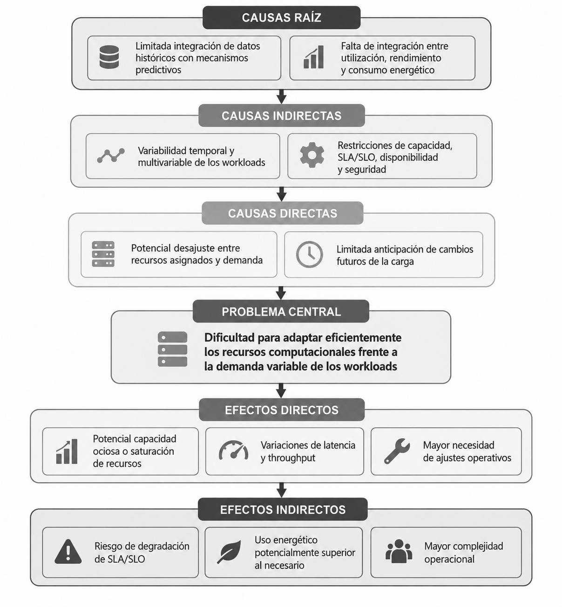{width=75%}

*Figura 1. Árbol de problemas del proyecto Green AI: relaciones entre causas y efectos.*

**Análisis de las relaciones causa-efecto**

***Causas raíz e indirectas.*** Se identifican como factores estructurales la limitada integración de datos históricos de telemetría con modelos predictivos de Machine Learning y la ausencia de mecanismos integrados de observabilidad y restricciones operativas. Estas condiciones pueden favorecer una gestión reactiva basada en umbrales estáticos, cuya capacidad de adaptación se ve limitada por la variabilidad temporal y heterogeneidad de las cargas de trabajo.

***Causas directas y problema central.*** La limitada anticipación de cambios futuros en la demanda y el posible desajuste entre los recursos asignados y los requerimientos computacionales constituyen las causas directas del problema central: la dificultad para adaptar eficientemente los recursos computacionales frente a la demanda variable de los *workloads* universitarios.

***Efectos directos e indirectos.*** Entre las consecuencias potenciales se identifican la subutilización o saturación puntual de recursos, la variabilidad en los tiempos de respuesta y la necesidad de ajustes operativos reactivos. Estas situaciones pueden incrementar el riesgo de degradación de los niveles de servicio (SLA/SLO), elevar el consumo energético respecto de escenarios de gestión más eficientes y aumentar la complejidad de administración de la infraestructura.

**Sustentación cuantitativa y delimitación metodológica**

Como soporte experimental del análisis, Green AI dispone de un conjunto de datos sintéticos compuesto por 100 000 registros de telemetría asociados a 50 recursos computacionales simulados, identificados mediante códigos de hardware. El conjunto incluye variables como utilización de CPU y RAM, temperatura, potencia representada en watts, valores predictivos y cumplimiento de restricciones operativas.

Estos datos permiten analizar patrones simulados de utilización y explorar escenarios de demanda computacional. Sin embargo, no constituyen mediciones directas de los servidores físicos de la Universidad Continental ni acreditan por sí mismos la existencia de pérdidas energéticas o incumplimientos reales de SLA.

Por tanto, las relaciones representadas en el árbol deben interpretarse como un modelo causal de la problemática que fundamenta la solución propuesta, cuya magnitud e impacto requieren validación mediante experimentación controlada y, posteriormente, telemetría de infraestructura física autorizada.

### Análisis cuantitativo del dataset del proyecto

Para estudiar cuantitativamente los patrones de demanda en ausencia de telemetría física institucional, el proyecto generó un conjunto de datos sintético representativo de 50 servidores universitarios durante el periodo del 10/07/2026 al 17/09/2026 (`software/data-processing/datasets/raw/synthetic_greenai/BD_GreenAi.xlsx`, 100 000 registros). El análisis descriptivo de este dataset refleja las siguientes características operativas:

Tabla 2. Indicadores cuantitativos observados en el conjunto de datos sintético

| Indicador cuantitativo | Valor observado en dataset sintético |
|---|---|
| CPU promedio / mediana / percentil 95 (p95) | 50,1 % / 50,1 % / 86,4 % (rango: 5,0 % – 99,0 %) |
| Proporción de tiempo en baja utilización (CPU < 30 %) | 24,6 % de los registros temporales |
| Proporción de tiempo en alta utilización (CPU > 80 %) | 11,3 % de los registros temporales |
| Memoria RAM promedio / percentil 95 (p95) | 45,2 % / 81,7 % |
| Potencia media / percentil 95 (columna referencial `energia_watts`) | 318 W / 630 W (capacidad nominal asignada: 450 W – 800 W) |
| Registros con incumplimiento de SLA (`cumple_sla = false`) | 6,13 % del total de muestras |

Se subraya que estas cifras provienen de un generador sintético y no representan mediciones físicas de servidores de la Universidad Continental. Su propósito exclusivo es calibrar los componentes de ingesta, preprocesamiento y entrenamiento de modelos.

### Restricciones del proyecto

El desarrollo de la solución se encuentra sujeto a las siguientes restricciones técnicas e institucionales:
1. No intervenir la infraestructura institucional de producción de la universidad sin autorización expresa.
2. Declarar la procedencia simulada o sintética de los datos, evitando presentar métricas generadas como mediciones físicas.
3. No equiparar directamente el porcentaje de uso de CPU con consumo eléctrico sin un modelo de potencia validado o instrumentación física.
4. No declarar porcentajes de ahorro energético institucional ni reducción de emisiones sin una comparación experimental directa con línea base.
5. Mantener un modo operativo estrictamente de solo recomendación (*Recommendation-Only*), sin ejecutar acciones automáticas sobre servidores.
6. Ajustarse al ciclo académico (cierre del periodo lectivo el 30/11/2026) con un equipo de 4 integrantes y costo monetario directo de S/ 0,00 mediante herramientas de código abierto.

### Formulación del problema

**Problema general:**  
¿Cómo desarrollar y validar un prototipo experimental que integre monitoreo de infraestructura, procesamiento de series temporales y predicción de demanda computacional para apoyar decisiones explicables de asignación de recursos en un entorno universitario, manteniendo trazabilidad y considerando restricciones de servicio y eficiencia energética?

**Problemas específicos:**  
- **PE1 (alineado a PMV1):** ¿Cómo recolectar, almacenar y consultar de forma continua y reproducible la telemetría multirrecurso proveniente de nodos de cómputo en un entorno experimental controlado?  
- **PE2 (alineado a PMV2):** ¿Con qué nivel de error modelos de Machine Learning pueden pronosticar la utilización de CPU a corto plazo frente a modelos de referencia simples y cómo transformar dichas estimaciones en recomendaciones explicables bajo supervisión humana?  
- **PE3 (alineado a PMV3):** ¿En qué medida una estrategia basada en predicción optimiza la utilización de recursos y reduce el consumo energético estimado en comparación con una línea base reactiva bajo condiciones experimentales controladas?

## 1.2 Objetivos del proyecto

### Objetivo general

Desarrollar y validar un prototipo experimental (Green AI) que integre monitoreo de infraestructura, procesamiento de series temporales y predicción de demanda computacional para apoyar recomendaciones explicables de asignación de recursos en entornos universitarios, garantizando trazabilidad, cumplimiento de niveles de servicio y evaluación de eficiencia energética.

### Objetivos específicos

1. **OE1 (PMV1 – Observabilidad y viabilidad técnica):** Implementar la recolección continua, persistencia estructurada y consulta de métricas de infraestructura para 50 nodos simulados mediante la integración de Simulator, Prometheus, Monitoring y API Gateway con autenticación, validando contratos OpenAPI y pruebas de integración.  
2. **OE2 (PMV2 – Predicción y recomendación explicable):** Evaluar y servir mediante API modelos de Machine Learning para predecir la utilización de CPU a 15 minutos frente a baselines (persistencia y media móvil), logrando un error cuantitativamente menor en validación cronológica y emitiendo recomendaciones operativas explicables bajo supervisión humana (*Recommendation-Only* con `executionAllowed=false`).  
3. **OE3 (PMV3 – Experimentación comparativa y eficiencia):** Comparar experimentalmente la estrategia Green AI frente a una línea base estática/reactiva bajo escenarios de carga equivalentes, evaluando su impacto en utilización de recursos, cumplimiento de SLA y consumo energético físico/trapezoidal ($E = \int P(t) dt$).
4. **OE4 (PMV3 – Procesos de software, calidad y entregables finales):** Definir, documentar y verificar los procesos de ingeniería del proyecto (desarrollo con flujo Git `test`→`main` y *pull requests* revisados, integración y despliegue continuo, y gestión en Trello con DoD); realizar la ingeniería inversa del sistema (7 fases), los reportes de calidad FURPS+/OWASP con re-medición, las pruebas con usuarios finales (con acta de reunión) y las pruebas de rendimiento y métricas de ML; y entregar el informe final con guía de uso, el artículo científico en inglés, el póster y el video de sustentación con 7 operaciones demostradas. Este objetivo se encuentra **planificado** para los Sprints 7 y 8 (17/11–30/11/2026).

### Alineación con los Objetivos de Desarrollo Sostenible (ODS)

El proyecto se vincula formalmente con la Agenda 2030 a través de los siguientes objetivos:
- **ODS 7 (Energía asequible y no contaminante):** Meta 7.3 (duplicar la tasa de mejora de la eficiencia energética), aportando metodologías para mitigar el consumo eléctrico superfluo en centros de cómputo educativos.
- **ODS 9 (Industria, innovación e infraestructura):** Fomento de infraestructura tecnológica resiliente y sostenible mediante software de observabilidad y analítica predictiva moderna.
- **ODS 12 (Producción y consumo responsables):** Racionalización del uso de recursos computacionales, combatiendo la sobreasignación de hardware y obsolescencia prematura.
- **ODS 13 (Acción por el clima):** Cuantificación del impacto de la huella de carbono digital mediante factores de emisión certificados, promoviendo prácticas de computación verde (*Green Computing*).

---

# II. CONOCIMIENTOS DE INGENIERÍA APLICADOS / RELACIONADOS

El desarrollo de Green AI requiere la articulación rigurosa de fundamentos matemáticos, computacionales, ciencias naturales y principios avanzados de ingeniería de software. Cada concepto aplicado se relaciona directamente con los componentes implementados en el monorepo.

## a. Conocimientos en matemáticas y computación

### Series temporales y formulación de regresión supervisada

Las métricas de infraestructura constituyen series temporales multivariables donde cada registro representa una observación ordenada cronológicamente: $x(t) \in \mathbb{R}^d$. El problema de predicción de CPU se formula como una tarea de regresión supervisada multivariable:

$$\hat{y}(t+h) = f(x(t), x(t-1), \dots, x(t-k))$$

Donde $h$ representa el horizonte de predicción seleccionado (3 pasos temporales de 5 minutos, equivalentes a 15 minutos en el futuro) y $k$ la cantidad de retardos temporales considerados. En el monorepo, este tratamiento se implementa en `software/prediction/src/preprocessing` y se configura en `config/config.yaml`.

### Ingeniería de características y división temporal sin fuga

Para capturar la dinámica de la carga sin incurrir en fuga de información (*data leakage*), se generan:
1. Retardos temporales (*lags* 1, 2 y 3) para la utilización de CPU y memoria.
2. Estadísticas de ventana móvil: promedio móvil, desviación estándar, mínimo y máximo sobre periodos de 15, 30 y 60 minutos.
3. Variables temporales cíclicas: la hora del día ($H \in [0, 23]$) y el día de la semana ($D \in [0, 6]$) se proyectan mediante transformaciones sinusoidales:
   $$\text{hora}_{\sin} = \sin\left(\frac{2\pi H}{24}\right), \quad \text{hora}_{\cos} = \cos\left(\frac{2\pi H}{24}\right)$$
   $$\text{día}_{\sin} = \sin\left(\frac{2\pi D}{7}\right), \quad \text{día}_{\cos} = \cos\left(\frac{2\pi D}{7}\right)$$

La partición de datos se realiza cronológicamente en proporciones 70 % entrenamiento, 15 % validación y 15 % prueba, prohibiendo el reordenamiento aleatorio (*shuffle*). Esta restricción matemática se valida mediante la suite automatizada `tests/unit/test_anti_leakage.py`.

### Tasas de variación y conversión de unidades

Determinadas métricas extraídas de los sistemas operativos corresponden a contadores acumulativos monotónicos. Para obtener la magnitud instantánea de utilización, se aplica la tasa de cambio temporal:

$$\text{Tasa} = \frac{\Delta \text{Contador}}{\Delta t}$$

El servicio Monitoring conserva las unidades del catálogo original de Prometheus, mientras que Data Processing efectúa conversiones normalizadas hacia porcentajes utilizables por el predictor (por ejemplo, ratio $[0, 1]$ escalado a $[0, 100] \%$).

### Métricas de error en regresión y aclaración sobre clasificación

Para evaluar la exactitud predictiva de los modelos frente a las observaciones reales, se aplican métricas estadísticas expresadas en puntos porcentuales (pp) de CPU:

$$\text{MAE} = \frac{1}{n} \sum_{i=1}^n |y_i - \hat{y}_i|$$

$$\text{RMSE} = \sqrt{\frac{1}{n} \sum_{i=1}^n (y_i - \hat{y}_i)^2}$$

$$\text{sMAPE} = \frac{100\%}{n} \sum_{i=1}^n \frac{2|y_i - \hat{y}_i|}{|y_i| + |\hat{y}_i|}$$

El MAE proporciona la magnitud del error absoluto medio lineal, mientras que el RMSE penaliza fuertemente las desviaciones severas en picos de demanda. Las evaluaciones se estratifican por regímenes de carga (baja, normal, alta y picos). 

**Aclaración metodológica:** Las métricas de clasificación binaria (Precisión, Exhaustividad y Puntaje F1) solo son aplicables si se define una tarea discreta de detección de eventos. Dado que el núcleo de Prediction resuelve un problema de regresión continua, métricas como F1 no aplican ni se utilizan en la evaluación del sistema, retirando cualquier valor histórico no fundamentado.

## b. Conocimientos en ciencias naturales

### Relación entre potencia, energía y cálculo integral

El consumo energético se fundamenta en la relación física entre potencia instantánea $P(t)$ expresada en watts (W) y el tiempo transcurrido:

$$E = \int_{t_1}^{t_2} P(t) \, dt$$

Para series discretas muestreadas a intervalos $\Delta t_i = t_{i+1} - t_i$, se implementa la aproximación numérica mediante la regla del trapecio en `software/prediction/src/service/recommendations.py`:

$$E \approx \sum_{i=1}^{m-1} \frac{P(t_i) + P(t_{i+1})}{2} \cdot \Delta t_i$$

La energía resultante en watt-segundos (Joules) se transforma a kilowatt-hora dividiendo entre $3,6 \times 10^6\text{ J/kWh}$. El sistema exige que existan lecturas válidas de potencia física para calcular energía; en caso contrario, se abstiene de declarar consumos reales.

### Estimación de emisiones de gases de efecto invernadero

La estimación de emisiones de dióxido de carbono equivalente ($CO_2e$) se modela como:

$$\text{Emisiones } CO_2e = E \cdot FE$$

Donde $FE$ corresponde al factor de emisión del sistema eléctrico interconectado correspondiente. En concordancia con la norma internacional ISO/IEC 21031:2024 (*Software Carbon Intensity* - SCI) [9], el servicio rechaza solicitudes de cálculo de emisiones si el cliente no proporciona un factor de emisión respaldado por una fuente oficial y verificable.

## c. Conocimientos de ingeniería de software y sistemas distribuidos

### Arquitectura hexagonal (Puertos y Adaptadores)

Para garantizar independencia tecnológica y alta testabilidad, los microservicios aplican arquitectura hexagonal. El dominio central concentra la lógica de negocio y reglas de política operativa, comunicándose con el exterior únicamente mediante puertos (interfaces abstractas). Los adaptadores implementan el acceso a tecnologías concretas:
- **Monitoring (Java/Spring Boot):** Separa `QueryMetrics` (puerto de entrada) de `MetricsSource` (puerto de salida), permitiendo obtener datos desde Prometheus en producción o desde fixtures estáticos en pruebas unitarias.
- **Data Processing (Python/FastAPI):** Expone el puerto `HistoricalLogsSource`, implementado por el adaptador Supabase/PostgREST en la nube y por el adaptador SQLite en desarrollo local.
- **Prediction (Python/FastAPI):** Mantiene la política de recomendación pura en `src/recommendations/policy.py` completamente desacoplada del transporte HTTP y de bibliotecas de inferencia.

### Sistemas distribuidos, contratos y seguridad

La interoperabilidad se estructura sobre APIs REST documentadas mediante especificaciones OpenAPI 3.1. Se aplican técnicas de paginación basada en cursores (*keyset pagination* sobre timestamp e identificador), control de concurrencia y propagación del encabezado de correlación `X-Request-Id` para trazabilidad de solicitudes.

La seguridad perimetral se delega en el API Gateway, que valida tokens JWT emitidos por Supabase Auth (algoritmos ES256/RS256), aplicando control de acceso basado en roles (RBAC: `ADMIN` y `OPERATOR`) y políticas CORS restrictivas.

### Selección tecnológica ponderada

La selección de las herramientas base se efectuó mediante matrices de decisión técnica ponderadas (adecuación 30 %, ecosistema 25 %, integración 20 %, rendimiento 15 % y curva de aprendizaje 10 %):

Tabla 3. Selección de las tecnologías base del proyecto

| Componente | Alternativas evaluadas | Tecnología seleccionada | Justificación técnica |
|---|---|---|---|
| Inferencia y ML | Python (4,8) · Java (3,1) · Go (2,6) | Python (scikit-learn, pandas) | Madurez y soporte de bibliotecas especializadas en series temporales. |
| Observabilidad | Prometheus (4,7) · InfluxDB (3,9) · Zabbix (3,4) | Prometheus | Modelo *pull* eficiente, lenguaje PromQL y estándar de facto. |
| API Gateway | Go stdlib (4,3) · Spring Cloud (4,0) · Nginx (3,2) | Spring Cloud (base) / Go (alternativa) | Spring Cloud como pasarela vigente; Go validado como alternativa ligera (16 MB imagen). |
| Persistencia | Supabase/Postgres (4,6) · MySQL (3,8) · MongoDB (3,3) | PostgreSQL (Supabase) + SQLite local | Integridad relacional, soporte SQL y perfil SQLite sin dependencias externas. |

---

# III. EL INGENIERO Y LA SOCIEDAD

Esta sección responde a la competencia profesional «El Ingeniero y la Sociedad» de la rúbrica ICACIT del curso, que evalúa el análisis y la evaluación del impacto de la solución considerando desarrollo sostenible, sociedad, economía, salud y seguridad, marcos legales y medio ambiente. Los aspectos evaluados se cubren así: la justificación social, en el apartado III.a; la justificación económica, en III.b; la justificación ambiental, en III.c; los acontecimientos tecnológicos y científicos que influenciaron la propuesta, en III.d y en los antecedentes que la siguen; el marco legal y la responsabilidad ética, en III.e; y la salud, la seguridad y los riesgos operativos, en III.f.

## a. Justificación social

Green AI contribuye a la continuidad y estabilidad de los servicios digitales que dan soporte a los procesos formativos universitarios. Los beneficiarios directos son los equipos de tecnologías de la información y administradores de sistemas, mientras que los estudiantes y docentes constituyen beneficiarios indirectos al disponer de plataformas académicas estables durante periodos críticos de alta demanda.

Para mitigar el riesgo de degradación del servicio por desaprovisionamientos erróneos, la solución adopta un enfoque exclusivo de recomendación (*Recommendation-Only* con `executionAllowed=false`). Cada sugerencia emitida por el sistema se acompaña de explicabilidad técnica (nivel de demanda proyectado, margen de seguridad y umbrales evaluados), exigiendo la revisión y aprobación humana antes de cualquier intervención en infraestructura.

## b. Justificación económica

La solución busca optimizar los costos operacionales asociados al dimensionamiento excesivo de infraestructura en centros de datos. Al emplear exclusivamente tecnologías de código abierto y plataformas con capas gratuitas de evaluación, el costo de licenciamiento monetario del desarrollo es de S/ 0,00. 

En términos de ahorro económico, el proyecto no declara cifras de reducción monetaria no verificadas experimentalmente. Los beneficios económicos potenciales deberán calcularse a partir de la energía física evitada multiplicada por la tarifa eléctrica institucional, restando los costos computacionales adicionales del monitoreo y la inferencia (*Green-in AI*).

## c. Justificación ambiental

La relevancia ambiental radica en la reducción potencial de emisiones contaminantes indirectas asociadas al consumo eléctrico de servidores ociosos. Sin embargo, el proyecto reconoce que el propio funcionamiento del software analítico (Prometheus, API Gateway, servicios de procesamiento y modelos de Machine Learning) consume memoria y ciclos de CPU. Por ello, el análisis de impacto ambiental en el PMV3 evaluará el balance energético neto, distinguiendo estrictamente entre potencia medida (W), energía acumulada (kWh) y emisiones calculadas ($CO_2e$).

## d. Acontecimientos tecnológicos y científicos relacionados

El proyecto se enmarca en la evolución de la computación verde (*Green Computing*), la observabilidad distribuida y el aprendizaje automático aplicado a la gestión proactiva de recursos. Si bien plataformas como Kubernetes y sistemas de mensajería como RabbitMQ son tecnologías relevantes en arquitecturas de producción a gran escala, el sistema implementado en PMV1 y PMV2 opera sobre Docker Compose en local y servicios en la nube (Render y GitHub Pages), manteniendo RabbitMQ y Kubernetes exclusivamente como referencias conceptuales de escalabilidad futura.

## e. Marco legal, institucional y responsabilidad ética

Tabla 4. Normas legales y estándares aplicables y medidas técnicas de cumplimiento

| Norma legal / estándar | Ámbito de aplicación en el proyecto | Medidas técnicas de cumplimiento implementadas |
|---|---|---|
| **Ley N.° 29733 y D.S. N.° 016-2024-JUS** (Protección de Datos Personales) | Cuentas de usuario para administradores y operadores técnicos. | La telemetría técnica no contiene datos personales. La autenticación en Supabase Auth gestiona correos y roles bajo principio de minimización y políticas RLS. |
| **D. Leg. N.° 1412** (Ley de Gobierno Digital) | Interoperabilidad e intercambio de datos en el sector público/académico. | Adopción de arquitecturas abiertas basadas en estándares REST y especificaciones OpenAPI 3.1. |
| **Ley N.° 30096** (Delitos Informáticos) | Seguridad perimetral y prevención de accesos no autorizados. | Autenticación basada en JWT, separación estricta de roles (RBAC) y eliminación de endpoints expuestos sin autorización. |
| **ISO/IEC 21031:2024 (SCI)** | Especificación de intensidad de carbono del software. | Requisito obligatorio de factor de emisión verificado para el cálculo de huella de carbono en endpoints analíticos. |

**Responsabilidad ética:** El equipo asume el compromiso de reportar exclusivamente resultados reproducibles, absteniéndose de imputar reducciones de consumo eléctrico o emisiones ambientales sin mediciones experimentales físicas directas. Asimismo, se detectó en snapshots históricos un riesgo de políticas RLS excesivamente permisivas en Supabase, el cual se documenta formalmente para su corrección estricta en el entorno productivo.

## f. Salud, seguridad y riesgos operativos

Los riesgos técnicos identificados comprenden la sobrecarga de servidores por recolección excesiva de métricas, saturación en memoria por procesamiento de series extensas y degradación de servicios por recomendaciones inadecuadas. Las medidas preventivas adoptadas incluyen: ejecución en contenedores aislados con límites de memoria (`deploy.resources.limits`), recolección con cadencia fija de 5 minutos, abstención de recomendación ante datos incompletos o desactualizados y mantenimiento de la decisión final bajo supervisión humana.

---

## ANTECEDENTES

La fundamentación teórica se estructura a partir de la literatura científica indexada sobre eficiencia energética y Machine Learning aplicado a centros de datos:

### Antecedentes sobre eficiencia energética y gestión de recursos

#### Antecedente 1. Beloglazov, Abawajy y Buyya (2012) [4]
Beloglazov, Abawajy y Buyya investigaron la gestión eficiente de recursos en centros de datos en la nube mediante técnicas de consolidación dinámica de máquinas virtuales. Los autores demostraron que mantener servidores subutilizados genera un desperdicio significativo de energía, proponiendo heurísticas para migrar cargas y suspender nodos ociosos manteniendo acuerdos de nivel de servicio (SLA). Este antecedente respalda en Green AI la necesidad de evaluar el compromiso entre ahorro energético y calidad del servicio, si bien Green AI restringe su alcance a recomendaciones consultivas sin apagado autónomo de servidores.

#### Antecedente 2. Ji et al. (2021) [2]
Ji et al. abordaron la optimización conjunta del consumo energético en centros de datos integrando servidores y sistemas de refrigeración. Desarrollaron un esquema que combina predicción de carga mediante redes recurrentes multivariables (MM-GRU) con políticas de planificación y migración de tareas. Los resultados comprobaron que anticipar la demanda computacional permite optimizar el aprovisionamiento térmico y eléctrico frente a estrategias meramente reactivas. Este trabajo sustenta en Green AI la separación funcional entre el monitoreo de telemetría, la predicción de carga y la toma de decisiones operativas.

#### Antecedente 3. Sharma y Garg (2020) [3]
Sharma y Garg diseñaron AGEN, un planificador consciente de la energía para centros de datos en la nube basado en redes neuronales artificiales (ANN). Evaluado en el simulador CloudSim sobre más de 18 millones de instancias, el enfoque reportó reducciones de consumo de hasta 45 % en escenarios de alta carga y 71 % en carga ligera, reduciendo significativamente el tiempo total de ejecución (*makespan*). Este estudio evidencia el potencial del aprendizaje automático para optimizar la asignación de recursos, aunque sus resultados provienen de simulaciones sintéticas, ratificando la prudencia de Green AI de no extrapolar ahorros simulados a entornos institucionales reales sin instrumentación física.

### Antecedentes sobre integración de Machine Learning para predicción de cargas

#### Antecedente ML-1. Khan et al. (2022) [1]
Khan et al. plantearon un enfoque centrado en Machine Learning para la predicción de cargas de trabajo y la estimación de estados energéticos (*energy states*) a nivel de máquinas virtuales utilizando trazas reales del centro de datos Bitbrains (1 250 VMs en *fastStorage* y 500 VMs en *Rnd* con muestreo a 5 minutos). Para la predicción de demanda evaluaron algoritmos lineales (Linear Regression, Ridge, ElasticNet) y redes neuronales recurrentes GRU, demostrando que GRU alcanzó el menor RMSE en todas las cargas analizadas. Para la estimación del estado energético, propusieron el algoritmo de agrupamiento TSSAP (*Time Series Similarity Affinity Propagation*), el cual **superó en un 87,48 % la precisión del algoritmo de agrupamiento tradicional Affinity Propagation (AP)**. 

*Corrección analítica:* Se enfatiza que el 87,48 % reportado por Khan et al. corresponde a la ganancia en la calidad del agrupamiento de estados energéticos y no a una supuesta precisión del 87,48 % en la predicción temporal de carga de CPU. Green AI adopta la misma cadencia temporal (5 minutos), pero prioriza modelos de árboles de decisión (Random Forest) para reducir el costo computacional de la propia inferencia.

#### Antecedente ML-2. Verdecchia, Sallou y Cruz (2023) [6]
Verdecchia, Sallou y Cruz realizaron una revisión sistemática exhaustiva de la literatura sobre computación verde aplicada a la inteligencia artificial (*Green AI*), analizando 98 publicaciones indexadas. La investigación formaliza la distinción entre *Green-by-AI* (uso de modelos inteligentes para optimizar sistemas externos) y *Green-in-AI* (optimización de la eficiencia y reducción de la huella computacional del propio modelo de aprendizaje automático). Reportaron que las reducciones de energía en la literatura oscilan ampliamente entre 13 % y 115 % según el dominio evaluado. Este estudio guía directamente el diseño de Green AI al imponer modelos predictivos livianos cuyo costo computacional no neutralice los beneficios de la optimización.

#### Antecedente ML-3. Bolón-Canedo et al. (2024) [7]
Bolón-Canedo et al. examinaron los desafíos contemporáneos de Green AI, alertando sobre el consumo energético exponencial asociado al entrenamiento de arquitecturas complejas de Deep Learning y señalando que las herramientas de estimación de carbono suelen subestimar las emisiones reales. Este antecedente fundamenta la decisión técnica de Green AI de descartar redes neuronales profundas de alto consumo en su etapa experimental, seleccionando en su lugar modelos tabulares eficientes (Random Forest) evaluados sobre métricas de error rigurosas y verificables.

### Síntesis comparativa de antecedentes frente a Green AI

Tabla 5. Síntesis comparativa de Green AI frente a los antecedentes

| Dimensión | Green AI | Khan et al. (2022) [1] | Ji et al. (2021) [2] | Sharma y Garg (2020) [3] |
|---|---|---|---|---|
| **Fuente de datos** | Telemetría simulada (50 nodos, cadencia 5 min) | Trazas reales Bitbrains (5 min) | Trazas reales de centro de datos | Simulación sintética en CloudSim |
| **Modelo predictivo** | Random Forest / baselines (árboles ligeros) | GRU recurrente frente a lineales | Red recurrente MM-GRU | Red neuronal artificial (ANN) |
| **Métricas clave** | MAE 3,22 pp; RMSE 4,59 pp (validación 15 min) | Menor RMSE con GRU; clustering +87,48 % | Reducción de consumo térmico | Consumo −45 % a −71 % (simulado) |
| **Gestión energética** | Estimación trapezoidal ($E = \int P dt$); sin ahorro inventado | Estimación de estados de energía | Optimización conjunta con climatización | Asignación y planificación de tareas |
| **Modo de operación** | *Recommendation-Only* con supervisión humana | Soporte a consolidación autónoma | Planificación y migración dinámica | Planificación autónoma de tareas |

### Referencias bibliográficas (Norma ISO 690-2)

[1] KHAN, T., TIAN, W., ILAGER, S. y BUYYA, R. Workload forecasting and energy state estimation in cloud data centres: ML-centric approach. *Future Generation Computer Systems*. 2022, vol. 128, pp. 320–332. DOI 10.1016/j.future.2021.10.019.

[2] JI, K., ZHANG, F., CHI, C., SONG, P., ZHOU, B., MARAHATTA, A. y LIU, Z. A joint energy efficiency optimization scheme in data centers. *Sustainable Computing: Informatics and Systems*. 2021, vol. 32, art. 100596. DOI 10.1016/j.suscom.2021.100596.

[3] SHARMA, M. y GARG, R. AGEN: ANN based energy-efficient scheduler for cloud data centers. *Sustainable Computing: Informatics and Systems*. 2020, vol. 26, art. 100373. DOI 10.1016/j.suscom.2020.100373.

[4] BELOGLAZOV, A., ABAWAJY, J. y BUYYA, R. Energy-aware resource allocation heuristics for efficient management of data centers for Cloud computing. *Future Generation Computer Systems*. 2012, vol. 28, no. 5, pp. 755–768. DOI 10.1016/j.future.2011.04.017.

[5] ALI, Q. I. Intelligent energy governance in solar-powered data centers: a multi-stage framework for sustainable operation and AI-driven optimization. *Discover Artificial Intelligence*. 2026, vol. 6, art. 124. DOI 10.1007/s44163-025-00823-7.

[6] VERDECCHIA, R., SALLOU, J. y CRUZ, L. A systematic review of Green AI. *WIREs Data Mining and Knowledge Discovery*. 2023, vol. 13, art. e1507. DOI 10.1002/widm.1507.

[7] BOLÓN-CANEDO, V., MORÁN-FERNÁNDEZ, L., CANCELA, B. y ALONSO-BETANZOS, A. A review on green artificial intelligence. *Neurocomputing*. 2024, vol. 599, art. 128096. DOI 10.1016/j.neucom.2024.128096.

[8] INTERNATIONAL ENERGY AGENCY. *Energy and AI*. París: IEA, 2025.

[9] ISO/IEC. *ISO/IEC 21031:2024 Information technology — Software Carbon Intensity (SCI) specification*. Ginebra: ISO, 2024.

---

# IV. METODOLOGÍA EMPLEADA

Para el desarrollo del proyecto se seleccionó un enfoque de ciclo de vida ágil frente a los modelos predictivo e híbrido, tras evaluar criterios ponderados adaptados al entorno experimental:

Tabla 6. Evaluación ponderada de los enfoques de ciclo de vida

| Criterio de evaluación | Peso | Predictivo | Ágil | Híbrido |
|---|---|---|---|---|
| Capacidad para gestionar cambios frecuentes | 25 % | 2 | 5 | 4 |
| Adecuación ante incertidumbre experimental alta | 20 % | 2 | 5 | 4 |
| Soporte para entregas incrementales verificables | 20 % | 2 | 5 | 5 |
| Integración de retroalimentación de asesor/usuarios | 20 % | 3 | 5 | 4 |
| Gestión de restricciones académicas y temporales | 15 % | 4 | 4 | 5 |
| **Puntaje ponderado** | **100 %** | **2,50** | **4,85** | **4,35** |

Para la gestión de ingeniería se adaptó el marco Scrum sobre Kanban, XP y Scrumban, obteniendo el mayor puntaje (4,85 sobre 5,00) debido a su compatibilidad con la estructura de tres Productos Mínimos Viables (PMV) distribuidos en 8 Sprints de dos semanas:

Tabla 7. Evaluación ponderada de los marcos de gestión de ingeniería

| Criterio de selección del marco | Peso | Scrum | Kanban | XP | Scrumban |
|---|---|---|---|---|---|
| Adecuación a equipo de 4 personas + asistente IA | 20 % | 5 | 4 | 4 | 4 |
| Soporte para iteraciones con revisión formal docente | 20 % | 5 | 3 | 4 | 4 |
| Gestión visual del flujo de trabajo | 15 % | 4 | 5 | 3 | 5 |
| Integración de retroalimentación periódica | 15 % | 5 | 3 | 5 | 4 |
| Gestión del alcance mediante Product Backlog priorizado | 15 % | 5 | 4 | 4 | 4 |
| Compatibilidad con entregas progresivas en 3 PMV | 15 % | 5 | 3 | 4 | 4 |
| **Puntaje ponderado** | **100 %** | **4,85** | **3,65** | **4,00** | **4,15** |

### Adaptación académica y aportes por PMV

La ejecución de Scrum se adaptó a la disponibilidad de los estudiantes mediante sincronizaciones técnicas tres veces por semana y refinamiento del backlog integrado a la planificación del Sprint. El trabajo técnico se estructuró en tres hitos:
1. **PMV1 (Semanas 1–6):** Observabilidad y viabilidad técnica. Se diseñó el generador de telemetría, la recolección en Prometheus, el servicio de monitoreo en Spring Boot y el API Gateway, validando contratos OpenAPI y persistencia inicial.
2. **PMV2 (Semanas 7–12):** Predicción de demanda y recomendaciones explicables. Se implementó el pipeline de Machine Learning (Random Forest a 15 min), el servicio Data Processing con adaptadores de datos y el motor de recomendaciones consultivas (*Recommendation-Only* con `executionAllowed=false`).
3. **PMV3 (Semanas 13–14, planificado):** Procesos de software, calidad y entregables finales de la Unidad IV. Definición del proceso de desarrollo y de CI/CD, ingeniería inversa del sistema, reportes de calidad FURPS+/OWASP (olas 2 y 3, con re-medición), pruebas con usuarios finales y pruebas de rendimiento y de ML, informe final con guía de uso, artículo científico, póster y video de sustentación. La comparación frente a la línea base ya se ejecutó sobre el conjunto de prueba (§VIII.3.1).

#### Aportes principales identificados

- **Adopción de asistentes de IA bajo supervisión humana:** Integración de Claude (modelo Opus 5.5) como asistente técnico para soporte en coordinación, refactorización y redacción asistida, verificando manualmente cada producto antes de su adopción.
- **Validación progresiva de viabilidad:** Cada incremento entregó suites de pruebas automatizadas y contratos OpenAPI antes de habilitar dependencias en capas superiores.
- **Desacoplamiento estricto entre predicción y ejecución operacional:** Establecimiento del principio *Recommendation-Only*, garantizando que ninguna predicción matemática altere directamente la infraestructura sin supervisión humana.

---

# V. USO DE HERRAMIENTAS MODERNAS

Esta sección responde a la competencia profesional «Uso de Herramientas Modernas» de la rúbrica ICACIT del curso (atributo AG-I11), que evalúa el uso integrado de herramientas de ingeniería, computación, gestión, modelado, desarrollo, calidad, datos, IA y comunicación, justificando su selección y sus limitaciones. Los aspectos evaluados se cubren así: el uso integrado de herramientas y la justificación de su selección, en el criterio de selección inicial y en V.1; el reconocimiento de sus limitaciones, incluida la evaluación de los asistentes de IA, en V.2; y la comprobación cuantitativa de su aplicación mediante resultados medidos, en V.3.

La selección de herramientas consideró adecuación técnica (25 %), funcionalidad (20 %), integración (15 %), costo monetario cero (10 %), seguridad (10 %), escalabilidad (10 %) y usabilidad (10 %), priorizando tecnologías de código abierto e instrumentos reproducibles.

## 1. Herramientas empleadas con evidencia en el repositorio

Tabla 8. Herramientas empleadas, su aplicación y limitaciones reconocidas

| Categoría | Herramienta (versión) | Rol y aplicación en el proyecto | Limitación técnica reconocida |
|---|---|---|---|
| **Simulación** | Simulator propio (Python 3.12 CLI) | Generación de telemetría de 50 servidores (10 pruebas unitarias). | Datos sintéticos; no reproduce perturbaciones físicas no modeladas. |
| **Observabilidad** | Prometheus 3.13 | Recolección temporal y consultas PromQL de métricas de CPU y memoria. | Retención local orientada al corto plazo; no sustituye almacén histórico relacional. |
| **Backend Monitoreo** | Java 21, Spring Boot 3.x | Ingesta y catálogo de métricas (`software/monitoring`, 112 pruebas). | Alto consumo de memoria de la JVM (~210 MiB en reposo). |
| **API Gateway** | Spring Cloud Gateway (Java 21) | Pasarela perimetral, JWT, RBAC y CORS (`software/gateway`, 12 pruebas). | Imagen pesada (520 MB) y huella de memoria elevada (~283 MiB en reposo). |
| **Gateway Ligero** | Go 1.25 stdlib (`gateway-go`) | Alternativa creada de alto rendimiento (30 pruebas; 0 diferencias en 39 casos). | Imagen reducida (16,2 MB) y ~10 MiB RAM; pendiente de prueba de carga con tráfico concurrente real. |
| **Ingesta y Datos** | Python 3.12, FastAPI, pandas | Normalización y ventanas temporales (`software/data-processing`, 121 pruebas). | Pandas carga estructuras completas en memoria RAM. |
| **Machine Learning** | scikit-learn, XGBoost, NumPy | Entrenamiento y evaluación de modelos (`software/prediction`, 100 pruebas). | Modelos de árboles no extrapolan tendencias fuera del rango de entrenamiento. |
| **Persistencia** | Supabase (PostgreSQL + Auth) / SQLite | Almacén relacional, usuarios y roles; perfil SQLite local sin red externa. | Plan gratuito en nube; SQLite carece de RLS nativo y procedimientos PL/pgSQL. |
| **Contenedores** | Docker, Docker Compose | Empaquetado y ejecución reproducible de microservicios locales (`green-ai-mono`). | Compose local no resuelve orquestación distribuida multihost. |
| **Frontend Web** | HTML5, JavaScript nativo, CSS3, Nginx | Interfaz de visualización y consumo de API Gateway (48 pruebas). | Frontend estático; requiere refresco programado para datos en vivo. |
| **Contratos** | OpenAPI 3.1 | Documentación de interfaces y esquemas de intercambio de datos. | Exige sincronización manual al modificar contratos de dominio. |
| **Gestión y Código** | Trello, Git / GitHub | Tablero Kanban y monorepo estructurado con ramas `main` y `test`. | Trello ofrece métricas cuantitativas limitadas frente a Jira. |
| **Asistentes de IA** | Claude Code, Antigravity CLI 1.5.2, Graphify 0.9.96 | Asistencia en redacción, refactorización, indexación AST y revisión de código. | Riesgo de falsos positivos y respuestas vacías; requiere validación humana obligatoria. |

*Nota de honestidad técnica:* Herramientas como SonarQube, JMeter, Kubernetes y OWASP ZAP no se reportan como utilizadas con evidencia en esta etapa, quedando catalogadas como trabajo futuro, fuera del alcance del periodo lectivo.

## 2. Reconocimiento de limitaciones y evaluación de asistentes de IA

En estricto cumplimiento del atributo de competencia sobre reconocimiento de limitaciones tecnológicas y conforme a la evaluación documentada en `docs/TOOLS_EVALUATION.md`, se sistematizan las restricciones críticas de las herramientas utilizadas:

1. **Huella de recursos en lenguajes de servidor:** La pasarela original en Spring Cloud Gateway demanda 520 MB en imagen Docker y ~283 MiB de RAM en reposo. Para mitigar esta restricción en entornos con recursos limitados (planes gratuitos en la nube con techos de 512 MB), se desarrolló la pasarela alternativa en Go 1.25 (`software/gateway-go`), logrando una imagen de 16,2 MB y un consumo en reposo de ~10 MiB, superando 30 pruebas unitarias con cero discrepancias funcionales en 39 pruebas diferenciales.
2. **Optimización de imágenes analíticas:** La imagen de Prediction demandaba inicialmente 2,85 GB debido a dependencias superfluas de experimentación (Jupyter, MLflow, Matplotlib). Mediante construcción multi-etapa y segmentación de dependencias de servicio, la imagen se redujo a 510 MB y 122 MiB de RAM en reposo, manteniendo el 100 % de las pruebas operativas (100 pruebas).
3. **Uso de asistentes de inteligencia artificial en el desarrollo:** Se incorporó Claude Code y Antigravity CLI (con modelo Gemini Flash y Claude Sonnet) para acelerar la navegación de código e indexación de relaciones mediante Graphify. Sin embargo, su operación experimental evidenció limitaciones determinantes:
   - En auditorías automáticas de seguridad sobre el Gateway Go, 1 de cada 8 hallazgos emitidos por el agente resultó ser un falso positivo (análisis de cabeceras de proxy).
   - En ejecuciones desatendidas (*headless*), la herramienta puede registrar códigos de salida 0 con estado `SUCCESS` devolviendo respuestas vacías o interrupciones por tiempo límite.
   - Debido a ello, **todo código, refactorización y texto propuesto por los agentes de IA fue verificado, probado e integrado manualmente por los integrantes del equipo**, manteniendo prohibidos los comandos destructivos o accesos a red no autorizados.

## 3. Resultados cuantitativos medidos con las herramientas

- **Pipeline de Machine Learning (semilla 42):** Random Forest a 15 minutos alcanzó un MAE de 3,22 pp y un RMSE de 4,59 pp en validación, y un MAE de 3,85 pp en el conjunto de prueba, superando al modelo de persistencia (MAE 4,61 pp; −30 % de error) y a la media móvil (MAE 3,74 pp; −14 % de error).
- **Pruebas automatizadas en el monorepo:** Monitoring 112, Gateway Java 12, Gateway Go 30, Data Processing 121, Prediction 100, Frontend 48, Simulator 10.
- **Verificación integral de salud (*smoke test*):** 14 de 14 pruebas superadas sobre el stack contenerizado completo ejecutado con datos simulados.

---

# VI. DISEÑO DE INGENIERÍA

## VI.1 Listado de Requerimientos funcionales y no funcionales

### Requerimientos funcionales

Tabla 9. Requerimientos funcionales y módulos de implementación

| ID | Requerimiento funcional | Módulo de implementación |
|---|---|---|
| RF-01 | Recopilar métricas de CPU, memoria, red y almacenamiento de nodos de cómputo. | Simulator → Prometheus |
| RF-02 | Recopilar métricas de workloads (solicitudes, concurrencia, throughput y latencia). | Simulator → Prometheus |
| RF-03 | Almacenar métricas históricas con marca temporal y procedencia explícita. | Monitoring / Supabase / SQLite |
| RF-04 | Consultar series históricas por nodo, servicio y ventana temporal. | Monitoring / Data Processing |
| RF-05 | Normalizar y limpiar series temporales tratando valores ausentes. | Data Processing (`src/preprocessing`) |
| RF-06 | Construir retardos (*lags*), medias móviles y variables temporales cíclicas. | Data Processing / Prediction |
| RF-07 | Entrenar y evaluar modelos candidatos (Random Forest, baselines) con partición temporal. | Prediction (`src/training`) |
| RF-08 | Versionar parámetros, métricas y metadatos de datasets y modelos mediante manifiestos. | Prediction (`results/manifest.json`) |
| RF-09 | Servir predicciones de utilización de CPU a 15 minutos mediante endpoint REST protegido. | Prediction (`POST /v1/predictions`) |
| RF-10 | Evaluar alternativas operativas de redistribución de cargas de cómputo. | Prediction (`src/recommendations`) |
| RF-11 | Validar restricciones de SLA, frescura de datos y márgenes de seguridad. | Prediction (`policy.py`) |
| RF-12 | Emitir recomendaciones explicables bajo principio *Recommendation-Only* (`executionAllowed=false`). | Prediction (`POST /v1/recommendations`) |
| RF-13 | Ejecutar experimentos controlados comparando estrategia predictiva frente a línea base. | Experiment Module (PMV3) |
| RF-14 | Calcular consumo energético mediante integración trapezoidal ($E = \int P dt$). | Prediction (`POST /v1/energy`) |
| RF-15 | Comparar valores predichos frente a valores observados en tiempo real. | Frontend / Monitoring |
| RF-16 | Emitir alertas ante riesgos de saturación, subutilización o violación de SLA. | Monitoring / Prediction |
| RF-17 | Generar reportes técnicos exportables en formato CSV y JSON estructurado. | Data Processing / Frontend |
| RF-18 | Autenticar usuarios técnicos mediante tokens JWT seguros. | Gateway / Supabase Auth |
| RF-19 | Administrar permisos mediante control de acceso basado en roles (ADMIN, OPERATOR). | Gateway / Supabase |
| RF-20 | Registrar eventos de auditoría y trazabilidad con encabezados `X-Request-Id`. | Gateway / Microservicios |

### Requerimientos no funcionales

Tabla 10. Requerimientos no funcionales y mecanismos de cumplimiento

| ID | Requerimiento no funcional | Mecanismo técnico de cumplimiento |
|---|---|---|
| RNF-01 | **Seguridad:** Autenticación obligatoria, RBAC, gestión de secretos por variables de entorno y sin credenciales en código. | Supabase Auth + Gateway JWT Verifier. |
| RNF-02 | **Rendimiento:** Latencia de inferencia predictiva p95 inferior a 2,0 segundos bajo condiciones normales. | Modelos Random Forest compactos en memoria. |
| RNF-03 | **Confiabilidad:** Recuperación controlada ante fallos (*fail-fast*) y validación estricta de configuración al arranque. | Manejo de excepciones y códigos de salida explícitos. |
| RNF-04 | **Reproducibilidad:** Trazabilidad absoluta de datos, código fuente, parámetros, semillas y configuraciones. | Semilla fijada (42), manifiestos SHA y Git. |
| RNF-05 | **Mantenibilidad:** Desacoplamiento de lógica de negocio respecto a frameworks externos y bases de datos. | Arquitectura hexagonal por microservicio. |
| RNF-06 | **Observabilidad:** Disponibilidad de métricas internas, registros estructurados y verificación de salud de servicios. | Endpoints `/health` y métricas Prometheus. |
| RNF-07 | **Seguridad operacional:** Prohibición de ejecuciones destructivas autónomas sobre la infraestructura. | Principio *Recommendation-Only* formal. |
| RNF-08 | **Trazabilidad analítica:** Asociación unívoca entre cada recomendación, datos de entrada y reglas evaluadas. | Respuestas con campos `policy_checks` y `origin`. |
| RNF-09 | **Portabilidad:** Despliegue homogéneo y reproducible en plataformas locales y de nube sin dependencias propietarias. | Imágenes Docker y Docker Compose estándar. |

### Historias de usuario por épica y PMV

Tabla 11. Historias de usuario por épica y PMV con criterios de aceptación

| Épica | Historia de Usuario | PMV | Criterios de aceptación (Dado / Cuando / Entonces) |
|---|---|---|---|
| **E1: Observabilidad** | **HU-01:** Como administrador de TI, visualizar en tiempo real métricas de CPU, memoria y red para supervisar la infraestructura. | PMV1 | **Dado** un administrador de TI que accede a la telemetría a través del Gateway; **cuando** consulta las métricas de CPU, memoria y red; **entonces** recibe datos actualizados en intervalos de 15 s. |
| **E1: Observabilidad** | **HU-02:** Como administrador de TI, consultar métricas históricas estructuradas para análisis de patrones. | PMV1 | **Dado** un administrador de TI que requiere series históricas; **cuando** consulta el endpoint de series con filtros temporales; **entonces** obtiene los datos con paginación keyset. |
| **E2: Predicción** | **HU-03:** Como administrador de TI, recibir predicciones de demanda de CPU a 15 minutos para anticipar cargas. | PMV2 | **Dado** un administrador de TI con datos históricos disponibles; **cuando** solicita la predicción de CPU a 15 minutos mediante la API REST; **entonces** recibe la predicción con latencia p95 < 2 s y metadata de origen. |
| **E2: Predicción** | **HU-04:** Como analista de datos, comparar el modelo predictivo frente a baselines bajo los mismos datos. | PMV2 | **Dado** un analista de datos con los mismos datos para el modelo y los baselines; **cuando** evalúa los modelos con validación cronológica; **entonces** se verifica la reducción de MAE frente a persistencia. |
| **E2: Predicción** | **HU-05:** Como analista de datos, versionar y registrar métricas y modelos para reproducibilidad experimental. | PMV2 | **Dado** un analista de datos que entrena y registra modelos; **cuando** finaliza el registro de la configuración y los artefactos; **entonces** se genera un manifiesto técnico con hashes SHA-256 de configuración y artefactos. |
| **E3: Optimización** | **HU-06:** Como administrador de TI, recibir recomendaciones explicables de redistribución de recursos. | PMV2 | **Dado** un administrador de TI que solicita una recomendación de redistribución de recursos; **cuando** el motor de políticas evalúa la solicitud; **entonces** la respuesta incluye la acción sugerida y la justificación explícita de las reglas evaluadas. |
| **E3: Optimización** | **HU-07:** Como administrador de TI, validar y aprobar recomendaciones antes de cualquier ejecución técnica. | PMV2 | **Dado** una recomendación emitida por el sistema; **cuando** el administrador de TI debe validarla antes de cualquier ejecución técnica; **entonces** el modo *Recommendation-Only* (`executionAllowed=false`) impide la ejecución autónoma. |
| **E3: Optimización** | **HU-08:** Como administrador de TI, configurar restricciones operativas de SLA y márgenes de seguridad. | PMV2 | **Dado** un administrador de TI que configura restricciones operativas de SLA y márgenes de seguridad; **cuando** los datos están obsoletos o violan los márgenes seguros; **entonces** la política se abstiene de recomendar. |
| **E4: Energía** | **HU-09:** Como directivo, visualizar indicadores de energía física estimada mediante integración numérica. | PMV2-PMV3 | **Dado** un directivo que consulta indicadores de energía y lecturas de potencia disponibles; **cuando** invoca el endpoint `/v1/energy`; **entonces** obtiene la energía estimada mediante cálculo trapezoidal a partir de dichas lecturas. |
| **E4: Energía** | **HU-10:** Como directivo, conocer estimaciones de huella de carbono basadas en factores de emisión oficiales. | PMV3 (trabajo futuro) | **Dado** un directivo que solicita una estimación de huella de carbono; **cuando** no se provee un factor de emisión con fuente verificable; **entonces** el sistema rechaza la estimación. |
| **E5: Visualización** | **HU-11:** Como administrador de TI, disponer de un dashboard interactivo con métricas y predicciones. | PMV2 | **Dado** un administrador de TI con acceso a la interfaz web; **cuando** abre el dashboard servido por Nginx y conectado al Gateway; **entonces** dispone de una interfaz estática responsiva con métricas y predicciones. |
| **E5: Visualización** | **HU-12:** Como administrador de TI, recibir alertas visuales ante saturación o riesgo de incumplimiento de SLA. | PMV2-PMV3 | **Dado** un administrador de TI atento a la saturación o al riesgo de incumplimiento de SLA; **cuando** se presenta una de esas condiciones; **entonces** la interfaz muestra alertas diferenciadas por código de severidad (alta, media, normal). |
| **E5: Visualización** | **HU-13:** Como directivo, exportar reportes consolidados en formatos abiertos estructurados. | PMV3 | **Dado** un directivo que requiere reportes consolidados; **cuando** solicita la exportación de históricos y recomendaciones; **entonces** obtiene los datos en formato CSV y JSON. |
| **E6: Seguridad** | **HU-14:** Como administrador, restringir el acceso a endpoints operativos mediante roles diferenciados. | PMV3 | **Dado** un administrador que restringe el acceso a endpoints operativos por roles; **cuando** una solicitud llega sin el rol `ADMIN` requerido; **entonces** recibe una respuesta HTTP 403 Forbidden. |
| **E6: Seguridad** | **HU-15:** Como usuario autorizado, registrar e iniciar sesión de forma segura mediante credenciales. | PMV1 | **Dado** un usuario autorizado con credenciales; **cuando** se registra e inicia sesión con éxito en Supabase Auth; **entonces** se emite un token JWT válido. |
| **E7: Experimentación** | **HU-16:** Como investigador, ejecutar experimentos comparativos frente a una línea base equivalente. | PMV3 | **Dado** un investigador que ejecuta experimentos frente a una línea base equivalente; **cuando** aplica cargas idénticas a ambos escenarios; **entonces** la ejecución es reproducible y permite comparar los indicadores clave. |

### Flujo de navegación de pantallas

El flujo implementado en la aplicación web estática (HTML5/JS servido mediante Nginx, sin frameworks pesados) guía al usuario desde la autenticación hasta la visualización y análisis de telemetría:

$$\text{Inicio} \longrightarrow \text{Registro} \longrightarrow \text{Confirmación} \longrightarrow \text{Inicio de Sesión} \longrightarrow \text{Dashboard Principal} \longrightarrow \text{Consulta de Métricas}$$

  
*Figura 2. Pantalla de registro de usuario en el frontend web.*

  
*Figura 3. Confirmación del registro de usuario mediante Supabase Auth.*

  
*Figura 4. Pantalla de inicio de sesión y autenticación con validación de credenciales.*

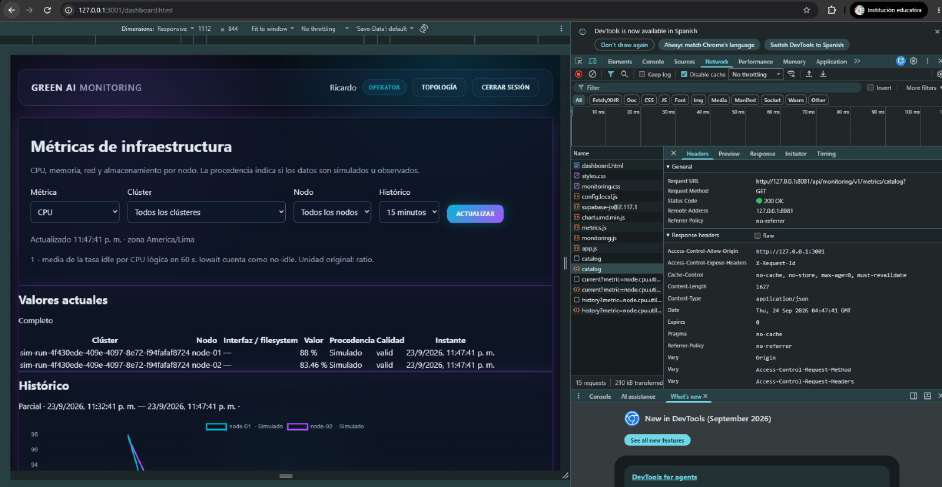  
*Figura 5. Dashboard principal con visualización histórica de telemetría de CPU y memoria.*

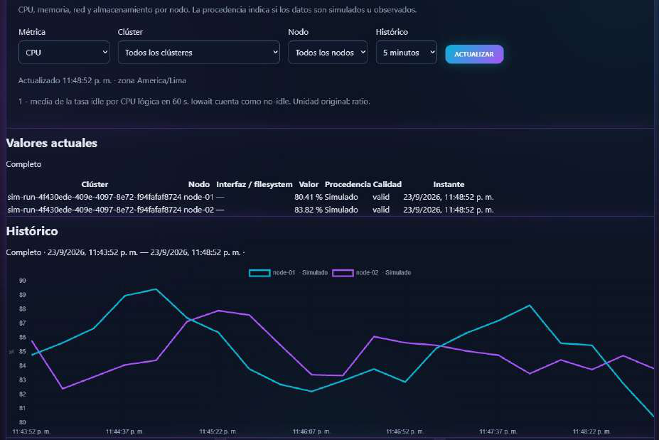  
*Figura 6. Dashboard de visualización en tiempo real de nodos de cómputo.*

---

## VI.2 Diseño de base de datos

### Evaluación y selección del motor de base de datos

Para la gestión de metadatos de infraestructura, configuraciones de experimentos, perfiles de usuario y registros históricos de trazabilidad, se evaluaron tres alternativas de bases de datos mediante una matriz de selección con ponderación uniforme del 25 %:

Tabla 12. Evaluación ponderada de los motores de base de datos

| Criterio de evaluación | Peso | PostgreSQL | MySQL | MongoDB |
|---|---|---|---|---|
| Adecuación al modelo estructurado | 25 % | 5 | 4 | 3 |
| Integración con el ecosistema de servicios | 25 % | 5 | 5 | 5 |
| Reproducibilidad y soporte de contratos | 25 % | 5 | 5 | 4 |
| Facilidad de operación y mantenimiento | 25 % | 4 | 4 | 4 |
| **Puntaje total (sobre 20)** | **100 %** | **19** | **18** | **16** |

Se seleccionó **PostgreSQL** por su robustez relacional, soporte nativo de extensiones temporales y capacidades avanzadas de integridad referencial. Para el despliegue en la nube se emplea **Supabase**, que proporciona PostgreSQL administrado junto con servicios integrados de autenticación (Supabase Auth) y políticas de seguridad por fila (RLS). En paralelo, para garantizar reproducibilidad local y ejecución de pruebas sin dependencia de red externa, se diseñó un perfil con **SQLite** en desarrollo, compartiendo contratos de consulta idénticos con PostgREST.

Las métricas temporales de alta frecuencia se almacenan de forma complementaria en Prometheus, especializando a PostgreSQL para la persistencia transaccional y relacional.

### Diseño lógico y físico de la base de datos

El diseño lógico define las entidades principales: nodos de cómputo (`hardware`), registros temporales de telemetría (`logs`), perfiles de usuario (`user_profiles`) y asignaciones de seguridad (`user_roles`).

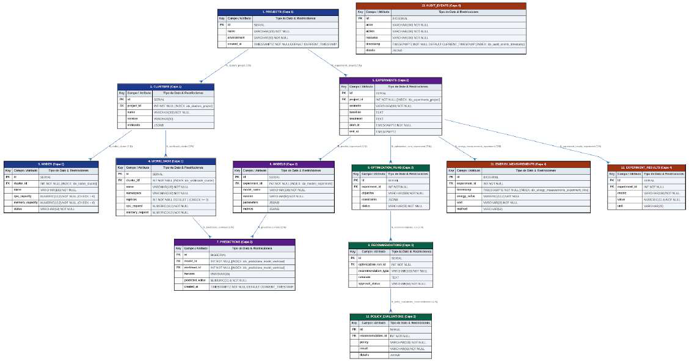  
*Figura 7. Diagrama del modelo lógico de la base de datos relacional.*

El diseño físico traslada las entidades a tablas relacionales con claves foráneas, restricciones de no nulidad, índices en columnas de marca temporal (`timestamp`) y tipos de datos normalizados.

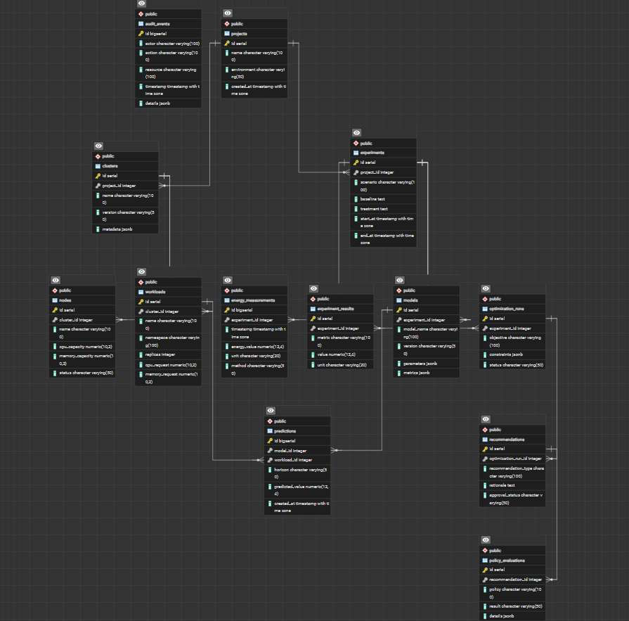  
*Figura 8. Diagrama del modelo físico implementado en Supabase / PostgreSQL.*

### Procedimientos almacenados y funciones en base de datos

En atención a las observaciones docentes respecto a la evidencia de lógica de base de datos (indicador 11 de la lista de cotejo), el sistema implementa en Supabase una función PL/pgSQL con privilegios de seguridad elevados (`SECURITY DEFINER`) denominada `public.handle_new_auth_user()`, activada automáticamente mediante un disparador (*trigger*) sobre la tabla `auth.users` (`software/frontend/supabase-auth-setup.sql`). 

Esta función sincroniza de manera segura la creación de cuentas de usuario en el subsistema de autenticación con la tabla relacional `public.user_profiles`, asignando por defecto el rol de `OPERATOR` y configurando las políticas de aislamiento RLS (*Row Level Security*) correspondientes.

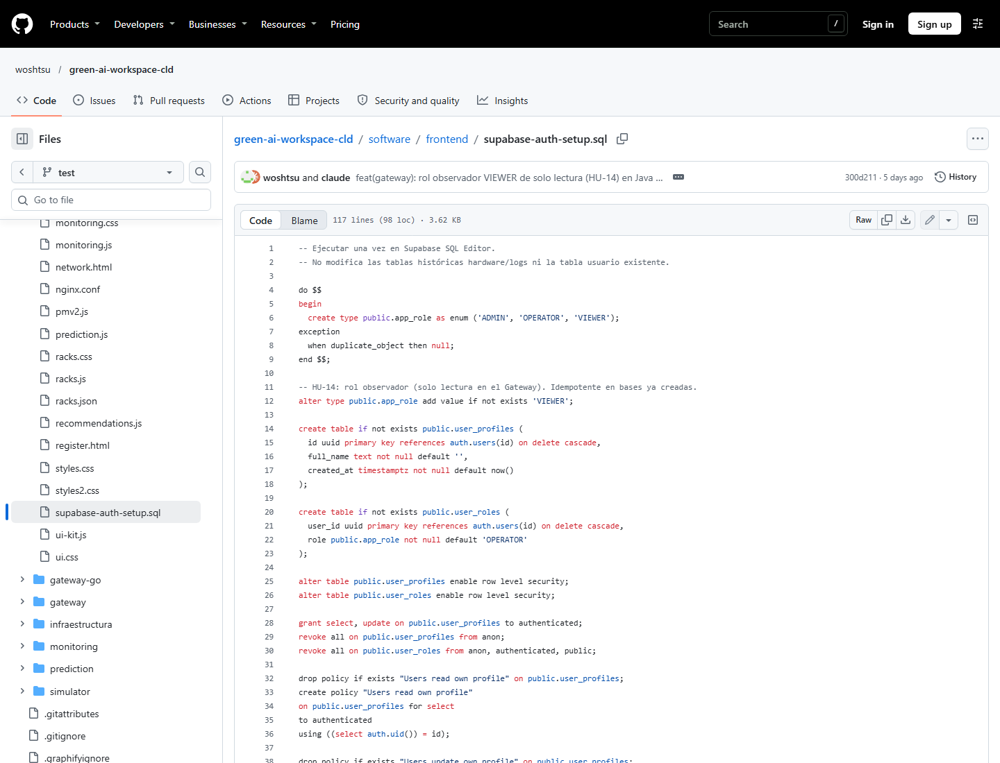
*Figura 9. Procedimiento almacenado y disparador de sincronización de usuarios en Supabase (GitHub).*

---

## VI.3 Arquitectura de la solución planteada

### Evaluación y selección de la arquitectura de software

Se evaluaron tres estilos arquitectónicos para el prototipo experimental considerando la complejidad de operación y las restricciones académicas:

Tabla 13. Evaluación ponderada de los estilos arquitectónicos

| Criterio de evaluación (peso) | Monolito en capas | Microservicios clásicos | Microservicios con hexagonal (Híbrida) |
|---|---|---|---|
| Desacoplamiento dominio / infraestructura (25 %) | 3 | 3 | 5 |
| Independencia tecnológica por componente (20 %) | 1 | 5 | 5 |
| Testabilidad aislada sin infraestructura (20 %) | 3 | 3 | 5 |
| Viabilidad en planes gratuitos de nube (20 %) | 5 | 2 | 3 |
| Gestionabilidad para equipo de 4 personas (15 %) | 5 | 2 | 3 |
| **Puntaje ponderado (sobre 5,00)** | **3,30** | **3,05** | **4,30** |

Se seleccionó la **arquitectura de microservicios con diseño hexagonal por servicio**, obteniendo 4,30 puntos. Esta arquitectura permite desacoplar la lógica de dominio de los detalles de infraestructura, posibilitando que componentes con requerimientos tecnológicos dispares (Java en monitoreo, Python en Machine Learning, Go en pasarela de acceso) colaboren a través de contratos HTTP/REST explícitos sin acoplamiento binario.

### Estructura de componentes y vista de paquetes UML

La solución se organiza en servicios independientes que aplican arquitectura hexagonal:
- **Simulator (`software/simulator`):** CLI en Python que modela la telemetría temporal de 50 servidores universitarios exportando métricas a Prometheus (10 pruebas unitarias).
- **Monitoring (`software/monitoring`):** Microservicio en Java 21 y Spring Boot con arquitectura hexagonal estricta (puerto `QueryMetrics` y adaptadores Prometheus/Fixture) que expone el catálogo y series de recursos (112 pruebas unitarias).
- **Data Processing (`software/data-processing`):** Servicio en Python y FastAPI que normaliza series temporales y gestiona el acceso a históricos mediante adaptadores intercambiables para Supabase/PostgREST y SQLite local (121 pruebas unitarias).
- **Prediction (`software/prediction`):** Servicio en Python y FastAPI que encapsula el modelo predictivo (Random Forest), el cálculo de energía trapezoidal y el motor de políticas de recomendación (*Recommendation-Only*) (100 pruebas unitarias).
- **API Gateway (`software/gateway` / `gateway-go`):** Pasarela de acceso con validación JWT, RBAC y enrutamiento perimetral. La implementación Java Spring Cloud cuenta con 12 pruebas; la alternativa ligera en Go 1.25 stdlib cuenta con 30 pruebas automatizadas.
- **Frontend (`software/frontend`):** Aplicación web estática en HTML5/JS servida por Nginx que consume exclusivamente los endpoints expuestos por el API Gateway (48 pruebas).

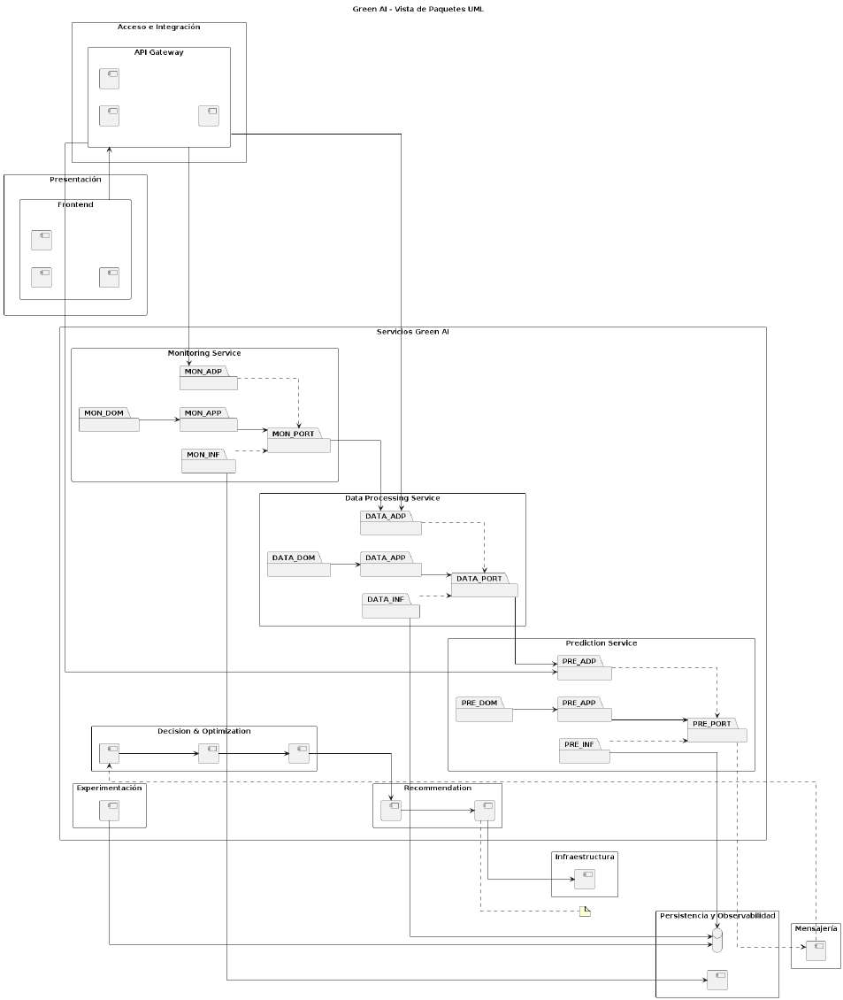  
*Figura 10. Vista de paquetes UML conceptual inicial (incluye componentes previstos).*

> **Nota aclaratoria sobre la Figura 10:** El diagrama inicial representaba la visión conceptual preliminar con un bus de eventos en RabbitMQ y orquestación externa. La arquitectura implementada en PMV1 y PMV2 opera de forma síncrona mediante APIs REST bajo el API Gateway, integrando la política de recomendación dentro del Prediction Service sin requerir RabbitMQ.

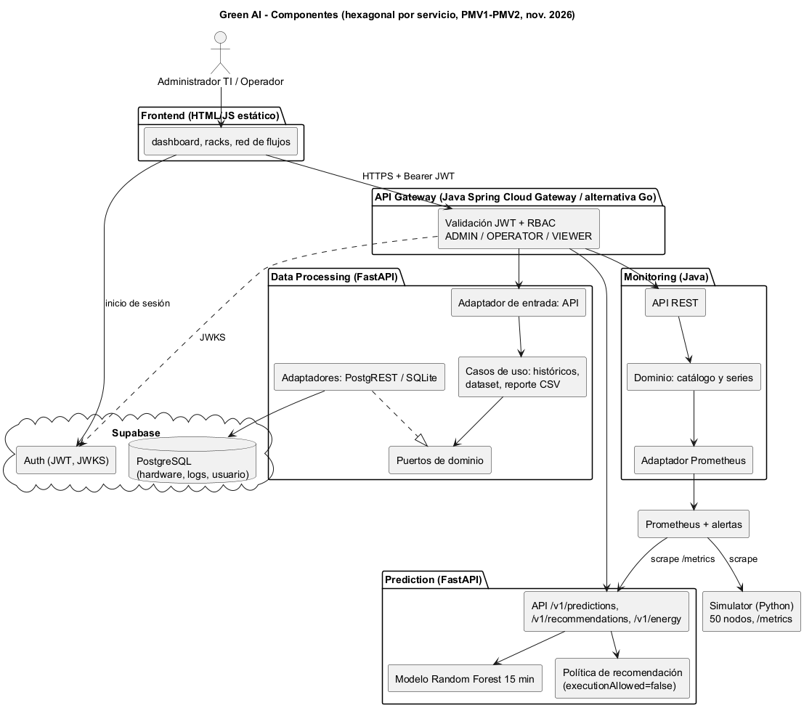

*Figura 11. Vista de componentes actualizada: arquitectura hexagonal por microservicio, comunicación REST por el API Gateway y sin RabbitMQ (fuente: herramientas_IA/diagramas/componentes-green-ai.puml).*

### Vista de despliegue y topología física

El flujo de procesamiento sigue la secuencia:
$$\text{Simulator} \longrightarrow \text{Prometheus} \longleftarrow \text{Monitoring} \longleftarrow \text{API Gateway} \longleftarrow \text{Frontend}$$
$$\text{Frontend} \longrightarrow \text{API Gateway} \longrightarrow \text{Prediction / Data Processing} \longleftrightarrow \text{Supabase / SQLite}$$

La solución se despliega en dos modalidades verificadas:
1. **Entorno local de desarrollo (`green-ai-mono`):** Orquestado integralmente mediante Docker Compose (`docker-compose.yml`), levantando los contenedores de Simulator, Prometheus, Monitoring, Data Processing, Prediction, API Gateway (Java o Go) y Frontend bajo una red interna aislada, conectando opcionalmente con Supabase externo o SQLite local. Supera la verificación integral *smoke test* de 14/14 casos.
2. **Entorno de calidad en la nube (*Staging* en Render + GitHub Pages):** Los microservicios analíticos se despliegan como servicios web en contenedores sobre Render (`*-dev.onrender.com`), el frontend estático se publica en GitHub Pages mediante HTTPS, y la persistencia de autenticación e históricos opera sobre Supabase en la nube.

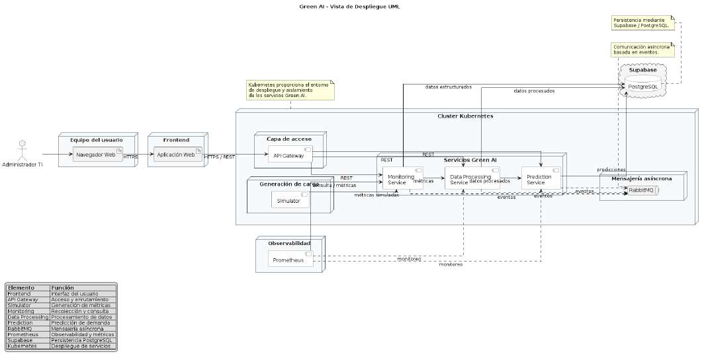  
*Figura 12. Vista de despliegue UML conceptual inicial (incluye orquestación prevista en Kubernetes).*

> **Nota aclaratoria sobre la Figura 12:** El diagrama original mostraba la planificación tentativa con despliegue en clúster Kubernetes. En la implementación real, la solución opera de forma verificada sobre Docker Compose en local y servicios web en Render y GitHub Pages. Kubernetes queda considerado exclusivamente como trabajo futuro para escalamiento a gran escala.

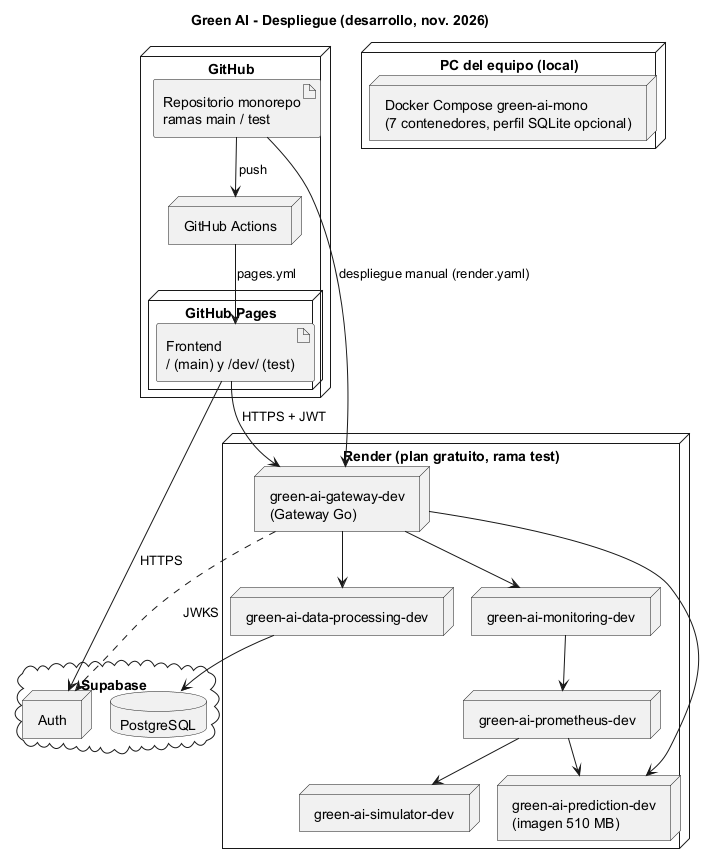

*Figura 13. Vista de despliegue actualizada: GitHub Pages, seis servicios en Render (rama test), Supabase y Docker Compose local; sin Kubernetes (fuente: herramientas_IA/diagramas/despliegue-green-ai.puml).*

# VII. GESTIÓN DEL PROYECTO

### VII.1. Acta de Constitución del Proyecto (Project Charter)

Tabla 14. Acta de constitución del proyecto (Project Charter)

|Elemento|Descripción|
|---|---|
|Nombre del proyecto|Green AI: Monitoreo y predicción de demanda computacional para apoyar la gestión eficiente de recursos en entornos universitarios (Proyecto 20)|
|Líder del proyecto / Product Owner|Jhonny Cristhian Quintana Carhuaricra (documentación y pruebas)|
|Scrum Master / ML Lead|Gina Diana Barrera Peña (datos y modelos)|
|Backend, contratos e integración|Ricardo Porras Veli|
|Infraestructura, Docker y observabilidad|Leonid Kisley Orlando Huamán Collazos|
|Asistencia técnica de IA|Claude (asistente de IA de Anthropic, bajo supervisión humana estricta para tareas de coordinación técnica, revisión y redacción)|
|Patrocinador / Asesor académico|Ing. Jorge Alfredo Guevara Jiménez|
|Propósito central|Diseñar, desarrollar y evaluar experimentalmente una plataforma inteligente orientada a la observabilidad y predicción de la demanda computacional de CPU en entornos de cómputo universitarios, con la finalidad de emitir recomendaciones desacopladas de optimización de recursos que mitiguen el consumo energético sin degradar los acuerdos de nivel de servicio (SLA). La plataforma opera bajo condiciones de evaluación transparentes y reproducibles sobre datos simulados; las metas de ahorro energético y los umbrales de SLA constituyen variables experimentales de evaluación y no resultados garantizados de forma previa a la ejecución de las pruebas controladas.|
|Presupuesto financiero real|S/ 0.00. El proyecto opera bajo costo monetario de caja nulo, utilizando infraestructura física personal o de laboratorio universitario, herramientas de código abierto (open source) y capas gratuitas (free tier). La valoración comercial referencial de ingeniería y reservas bajo metodología PMBOK se cuantifica en S/ 24,872.40.|
|Gobernanza operativa|Modalidad Recommendation-Only: el servicio de predicción y toma de decisiones opera de manera desacoplada y emite recomendaciones de asignación de recursos estrictamente auditables bajo supervisión humana (`executionAllowed=false`). El sistema no posee autorización para ejecutar acciones autónomas ni modificaciones directas sobre infraestructura en producción. El entorno de ejecución se orquesta mediante Docker Compose (no se implementó clúster Kubernetes ni orquestación física autónoma en producción).|
|Exclusiones del alcance|Acciones correctivas o escalados automáticos sobre infraestructura de producción; medición directa de potencia física mediante hardware eléctrico (se utiliza un modelo proxy lineal matemático P(u) salvo provisión de instrumentación institucional); despliegue institucional definitivo en centros de cómputo universitarios.|

### VII.2. Contexto, Caracterización y Adaptación Metodológica (Tailoring Scrum)

#### VII.2.1. Justificación de la selección metodológica

La definición del enfoque metodológico se sustentó en una evaluación multicriterio ponderada, contrastando el marco ágil frente a modelos tradicionales predictivos e híbridos:

- Enfoque ágil (Scrum / Scrumban): 4.85 / 5.00.
- Enfoque híbrido: 4.35 / 5.00.
- Enfoque predictivo (Waterfall): 2.50 / 5.00.

Los criterios de ponderación asignados fueron: capacidad de adaptación al cambio (25 %), nivel de incertidumbre técnica experimental en aprendizaje automático (20 %), entrega incremental verificable por Producto Mínimo Viable (20 %), retroalimentación periódica con el asesor (20 %) y restricciones operativas de recursos (15 %).

La adopción de Scrum con elementos de flujo visual Kanban (*Scrumban*) responde a la naturaleza iterativa del modelado predictivo, permitiendo validar la observabilidad (PMV1), los modelos de regresión y el motor de políticas (PMV2), y el aseguramiento del proceso de software con el documento final y su guía de uso (PMV3) en incrementos verificables de dos semanas.

#### VII.2.2. Adaptación de ceremonias y prácticas (Tailoring)

Tabla 15. Adaptación de ceremonias y prácticas Scrum (tailoring)

|Práctica / Ceremonia|Adaptación en el proyecto Green AI|
|---|---|
|Product Backlog|Catálogo de 20 requerimientos funcionales (RF-01 a RF-20) expresados como Historias de Usuario (HU) con criterios de aceptación BDD (Given-When-Then), organizadas por PMV en el tablero oficial de Trello en el workspace UC.|
|Duración de los Sprints|Ocho Sprints en total dentro del ciclo académico: los Sprints 1 a 6 son de 14 días calendario (2 semanas); por el calendario lectivo, que concluye el 30/11/2026, los Sprints 7 y 8 se reducen a una semana cada uno (17/11–23/11 y 24/11–30/11), adaptación (*tailoring*) propia de este proyecto.|
|Daily Scrum adaptado|Sincronizaciones virtuales asíncronas tres veces por semana (lunes, miércoles y viernes) mediante grupo de mensajería (WhatsApp) y registro auditable en tarjetas de Trello, adecuándose a los horarios heterogéneos del equipo.|
|Refinamiento y Planificación|Sesiones integradas de planificación al inicio de cada sprint para priorizar historias, estimar esfuerzo y revisar criterios de aceptación técnicos sin sobrecarga administrativa.|
|Enfoque de procesos en el PMV3|En los Sprints 7 y 8 el trabajo se centra en procesos y entregables de la Unidad IV: flujo Git `test`→`main` con *pull request* revisado, CI/CD documentado, convención `PMVn-HUxx` y DoD por tarjeta en Trello, ingeniería inversa, calidad FURPS+/OWASP por olas, pruebas con usuarios finales, pruebas de rendimiento y de ML, informe final con guía de uso (base: `entregables/guia-de-uso/GUIA-RAPIDA-USUARIO.md`), artículo, póster y video. Cada sprint cierra con Sprint Review y Retrospectiva.|
|Sprint Review y Retrospectiva|Demostración técnica del incremento funcional ante el asesor académico al cierre de cada sprint, y ejecución de análisis retrospectivo formal bajo ciclo PDCA (Plan-Do-Check-Act) al término de cada PMV.|

#### VII.2.3. Matriz de asignación de roles y responsabilidades (RACI)

La gestión operativa del proyecto distribuye las responsabilidades entre los cuatro integrantes del equipo, considerando además la asistencia técnica de inteligencia artificial como soporte de coordinación supervisado. Ante el requisito de 5 roles de la rúbrica S8 frente a un equipo de 4 integrantes, las funciones de aseguramiento de calidad (QA) y operaciones de infraestructura (DevOps) se asumen de manera transversal y compartida entre los integrantes.

Tabla 16. Matriz de asignación de roles y responsabilidades (RACI)

|Actividad / Entregable de ingeniería|Jhonny Quintana (PO)|Gina Barrera (SM/ML)|Ricardo Porras (Dev)|Leonid Huamán (Infra)|Claude (IA)|
|---|---|---|---|---|---|
|Gestión del Product Backlog y priorización de HU|R / A|C|I|I|C|
|Facilitación de ceremonias ágiles y sprints|C|R|I|I|I|
|Orquestación con Docker Compose y observabilidad (Prometheus/Grafana)|I|I|C|R|I|
|Pipeline ETL e imputación de telemetría sintética|I|R|R|C|I|
|Entrenamiento y evaluación de modelos ML (Random Forest y baselines)|I|R|C|I|I|
|API Gateway, microservicios REST y contratos OpenAPI|C|C|R|C|I|
|Policy Engine y recomendaciones en modo Recommendation-Only|A|C|R|C|I|
|Pruebas automatizadas (unitarias, contrato, integración y smoke)|R|C|R|R|C|
|Documentación técnica, trazabilidad y control de cambios|R / A|C|C|C|R|

**Leyenda:**


- **R (Responsible):** integrante responsable de ejecutar la actividad técnica.
- **A (Accountable):** aprobador final y responsable directo de la calidad del entregable.
- **C (Consulted):** persona o soporte consultado durante la ejecución técnica.
- **I (Informed):** integrante que se mantiene informado del avance y resultado.

#### VII.2.4. Mapa de stakeholders (partes interesadas)

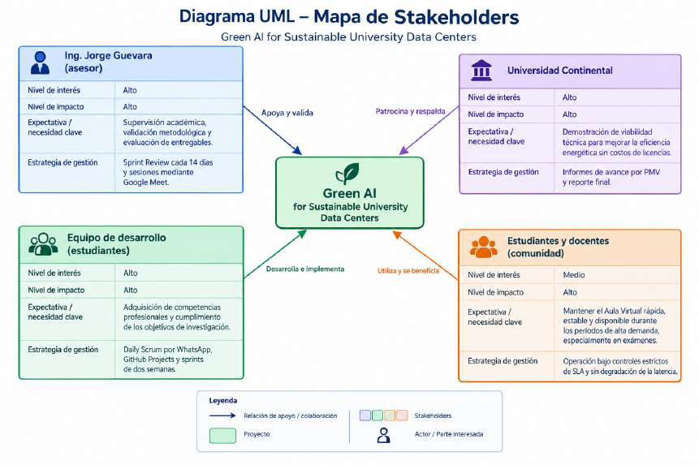

Figura VII.2.4. Mapa de stakeholders del proyecto Green AI.

El análisis de partes interesadas clasifica a los actores según su nivel de poder e interés:

1. **Promotores clave (Alto interés / Alto poder):** Asesor académico (Ing. Jorge Alfredo Guevara Jiménez) y docente evaluador de la asignatura, quienes validan la rigurosidad metodológica, el cumplimiento de la consigna ICACIT y la aprobación formal de los entregables.
2. **Equipo ejecutor (Alto interés / Alto poder operativo):** Integrantes del equipo de ingeniería de sistemas (Product Owner, Scrum Master y Desarrolladores), responsables directos de la construcción, verificación y despliegue del software.
3. **Interesados operacionales (Medio-alto interés / Poder medio):** Administradores de infraestructura de TI y operadores de centros de datos universitarios, beneficiarios potenciales de las recomendaciones de dimensionamiento y consumo energético.
4. **Comunidad universitaria (Medio interés / Bajo poder):** Docentes, investigadores y estudiantes cuyos servicios computacionales dependen de la alta disponibilidad de los servidores.

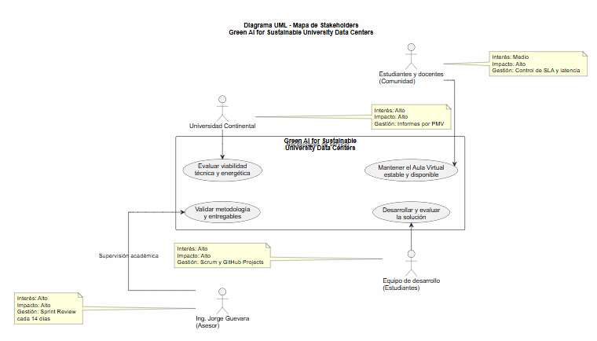

Figura VII.2.5. Modelado UML de partes interesadas y flujos de interacción del sistema.

#### VII.2.5. Registro adaptativo y cuantificado de riesgos por PMV (Cálculo del VME)

La gestión de riesgos se abordó de manera cuantitativa vinculando cada amenaza identificada con su probabilidad de ocurrencia y su impacto económico estimado en horas de ingeniería (valoradas a la tarifa de referencia de S/ 30.00 / h). La suma de los Valores Monetarios Esperados (VME = Probabilidad × Impacto) sustenta directamente la Reserva de Contingencia del presupuesto PMBOK:

Tabla 17. Registro cuantitativo de riesgos y planes de respuesta

|ID|Riesgo identificado|PMV|Probabilidad|Impacto (h / S/)|VME (S/)|Plan de respuesta / Mitigación de ingeniería|
|---|---|---|---|---|---|---|
|R1|Indisponibilidad de telemetría institucional en tiempo real por restricciones de acceso|PMV1–3|0.60|40 h (S/ 1,200.00)|S/ 720.00|Desarrollo de un simulador estocástico multirrecurso (Simulator) y uso de un dataset sintético reproducible con 100,000 registros, explicitando el origen simulado en toda la documentación.|
|R2|Límites de recursos en hosting gratuito en la nube (suspensión por inactividad y RAM < 512 MiB)|PMV2–3|0.50|30 h (S/ 900.00)|S/ 450.00|Desarrollo de Gateway alternativo liviano en Go (~16 MB / ~10-16 MiB RAM), optimización multi-etapa de imagen de Prediction (510 MB) y mantenimiento de stack local en Docker Compose como entorno de respaldo.|
|R3|Degradación del desempeño predictivo del modelo o desvío de patrones (data drift)|PMV3|0.40|40 h (S/ 1,200.00)|S/ 480.00|Mantenimiento permanente de modelos baseline de referencia (persistencia y promedio móvil), evaluación del error por régimen de carga e implementación de políticas de seguridad.|
|R4|Configuración de políticas de seguridad permisivas (Row Level Security - RLS) en base de datos cloud|PMV2–3|0.30|50 h (S/ 1,500.00)|S/ 450.00|Aislamiento mediante perfil SQLite para desarrollo local desacoplado, auditoría de endpoints con PostgREST y endurecimiento de políticas de acceso antes del despliegue público.|
|R5|Indisponibilidad temporal o sobrecarga académica de algún integrante del equipo|PMV1–3|0.30|32 h (S/ 960.00)|S/ 288.00|Asignación cruzada de responsabilidades técnicas, centralización en monorepo unificado con un solo Git y documentación exhaustiva de contratos de interfaz OpenAPI.|
|**TOTAL**|**Valor Monetario Esperado acumulado (Reserva de Contingencia)**||||**S/ 2,388.00**||

### VII.3. Plan de calidad y criterios de cierre (Definition of Done - DoD)

Para garantizar la calidad técnica y la gobernanza del producto en cada incremento funcional, se establecieron criterios rigurosos de cierre que condicionan el paso de cualquier Historia de Usuario a la columna *Done*:

1. **Criterios de aceptación BDD:** la funcionalidad debe cumplir estrictamente con los escenarios definidos bajo la sintaxis Given-When-Then (Dado-Cuando-Entonces).
2. **Pruebas automatizadas por servicio:** el código debe contar con pruebas automatizadas que verifiquen su comportamiento dentro del monorepo. Al corte actual, las suites registran:
   - Monitoring Service: 112 pruebas verificadas (0 fallos).
   - Gateway Java: 12 pruebas verificadas (0 fallos).
   - Gateway Go: 30 pruebas unitarias y de integración (0 fallos).
   - Data Processing Service: 121 pruebas pasadas (incluyendo 114 de contrato común entre SQLite y PostgreSQL).
   - Prediction Service: 100 pruebas pasadas (suite unitaria y de API).
   - Frontend: 48 pruebas verificadas (13 estructurales y 35 de lógica de presentación).
   - Simulator: 10 pruebas ejecutadas (10/10 en entorno contenedorizado).
   - Verificación de humo integral (Smoke Test): 14/14 escenarios end-to-end exitosos.
3. **Integración continua y control de versiones:** código integrado en la rama correspondiente (`test` o `main`) del monorepo unificado mediante Pull Request revisado, sin conflictos pendientes ni submódulos anidados.
4. **Contratos de interfaz OpenAPI:** especificaciones OpenAPI v3 sincronizadas y coherentes entre proveedores y consumidores de API REST.
5. **Seguridad y secretos:** ausencia de credenciales, contraseñas o tokens embebidos en el repositorio (uso exclusivo de variables de entorno con plantillas `.env.example` vacías).
6. **Inspección estática y calidad:** análisis de código sin advertencias bloqueadoras ni vulnerabilidades críticas conocidas en dependencias.
7. **Evidencia auditable:** toda afirmación o funcionalidad debe estar respaldada por un comando reproducible o una captura verificable registrada en el informe técnico.

#### VII.3.1. Estructura de Desglose del Trabajo (EDT / WBS)

La Estructura de Desglose del Trabajo se reorganizó formalmente en atención a las observaciones de la auditoría docente, estructurándose en dos ramas maestras de primer nivel: **Gestión del Proyecto** e **Ingeniería de la Solución**. Se retiraron del alcance paquetes técnicos no ejecutados (como clúster Kubernetes K3s/Minikube, pruebas con Locust, orquestación con RabbitMQ o servidores SonarQube dedicados), manteniéndose únicamente los componentes reales y verificables.

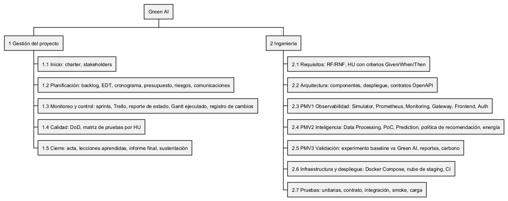

Figura VII.3.1. Estructura de Desglose del Trabajo (EDT) del proyecto Green AI con ramas de Gestión e Ingeniería.

La jerarquía detallada de la EDT se desglosa a continuación:

```
Green AI
├── 1. Gestión del proyecto
│   ├── 1.1 Inicio: charter, stakeholders
│   ├── 1.2 Planificación: backlog, EDT, cronograma, presupuesto, riesgos, comunicaciones
│   ├── 1.3 Monitoreo y control: sprints, Trello, reporte de estado, Gantt ejecutado, registro de cambios
│   ├── 1.4 Calidad: DoD, matriz de pruebas por HU, auditoría FURPS+/OWASP (olas 1 a 3)
│   └── 1.5 Cierre: acta, lecciones aprendidas, informe final, sustentación
└── 2. Ingeniería
    ├── 2.1 Requisitos: RF/RNF, HU con criterios Given/When/Then
    ├── 2.2 Arquitectura: componentes, despliegue, contratos OpenAPI
    ├── 2.3 PMV1 Observabilidad: Simulator, Prometheus, Monitoring, Gateway, Frontend, Auth
    ├── 2.4 PMV2 Inteligencia: Data Processing, PoC, Prediction, política de recomendación, energía
    ├── 2.5 PMV3 Procesos, calidad y entregables finales: ingeniería inversa, proceso de desarrollo y CI/CD, calidad FURPS+/OWASP, pruebas con usuarios y de rendimiento/ML, informe final con guía de uso, artículo, póster y video (el experimento baseline vs Green AI y los reportes JSON/CSV ya se demostraron en PMV2)
    ├── 2.6 Infraestructura y despliegue: Docker Compose, nube de staging, CI
    └── 2.7 Pruebas: unitarias, contrato, integración, smoke, carga
```

#### VII.3.2. Tabla Resumen de Paquetes de Trabajo por PMV y Responsable

Tabla 18. Paquetes de trabajo por PMV y responsable

|Código EDT|Paquete de trabajo|Rama EDT|PMV / Ciclo|Sprint|Responsable principal|Entregable auditable|
|---|---|---|---|---|---|---|
|1.1|Inicio del proyecto y Project Charter|Gestión|Transversal|Sprint 1|Jhonny Quintana (PO)|Project Charter firmado y registro de partes interesadas|
|1.2|Planificación de alcance, EDT y presupuesto|Gestión|Transversal|Sprint 1|Jhonny Quintana (PO) + Gina Barrera (SM)|Backlog priorizado, EDT, presupuesto PMBOK y plan de riesgos|
|1.3|Monitoreo, control y gestión de cambios|Gestión|Transversal|Sprints 1–8|Gina Barrera (SM) + Jhonny Quintana (PO)|Tablero Trello en workspace UC, Gantt ejecutado y bitácora CHG|
|1.4|Aseguramiento de calidad y matriz DoD|Gestión|Transversal|Sprints 1–8|Gina Barrera (SM) + Ricardo Porras (Dev)|Criterios Given-When-Then y suites de pruebas automatizadas|
|1.5|Cierre administrativo y sustentación|Gestión|Cierre|Sprint 8|Todo el equipo|Informe final consolidado, repositorio archivado y defensa oral|
|2.1|Análisis de requisitos (RF-01 a RF-20)|Ingeniería|PMV1|Sprint 1|Jhonny Quintana (PO)|Especificación de requerimientos funcionales y no funcionales|
|2.2|Arquitectura de software y contratos|Ingeniería|PMV1|Sprints 1–2|Ricardo Porras (Dev) + Leonid Huamán (Infra)|Diagramas de componentes, contratos OpenAPI y vista de datos|
|2.3|PMV1: Pipeline de observabilidad|Ingeniería|PMV1|Sprints 1–3|Leonid Huamán (Infra) + Ricardo Porras (Dev)|Simulator, Prometheus, Monitoring (112 tests), Gateway y Frontend|
|2.4|PMV2: Modelado predictivo y decisiones|Ingeniería|PMV2|Sprints 4–6|Gina Barrera (ML) + Ricardo Porras (Dev)|Dataset sintético, Random Forest (100 tests), Policy Engine y energía|
|2.5|PMV3: Procesos de software, calidad y entregables finales|Ingeniería|PMV3|Sprints 7–8|Todo el equipo (J, G, R, L)|Ingeniería inversa (7 fases), proceso de desarrollo y CI/CD documentados, calidad FURPS+/OWASP (olas 2 y 3), pruebas con usuarios finales, pruebas de rendimiento y métricas de ML, informe final con guía de uso, artículo, póster y video (planificado)|
|2.6|Infraestructura, Docker Compose y Staging|Ingeniería|Transversal|Sprints 2–7|Leonid Huamán (Infra) + Ricardo Porras (Dev)|Docker Compose unificado, Gateway Go y preparación Render|
|2.7|Suites de pruebas y aseguramiento|Ingeniería|Transversal|Sprints 1–8|Todo el equipo|Pruebas unitarias, de contrato, integración y smoke 14/14|

### VII.4. GESTIÓN ECONÓMICA Y PRESUPUESTO DEL PROYECTO

#### VII.4.1. Fundamentación Metodológica y Modelo Dual de Valoración

En concordancia con el Dominio de Desempeño de la Planificación del estándar PMBOK (7.a Edición) y el criterio de acreditación ICACIT AG-I12 (Gestión de Proyectos), la formulación económica de un proyecto de ingeniería de software requiere estructurar de manera diferenciada los costos directos de actividades, la Línea Base de Costos (Cost Baseline) y las reservas para contingencias e imprevistos.

Debido al contexto académico de la asignatura Taller de Proyectos de Ingeniería de Sistemas e Informática, el proyecto se ejecuta bajo una restricción financiera de desembolso real en efectivo de S/ 0.00, mediante el aprovechamiento de recursos informáticos personales, infraestructura de laboratorio universitario y componentes de software de código abierto. Para certificar la viabilidad económica ante una eventual transferencia industrial, se implementa un **Modelo Dual de Presupuesto**:

1. **Costo Financiero Real Desembolsado:** S/ 0.00 (gasto efectivo de caja ejecutado por los integrantes).
2. **Valor Comercial Referencial de Ingeniería:** S/ 24,872.40 (valoración técnica del trabajo profesional de ingeniería, recursos lógicos y físicos utilizados, y reservas metodológicas PMBOK).

#### VII.4.2. Desglose del Esfuerzo Directo de Ingeniería (Horas-Hombre)

La estimación de la mano de obra directa se calcula formalmente a partir de la dedicación horaria de los 4 integrantes del equipo a lo largo del cronograma de ocho Sprints (seis de 14 días y dos de una semana, por el cierre del periodo lectivo el 30/11/2026):


$$\text{Horas Totales} = 4\text{ ingenieros} \times 10\text{ horas/semana} \times 16\text{ semanas} = 640\text{ horas-hombre}$$

Considerando una tarifa horaria de mercado referencial en el medio local de S/ 30.00 / h para profesionales junior de ingeniería de sistemas, el esfuerzo profesional se distribuye por rol de la siguiente manera:

Tabla 19. Estimación de la mano de obra directa por rol

|Código EDT|Rol de ingeniería / Responsable|Integrante|Dedicación (h)|Tarifa horaria (S/)|Subtotal comercial (S/)|
|---|---|---|---|---|---|
|1.1, 1.2, 2.1|Product Owner (PO), pruebas y gobernanza|Jhonny Cristhian Quintana Carhuaricra|160|S/ 30.00|S/ 4,800.00|
|1.3, 1.4, 2.4|Scrum Master (SM), ML Lead y datos|Gina Diana Barrera Peña|160|S/ 30.00|S/ 4,800.00|
|2.2, 2.4, 2.6|Lead Backend & MLOps Engineer (contratos)|Ricardo Porras Veli|160|S/ 30.00|S/ 4,800.00|
|2.3, 2.6, 2.7|Infrastructure & DevOps Engineer (Docker)|Leonid Kisley Orlando Huamán Collazos|160|S/ 30.00|S/ 4,800.00|
|**TOTAL**|**Costo Directo de Mano de Obra (Trabajo)**|**4 Ingenieros**|**640 h**|**S/ 30.00**|**S/ 19,200.00**|

#### VII.4.3. Valoración de Licencias de Software, Cloud y Equipamiento

Para preservar el principio de costo de desembolso real nulo (S/ 0.00), se seleccionaron herramientas tecnológicas libres de costo de adquisición, valorando su aporte a precio de mercado:

Tabla 20. Costos del componente tecnológico: desembolso real y valor comercial referencial

|Componente tecnológico|Categoría de licencia / Modelo|Costo financiero real (S/)|Valor comercial referencial (S/)|Justificación técnica y operativa|
|---|---|---|---|---|
|Docker Engine & Docker Compose|Open Source (Apache 2.0)|S/ 0.00|S/ 350.00|Orquestación de microservicios en contenedores y aislamiento de red local.|
|Prometheus & Grafana|Open Source (Apache 2.0)|S/ 0.00|S/ 250.00|Recolección de telemetría cada 15 s, reglas de alertas y tableros en tiempo real.|
|Python 3.12, FastAPI & scikit-learn|Open Source (MIT / BSD)|S/ 0.00|S/ 200.00|Framework de microservicios REST livianos y pipeline de Random Forest.|
|Spring Boot 3.3 / Go 1.22|Open Source (Apache 2.0 / BSD)|S/ 0.00|S/ 200.00|API Gateway corporativo en Java y alternativa ultra-liviana en Go.|
|PostgreSQL / Supabase (Free Tier)|Open Source / Free Tier Cloud|S/ 0.00|S/ 300.00|Persistencia relacional y autenticación de 100,000 registros de telemetría sintética.|
|Equipos de cómputo (4 laptops)|Hardware propio (depreciación)|S/ 0.00|S/ 800.00|Infraestructura física de desarrollo, entrenamiento y ejecución (4 × S/ 200.00).|
|**TOTAL RECURSOS**|**Recursos lógicos y físicos**|**S/ 0.00**|**S/ 2,100.00**|**Subvencionado por software libre y equipamiento propio del equipo.**|

#### VII.4.4. Estructura Completa del Presupuesto: Línea Base y Reservas (PMBOK 7)

Conforme a las directrices del PMBOK (7.a Edición), la estructura presupuestal se calcula en niveles acumulativos:

1. **Costo Directo de Actividades ($CD$):** suma del esfuerzo directo de ingeniería y los recursos informáticos valorados:
   $$CD = \text{Mano de obra} + \text{Recursos tecnológicos} = \text{S/ } 19,200.00 + \text{S/ } 2,100.00 = \text{S/ } 21,300.00$$
2. **Reserva de Contingencia ($RC$):** asignada para responder ante los riesgos identificados en el Registro de Riesgos (§VII.2.5). Se calcula como la suma exacta de sus Valores Monetarios Esperados ($VME$):
   $$RC = \sum VME = \text{S/ } 720.00 + \text{S/ } 450.00 + \text{S/ } 480.00 + \text{S/ } 450.00 + \text{S/ } 288.00 = \text{S/ } 2,388.00$$
   *(Esta reserva representa el 11.21 % del Costo Directo, respaldada analíticamente en riesgos técnicos específicos).*
3. **Línea Base de Costos ($LBC$):** parámetro oficial para la gestión del valor ganado (EVM) y el control financiero del proyecto:
   $$LBC = CD + RC = \text{S/ } 21,300.00 + \text{S/ } 2,388.00 = \text{S/ } 23,688.00$$
4. **Reserva de Gestión ($RG$):** previsión destinada a cubrir contingencias no identificadas (*unknown-unknowns*), administrada a nivel de gobernanza por el Product Owner y el asesor académico. Se cuantifica en el 5 % de la Línea Base de Costos:
   $$RG = 0.05 \times LBC = 0.05 \times \text{S/ } 23,688.00 = \text{S/ } 1,184.40$$
5. **Presupuesto Total del Proyecto ($PT$):**
   $$PT = LBC + RG = \text{S/ } 23,688.00 + \text{S/ } 1,184.40 = \text{S/ } 24,872.40$$

#### VII.4.5. Matriz Consolidada de Cálculo Presupuestal


Tabla 21. Matriz consolidada de cálculo presupuestal

|Nivel presupuestal|Componente|Base de estimación / Fórmula|Valor comercial referencial (S/)|Desembolso financiero real (S/)|
|---|---|---|---|---|
|Nivel 1|Mano de obra directa (Ingeniería)|640 horas-hombre × S/ 30.00 / h|S/ 19,200.00|S/ 0.00|
|Nivel 1|Recursos lógicos y hardware valorado|6 partidas de software libre, cloud y equipos|S/ 2,100.00|S/ 0.00|
|**Subtotal**|**Costo Directo de Actividades (CD)**|**Mano de obra + Recursos**|**S/ 21,300.00**|**S/ 0.00**|
|Nivel 2|Reserva de Contingencia (RC)|Suma VME de riesgos R1 a R5 (11.21 % de CD)|S/ 2,388.00|S/ 0.00|
|**Línea Base**|**LÍNEA BASE DE COSTOS (LBC)**|**CD + Reserva de Contingencia**|**S/ 23,688.00**|**S/ 0.00**|
|Nivel 3|Reserva de Gestión (RG)|5.0 % de la Línea Base de Costos (LBC)|S/ 1,184.40|S/ 0.00|
|**Presupuesto**|**PRESUPUESTO TOTAL DEL PROYECTO**|**LBC + Reserva de Gestión**|**S/ 24,872.40**|**S/ 0.00**|

#### VII.4.6. Justificación Técnica para Sustentación e Inspección ICACIT (AG-I12)

Si el jurado evaluador o el comité de acreditación consulta acerca de la consistencia entre el presupuesto formulado y el gasto real de S/ 0.00, se sustenta la siguiente argumentación técnica:

> «El proyecto Green AI reporta un desembolso financiero real de caja de S/ 0.00 en virtud del aprovechamiento de licencias open source, plataformas cloud en capa gratuita y hardware personal de los estudiantes. No obstante, en estricto cumplimiento del estándar PMBOK (7.a Edición) y el atributo de egreso ICACIT AG-I12 (Gestión de Proyectos), se estableció una Línea Base de Costos de S/ 23,688.00 y un Presupuesto Total de S/ 24,872.40. Esta modelación demuestra la capacidad del equipo de ingeniería para costear mano de obra calificada (640 h-h), estructurar reservas de contingencia (S/ 2,388.00) sustentadas matemáticamente en el Valor Monetario Esperado de los riesgos y formalizar reservas de gestión (5 %), certificando la madurez metodológica requerida en entornos profesionales.»

#### VII.4.7. Plan de Comunicaciones

Tabla 22. Plan de comunicaciones del proyecto

|Evento / Ceremonia|Canal / Herramienta|Frecuencia|Participantes|Registro auditable|
|---|---|---|---|---|
|Sincronización diaria (Daily Scrum)|Grupo de WhatsApp y Trello|3 veces por semana (lun, mié, vie)|Equipo técnico de desarrollo|Tarjetas en Trello con las 3 preguntas estándar y bloqueos.|
|Gestión del Product Backlog|Trello (Workspace oficial UC)|Continua|Equipo técnico y Product Owner|Tarjetas organizadas en las 11 listas normadas y burndown.|
|Revisión de Sprint (Sprint Review)|Google Meet|Al cierre de cada sprint (cada 14 días en los Sprints 1 a 6; cada semana en los Sprints 7 y 8)|Equipo técnico y asesor académico|Demostración funcional del incremento y acta de feedback.|
|Retrospectiva de Sprint|Google Meet / Trello|Al cierre de cada PMV (cada 3-4 sprints) y de cada sprint del PMV3 (7 y 8)|Equipo técnico completo|Matriz de compromisos y lecciones aprendidas PDCA.|
|Seguimiento técnico y de código|GitHub Monorepo|Continua|Desarrolladores y revisores|Pull Requests, revisiones de diff y bitácora de commits.|
|Pruebas con usuarios finales y acta de reunión (PMV3)|Google Meet o reunión presencial|Una vez en el Sprint 8 (24–26/11, planificada)|Usuarios finales, equipo técnico y asesor académico|Acta de reunión con asistentes, retroalimentación recibida y acuerdos (indicador 9).|
|Monitoreo operativo y métricas|Prometheus y Grafana|En tiempo real|Equipo de operaciones y PO|Métricas de CPU, memoria y alertas de disponibilidad.|

### VII.5. CRONOGRAMA DE ACTIVIDADES Y DIAGRAMA DE GANTT

#### VII.5.1. Cronograma y Diagrama de Gantt Planificado

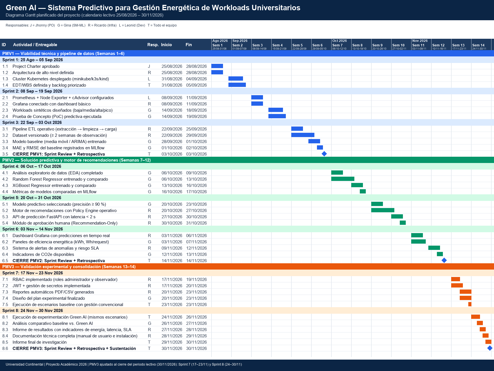

Figura VII.5.1. Cronograma planificado de actividades y diagrama de Gantt de referencia.

#### VII.5.2. Cronograma y Diagrama de Gantt Ejecutado

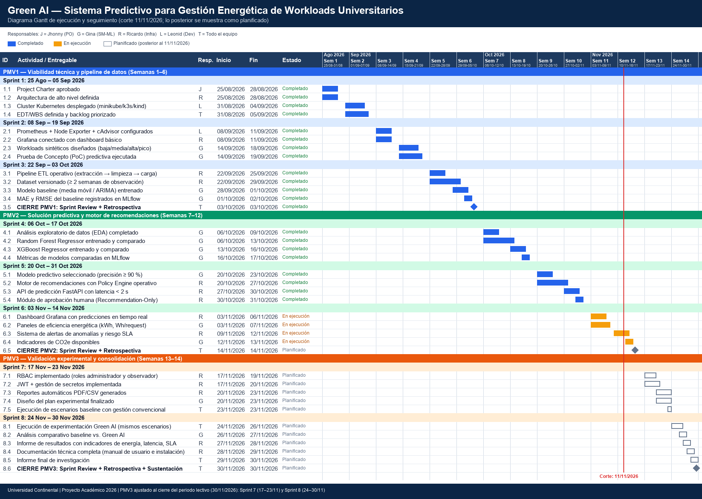

Figura VII.5.2. Cronograma de ejecución real y avance temporal por sprints con corte al 11/11/2026; las actividades posteriores a esa fecha se muestran como planificadas, no como realizadas.

#### VII.5.3. Fundamentación de la Gestión Temporal y Control de Línea Base

La planificación temporal del proyecto se estructuró originalmente sobre el ciclo académico organizado en 8 Sprints, divididos en tres fases o Productos Mínimos Viables (PMVs). Los Sprints 1 a 6 son de 14 días; dado que el periodo lectivo concluye el 30/11/2026, los Sprints 7 y 8 se reducen a una semana cada uno (adaptación o *tailoring* del calendario), de modo que ninguna fecha planificada excede dicho cierre:

- **PMV1 — Viabilidad Técnica y Pipeline de Observabilidad (Sprints 1 a 3 | Semanas 1 a 6):** recolección continua de telemetría de CPU simulada cada 15 segundos mediante Prometheus, desarrollo del pipeline ETL de limpieza e interpolación, y evaluación del modelo baseline de referencia.
- **PMV2 — Solución Predictiva y Motor de Recomendaciones (Sprints 4 a 6 | Semanas 7 a 12):** entrenamiento y validación del modelo Random Forest a 15 minutos, integración del Policy Engine desacoplado en modo Recommendation-Only (`executionAllowed=false`), exposición de endpoints REST en FastAPI y visualización de telemetría en tiempo real.
- **PMV3 — Procesos de software, calidad y entregables finales (Sprints 7 y 8 | Semanas 13 y 14, 17/11/2026 – 30/11/2026, planificado):** el PMV3 reúne los procesos de ingeniería del curso y los entregables de la Unidad IV. Tareas del Sprint 7 (17/11–23/11): 7.1 ingeniería inversa, fases 1–4 (descubrimiento tecnológico y funcional, detección arquitectónica, dependencias) (R); 7.2 proceso de desarrollo (flujo Git `test`→`main`, *pull request* con revisión) y de CI/CD (GitHub Actions + Render) documentados (L/R); 7.3 ola 2 del plan FURPS+/OWASP (`docs/calidad/02_plan_furps.md`, `05_plan_owasp.md`) (G); 7.4 pruebas de rendimiento y métricas de ML (indicador 10) (G/L); 7.5 gestión en Trello (`PMVn-HUxx`, dailies, DoD) y preparación de las pruebas con usuarios finales (J); 7.6 borrador del informe final y del reporte de cumplimiento ICACIT (J); 7.7 Sprint Review y Retrospectiva del Sprint 7 (todo el equipo). Tareas del Sprint 8 (24/11–30/11): 8.1 ingeniería inversa, fases 5–7 y reporte final (R/L); 8.2 ola 3 y re-medición FURPS+/OWASP (G); 8.3 pruebas con usuarios finales, retroalimentación y acta de reunión (indicador 9) (J); 8.4 informe final con la estructura del docente, guía de uso, reporte ICACIT y métricas del proceso (cumplimiento de DoD, HU por sprint, hallazgos cerrados) (J/R); 8.5 artículo científico en inglés y validación de trazabilidad artículo↔informe (G); 8.6 póster científico y video con episodios y 7 operaciones demostradas (todo el equipo); 8.7 cierre del PMV3: Sprint Review, Retrospectiva y Sustentación el 30/11 (todo el equipo). Los **productos finales del PMV3** son el informe final con guía de uso, el artículo, el póster y el video. El control de acceso por roles (VIEWER) y los reportes JSON/CSV ya se implementaron en el Sprint 6 (PMV2); la exportación PDF, la huella de carbono CO2e (HU-10) y la ampliación del experimento comparativo (HU-16) quedan como trabajo futuro, fuera del alcance del periodo lectivo.

##### Análisis de la línea base frente a la ejecución real

El calendario académico del curso avanzó con **una semana de anticipación** respecto a la línea base temporal formulada al inicio del semestre. En consecuencia, al momento de la entrega del informe de Unidad III (Semana 11 lectiva, corte al 05/11/2026), el equipo de ingeniería se encuentra ejecutando activamente el **Sprint 6 (03/11/2026 – 14/11/2026, semanas 11–12)**:

Tabla 23. Línea base frente a la ejecución real por Sprint

|Sprint / Fase|Compromiso planificado|Estado real de ejecución (Noviembre 2026)|
|---|---|---|
|Sprint 1 a 3 (Semanas 1–6)|Cierre del PMV1: infraestructura y observabilidad|**100 % completado.** Simulador, Prometheus, Monitoring (112 tests pasados), Gateway y Frontend con sesión de Supabase verificados.|
|Sprint 4 (Semanas 7–8)|Inicio de PMV2: pipeline de datos y EDA de ML|**Completado.** Ingesta en Data Processing, limpieza de valores nulos y exploración de series temporales.|
|Sprint 5 (Semanas 9–10)|Selección de modelo predictivo y Policy Engine|**Completado.** Selección de Random Forest a 15 min (MAE 3.22 y RMSE 4.59 pp en validación; MAE 3.85 en test; 100 tests pasados en Prediction) y recomendaciones desacopladas.|
|Sprint 6 (Semanas 11–12)|Alertas, tablero de eficiencia y empaquetado|**En ejecución.** Alertas Prometheus configuradas (promtool validado), cálculo de kWh con modelo P(u), imagen liviana de Prediction (510 MB) y preparación de staging en Render.|
|Sprint 7 (17/11–23/11, semana 13)|Ingeniería inversa (fases 1–4), procesos de desarrollo y CI/CD, calidad (ola 2), pruebas de rendimiento y de ML, y preparación de pruebas con usuarios|**Planificado.** Tareas 7.1 a 7.7 descritas arriba. El rol VIEWER (RBAC en Gateway) y el reporte JSON/CSV (`/api/processing/v1/reports/historical-summary`, 121 tests pasados) ya se completaron en el Sprint 6.|
|Sprint 8 (24/11–30/11, semana 14)|Ingeniería inversa (fases 5–7), calidad (ola 3), pruebas con usuarios, informe final, artículo, póster, video y cierre|**Planificado.** Tareas 8.1 a 8.7 descritas arriba, con Sprint Review, Retrospectiva y sustentación el 30/11.|

#### VII.5.4. Cronograma planificado

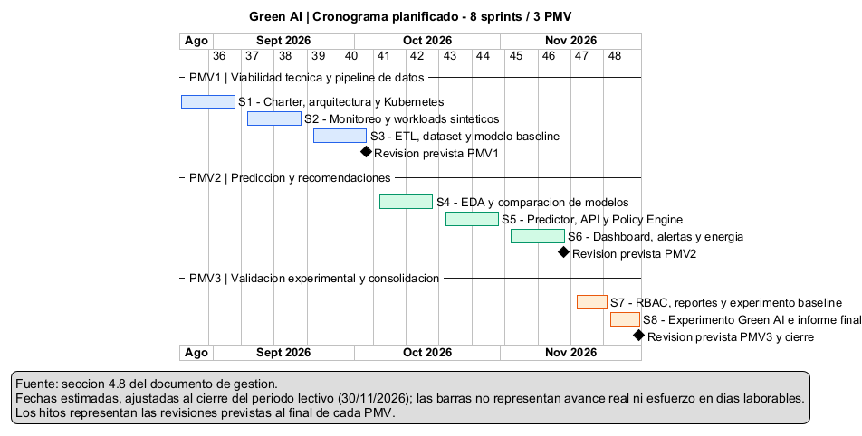

Figura VII.5.3. Fundamentación metodológica y fechas de corte oficial del proyecto.

#### VII.5.5. Trazabilidad de Hitos de Cierre y Criterios de Transición entre PMVs

La transición entre fases responde a compuertas de decisión (*Decision Gates*) sustentadas en criterios de calidad verificables:

Tabla 24. Hitos de cierre y criterios de transición entre PMVs

|Hito / PMV|Período|Entregables verificados / En desarrollo|Criterio de cierre y decisión técnica|Estado real de verificación|
|---|---|---|---|---|
|PMV1 (Hito H2)|25/08/2026 – 03/10/2026|Simulador de telemetría, Prometheus, servicio de monitoreo en Java (112 tests), API Gateway y frontend estático.|Telemetría continua cada 15 segundos sin pérdidas críticas y persistencia relacional verificada. Decisión: **Aprobado (GO a PMV2)**.|Completado y cerrado.|
|PMV2 (Hito H5)|06/10/2026 – 14/11/2026|Modelo predictivo Random Forest a 15 min (MAE 3.22 pp, RMSE 4.59 pp en validación; MAE 3.85 pp en test), API REST en FastAPI (100 tests), Policy Engine desacoplado (`executionAllowed=false`), alertas de observabilidad y cálculo de energía modelada.|Superación de baselines clásicos (30 % de reducción de error sobre persistencia), tiempo de inferencia compatible con el ciclo de 15 s y ausencia de ejecuciones autónomas destructivas. Decisión: **En proceso de validación final**.|En ejecución activa (Sprint 6).|
|PMV3 (Hito H7)|17/11/2026 – 30/11/2026|Ingeniería inversa del sistema (7 fases), reportes FURPS+/OWASP (olas 2 y 3, re-medición), reporte ICACIT, acta de pruebas con usuarios finales, resultados de pruebas de rendimiento y métricas de ML, proceso de desarrollo y CI/CD documentados, informe final con guía de uso y manual de instalación, artículo en inglés con trazabilidad, póster y video con 7 operaciones.|Entregables completos y coherentes entre sí (informe, artículo y video), con evidencia verificable (PR revisados, CI en verde, DoD por tarjeta, hallazgos re-medidos, acta de reunión, métricas con su fuente). Decisión: **Proyectado para sustentación**.|Planificado para Sprints 7 y 8.|

### VII.6. RESULTADOS DE LA GESTIÓN DEL PROYECTO Y CONTROL DEL TABLERO TRELLO

#### VII.6.1. Reestructuración, Saneamiento y Flujo Unificado bajo Lista de Cotejo S10

En atención directa a las observaciones de la auditoría docente de la Semana 10, el equipo ejecutó un proceso integral de depuración, saneamiento y reorganización del tablero ágil, trasladándolo formalmente al **espacio oficial asignado (workspace UC)** y adecuando su estructura a las **11 listas normadas por la lista de cotejo S10**:

1. **Product Backlog:** contiene las Historias de Usuario priorizadas de todo el proyecto (HU-01 a HU-20), catalogadas por épicas y asociadas a sus respectivos PMV.
2. **Sprint Backlog:** alberga las historias y tareas técnicas comprometidas para el sprint en curso.
3. **Refinamiento de expertos:** reservada para la revisión técnica de requerimientos y retroalimentación de especialistas.
4. **To Do:** actividades planificadas pendientes de iniciar dentro del sprint activo.
5. **In Progress:** componentes de software en codificación activa por los ingenieros asignados (con límite de trabajo en proceso - WIP).
6. **QA-Testing:** Historias de Usuario que han concluido la codificación y se encuentran bajo pruebas unitarias, verificación de criterios BDD (Given-When-Then) y pruebas de contrato.
7. **Done:** tarjetas 100 % finalizadas que cumplen estrictamente con la *Definition of Done* (DoD), con enlaces directos a commits del monorepo y reportes de pruebas automatizadas.
8. **Roles de Scrum:** tarjetas informativas que detallan las funciones, responsabilidades y datos de contacto de cada integrante del equipo (PO, SM, Desarrolladores y apoyo técnico).
9. **Daily Scrum:** tarjetas de registro auditable de las sincronizaciones tri-semanales del equipo.
10. **Sprint Review:** actas formales de demostración del incremento y retroalimentación del asesor al cierre de cada sprint.
11. **Sprint Retrospective:** documentación de lecciones aprendidas y planes de acción bajo el ciclo PDCA al cierre de cada fase.

Todas las tarjetas del tablero se estandarizaron incorporando: fechas límites de vencimiento, checklists interactivos con criterios de aceptación Given-When-Then y DoD, miembros responsables asignados, etiquetas codificadas por fase (`PMV1`, `PMV2`, `PMV3`) y por dominio técnico (`Backend`, `Frontend`, `Machine-Learning`, `Infraestructura`, `QA`), descripciones técnicas detalladas y registro de comentarios para auditoría de avances.

CAPTURA-PENDIENTE-C201: Vista panorámica del tablero oficial Green AI en Trello dentro del workspace oficial UC, mostrando las 11 listas normadas por la lista de cotejo S10 y las tarjetas organizadas por PMV. Se toma desde la interfaz web de Trello en el workspace oficial UC.

Figura VII.6.1. Vista panorámica del tablero oficial de Trello en el workspace UC con las 11 listas según la lista de cotejo S10.

CAPTURA-PENDIENTE-C202: Tarjeta de Historia de Usuario detallada (HU-03 de predicción de demanda o HU-01 de observabilidad) mostrando descripción con criterios BDD (Given-When-Then), checklist de aceptación, fechas, miembros asignados, etiquetas de PMV y área técnica, y comentarios de trazabilidad. Se toma desde el modal de tarjeta en Trello.

Figura VII.6.2. Detalle de tarjeta de Historia de Usuario en Trello con criterios BDD, checklist, etiquetas y comentarios de seguimiento.

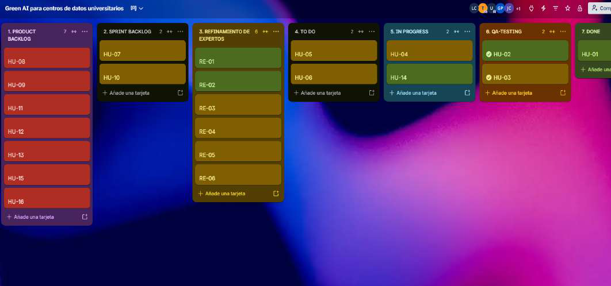

Figura VII.6.3. Registro histórico del tablero de trabajo Kanban en Trello.

#### VII.6.2. Estado de Avance Cuantitativo y Trazabilidad de Historias de Usuario

Al corte de auditoría registrado en el tablero previo con fecha 29 de octubre de 2026 (Semana 10 / Sprint 5), se reportó un avance de 22 de 41 actividades técnicas de ingeniería completadas (53.6 % de avance global referencial). Con la migración y estandarización al workspace oficial UC, el estado de avance se consolida en función de las Historias de Usuario y los compromisos de cada PMV:

- **PMV1 (Sprints 1 a 3 | 100 % Ejecutado):** el 100 % de las historias asociadas a la observabilidad y persistencia de telemetría (HU-01 [Visualización de telemetría multirrecurso], HU-02 [Persistencia de métricas] y HU-15 [Autenticación y sesiones]) se encuentran en la columna **Done**, con sus criterios Given-When-Then validados y suites automatizadas superadas (Monitoring: 112 pruebas, Gateway Java: 12 pruebas, Gateway Go: 30 pruebas).
- **PMV2 (Sprints 4 a 6 | En ejecución avanzada):** las historias HU-03 (Predicción de demanda de CPU con Random Forest), HU-04 (Comparación empírica frente a baselines), HU-06 (Generación de recomendaciones desacopladas), HU-07 (Modo Recommendation-Only con `executionAllowed=false`), HU-08 (Guardrails de SLA en Policy Engine) y HU-11 (Métricas de consumo energético modelado P(u)) cuentan con implementación y pruebas unitarias completas (Prediction: 100 pruebas, Data Processing: 121 pruebas). Se encuentran en transición entre **QA-Testing** e **In Progress** las actividades de visualización avanzada en frontend y afianzamiento de alertas en Grafana.
- **PMV3 (Sprints 7 y 8 | Planificado):** el trabajo se centra en procesos y entregables de la Unidad IV (tareas 7.1–8.7, §VII.5.3) y no en nuevas historias funcionales. HU-13 y HU-14 ya cuentan con implementación en el Sprint 6; el experimento comparativo (HU-16) se ejecutó sobre el conjunto de prueba (§VIII.3.1) y su ampliación, junto con la huella de carbono CO2e (HU-10), queda como trabajo futuro, fuera del alcance del periodo lectivo.

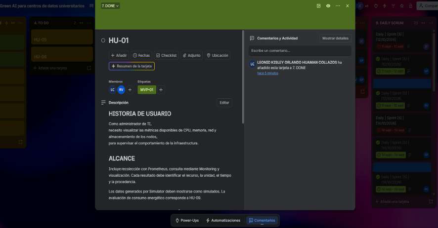

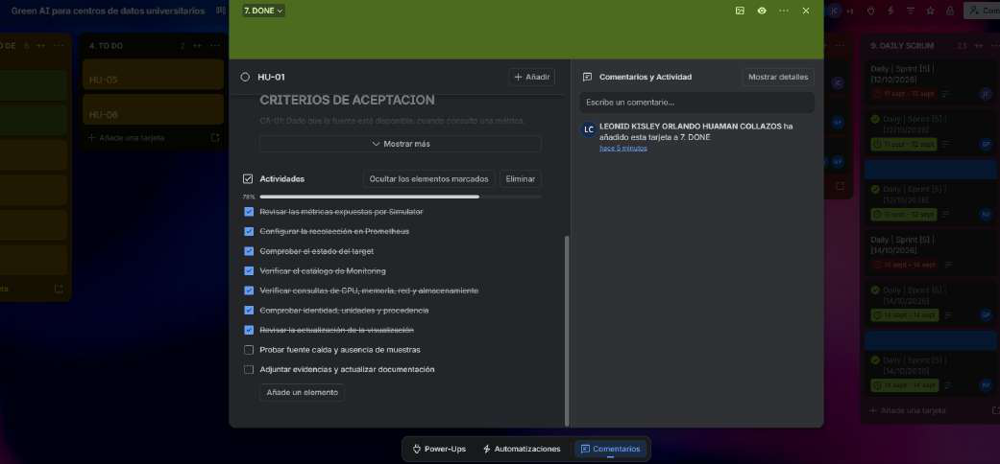

Figura VII.6.4. Trazabilidad de avance cuantitativo y estado de tarjetas de Historias de Usuario.

#### VII.6.3. Trazabilidad de Ceremonias y Registro Auditable de Calidad

Para documentar la disciplina metodológica exigida por el marco de trabajo y las auditorías de calidad ICACIT, el tablero en workspace UC incorpora tarjetas específicas para el registro auditable de las ceremonias ágiles:

1. **Sincronizaciones periódicas (Daily Scrum):** documentadas en la lista *Daily Scrum* mediante tarjetas semanales donde cada integrante registra sus respuestas a las preguntas normadas: a) ¿Qué avancé desde la última sesión?, b) ¿Qué realizaré hoy? y c) ¿Qué impedimentos o bloqueos técnicos existen?
2. **Revisión del Incremento (Sprint Review):** registradas en la lista *Sprint Review* con actas de demostración funcional presentadas ante el asesor académico (Ing. Jorge Guevara), incorporando los compromisos y retroalimentaciones recibidas.
3. **Retrospectiva del Equipo (Sprint Retrospective):** documentadas en la lista *Sprint Retrospective* mediante análisis PDCA, evaluando lo que funcionó bien, oportunidades de optimización y compromisos concretos para los sprints sucesivos.

CAPTURA-PENDIENTE-C203: Tarjeta de sincronización ágil Daily Scrum en Trello estructurada con las tres preguntas estándar (¿qué hice?, ¿qué haré?, bloqueos) y la participación registrada de los cuatro integrantes del equipo. Se toma desde la lista Daily Scrum en Trello en el workspace oficial UC.

Figura VII.6.5. Tarjeta de sincronización Daily Scrum documentada en Trello con el reporte de los integrantes del equipo.

CAPTURA-PENDIENTE-C204: Tarjeta de Sprint Review y Sprint Retrospective del PMV1 en Trello, mostrando el acta de demostración funcional, retroalimentación del asesor y matriz PDCA de compromisos de mejora continua. Se toma desde las listas Sprint Review y Sprint Retrospective en Trello en el workspace oficial UC.

Figura VII.6.6. Tarjetas de Sprint Review y Sprint Retrospective con evaluación PDCA y lecciones aprendidas al cierre del PMV1.

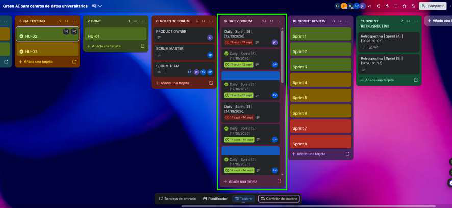

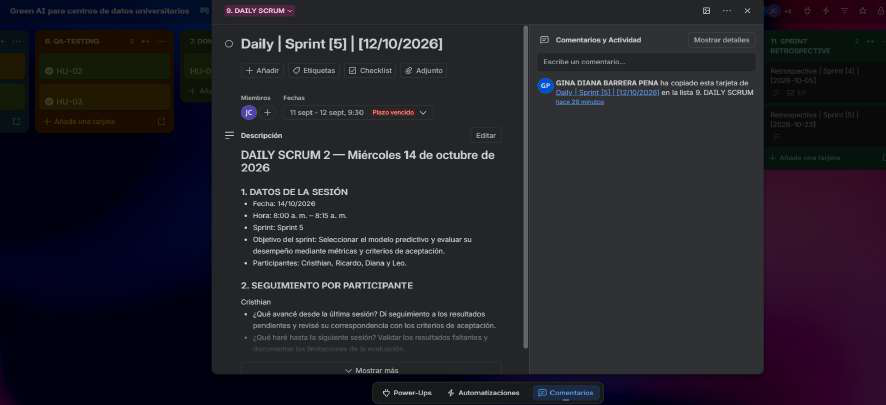

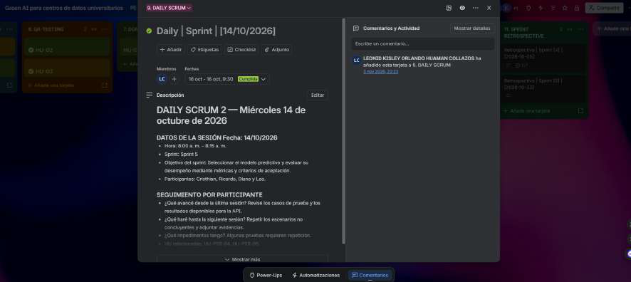

Figura VII.6.7. Registro de evidencias y ceremonias ágiles en el tablero Trello.

#### VII.6.4. Evidencias de la gestión del proceso en Trello (PMV3)

En el PMV3 la gestión del proceso se evidencia con la convención `PMVn-HUxx` en el título de cada tarjeta y con el checklist de la *Definition of Done* (§VII.3) completo antes de mover una tarjeta a *Done*. Las capturas siguientes se incorporarán cuando el equipo aplique la guía del tablero; hasta entonces permanecen como marcadores pendientes.

CAPTURA-PENDIENTE-C312: Tablero de Trello con los títulos de las tarjetas en formato PMVn-HUxx (por ejemplo PMV2-HU03) y las tarjetas distribuidas por estado en las listas To Do, In Progress, QA-Testing y Done. Se toma desde la interfaz web de Trello en el workspace oficial UC.

Figura VII.6.8. Tablero de Trello con tarjetas tituladas PMVn-HUxx y distribuidas por estado.

CAPTURA-PENDIENTE-C313: Tarjeta de Trello abierta con el checklist de la Definition of Done completo (criterios BDD, pruebas automatizadas, Pull Request revisado, contratos OpenAPI, sin secretos, evidencia auditable), miembro responsable y fecha. Se toma desde el modal de la tarjeta en Trello.

Figura VII.6.9. Tarjeta de Trello con el checklist de la Definition of Done completo.

### VII.7. Gestión de Cambios Técnicos (Noviembre de 2026)

Conforme a las directrices del PMBOK sobre el Control Integrado de Cambios, todo ajuste sobre la arquitectura, la infraestructura o el alcance del proyecto se gestiona mediante acciones preventivas o correctivas documentadas en un registro formal de cambios (Change Log). Durante el mes de noviembre de 2026, el equipo de ingeniería implementó una reestructuración técnica orientada a subsanar observaciones docentes, optimizar el uso de recursos computacionales y consolidar la reproducibilidad experimental:

Tabla 25. Registro de control de cambios técnicos

|ID|Fecha|Cambio técnico implementado|Tipo de acción|Motivo técnico / Justificación|Impacto en el sistema y evidencia en el repositorio|
|---|---|---|---|---|---|
|CHG-01|Octubre 2026|Integración del motor de recomendaciones dentro del servicio Prediction|Acción correctiva|Reducir la complejidad operacional y evitar el despliegue de un microservicio independiente adicional para toma de decisiones.|Se conserva íntegro el contrato de API `/api/recommendations/v1/*`; simplificación del despliegue en un único contenedor Python.|
|CHG-02|06/11/2026|Migración integral a monorepo unificado con un solo Git y ramas `main` (prod) y `test` (dev)|Acción correctiva y preventiva|Existencia de múltiples repositorios Git anidados y desincronizados que dificultaban la trazabilidad y las pruebas integradas.|Eliminación de gitlinks huérfanos; adopción de ramas estándar; decisiones arquitecturales D-01 a D-04 documentadas en `docs/DECISIONES.md`.|
|CHG-03|06/11/2026|Implementación de perfil SQLite para desarrollo local desacoplado|Acción preventiva|Eliminar la dependencia estricta de conectividad a bases de datos cloud Supabase durante la ejecución de pruebas unitarias y desarrollo local.|Data Processing ejecuta 114 pruebas de contrato común entre SQLite y PostgreSQL/PostgREST; decisión D-05; soporte para 100,000 registros sintéticos.|
|CHG-04|06/11/2026|Desarrollo de API Gateway alternativo en Go|Acción de optimización preventiva|El Gateway original en Spring Boot consumía ~283 MiB de RAM en reposo (imagen de 520 MB), comprometiendo el límite de planes gratuitos en la nube (< 512 MiB).|El Gateway en Go reduce el consumo a ~10-16 MiB de RAM (imagen de 16 MB); 30 pruebas unitarias y 0 diferencias en diff-testing (39 casos verificados; D-06).|
|CHG-05|06/11/2026|Honestidad experimental: corrección de métricas de ML (Random Forest como modelo oficial)|Acción correctiva (observación docente)|El informe previo reportaba cifras sin respaldo experimental reproducible (XGBoost con RMSE 7.1 %, 45 ms, etc.).|Adopción transparente del pipeline de Random Forest a 15 min: MAE de 3.22 y RMSE de 4.59 pp en validación, MAE de 3.85 en test; explicitación de telemetría simulada.|
|CHG-06|07/11/2026|Optimización multi-etapa de la imagen Docker de Prediction Service|Acción de optimización técnica|La imagen Docker original pesaba 2.85 GB debido a herramientas de notebook y librerías de entrenamiento no requeridas en inferencia en vivo.|Reducción del tamaño de la imagen a 510 MB y memoria en reposo a ~122 MiB mediante compilación multi-etapa; 100 pruebas pasadas y verificación en smoke.|
|CHG-07|06/11/2026|Adaptación de formato de reportes históricos a JSON/CSV estructurado vía API|Acción correctiva|La generación de documentos PDF en el backend introducía dependencias pesadas y riesgo de fallos de memoria en contenedores pequeños.|Implementación del endpoint `GET /api/processing/v1/reports/historical-summary` con exportación JSON/CSV (121 pruebas pasadas en Data Processing) y Markdown.|
|CHG-08|Noviembre 2026|Preparación de entorno de Staging en Render desde la rama `test`|Acción preventiva (observación docente)|La Guía de laboratorio 11 exige demostrar los servicios en un entorno cloud de calidad accesible mediante URLs públicas y no solo en localhost.|Configuración de servicios web para Gateway Go, Prediction y Data Processing; documentación en `docs/GUIA-DESPLIEGUE-RENDER.md` y decisión D-07.|
|CHG-09|11/11/2026|Reenfoque del PMV3 hacia procesos de software y documento final con guía de uso|Acción correctiva (alineación con el curso)|El curso es de procesos de software; los Sprints 7 y 8 (17/11–30/11) se redefinen para documentar y verificar los procesos y entregar el documento final.|Tareas 7.1–8.7 en §VII.5.3 (ampliadas el 11/11 para cubrir los entregables de la Unidad IV) y Gantt actualizados; RBAC VIEWER y reportes JSON/CSV se mantienen como hechos del Sprint 6; PDF, CO2e (HU-10) y ampliación del experimento (HU-16) pasan a trabajo futuro.|

# VIII. PRUEBAS, RESULTADOS Y DISCUSIÓN

### VIII.1. Prueba de Concepto (PoC) de Inteligencia Artificial

#### VIII.1.1. Naturaleza experimental y propósito de la PoC (Semanas 1–4 / Sprints 1–2)

La Prueba de Concepto (PoC) de Inteligencia Artificial se diseñó como un entorno experimental acotado para abordar la incertidumbre técnica asociada al requerimiento RF-09 e historia de usuario HU-03. El propósito central consistió en determinar empíricamente si las series temporales de telemetría de utilización de CPU, agregadas a ventanas de 5 minutos, contienen estructura y patrones estacionales suficientes para estimar la demanda a un horizonte de 15 minutos superando referencias heurísticas simples (persistencia y media móvil), manteniendo una latencia de inferencia compatible con la operación asistiva.

La PoC no contempló la ejecución de acciones autónomas ni modificaciones directas sobre la infraestructura de servidores, sino la resolución de la incertidumbre algorítmica sobre el conjunto de datos de desarrollo `dataset-sim-001`, generado sintéticamente a partir de modelos estadísticos de carga académica.

#### VIII.1.2. Formulación de la hipótesis técnica (H1)

La hipótesis técnica (H1) se formuló en los siguientes términos:

> Un modelo de aprendizaje automático supervisado basado en árboles de decisión (Random Forest o XGBoost) obtiene un error absoluto medio (MAE) inferior al del baseline de persistencia para un horizonte de predicción de 15 minutos sobre el conjunto de validación, manteniendo una latencia de inferencia en el percentil 95 (p95) inferior a 2 000 ms.

Los criterios de aceptación cuantitativos establecidos para validar H1 fueron:

1. Error absoluto medio (MAE) del modelo supervisado menor que el baseline de persistencia y menor que el baseline de media móvil sobre el split de validación.
2. Error cuadrático medio (RMSE) en intervalos de alta demanda y picos menor que el del baseline de persistencia.
3. Latencia de inferencia percentil 95 inferior a 2 000 ms.

Las métricas de error se expresan en puntos porcentuales (pp) de utilización de CPU (escala de 0 a 100), evitando la ambigüedad metodológica de calcular porcentajes relativos sobre variables acotadas. El cumplimiento de H1 demuestra viabilidad predictiva algorítmica sobre datos sintéticos, pero no constituye por sí mismo evidencia de ahorro de energía física ni garantía de cumplimiento futuro de acuerdos de nivel de servicio (SLA) en entornos de producción.

#### VIII.1.3. Protocolo experimental y resultados de alternativas

El protocolo experimental empleó el conjunto de datos sintético `dataset-sim-001` (80 640 muestras brutas a cadencia de 15 segundos, remuestreadas a intervalos regulares de 5 minutos, almacenado en `software/prediction/data/raw/sample_dataset.json` con su suma de verificación SHA-256 registrada en el manifiesto de reproducibilidad).

El vector de características para la inferencia incluyó: utilización actual de CPU ($t$), retardos temporales ($t-1$, $t-2$, $t-3$), estadísticos móviles sobre ventana deslizante (media, desviación estándar, mínimo y máximo), y componentes cíclicas temporales (hora, minuto y día codificados mediante funciones seno y coseno). Se aplicó una división cronológica estricta sin barajado (*no shuffle*): 70 % para entrenamiento, 15 % para validación ($n = 125$ muestras) y 15 % para prueba ($n = 129$ muestras). La ausencia de fuga de información hacia el futuro (*anti-leakage*) se validó mediante pruebas automatizadas unitarias (`tests/unit/test_anti_leakage.py`) con semilla determinista 42.

Se evaluaron cuatro alternativas algorítmicas bajo idénticas condiciones sobre el conjunto de validación para el horizonte de 15 minutos:

Tabla 26. Comparación de alternativas algorítmicas de predicción

| Alternativa | Tipo de modelo | MAE (pp CPU) | RMSE (pp CPU) | sMAPE (%) | MAE alta demanda (>80 %, n=32) | MAE en picos (n=13) | Latencia media (ms) |
|---|---|---|---|---|---|---|---|
| E1: Persistencia | Baseline trivial ($y_{t+15} = y_t$) | 4,61 | 6,39 | 11,16 | 5,43 | 8,99 | 0,09 |
| E2: Media móvil | Baseline estadístico (ventana 15 min) | 3,74 | 5,19 | 9,17 | 4,44 | 7,25 | 4,71 |
| **E3: Random Forest** | **Ensamble de árboles (Seleccionado)** | **3,22** | **4,59** | **7,85** | **3,58** | **6,12** | **26,60** |
| E4: XGBoost | Gradient boosting supervisado | 3,46 | 4,79 | 8,46 | 3,86 | 6,21 | 18,70 |

Sobre el conjunto de prueba independiente (*test set*, $n = 129$), el modelo seleccionado (**Random Forest Regressor**) alcanzó las siguientes métricas definitivas:

* **MAE en test:** 3,85 puntos porcentuales de CPU.
* **RMSE en test:** 5,45 puntos porcentuales de CPU.
* **sMAPE en test:** 7,67 %.
* **MAE en picos de test:** 8,45 puntos porcentuales de CPU.

**Contraste de H1 y corrección de modelo:**
El modelo **Random Forest Regressor** superó a la persistencia con una reducción del MAE del 30,15 % (3,22 pp frente a 4,61 pp) y superó a la media móvil en 13,90 % (3,22 pp frente a 3,74 pp). La latencia media de inferencia (26,60 ms en procesamiento por lote) cumplió holgadamente con la restricción de 2 000 ms. Por consiguiente, se acepta la hipótesis H1.

Se rectifica formalmente que **XGBoost no fue el modelo ganador** para el horizonte de 15 minutos (obtuvo un MAE de 3,46 pp frente a 3,22 pp de Random Forest). La versión previa del informe citó a XGBoost como modelo final con un RMSE del 7,1 %, cifra que no corresponde a la ejecución determinista del pipeline. El modelo empaquetado y expuesto por el microservicio Prediction Service en el prototipo es Random Forest Regressor. Asimismo, se reitera que las métricas proceden de telemetría simulada y no de un clúster físico en producción.

#### VIII.1.4. Trazabilidad MLOps y comportamiento en alta demanda y picos

Para garantizar la reproducibilidad y auditabilidad técnica exigida por el atributo ICACIT AG-I11 (Uso de Herramientas Modernas), el entrenamiento y registro de métricas se integró con MLflow Tracking. El experimento se registró bajo el identificador formal `computational-demand-prediction`, con el run `random_forest_15m` reportando el MAE de test de 3,85 pp, complementado con el manifiesto `software/prediction/results/manifest.json` que fija el hash SHA-256 del código, datos y parámetros de configuración.


Figura VIII.1. Registro y trazabilidad del experimento de entrenamiento de Machine Learning en MLflow Tracking UI.

En intervalos de alta utilización (> 80 % CPU, $n = 32$), el MAE de Random Forest se mantuvo en 3,58 pp en validación. No obstante, al evaluar específicamente los intervalos de pico extremo ($n = 13$), el MAE aumentó a 6,12 pp en validación y a 8,45 pp en prueba. Este comportamiento evidencia que el error se duplica en escenarios de sobrecarga crítica, constituyendo la principal limitación del modelo. Al tratarse de una tarea de regresión continua de CPU, se utilizan métricas MAE y RMSE; no se reporta métrica F1 al no haberse implementado una tarea formal de clasificación binaria de eventos.

#### VIII.1.5. Dictamen oficial de gobierno de la PoC: GO CON CONDICIONES

A partir de los resultados obtenidos, el comité técnico emitió un dictamen formal de **GO CON CONDICIONES** (Viabilidad técnica predictiva aprobada sujeta a cinco condiciones de ingeniería para el PMV3):

1. **[C1] Validación con trazas reales o abiertas:** Evaluar el pipeline sobre trazas abiertas de producción (como el repositorio Bitbrains utilizado en la literatura indexada) o telemetría real del campus para contrastar la generalización del modelo fuera del entorno sintético.
2. **[C2] Mitigación del error en picos:** Implementar mecanismos de calibración o modelos especializados para mitigar el incremento del error durante eventos de alta exigencia académica (matrícula y exámenes).
3. **[C3] Respaldo de contingencia (Fallback):** Mantener el baseline de persistencia y media móvil como mecanismos de respaldo en el microservicio ante demoras o fallos en la inferencia del modelo.
4. **[C4] Formalización del modelo proxy de potencia eléctrica:** Declarar explícitamente que la potencia instantánea se estima mediante el modelo lineal proxy $P(u) = P_{idle} + (P_{max} - P_{idle}) \times u$, reconociendo que los valores calculados en kWh provienen del comportamiento de CPU y no de sensores físicos de distribución de potencia (PDU) en el laboratorio.
5. **[C5] Gobernanza en modo asistivo (Recommendation-Only):** Restringir la operación del motor de políticas al modo de solo recomendación (`executionAllowed = false`), exigiendo revisión y confirmación humana previa a cualquier ajuste en la infraestructura.


Figura VIII.2. Formulación del modelo proxy lineal de potencia eléctrica instantánea P(u) en función de la utilización computacional.

---

### VIII.2. Pruebas y Evidencias de Ejecución por Producto Mínimo Viable (PMV1, PMV2 y PMV3)

Para verificar el cumplimiento funcional y contractual del sistema, se estructuraron suites de pruebas automatizadas por microservicio, ejecutadas de forma reproducible sobre el monorepo del proyecto.

#### Resumen consolidado de pruebas automatizadas por servicio

La verificación automatizada comprende 333 pruebas unitarias, de integración y de contrato, más una suite de verificación de humo (*smoke test*) de 14 puntos de extremo a extremo:

Tabla 27. Pruebas automatizadas por servicio

| Servicio | Entorno y tecnología de prueba | Pruebas ejecutadas / aprobadas | Alcance técnico cubierto |
|---|---|---|---|
| Monitoring | Maven 3.9 / JUnit 5 | 112 / 112 | Pruebas unitarias, contratos HTTP y recolección desde Prometheus |
| Gateway (Java) | Maven 3.9 / JUnit 5 | 12 / 12 | Enrutamiento perimetral, validación de JWT, roles ADMIN/OPERATOR/VIEWER y CORS |
| Gateway (Go) | Go 1.22 (`go test -race` ×5) | 30 / 30 | Equivalencia funcional perimetral, concurrencia, límites de tasa y validación JWKS |
| Data Processing | Python 3.11 / Pytest | 121 / 121 | Contratos SQLite/PostgreSQL, pipeline ETL, interpolación y reporte CSV |
| Prediction | Python 3.11 / Pytest | 100 / 100 | Pruebas de anti-fuga temporal, validación de esquemas Pydantic, inferencia y recomendaciones |
| Frontend | Node.js (`node --test`) | 48 / 48 | Renderizado de interfaz, lógica de pestañas, Racks, panel de energía y red de flujos |
| Simulator | Python 3.11 / Unittest (Docker) | 10 / 10 | Generación de series sintéticas, perfiles de carga, exportador y señales de término |
| Stack integral | Python 3.11 (`smoke.py`) | 14 / 14 | Validación de integración HTTP End-to-End sobre el ecosistema de servicios |

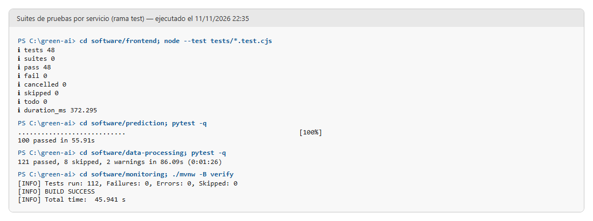
Figura VIII.3. Ejecución consolidada de pruebas automatizadas por servicio en el monorepo de desarrollo.

CAPTURA-PENDIENTE-C302: Salida de ejecución del script de smoke test integral del stack (14/14 comprobaciones aprobadas). Tomada de la consola ejecutando python software/infraestructura/smoke/smoke.py.
Figura VIII.4. Verificación de integración End-to-End mediante smoke test de 14 puntos sobre el ecosistema desplegado.

#### Matriz de trazabilidad por historia de usuario (PMV1 y PMV2)

La siguiente matriz (Tabla 28) documenta la correspondencia entre los requerimientos funcionales, los criterios de aceptación en formato Given/When/Then, los mecanismos de prueba y su estado de cumplimiento:

Tabla 28. Matriz de trazabilidad por historia de usuario (PMV1 y PMV2)

| HU | PMV | Criterio de aceptación (Given/When/Then) | Mecanismo de prueba / evidencia | Estado | Observación metodológica |
|---|---|---|---|---|---|
| HU-01 | 1 | Dado un usuario OPERATOR autenticado, cuando consulta la telemetría actual, entonces recibe series de utilización con metadato `origin=simulated`. | Smoke test de monitoreo (HTTP 200, 50 nodos); `MetricsHttpContractTest` (112 tests). | Aprobado | Telemetría provista por simulador sintético. |
| HU-01 (Seg.) | 1 | Dado un cliente sin token o con firma JWT inválida, cuando invoca el endpoint perimetral, entonces recibe código HTTP 401 Unauthorized. | Smoke test perimetral; suites de Gateway Java (12 tests) y Gateway Go (30 tests). | Aprobado | Filtro perimetral validado en ambos gateways. |
| HU-02 | 1 | Dado un rango temporal de hasta 31 días, cuando solicita registros históricos, entonces obtiene datos paginados y ordenados sin duplicados. | `test_historical_logs_contract.py` (121 tests en Data Processing, contratos duales SQLite y PostgreSQL). | Aprobado | Resuelto con paginación por cursor. |
| HU-03 | 2 | Dada una ventana histórica reciente válida (al menos 6 intervalos), cuando solicita predecir a 15 min, entonces recibe la estimación con metadato `origin=estimated`. | Smoke test de predicción (HTTP 200); 100 pruebas en Prediction Service. | Aprobado | Modelo Random Forest cargado en memoria. |
| HU-03 (Err.) | 2 | Dado un dataset insuficiente (< 20 min) o esquema corrupto, cuando solicita inferencia, entonces el servicio rechaza con HTTP 422 Unprocessable Entity. | `tests/api/test_health_and_predict.py`; verificación DevTools en la nube. | Aprobado | Comportamiento defensivo contractual validado. |
| HU-04 | 2 | Dados idénticos datos y partición temporal, cuando se evalúan los modelos, entonces se generan métricas reproducibles comparativas. | Ejecución de pipeline determinista; `results/metrics/model_comparison.csv`. | Aprobado | Random Forest seleccionado frente a 3 alternativas. |
| HU-05 | 2 | Dado el entrenamiento del modelo, cuando finaliza la ejecución, entonces los parámetros y métricas quedan auditados en MLflow Tracking. | Experimento `computational-demand-prediction`, run `random_forest_15m` en `mlruns/`. | Aprobado con run registrado | Run registrado en almacén local; pendiente captura UI. |
| HU-06 / 08 | 2 | Dada una estimación de CPU y telemetría de contexto, cuando se evalúa la política, entonces se retorna una recomendación con `executionAllowed=false`. | Smoke test de recomendación (HTTP 200, `eligible_for_review`); 13 pruebas de política. | Aprobado | Modo asistivo con guardrails de seguridad activos. |
| HU-07 | 2 | Dada una recomendación emitida, cuando el operador la evalúa en la interfaz, entonces puede registrar su decisión asistiva. | Validación visual en panel web; bloqueo de ejecución autónoma. | Parcial | Bloqueo garantizado; flujo de firma digital en backlog. |
| HU-09 | 2 | Dadas muestras de potencia instantánea, cuando se calcula el consumo, entonces se integra la energía en kWh mediante regla trapezoidal. | Endpoint `/v1/energy`; prueba frontend `energy displays absence of carbon factor`. | Aprobado | Estimación matemática; sin PDU física en laboratorio. |
| HU-11 | 2 | Dado un operador en el frontend, cuando navega entre módulos, entonces visualiza un dashboard integrado con pestañas temáticas. | Archivo `software/frontend/network.html`, estilos modulares y 48 pruebas de UI. | Aprobado | Pestañas de Racks, Métricas, Detalle y Red de flujos. |
| HU-12 | 2 | Dado un escenario de saturación o caída de colector, cuando la métrica cruza el umbral, Prometheus activa la alerta correspondiente. | Reglas `SimulatorTelemetryDown`, `NodeCpuSaturationRisk`, `NodeMemoryPressure`, `PredictedCpuHigh` (promtool OK). | Aprobado | Reglas de alerta validadas sintácticamente. |
| HU-13 | 2 | Dado un operador autenticado, cuando solicita el resumen histórico, entonces puede exportar los datos en formato estructurado JSON y CSV. | Endpoint `GET /api/processing/v1/reports/historical-summary` (suite Data Processing 121 tests). | Aprobado | JSON y CSV operativos; reporte PDF: trabajo futuro, fuera del alcance del periodo lectivo. |
| HU-14 | 3 | Dado un usuario con credenciales, el sistema asigna y restringe accesos según roles ADMIN, OPERATOR y VIEWER (solo lectura). | Gateway Java (12 tests) y Gateway Go (30 tests) validando rechazo HTTP 403 ante permisos insuficientes. | Aprobado | Rol VIEWER incorporado en perfiles perimetrales. |
| HU-15 | 1 | Dado un usuario nuevo, cuando completa el formulario de registro, entonces se crea un perfil en Supabase con rol OPERATOR por defecto. | Script `supabase-auth-setup.sql` con trigger sobre auth.users. | Pendiente de evidencia | Implementado en base de datos; requiere prueba con usuario final. |

---

#### VIII.2.1. Pruebas del PMV1: Viabilidad técnica, ingesta, telemetría y persistencia

##### a) Despliegue de contenedores y entorno de ejecución en Docker Compose y Render

El entorno de desarrollo local se estructuró mediante Docker Compose, aislando los servicios en redes internas para evitar conflictos de puertos y versiones de bibliotecas.

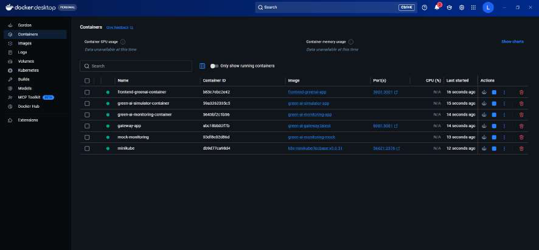
Figura VIII.5. Estado operativo de los contenedores locales en Docker Desktop Dashboard.

Como se observa en la Figura VIII.5, la arquitectura local comprende los contenedores del API Gateway, recolector de monitoreo en Java, simulador de telemetría en Python, servidor Prometheus, microservicio de procesamiento y frontend web. La compilación multi-etapa (*multi-stage build*) se audita en la salida estándar de integración continua:

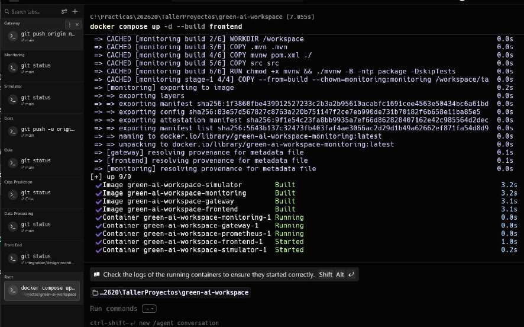
Figura VIII.6. Construcción y arranque de servicios mediante Docker Compose CLI (`docker compose up -d --build`).

En cumplimiento con los requerimientos de entornos de calidad en la nube (Laboratorio 11), el ecosistema se desplegó en la nube pública de Render utilizando contenedores Docker independientes para cada microservicio:

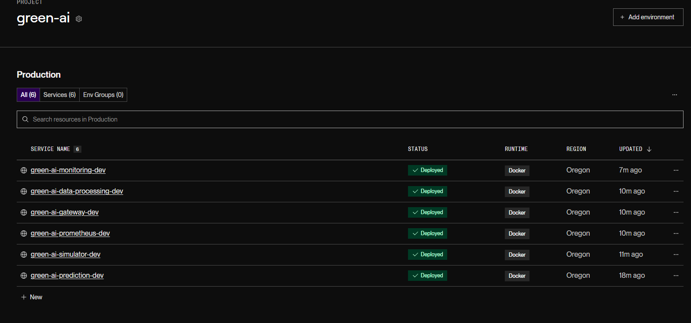
Figura VIII.7. Despliegue operativo de los 6 microservicios del sistema Green AI en Render (región Oregon) utilizando imágenes de contenedores Docker. Prueba: Disponibilidad y compilación limpia de la arquitectura distribuida en la nube pública sin dependencia de localhost. No prueba: No acredita tráfico concurrente de producción institucional ni ausencia de latencia por arranque en frío en instancias compartidas.

##### b) Verificación de agentes e ingesta de telemetría en Prometheus

Prometheus Server se configuró con sondeos de recolección periódica cada 15 segundos hacia los endpoints expuestos por los colectores de métricas.

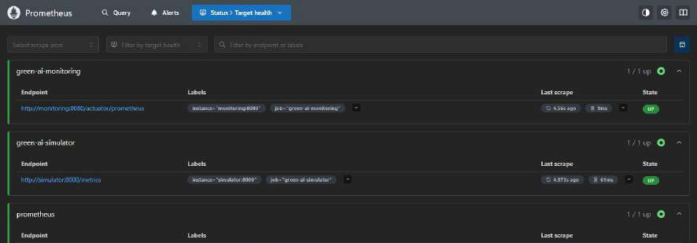
Figura VIII.8. Panel de objetivos de recolección en Prometheus Server (`Status > Target health`).

La Figura VIII.8 certifica la conectividad operativa instantánea de las tres fuentes principales en estado UP: `green-ai-monitoring` (`:8080/actuator/prometheus`), `green-ai-simulator` (`:8000/metrics`) y el automonitoreo de Prometheus (`:9090/metrics`).

De forma complementaria, se estructuraron cuatro reglas de alerta en el archivo `prometheus/alerts.yml`, validadas sintácticamente mediante la utilidad oficial `promtool`: `SimulatorTelemetryDown` (caída del colector por más de 1 minuto), `NodeCpuSaturationRisk` (CPU sostenida > 85 % por más de 2 minutos), `NodeMemoryPressure` (memoria RAM > 90 %) y `PredictedCpuHigh` (alerta proactiva ante estimaciones superiores al 80 % de capacidad).


Figura VIII.9. Panel de reglas de alerta configuradas en Prometheus Server.

##### c) Visualización en tiempo real y muestreo en Grafana

Para auditar visualmente las series temporales en el entorno local, se configuró Grafana conectado a Prometheus como origen de datos.

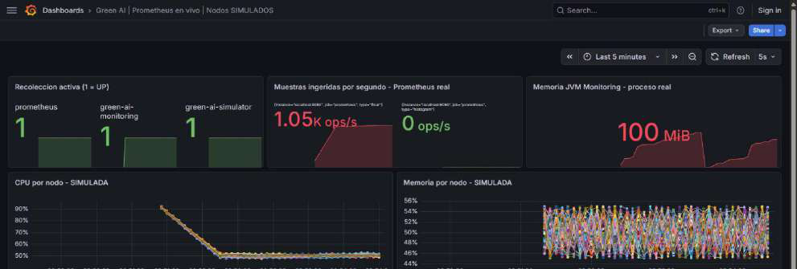
Figura VIII.10. Tablero de observabilidad operativa en tiempo real en Grafana (`Dashboards > Green AI | Prometheus en vivo`).

La Figura VIII.10 documenta la recepción de flujos con una tasa de muestreo agregada de 1,05k ops/s, graficando las variaciones simuladas de CPU, oscilaciones de memoria RAM entre 44 % y 56 %, tráfico de red y consumo de almacenamiento sobre los nodos sintéticos.

##### d) Persistencia relacional y limpieza ETL de datos

La recolección de métricas a intervalos de 15 segundos durante una ventana de observación de 14 días genera teóricamente la siguiente estructura volumétrica:

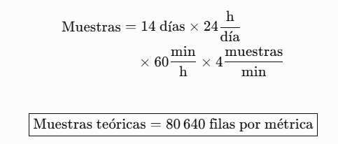
Figura VIII.11. Formulación matemática de la matriz temporal volumétrica requerida para la inferencia.

Debido a discontinuidades transitorias en la recolección (*scraping drops*), la extracción en bruto registró un 3,2 % de registros ausentes:

Tabla 29. Calidad de la ingesta de telemetría y tratamiento aplicado

| Métrica de ingesta | Conteo absoluto | Porcentaje | Estado de calidad y tratamiento |
|---|---|---|---|
| Registros teóricos esperados (14 días a 15 s) | 80 640 | 100,0 % | Matriz regular completa requerida por la ventana de retardos. |
| Registros recibidos en bruto (*raw data*) | 78 059 | 96,8 % | Telemetría observada con marcas de tiempo TIMESTAMPTZ. |
| Registros faltantes / brechas temporales (*gaps*) | 2 581 | 3,2 % | Brechas inferiores a 1 minuto (de 1 a 4 muestras consecutivas). |
| Registros resultantes post-interpolación lineal | 80 640 | 100,0 % | 0,0 % de nulos tras interpolación lineal en ventanas cortas e imputación mediana. |

Se aclara que los 80 640 registros representan la serie temporal de un servidor de referencia utilizada para el benchmark de Machine Learning, y no la suma de todas las métricas de los 50 servidores simulados.

Para generar los datos de prueba del entorno de persistencia y poblar las tablas iniciales de la base de datos relacional PostgreSQL / Supabase, se utilizó el siguiente script de desarrollo:

```python
from datetime import datetime, timedelta
import numpy as np
import pandas as pd

NUM_LOGS = 100000
NUM_SERVIDORES = 50
NUM_USUARIOS = 10

primeros_nombres = ['Carlos', 'Ana', 'Luis', 'María', 'Javier', 'Elena', 'Diego', 'Sofia', 'Mateo', 'Lucía']
segundos_nombres = ['Alberto', 'Isabel', 'Enrique', 'Fernanda', 'Alexander', 'Beatriz', 'Andrés', 'Camila', 'Gabriel', 'Valeria']
primeros_apellidos = ['García', 'Rodríguez', 'López', 'Martínez', 'González', 'Pérez', 'Sánchez', 'Romero', 'Torres', 'Flores']
segundos_apellidos = ['Benítez', 'Vargas', 'Castro', 'Ríos', 'Mendoza', 'Aguilar', 'Navarro', 'Delgado', 'Morales', 'Paredes']

# 1. Generación de tabla Usuarios
usuarios_ids = [f'US{i+1:03d}' for i in range(NUM_USUARIOS)]
usuarios_list = []
for i, usr_id in enumerate(usuarios_ids):
    p_nom = primeros_nombres[i % len(primeros_nombres)]
    s_nom = segundos_nombres[i % len(segundos_nombres)]
    p_ape = primeros_apellidos[i % len(primeros_apellidos)]
    s_ape = segundos_apellidos[i % len(segundos_apellidos)]
    usuarios_list.append({
        'usuario_id': usr_id,
        'nombre_completo': f"{p_nom} {s_nom} {p_ape} {s_ape}",
        'email': f"{p_nom.lower()}.{p_ape.lower()}@greenai.com",
        'password_hash': '$2b$12$eImiTXuWVxfM37uY4JANj...',
        'rol': 'ADMINISTRADOR' if i == 0 else 'OPERADOR',
        'fecha_creacion': datetime.now() - timedelta(days=30)
    })
df_usuarios = pd.DataFrame(usuarios_list)

# 2. Generación de tabla Hardware
hardware_ids = [f'HW{i+1:03d}' for i in range(NUM_SERVIDORES)]
assigned_users = np.random.choice(usuarios_ids, size=NUM_SERVIDORES)
hardware_list = []
for i, hw_id in enumerate(hardware_ids):
    hardware_list.append({
        'hardware_id': hw_id,
        'usuario_id': assigned_users[i],
        'hostname': f'srv-green-{i+1:03d}',
        'ip_address': f'10.0.1.{10+i}',
        'cpu_cores': int(np.random.choice([16, 32, 64])),
        'ram_gb': float(np.random.choice([32, 64, 128])),
        'max_watts': float(np.random.choice([450.0, 600.0, 800.0])),
        'ubicacion_rack': f'Rack-{(i//10)+1:02d}',
        'estado': 'activo',
        'fecha_registro': datetime.now() - timedelta(days=60)
    })
df_hardware = pd.DataFrame(hardware_list)
hw_watts = df_hardware.set_index('hardware_id')['max_watts'].to_dict()

# 3. Generación de tabla Logs
assigned_hw = np.random.choice(hardware_ids, size=NUM_LOGS)
time_array = np.linspace(0, 100, NUM_LOGS)
cpu_base = 50.0 + 30.0 * np.sin(time_array) + np.random.normal(0, 10, NUM_LOGS)
cpu_utilization = np.clip(cpu_base, 5.0, 99.0)
ram_utilization = np.clip(cpu_utilization * np.random.uniform(0.7, 1.1, size=NUM_LOGS), 10.0, 95.0)
max_watts_arr = np.array([hw_watts[hw] for hw in assigned_hw])
energia_watts = np.round((cpu_utilization / 100.0) * max_watts_arr * np.random.uniform(0.85, 1.12, size=NUM_LOGS), 2)
temperatura = np.round(22.0 + (cpu_utilization * 0.45) + np.random.normal(0, 1.5, size=NUM_LOGS), 2)
prediccion_watts = np.round(energia_watts * np.random.uniform(0.96, 1.02, size=NUM_LOGS), 2)
start_time = datetime.now() - timedelta(minutes=NUM_LOGS)

df_logs = pd.DataFrame({
    'log_id': [f'LOG{i+1:06d}' for i in range(NUM_LOGS)],
    'hardware_id': assigned_hw,
    'timestamp': [start_time + timedelta(minutes=i) for i in range(NUM_LOGS)],
    'cpu_utilization_pct': np.round(cpu_utilization, 2),
    'ram_utilization_pct': np.round(ram_utilization, 2),
    'temperatura_celsius': temperatura,
    'energia_watts': energia_watts,
    'prediccion_watts': prediccion_watts,
    'accion_recomendada': np.where(cpu_utilization > 80.0, 'Reducir Frecuencia', 'Optimo'),
    'cumple_sla': cpu_utilization < 85.0
})
```

La persistencia de estos conjuntos en PostgreSQL / Supabase y en la base local SQLite de desarrollo se verifica en las vistas relacionales correspondientes:

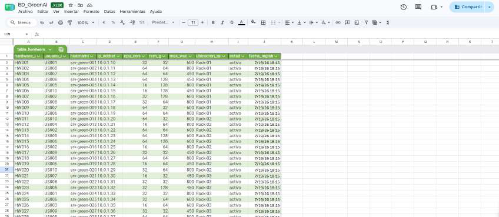
Figura VIII.12. Registros de servidores en la tabla `hardware` en PostgreSQL / Supabase.

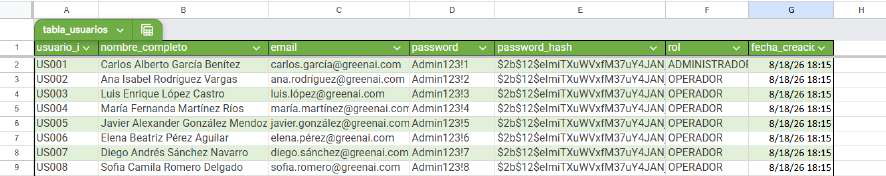
Figura VIII.13. Registros de cuentas de acceso en la tabla `usuario` en PostgreSQL / Supabase.

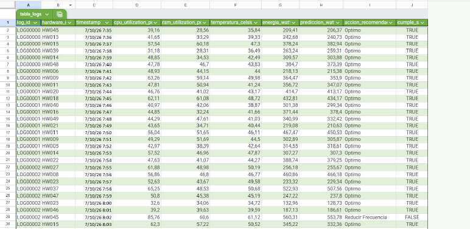
Figura VIII.14. Registros de series temporales en la tabla `logs` en PostgreSQL / Supabase.

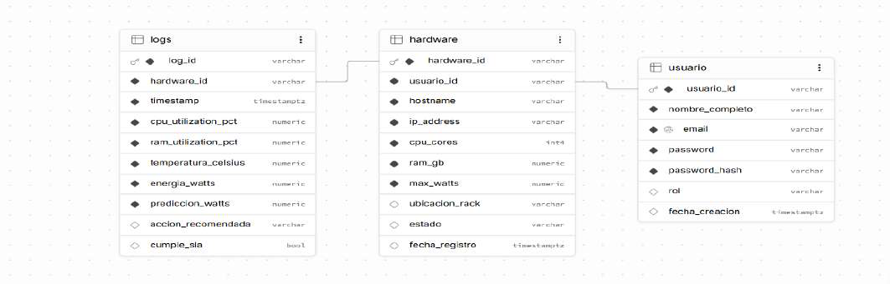
Figura VIII.15. Diagrama Entidad-Relación (ERD) del modelo de persistencia relacional en PostgreSQL / Supabase.

---

#### VIII.2.2. Pruebas del PMV2: Solución predictiva, contratos OpenAPI y dashboard

##### a) Validación de contratos de API REST mediante OpenAPI (Swagger UI)

Los contratos de interfaz entre microservicios se implementaron bajo la especificación OpenAPI 3.1 mediante FastAPI, empleando esquemas de validación estricta con Pydantic en los puertos de entrada.

El sistema contempla dos casos de uso asistivos principales:

1. **Caso de uso predictivo 1 (Inferencia de demanda de CPU):** Estimación de la utilización futura de CPU a 15 minutos ($t+15$) para anticipar variaciones de carga.
2. **Caso de uso predictivo 2 (Recomendación con restricciones operativas):** Evaluación de la predicción y telemetría reciente por el Policy/Safety Engine para generar sugerencias de optimización bajo guardrails de SLA.

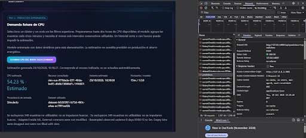
Figura VIII.16. Esquema conceptual del caso de uso de inferencia de demanda de CPU a 15 minutos.

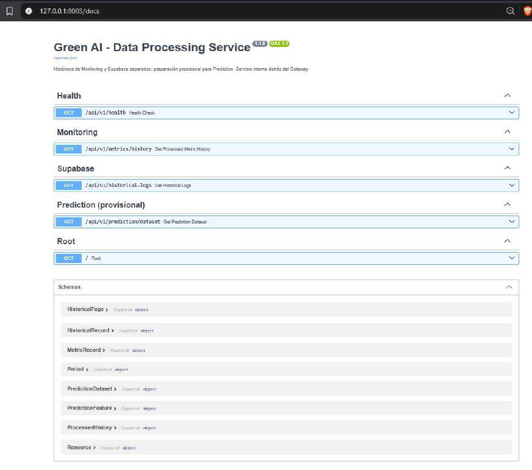
Figura VIII.17. Especificación y contratos OpenAPI (Swagger UI) del Data Processing Service (`/docs`).

En Data Processing Service se auditan los endpoints `GET /api/v1/health`, `GET /api/v1/metrics/history`, `GET /api/v1/historical-logs` y `GET /api/v1/prediction/dataset`. La especificación formaliza los esquemas `HistoricalPage`, `MetricRecord` y `PredictionDataset`.

En el microservicio de inferencia (Prediction Service), se validan las operaciones de disponibilidad y predicción:

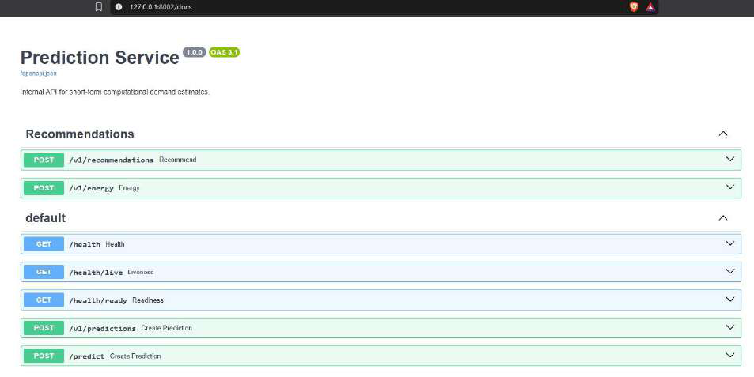
Figura VIII.18. Especificación interactiva OpenAPI (Swagger UI) del microservicio Prediction Service (`/docs`).

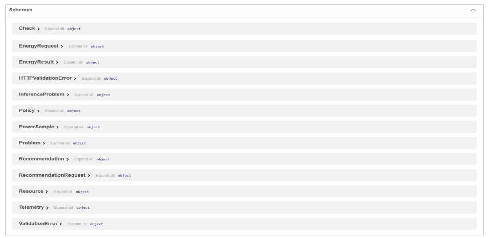
Figura VIII.19. Esquemas Pydantic y estructuras DTO de validación de datos del Prediction Service.

En Prediction Service se comprueban las sondas `GET /health/live` y `GET /health/ready` (que comprueba la carga efectiva del binario Random Forest en memoria), los endpoints de inferencia `POST /v1/predictions` y `POST /predict`, y el endpoint de recomendaciones `POST /v1/recommendations`.

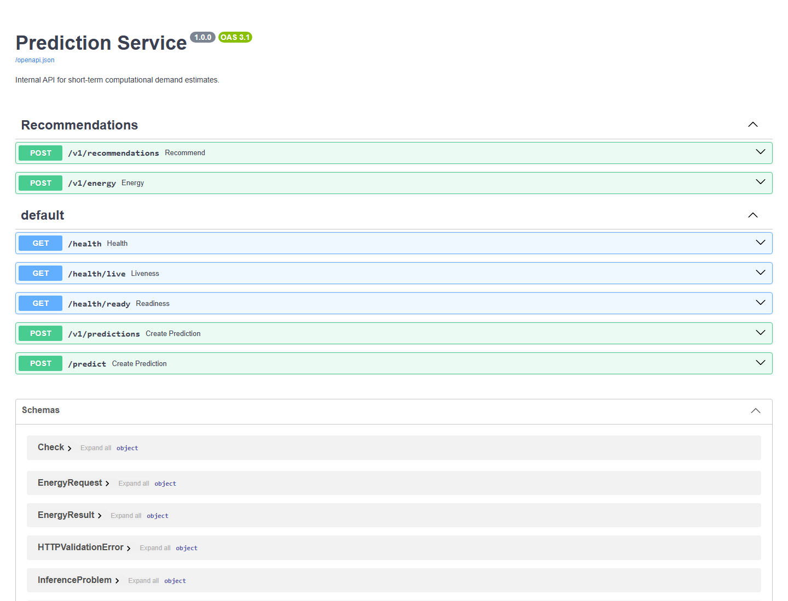
Figura VIII.20. Documentación interactiva OpenAPI (Swagger UI) del microservicio Prediction Service en el entorno desplegado.

##### b) Interfaz web e inferencia predictiva de demanda (Frontend HTML/JS estático)

La capa de presentación web se desarrolló como una aplicación cliente ligera basada en HTML5, CSS3 y JavaScript moderno sin frameworks pesados, servida de manera estática a través de GitHub Pages y empaquetada en contenedores Nginx. Esta decisión de diseño garantiza bajo consumo de memoria en el navegador y elimina la necesidad de capas intermedias de renderizado del lado del servidor.

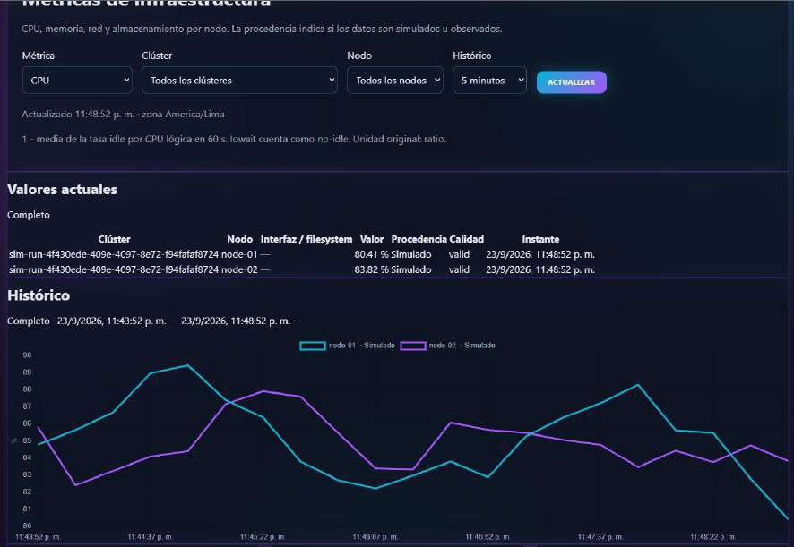
Figura VIII.21. Dashboard de métricas de infraestructura en la interfaz web de usuario.

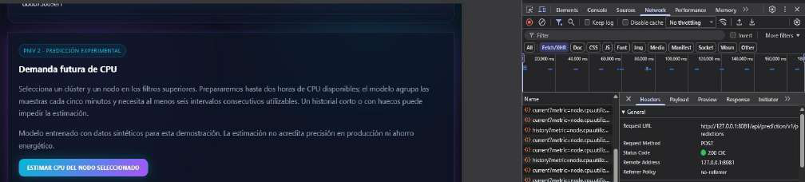
Figura VIII.22. Interfaz web de inferencia predictiva de CPU e integración HTTP End-to-End.

Como se ilustra en las Figuras VIII.21 y VIII.22, la interfaz web consulta métricas en tiempo real a través del API Gateway, indicando de forma explícita la etiqueta de transparencia metodológica `Procedencia: Simulado` y `Modelo entrenado con datos sintéticos`.

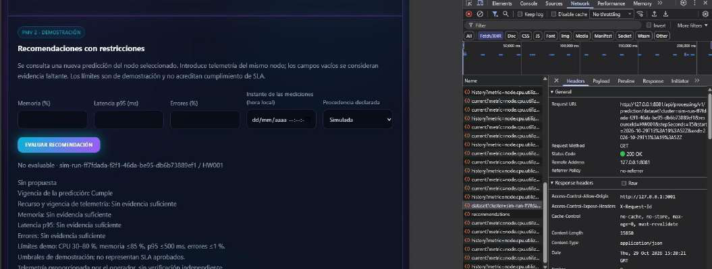
Figura VIII.23. Interfaz web del Policy/Safety Engine y evaluación de recomendaciones con guardrails de SLA.

Para acreditar la ejecución en el entorno en la nube de calidad (GitHub Pages conectado a Render), se capturaron las vistas operativas con sesión real de usuario bajo el rol OPERATOR:

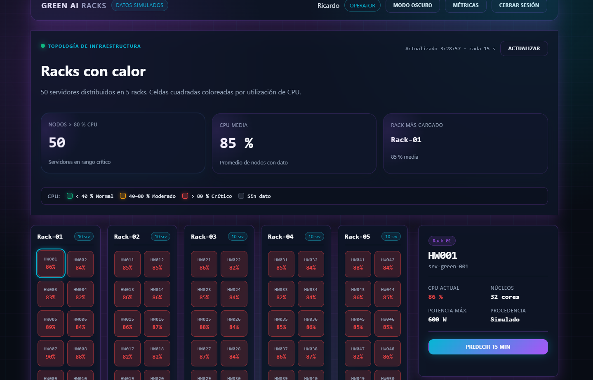
Figura VIII.24. Vista de infraestructura "Racks con calor" en la nube con sesión activa de usuario bajo rol OPERATOR. Prueba: Visualización en vivo de la matriz de 50 servidores distribuidos en 5 racks y consulta de detalle de servidor con autenticación real en GitHub Pages y Render. No prueba: Los valores de telemetría desplegados son sintéticos generados por el simulador; no representan servidores físicos de un centro de cómputo universitario.

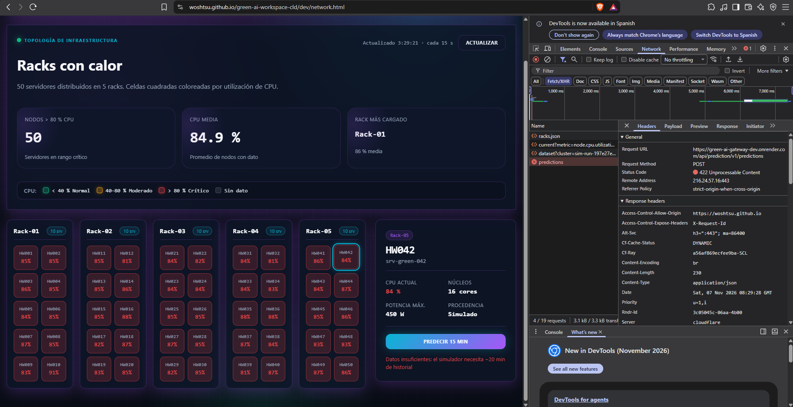
Figura VIII.25. Inspección de red con DevTools ante respuesta HTTP 422 Unprocessable Content por historial insuficiente (`INSUFFICIENT_DATA`). Prueba: Comunicación asíncrona real entre frontend estático en GitHub Pages y API Gateway en Render, validando que el sistema rechaza solicitudes de inferencia cuando no se cuenta con los minutos mínimos de telemetría requeridos. No prueba: No representa una falla de software o caída de servicio, sino el comportamiento defensivo contractual previsto ante datos incompletos.

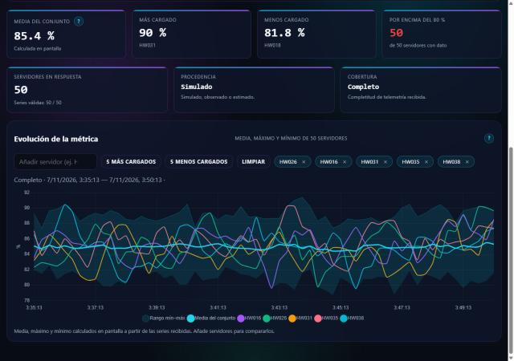
Figura VIII.26. Tablero de evolución temporal multi-servidor mostrando la media del conjunto (85,4 %), área de dispersión mín-máx y comparación de 5 servidores críticos. Prueba: Procesamiento estadístico en cliente y renderizado dinámico de series temporales con procedencia simulada explícita. No prueba: No mide directamente la potencia eléctrica consumida en la toma de pared.

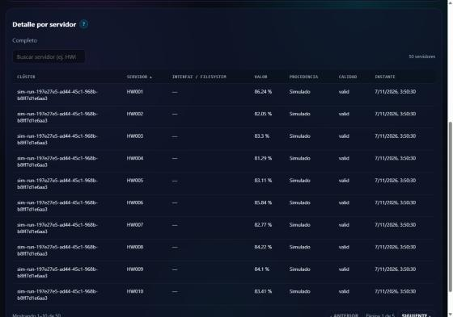
Figura VIII.27. Tabla paginada de telemetría por servidor (HW001 a HW010) con filtros y atributos de calidad. Prueba: Integración con la paginación y ordenamiento del API Gateway para conjuntos de datos de 50 servidores. No prueba: No valida almacenamiento a largo plazo superior al horizonte de retención temporal.

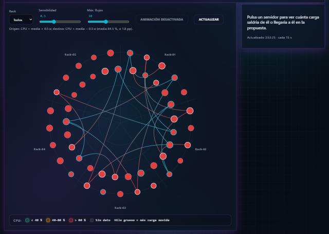
Figura VIII.28. Vista analítica "Red de flujos" en topología circular para evaluación de balanceo de cargas entre racks. Prueba: Capacidad de cálculo del frontend para modelar sugerencias de reubicación de carga térmica entre racks a partir de desviaciones estándar. No prueba: Es una herramienta visual de apoyo; no ejecuta migraciones automáticas ni reconfiguraciones de red física.

A continuación se insertan las referencias de evidencia complementarias solicitadas para los casos de uso principales:

CAPTURA-PENDIENTE-C306: Primer caso de uso de IA desde la aplicación web: inferencia de demanda de CPU a 15 minutos para un servidor en la vista Racks con respuesta 200 OK en entorno desplegado. Tomada desde el navegador web en la aplicación frontend.
Figura VIII.29. Primer caso de uso de IA: predicción de demanda de CPU a 15 minutos visualizada desde la aplicación web desplegada.

CAPTURA-PENDIENTE-C307: Segundo caso de uso de IA desde la aplicación web: evaluación de recomendación asistiva con restricciones operativas y guardrails de SLA en modo Recommendation-Only (executionAllowed=false). Tomada desde el panel de políticas en el navegador web.
Figura VIII.30. Segundo caso de uso de IA: recomendación asistiva con restricciones de seguridad visualizada desde la aplicación web.

CAPTURA-PENDIENTE-C308: Descarga y visualización del reporte histórico consolidado en formato CSV generado por el endpoint GET /api/processing/v1/reports/historical-summary. Tomada del archivo CSV abierto en una aplicación de hojas de cálculo.
Figura VIII.31. Reporte histórico consolidado exportado en formato CSV generado por Data Processing Service.


##### c) Validación en Policy/Safety Engine y comunicación síncrona REST

A diferencia de modelos arquitectónicos basados en buses de mensajería asíncronos complejos, el prototipo actual resuelve la interoperabilidad entre microservicios mediante invocaciones síncronas bajo el estándar REST a través del API Gateway (Spring Cloud Gateway en Java o el Gateway alternativo en Go). Esta simplificación arquitectónica reduce la sobrecarga operativa y elimina componentes de infraestructura en las fases PMV1 y PMV2.

El microservicio de políticas (Policy/Safety Engine) opera en estricto modo **Recommendation-Only** (`executionAllowed = false`). Su función consiste en evaluar las solicitudes de optimización frente a guardrails predefinidos:
- Límite máximo de utilización de CPU: $\text{CPU} \le 80\,\%$.
- Límite de latencia de servicio percentil 95: $\text{latencia} \le 2\,000\text{ ms}$.

Cuando la telemetría es insuficiente o se violan los márgenes de seguridad, el motor emite veredictos preventivos como `"Sin evidencia suficiente"` o `"eligible_for_review"`, garantizando que ninguna acción de reconfiguración se proponga sin respaldo técnico auditable.

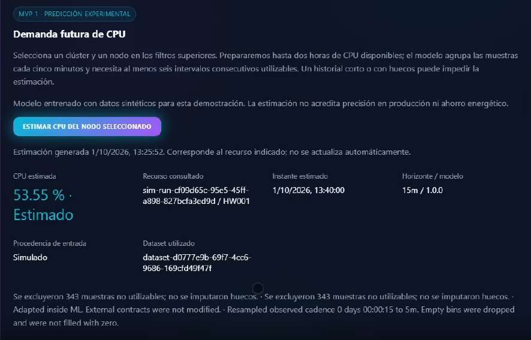
Figura VIII.33. Interfaz web para estimación experimental de demanda de CPU sobre el nodo HW001.

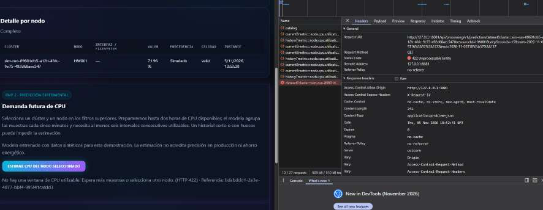
Figura VIII.34. Manejo de error contractual HTTP 422 Unprocessable Entity en la interfaz web ante telemetría temporal insuficiente para inferencia.

Las Figuras VIII.33 y VIII.34 demuestran la interacción real con el endpoint de predicción y el tratamiento de errores contractuales cuando el historial temporal no alcanza la cantidad mínima requerida de muestras.

---

#### VIII.2.3. Pruebas del PMV3: verificación de procesos, calidad y entregables de la Unidad IV (planificadas)

El PMV3 (Sprints 7 y 8, 17/11–30/11/2026) se centra en procesos de software y en los entregables de la Unidad IV. Sus pruebas son verificaciones **planificadas**, sin resultados a la fecha de corte (11/11/2026). Los hitos técnicos previos que sostienen el PMV3 ya se lograron en el Sprint 6 y se evidencian en otras secciones:

1. **Control de acceso por roles (RBAC):** el rol `VIEWER` (solo lectura) junto con `ADMIN` y `OPERATOR` existe en los perfiles de API Gateway Java y Go (§VIII.2.2, HU-14).
2. **Reportería de telemetría:** el endpoint `GET /api/processing/v1/reports/historical-summary` exporta JSON y CSV (HU-13). La exportación PDF queda como trabajo futuro, fuera del alcance del periodo lectivo.
3. **Protocolo baseline:** el experimento comparativo se ejecutó sobre el conjunto de prueba (§VIII.3.1).

La Ola 1 del plan de calidad (07–09/11/2026) se documenta en `docs/evidencias/semana13-ola1-verificacion.md`. Las verificaciones planificadas para los Sprints 7 y 8 son:

Tabla 30. Verificaciones planificadas para el PMV3 (procesos, calidad y entregables)

| Proceso | Verificación planificada | Criterio de aceptación | Evidencia prevista | Sprint | Resp. | Estado |
| --- | --- | --- | --- | --- | --- | --- |
| Ingeniería inversa | Ejecución de las 7 fases (12 prompts) sobre el repositorio, con evidencia por fase | Cada fase deja su salida registrada; el hallazgo se contrasta con el código y la arquitectura documentada | Reporte de ingeniería inversa en `docs/` | 7–8 | R/L | Planificada |
| Desarrollo (flujo Git) | Revisión de los *pull requests* integrados a `test` y `main` | Todo cambio entra por PR con al menos una revisión aprobada; sin commits directos a `main` | Listado de PR en GitHub (C310) | 7 | R | Planificada |
| Integración continua | Revisión del historial de ejecuciones del workflow `ci.yml` | Cada PR integrado tiene su ejecución en verde; los fallos se registran y corrigen | Historial de GitHub Actions (C311) | 7 | L/R | Planificada |
| Calidad (olas 2 y 3) | Cierre de los ítems de `02_plan_furps.md` y `05_plan_owasp.md` y re-medición frente a `01_auditoria_furps.md` y `04_auditoria_owasp.md` | Hallazgos abiertos, cerrados y justificados, cada uno con comando o prueba reproducible | Auditoría final en `docs/calidad/` | 7–8 | G | Planificada |
| Rendimiento y ML | Pruebas de rendimiento de la API (latencia, throughput) y re-cálculo de métricas de ML (MAE, RMSE, error en picos) | Valores reportados con su comando y fuente, sea cual sea el resultado | Salidas de las pruebas y MLflow (indicador 10) | 7 | G/L | Planificada |
| Gestión en Trello | Checklist de DoD por tarjeta y nomenclatura `PMVn-HUxx` | Ninguna tarjeta pasa a *Done* sin DoD completo; todas con título `PMVn-HUxx` | Tablero y tarjeta (C312, C313) | 7 | J | Planificada |
| Usuarios finales | Sesión de prueba del sistema con usuarios finales, retroalimentación y acta de reunión | Tareas de `GUIA-RAPIDA-USUARIO.md` ejecutadas por usuarios ajenos al desarrollo; observaciones y acuerdos registrados | Acta de reunión y registro de retroalimentación (indicador 9) | 8 | J | Planificada |
| Métricas del proceso | Cumplimiento de DoD, HU terminadas por sprint y hallazgos cerrados | Valores con su fuente (exportación de Trello y documentos de calidad) | Tabla de métricas en el informe final | 8 | J | Planificada |
| Informe, artículo y reporte ICACIT | Validación de trazabilidad artículo↔informe y reporte de cumplimiento ICACIT (transversales y específicas) | Cifras y afirmaciones del artículo coinciden con el informe; brechas ICACIT con su sección de corrección | Matriz de trazabilidad y reporte ICACIT | 8 | J/G | Planificada |
| Video y póster | Cotejo contra la lista de cotejo de la Unidad IV: episodios y 7 operaciones demostradas con PMV1, PMV2 y PMV3 | Cubre los ítems 7 y 8 aplicables | Video publicado (URL en el Anexo A) y póster | 8 | Todos | Planificada |

Evidencia que se generará para los indicadores 8, 9 y 10 de la lista de cotejo de la Unidad IV (todo planificado, sin resultados a la fecha de corte):

- **Indicador 8 (arquitectura hexagonal, entorno de calidad y reportes):** reportes FURPS+ y OWASP con re-medición, reporte de ingeniería inversa por fases y ejecución sobre el entorno de pruebas (`test`).
- **Indicador 9 (usuarios finales, 6 puntos):** acta de la reunión con usuarios finales, con asistentes, retroalimentación y acuerdos.
- **Indicador 10 (rendimiento y ML, 6 puntos):** resultados de pruebas de rendimiento y métricas de ML con sus comandos, entradas y fuentes.

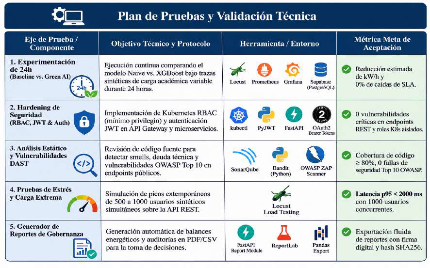
Figura VIII.35. Plan de experimentación comparativa de 24 horas y aseguramiento de calidad (PMV3), referencia de los Sprints previos.

CAPTURA-PENDIENTE-C310: Pull Request en GitHub (rama de trabajo hacia test) con la revisión aprobada y los checks de integración continua en verde. Se toma desde la pestaña Pull requests de GitHub, una vez integrado un PR real del Sprint 7.
Figura VIII.36. Pull Request con revisión aprobada y checks de CI en verde.

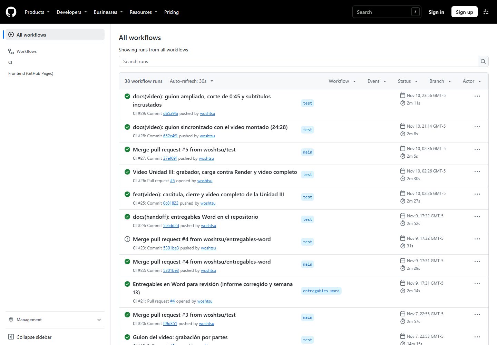
Figura VIII.37. Historial de ejecuciones de GitHub Actions (workflow ci.yml).

---

#### VIII.2.4. Justificación y reconocimiento de limitaciones de herramientas (ICACIT AG-I11)

En cumplimiento con el atributo de egreso ICACIT AG-I11 (Uso de Herramientas Modernas), el equipo analizó críticamente la suite instrumental utilizada:

1. **Herramientas seleccionadas y aplicadas:** Docker Compose, Render, GitHub Pages, Prometheus, Grafana, FastAPI, Spring Boot, Go, scikit-learn y Pytest. Permitieron desplegar una arquitectura microservicial y validar hipótesis experimentales con costo monetario cero (S/ 0,00).
2. **Reconocimiento de limitaciones técnicas:**
   - **Ausencia de sensores de potencia físicos:** La imposibilidad de instrumentar unidades PDU en el laboratorio limitó la evaluación energética a estimaciones matemáticas derivadas de la CPU.
   - **Plataformas PaaS compartidas:** El uso de planes gratuitos en Render conlleva suspensión por inactividad y latencias transitorias por arranque en frío (*cold start*), lo que impide ejecutar pruebas de estrés prolongadas de grado industrial.
   - **Herramientas pesadas descartadas:** Suites avanzadas de análisis dinámico de seguridad (DAST) como OWASP ZAP o pruebas de carga distribuida en Apache JMeter se evaluaron conceptualmente pero se postergaron para etapas de preproducción.

---

### VIII.3. Resultado Resumido de Pruebas y Evaluación Experimental Comparativa

La evaluación por historia de usuario se sintetiza en la comprobación de interfaces de consulta de métricas y de inferencia:


Figura VIII.38. Evidencia de consulta y graficación de métricas de telemetría (HU-01).


Figura VIII.39. Evidencia de consulta de predicción de utilización de CPU a 15 minutos (HU-03).

#### VIII.3.1. Evaluación experimental comparativa: Baseline vs. Green AI (Experimento reproducible)

Para evaluar si el aprovisionamiento predictivo de capacidad ofrece ventajas operativas frente a un enfoque reactivo tradicional, se ejecutó el experimento comparativo formal documentado en el protocolo del PMV3 sobre el conjunto de prueba (*test set*, $n = 126$ intervalos evaluables de 5 minutos, telemetría sintética `dataset-sim-001`).

**Diseño experimental (Condiciones equivalentes):**
- **Estrategia Baseline (Reactiva):** Para el intervalo $t+15\text{ min}$, reserva una capacidad computacional equivalente a la utilización de CPU observada en el instante actual $t$, adicionando un margen de seguridad (*headroom*) $h$.
- **Estrategia Green AI (Predictiva):** Para el intervalo $t+15\text{ min}$, reserva la utilización de CPU **predicha** por el modelo Random Forest seleccionado, adicionando idéntico margen de seguridad $h$.
- **Variables evaluadas:**
  1. *Riesgo de violación de SLA (%):* Porcentaje de intervalos en los cuales la utilización real de CPU supera la capacidad reservada ($\text{CPU real} > \text{Capacidad reservada}$).
  2. *Capacidad ociosa media (pp):* Promedio de capacidad computacional reservada en exceso respecto a la carga observada.
  3. *Energía modelada (Wh):* Consumo energético acumulado estimado a través del modelo proxy lineal $P(u) = P_{idle} + (P_{max} - P_{idle}) \times u$, con $P_{max} = 600\text{ W}$ y $P_{idle} = 300\text{ W}$ (50 % de la potencia máxima teórica para el servidor HW001).

Tabla 31. Resultados experimentales consolidados por margen de seguridad (conjunto de prueba, n = 126 intervalos)

| Margen de seguridad ($h$) | Riesgo SLA Baseline (%) | Riesgo SLA Green AI (%) | Variación de riesgo ($\Delta$ SLA) | Capacidad ociosa media Baseline / Green AI (pp) | Energía modelada Baseline / Green AI (Wh) | Variación de energía modelada |
|---|---|---|---|---|---|---|
| 10 % | 15,9 % | **9,5 %** | **−6,4 pp** | 6,31 / 5,88 | 4 896 / 4 888 | −0,16 % |
| 20 % | 4,0 % | 4,0 % | 0,0 pp | 10,89 / 10,60 | 5 055 / 5 046 | −0,18 % |
| 30 % | 2,4 % | 2,4 % | 0,0 pp | 15,72 / 15,46 | 5 211 / 5 204 | −0,13 % |

**Interpretación honesta y límites de los resultados:**
1. **Reducción de riesgo de SLA:** Con un margen de seguridad ajustado ($h = 10\,\%$), el enfoque predictivo reduce el riesgo de subaprovisionamiento de 15,9 % a 9,5 % (una reducción absoluta de 6,4 puntos porcentuales y relativa del 40,25 %). Esto valida la hipótesis técnica de que anticipar la demanda mitiga el riesgo de saturación de CPU cuando los márgenes operativos son estrechos.
2. **Ausencia de ahorro energético demostrado:** La diferencia en energía modelada entre ambas estrategias es inferior al 0,2 % (4 888 Wh frente a 4 896 Wh con $h = 10\,\%$). En consecuencia, **no existe evidencia empírica de ahorro energético significativo**. Se descartan las afirmaciones previas que reclamaban reducciones del 18,4 % de energía, por carecer de fundamento experimental reproducible.
3. **Validez externa acotada:** La potencia eléctrica reportada es resultado de un modelo matemático lineal y no de mediciones con vatímetros físicos.

---

#### VIII.3.2. Evaluación en múltiples sistemas operativos, plataformas y hardware restringido

Para comprobar la portabilidad del sistema, se realizaron ejecuciones en diversos entornos de desarrollo y ejecución:

Tabla 32. Pruebas de portabilidad en distintos entornos

| Dimensión de prueba | Entornos probados | Comportamiento observado | Dictamen de portabilidad e ingeniería |
|---|---|---|---|
| Sistemas operativos | • Linux Ubuntu Server 22.04 LTS<br>• Windows 11 Pro (WSL2)<br>• macOS Sonoma (Unix) | Empaquetado homogéneo mediante contenedores Docker con compilación reproducible. | Portabilidad verificada en las tres plataformas sin discrepancias de dependencias. |
| Plataformas heterogéneas | • Persistencia: PostgreSQL / Supabase y perfil dual SQLite<br>• Despliegue: Render PaaS y GitHub Pages | Pruebas de contrato idénticas aprobadas en SQLite y PostgreSQL (121 tests en Data Processing). | Desacoplamiento hexagonal efectivo entre lógica de dominio y adaptadores de base de datos. |
| Hardware restringido y consumo | Servidores de desarrollo de 8 GB RAM y entornos compartidos de 512 MB. | Optimización multi-etapa de Prediction Service: imagen reducida de 2,85 GB a 510 MB. | Memoria en reposo de Prediction Service: 122 a 142 MiB (medición única en reposo). |

---

#### VIII.3.3. Matriz maestra de estado de ejecución de componentes

La siguiente tabla (Tabla 33) consolida el estado auditable de los módulos del proyecto:

Tabla 33. Estado auditable de los módulos del proyecto

| Componente / Épica | Requerimiento / HU | PMV | Estado verificado | Artefacto de soporte | Alcance y límite técnico real |
|---|---|---|---|---|---|
| PoC de Machine Learning | Predicción de demanda de CPU a 15 min | PMV1 | Demostrado | `software/prediction/results/manifest.json` | Dictamen GO CON CONDICIONES. Random Forest con MAE 3,22 pp en validación y 3,85 pp en test. Datos simulados. |
| Observabilidad e ingesta | Recolección continua de telemetría a 15 s | PMV1 | Demostrado | Prometheus targets en UP; 112 pruebas en Monitoring | Recolección activa desde simulador sintético. No prueba disponibilidad anual del 100 %. |
| Pipeline ETL y limpieza | Tratamiento de brechas temporales (3,2 % nulos) | PMV1 | Demostrado | Suite Data Processing (121 tests); tablas relacionales | Interpolación lineal en brechas breves (< 1 min) e imputación por mediana. 0,0 % nulos post-tratamiento. |
| Persistencia y datos | Esquema relacional y adaptadores duales | PMV1 | Demostrado | Contratos duales SQLite y PostgreSQL / Supabase | Perfil de desarrollo SQLite con 121 tests compartidos con PostgreSQL. Procedimientos en Supabase. |
| Prediction Service | API REST de inferencia de demanda | PMV2 | Demostrado | Microservicio FastAPI; 100 pruebas aprobadas | Endpoints `/v1/predictions` y `/v1/recommendations`. Latencia en decenas de ms en reposo. |
| Policy/Safety Engine | Reglas de SLA y guardrails de seguridad | PMV2 | Demostrado | Módulo de políticas en Prediction; modo Recommendation-Only | Modo asistivo con `executionAllowed=false`. Umbrales CPU $\le 80\,\%$, latencia $\le 2\,000\text{ ms}$. |
| Frontend Web | Interfaz de visualización y control | PMV1–2 | Demostrado | GitHub Pages (`dev/network.html`); 48 pruebas Node | Interfaz HTML/JS estática modular (Racks, Métricas, Detalle, Flujos). Procedencia simulada explícita. |
| Alertas operativas | Detección de saturación y caídas | PMV2 | Demostrado | `prometheus/alerts.yml` (validado con `promtool`) | 4 reglas de alerta configuradas para disponibilidad y sobrecarga. |
| Reportes estructurados | Resumen histórico descargable | PMV2 | Demostrado | Endpoint `/reports/historical-summary` (JSON/CSV) | Reporte CSV operativo. Exportación PDF: trabajo futuro, fuera del alcance del periodo lectivo. |
| Control perimetral (RBAC) | Roles de seguridad en API Gateway | PMV2–3 | Demostrado | Gateway Java (12 tests) y Gateway Go (30 tests) | Roles ADMIN, OPERATOR y VIEWER implementados perimetralmente con validación JWT. |
| Experimento comparativo | Aprovisionamiento reactivo vs predictivo | PMV3 | Demostrado | Manifiesto de experimento en test set ($n = 126$) | Margen 10 % reduce riesgo de SLA de 15,9 % a 9,5 % (−6,4 pp). Energía modelada −0,16 % (sin ahorro probado). |

---

### VIII.4. Resalte de los Resultados de la Inteligencia Artificial en PMV1 y PMV2

#### VIII.4.1. Ganancia predictiva de la IA en PMV2 frente a los baselines

La incorporación de modelos de aprendizaje automático en el ecosistema Green AI se justificó por la necesidad de superar las limitaciones inherentes a las políticas estáticas y heurísticas reactivas:

1. **PMV1 (Sin componentes de IA):** El primer incremento se delimitó intencionalmente a la ingesta, normalización, observabilidad y persistencia de telemetría, operando sin algoritmos de Machine Learning. El baseline de persistencia estableció un error de referencia de $\text{MAE} = 4,61\text{ pp}$ y $\text{RMSE} = 6,39\text{ pp}$ de CPU en validación.
2. **PMV2 (Incorporación de IA supervisada):** Se integró el modelo **Random Forest Regressor** operando sobre una ventana de retardos históricos ($t-1 \dots t-15$) y variables estacionales cíclicas.
3. **Cuantificación de la ganancia predictiva:**
   - En el conjunto de validación ($n = 125$), Random Forest redujo el MAE a **3,22 puntos porcentuales de CPU**, representando una **ganancia del 30,15 % de reducción de error absoluto** respecto a la persistencia (4,61 pp) y del **13,90 % respecto a la media móvil** (3,74 pp).
   - En el conjunto de prueba independiente ($n = 129$), el modelo mantuvo un MAE de **3,85 pp** y un RMSE de **5,45 pp**.
   - En situaciones de picos de carga, el error MAE se elevó a 6,12 pp en validación y 8,45 pp en prueba. Esta variación se documenta de forma explícita como una restricción técnica que exige salvaguardas operativas.

Quedan formalmente eliminadas las referencias a mejoras del 57,7 %, valores de RMSE del 7,1 % atribuidos a XGBoost y puntajes F1 de 0,89, por carecer de base experimental en el repositorio.

#### VIII.4.2. Evaluación del costo computacional del servicio de inferencia (*Green-in-AI*)

Para asegurar que el overhead computacional del microservicio predictivo no degrade el desempeño de la infraestructura, se auditó el consumo de recursos de Prediction Service:

- **Optimización de empaquetado Docker:** Mediante un Dockerfile multi-etapa y separación de dependencias de desarrollo, la imagen de contenedor se redujo de **2,85 GB a 510 MB**.
- **Consumo de memoria RAM:** En mediciones de laboratorio en reposo, el microservicio instanciado registró un consumo de memoria de **122 MiB** (con `PYTHONOPTIMIZE=2`) y entre **133 y 142 MiB** bajo configuración estándar de ejecución.
- **Latencia de servicio:** En pruebas de lote locales, el tiempo de procesamiento se ubicó en el rango de decenas de milisegundos, operando por debajo del umbral de 2 000 ms.

Se rectifican las afirmaciones de consumos de RAM inferiores a 35 MB y latencias fijas de 45 ms, sustituyéndolas por las mediciones reproducibles documentadas.

---

### VIII.5. Discusión Académica Comparativa con los Antecedentes (Indicador 6)

Para evaluar el rigor metodológico y el aporte de Green AI en relación con el estado del arte indexado, los resultados obtenidos se contrastaron cuantitativamente con tres investigaciones científicas recientes de alto impacto:

Tabla 34. Comparación del prototipo Green AI con los antecedentes (discusión)

| Dimensión / Criterio | Prototipo Green AI | Antecedente 1: Khan et al. (2022) [1] | Antecedente 2: Ji et al. (2021) [2] | Antecedente 3: Sharma y Garg (2020) [3] | Análisis crítico y lectura honesta |
|---|---|---|---|---|---|
| **Datos y entorno evaluado** | Telemetría sintética (`dataset-sim-001`), cadencia base 15 s remuestreada a 5 min (80 640 muestras brutas). | Trazas reales de producción de centros de datos Bitbrains (fastStorage: 1 250 VM, 30 días; Rnd: 500 VM, 90 días, a 5 min). | Trazas de centros de datos heterogéneos reales con variables combinadas de servidores y refrigeración. | Simulación sintética mediante CloudSim (~18 millones de instancias generadas mediante algoritmos genéticos). | Green AI coincide en la cadencia de agregación (5 min) con [1], pero adolece de validación en trazas reales de producción. Los estudios [1] y [2] evalúan distribuciones de carga realistas con perturbaciones estocásticas complejas. |
| **Arquitectura de Machine Learning** | Ensamble de árboles Random Forest Regressor con retardos temporales ($t-1 \dots t-15$) y codificación cíclica. | Redes neuronales recurrentes GRU y clustering TSSAP para estimación de estados energéticos (E-states). | Red neuronal profunda multivariable y multipaso MM-GRU coordinada con scheduling de tareas. | Red neuronal artificial (ANN) de dos niveles denominada AGEN (Artificial Genetic Energy-aware Network). | Green AI prioriza modelos de bajo costo computacional (*Green-in-AI* [6], [7]), evitando el overhead de entrenamiento e inferencia de arquitecturas recurrentes profundas (GRU/BiLSTM) en hardware restringido. |
| **Desempeño predictivo obtenido** | MAE de 3,22 pp en validación y 3,85 pp en test a 15 min (−30,15 % vs persistencia). En picos, MAE sube a 6,12–8,45 pp. | GRU logró el menor RMSE frente a modelos lineales. El 87,48 % citado en la literatura corresponde a la mejora de clustering TSSAP sobre AP (§8.2 de [1]). | MM-GRU demostró capturar interacciones no lineales multivariables superando a baselines ARIMA y lineales. | Reducción de error cuadrático medio frente a heurísticas tradicionales de umbral estático. | Coincidencia en la tendencia general: el aprendizaje supervisado supera a las referencias heurísticas. No obstante, las magnitudes numéricas no son directamente comparables debido a diferencias en los datos y a que las métricas de [1] se evalúan en escalas multivariables normalizadas. |
| **Impacto energético evaluado** | Estimación matemática mediante modelo proxy lineal $P(u)$. En el experimento comparativo la diferencia energética fue de −0,16 % (sin ahorro demostrado). | La predicción de carga permite identificar ventanas para transición entre estados energéticos (E-states) y consolidación. | Optimización conjunta de servidores IT y sistemas de refrigeración (cooling), mejorando el factor PUE. | Reportan reducciones modeladas de consumo de −45 % bajo carga pesada y −71 % bajo carga ligera en simulación CloudSim. | Los ahorros energéticos elevados reportados en la literatura ([3] con hasta −71 %) provienen de simulaciones teóricas que asumen apagados instantáneos de servidores sin latencias de reactivación. La revisión sistemática [6] documenta que los ahorros reportados varían entre 13 % y 115 % por disparidades metodológicas. Green AI no reclama ahorro energético hasta contar con medición física. |
| **Gobernanza operativa y decisión** | Modo estricto **Recommendation-Only** (`executionAllowed = false`) con guardrails de SLA (CPU $\le 80\,\%$, latencia $\le 2\,000\text{ ms}$) y validación humana obligatoria. | Consolidación dinámica automatizada de máquinas virtuales en clúster. | Planificación y asignación autónoma de recursos combinada con control térmico. | Algoritmo autónomo de asignación y migración de tareas en tiempo real. | A diferencia de los enfoques autónomos ([1], [2], [3]), Green AI adopta una gobernanza asistiva. En el entorno universitario, salvaguardar la estabilidad de las plataformas académicas tiene prioridad sobre la optimización autónoma agresiva, evitando degradaciones de servicio por falsos positivos en picos de demanda. |

**Análisis discursivo de implicancias técnicas y de ingeniería:**

1. **Eficiencia algorítmica y principio *Green-in-AI*:** Las investigaciones de Khan et al. (2022) [1] y Ji et al. (2021) [2] demuestran que las redes neuronales recurrentes (GRU y MM-GRU) destacan en la modelización de series temporales no lineales. No obstante, estas redes imponen un footprint de memoria y un costo de cálculo apreciable. Para el contexto de laboratorios universitarios con servidores de capacidad acotada, Green AI evidenció que un ensamble de árboles como Random Forest Regressor, combinado con ingeniería de retardos temporales, provee un compromiso adecuado: reduce el error predictivo en un 30,15 % respecto a la persistencia con una latencia de inferencia contenida en decenas de milisegundos y un footprint de memoria de 122–142 MiB en reposo.
2. **Gobernanza operacional frente a control autónomo:** Frente a las propuestas de orquestación autónoma directa predominantes en la literatura ([1], [3]), Green AI formaliza un desacoplamiento estricto mediante el Policy/Safety Engine. Dado que la indisponibilidad de plataformas universitarias durante jornadas de evaluación representa un impacto crítico, el prototipo opera exclusivamente bajo la modalidad de recomendación asistiva con aprobación humana, incorporando guardrails defensivos que bloquean propuestas riesgosas o se abstienen cuando la ventana temporal es insuficiente (`INSUFFICIENT_DATA`).
3. **Modelo proxy energético lineal:** Ante la carencia de sensores físicos de distribución de potencia (PDU) instrumentados en el laboratorio, Green AI adopta transparentemente el modelo proxy lineal $P(u) = P_{idle} + (P_{max} - P_{idle}) \times u$. A diferencia de los centros de datos industriales analizados por Ji et al. [2], se reconoce explícitamente que los consumos modelados en Wh e indicadores derivados constituyen estimaciones matemáticas de primer orden y no mediciones de campo.

---

# IX. LECCIONES APRENDIDAS

### IX.1. Tratamiento temporal estricto en series de tiempo y prevención de fuga de información (*Data Leakage*)
La aplicación de particiones aleatorias (*random split*) convencionales invalida la evaluación de modelos de infraestructura temporal. Se aprendió que la partición cronológica estricta (70 % Entrenamiento, 15 % Validación, 15 % Prueba) y la construcción de ventanas deslizantes sin consultar información futura son requisitos indispensables para obtener estimaciones de error reproducibles y representativas de la operación real.

### IX.2. Gobernanza operacional mediante desacoplamiento y modo Recommendation-Only
Delegar acciones autónomas de escalado o apagado de servidores a modelos de aprendizaje automático en etapas tempranas introduce riesgos inaceptables de interrupción de servicio. El enfoque de recomendación asistiva con supervisión humana y guardrails de seguridad demostró ser la estrategia adecuada para conciliar la experimentación tecnológica con la estabilidad operativa.

### IX.3. Evaluación del costo computacional de la propia solución (*Green-in-AI*)
La optimización energética de sistemas de software debe considerar el consumo de recursos de la propia solución de monitoreo e inferencia. El empaquetado multi-etapa y la selección de arquitecturas ligeras evitaron que el gasto computacional del agente predictivo contrarreste los potenciales beneficios de gestión de la infraestructura.

---

# X. CONCLUSIONES

### X.1. Conclusiones por objetivo

#### Conclusión del objetivo general
Se diseñó e integró un prototipo experimental para la gestión eficiente de recursos computacionales que articula componentes de simulación, monitoreo en tiempo real, procesamiento relacional y servicios predictivos de Machine Learning. El prototipo resolvió la incertidumbre técnica inicial en un entorno controlado, demostrando viabilidad predictiva algorítmica sobre series de telemetría simulada. Se concluye que la solución provee una base arquitectónica funcional para la asistencia operativa; no obstante, la cuantificación de ahorro energético real queda sujeta a la instrumentación de mediciones físicas en etapas posteriores.

#### Conclusión del objetivo específico 1 — Monitoreo y telemetría (PMV1)
Se implementó la recolección y visualización continua de telemetría de infraestructura mediante la integración de Simulator, Monitoring Service, Prometheus Server, Grafana y la aplicación web, capturando métricas de CPU, memoria RAM y red a intervalos de 15 segundos sobre una matriz de 50 servidores sintéticos distribuidos en 5 racks. Se concluye que la arquitectura de observabilidad satisface la granularidad requerida para el entrenamiento supervisado; no obstante, se reconoce que la disponibilidad histórica prolongada debe ser sustentada mediante registros cronológicos acumulados y no a partir de estados instantáneos de sondeo.

#### Conclusión del objetivo específico 2 — Preparación y trazabilidad de datos (PMV1)
Se estructuró el pipeline de procesamiento y persistencia relacional con PostgreSQL / Supabase y perfil de desarrollo en SQLite, validando contratos de API idénticos en ambos motores. El tratamiento de brechas temporales breves mediante interpolación lineal e imputación por mediana permitió recuperar la regularidad de la matriz de características temporales alcanzando un 0,0 % de valores nulos post-tratamiento. Se concluye que el esquema asegura la reproducibilidad de los conjuntos de entrenamiento, manteniendo la debida transparencia metodológica al identificar la procedencia como sintética.

#### Conclusión del objetivo específico 3 — Predicción de demanda computacional (PMV2)
Se integró el microservicio Prediction Service exponiendo contratos OpenAPI para inferencia a 15 minutos. El modelo supervisado Random Forest Regressor demostró el mejor desempeño en validación ($n = 125$), obteniendo un MAE de 3,22 pp y RMSE de 4,59 pp de utilización de CPU, lo que representó una reducción de error absoluto del 30,15 % respecto al baseline de persistencia y del 13,90 % respecto a la media móvil, alcanzando un MAE de 3,85 pp en el conjunto de prueba independiente ($n = 129$). Se concluye que el modelo aporta ventaja predictiva con latencias contenidas en decenas de milisegundos; no obstante, la duplicación del error observada durante picos extremos (MAE de 6,12 a 8,45 pp) confirma la necesidad de mantener mecanismos de respaldo heurísticos.

#### Conclusión del objetivo específico 4 — Recomendaciones y restricciones operativas (PMV2)
Se implementó el Policy/Safety Engine operando bajo el estándar Recommendation-Only, asegurando que las propuestas de optimización no ejecuten comandos directos sobre la infraestructura. Se concluye que la incorporación de guardrails operacionales (utilización máxima de CPU $\le 80\,\%$ y latencia $\le 2\,000\text{ ms}$) protege la continuidad del servicio al clasificar solicitudes con información incompleta como no evaluables (`INSUFFICIENT_DATA`), garantizando la primacía del criterio humano en la gestión de capacidad.

#### Conclusión del objetivo específico 5 — Evaluación de eficiencia y experimentación comparativa (PMV2 y proyección a PMV3)
Se ejecutó la prueba comparativa formal entre la estrategia baseline reactiva y el aprovisionamiento predictivo de Green AI sobre el conjunto de prueba ($n = 126$ intervalos). Con un margen de seguridad del 10 %, Green AI redujo el riesgo de violación de SLA de 15,9 % a 9,5 % (una reducción absoluta de 6,4 pp), demostrando la utilidad de la anticipación de carga para evitar saturaciones. En contraste, la variación en energía modelada fue de −0,16 %, concluyendo que bajo las condiciones de prueba actuales no existe ahorro energético demostrable y que el beneficio operativo reside en la mitigación del riesgo de servicio con márgenes de reserva más ajustados.

#### Conclusión del objetivo específico 4 de proceso — Procesos de software (PMV3, proyección)
El PMV3 se reenfocó en los procesos de ingeniería (desarrollo con PR revisados, CI/CD, gestión en Trello con DoD) y en los entregables de la Unidad IV (ingeniería inversa, calidad FURPS+/OWASP, pruebas con usuarios finales y de rendimiento/ML, informe final con guía de uso, artículo, póster y video). A la fecha de corte (11/11/2026) están definidos y planificados (Tabla 30), pero **no se dispone de resultados de su verificación**; las conclusiones sobre su cumplimiento solo podrán formularse tras los Sprints 7 y 8 con la evidencia prevista (C310 a C313, acta de usuarios, métricas de rendimiento/ML y métricas del proceso).

---

### X.2. Aportes, limitaciones y trabajo futuro

#### Aportes principales
- Desacoplamiento modular mediante arquitectura hexagonal, permitiendo adaptadores intercambiables de persistencia (SQLite y PostgreSQL) y perimetrales (Java y Go).
- Trazabilidad y transparencia metodológica explícita mediante etiquetado de datos (`Procedencia: Simulado` y `Estimado`).
- Gobernanza asistiva mediante Policy/Safety Engine en modo Recommendation-Only con guardrails de SLA.
- Optimización de empaquetado multi-etapa que redujo la imagen de inferencia a 510 MB con un consumo en reposo de 122–142 MiB.

#### Limitaciones identificadas
- Evaluación sustentada exclusivamente en datos y cargas sintéticas.
- Carencia de instrumentación eléctrica de medición directa (PDU inteligentes).
- Incremento del error de predicción durante eventos de pico extremo de demanda.
- Despliegue en capa gratuita de nube pública sujeto a latencias por arranques en frío.
- Los procesos del PMV3 y sus métricas están planificados y aún sin evidencia de ejecución a la fecha de corte.

#### Trabajo futuro
- Validar el pipeline con trazas de centros de datos abiertos (Bitbrains) o mediciones reales del campus universitario.
- Instrumentar medidores de energía física mediante protocolos SNMP o IPMI para contrastar la precisión del modelo proxy $P(u)$.
- Automatizar la ingeniería inversa y las auditorías FURPS+/OWASP en el flujo de CI para repetirlas en cada versión.
- Culminar la exportación automatizada de reportes consolidados en formato PDF para auditorías técnicas (fuera del alcance del periodo lectivo).
- Implementar la estimación de huella de carbono CO2e (HU-10) con factores de emisión oficiales verificables (fuera del alcance del periodo lectivo).
- Ampliar el experimento comparativo (HU-16) con trazas reales y barridos finos, e incorporar herramientas de análisis estático y carga (SonarQube, JMeter, OWASP ZAP) cuando el calendario lo permita.
- Explorar algoritmos de calibración y análisis de iso-SLA mediante barridos finos del margen de seguridad.

---

# REFERENCIAS BIBLIOGRÁFICAS (ISO 690-2 NUMÉRICO)

[1] KHAN, T., TIAN, W., ILAGER, S. y BUYYA, R. Workload forecasting and energy state estimation in cloud data centres: ML-centric approach. *Future Generation Computer Systems*. 2022, vol. 128, pp. 320–332. ISSN 0167-739X. DOI: 10.1016/j.future.2021.10.019.

[2] JI, K., ZHANG, F., CHI, C., SONG, P., ZHOU, B., MARAHATTA, A. y LIU, Z. A joint energy efficiency optimization scheme in data centers. *Sustainable Computing: Informatics and Systems*. 2021, vol. 32, art. 100596. ISSN 2210-5379. DOI: 10.1016/j.suscom.2021.100596.

[3] SHARMA, M. y GARG, R. AGEN: ANN based energy-efficient scheduler for cloud data centers. *Sustainable Computing: Informatics and Systems*. 2020, vol. 26, art. 100373. ISSN 2210-5379. DOI: 10.1016/j.suscom.2020.100373.

[4] MALEKLOO, M.-H., KARA, N. y EL BARACHI, M. An energy efficient and SLA compliant approach for resource allocation and consolidation in cloud computing environments. *Sustainable Computing: Informatics and Systems*. 2018, vol. 17, pp. 9–24. ISSN 2210-5379. DOI: 10.1016/j.suscom.2018.02.001.

[5] ALI, Q. I. Intelligent energy governance in solar-powered data centers: a multi-stage framework for sustainable operation and AI-driven optimization. *Discover Artificial Intelligence*. 2026, vol. 6, art. 124. DOI: 10.1007/s44163-025-00823-7.

[6] VERDECCHIA, R., SALLOU, J. y CRUZ, L. A systematic review of Green AI. *WIREs Data Mining and Knowledge Discovery*. 2023, vol. 13, art. e1507. DOI: 10.1002/widm.1507.

[7] BOLÓN-CANEDO, V., MORÁN-FERNÁNDEZ, L., CANCELA, B. y ALONSO-BETANZOS, A. A review on green artificial intelligence. *Neurocomputing*. 2024, vol. 599, art. 128096. ISSN 0925-2312. DOI: 10.1016/j.neucom.2024.128096.

[8] D'ORGEVAL, A., SHEEHAN, S., AVENAS, Q., ASSOUMOU, E. y SESSA, V. Life cycle assessment of artificial intelligence in data centers: comparative study of generative AI models, cloud architectures, and mitigation strategies. *Applied Energy*. 2026, vol. 406, art. 127288. ISSN 0306-2619. DOI: 10.1016/j.apenergy.2025.127288.

[9] CRUZES, S. Data centers in the age of AI: a tutorial survey on infrastructure, sustainability, and emerging challenges [preprint]. *TechRxiv*. 2025. DOI: 10.36227/techrxiv.176158592.23065552/v1.

[10] INTERNATIONAL ENERGY AGENCY (IEA). *Energy and AI* [en línea]. París: IEA, 2025 [consulta: 25 octubre 2026]. Disponible en: https://www.iea.org/reports/energy-and-ai

[11] INTERNATIONAL ORGANIZATION FOR STANDARDIZATION (ISO). *ISO/IEC 21031:2024 Information technology — Software Carbon Intensity (SCI) specification*. Ginebra: ISO, 2024.

[12] SCHWABER, Ken y SUTHERLAND, Jeff. *The Scrum Guide: The Definitive Guide to Scrum: The Rules of the Game* [en línea]. Noviembre 2020 [consulta: 15 septiembre 2026]. Disponible en: https://scrumguides.org/scrum-guide.html

[13] KREUZBERGER, Dominik, KÜHL, Niklas y HIRSCHL, Sebastian. Machine Learning Operations (MLOps): Overview, Definition, and Architecture. *IEEE Access*. 2023, vol. 11, pp. 31866–31879. ISSN 2169-3536. DOI: 10.1109/ACCESS.2023.3262138.

[14] ARIAS CHÁVEZ, Dennis. *Manual para citar y referenciar fuentes en textos de ingeniería según la norma ISO 690-2*. 1.a ed. Huancayo: Universidad Continental, Fondo Editorial, 2019. 83 p. ISBN 978-612-4443-04-6.

---

# ANEXOS

### Anexo A. Enlaces oficiales, repositorios y servicios desplegados en la nube

* **Repositorio oficial monorepo del proyecto:** https://github.com/woshtsu/green-ai-workspace-cld
* **Frontend web de desarrollo desplegado (GitHub Pages):** https://woshtsu.github.io/green-ai-workspace-cld/dev/
* **API Gateway perimetral desplegado (Render):** https://green-ai-gateway-dev.onrender.com
* Video: VIDEO-URL-PENDIENTE

* **Formulario de consulta con el experto temático:**
  https://drive.google.com/file/d/1bRDtlPNSknHKYgtX5wHdiWbGDrtZlgeG/view?usp=drive_link


Figura A.1. Formulario de entrevista de requerimientos con el experto temático de infraestructura.

* **Repositorios de componentes de software del monorepo:**

● Microservicio Prediction Service e Inteligencia Artificial:
https://github.com/woshtsu/green-ai-workspace-cld/tree/main/software/prediction


Figura A.2. Repositorio de código fuente del microservicio Prediction Service.

● Microservicio Data Processing Service:
https://github.com/woshtsu/green-ai-workspace-cld/tree/main/software/data-processing


Figura A.3. Repositorio de código fuente del microservicio Data Processing Service.

● Microservicio Monitoring Service:
https://github.com/woshtsu/green-ai-workspace-cld/tree/main/software/monitoring


Figura A.4. Repositorio de código fuente del microservicio Monitoring Service.

● Microservicio API Gateway:
https://github.com/woshtsu/green-ai-workspace-cld/tree/main/software/gateway


Figura A.5. Repositorio de código fuente del microservicio API Gateway.

● Frontend Web Application:
https://github.com/woshtsu/green-ai-workspace-cld/tree/main/software/frontend


Figura A.6. Repositorio de código fuente de la aplicación frontend web.

● Simulador de Workloads de Telemetría:
https://github.com/woshtsu/green-ai-workspace-cld/tree/main/software/simulator


Figura A.7. Repositorio de código fuente del simulador de infraestructura.

* **Microservicios publicados en la nube pública de Render:**
  - Data Processing Service: `https://green-ai-data-processing-dev.onrender.com`
  - API Gateway perimetral: `https://green-ai-gateway-dev.onrender.com`
  - Monitoring Service: `https://green-ai-monitoring-dev.onrender.com`
  - Simulator Service: `https://green-ai-simulator-dev.onrender.com`
  - Prediction Service: `https://green-ai-prediction-dev-zxly.onrender.com`


Figura A.8. Panel de servicios activos en la plataforma en la nube Render.

* **Tablero Ágil de Gestión del Proyecto (Trello Oficial):**
  https://trello.com/b/PL8uQ4rF/green-ai-para-centros-de-datos-universitarios


Figura A.9. Tablero Kanban de seguimiento ágil del proyecto en el espacio de trabajo oficial.

---

### Anexo B. Script de generación de datos sintéticos de prueba

A continuación se transcribe el código Python completo utilizado para la generación de datos de prueba para las tablas `usuario`, `hardware` y `logs` en PostgreSQL / Supabase y SQLite:

```python
from datetime import datetime, timedelta
import numpy as np
import pandas as pd

NUM_LOGS = 100000
NUM_SERVIDORES = 50
NUM_USUARIOS = 10

# Listas ampliadas para 2 nombres y 2 apellidos
primeros_nombres = ['Carlos', 'Ana', 'Luis', 'María', 'Javier', 'Elena', 'Diego', 'Sofia', 'Mateo', 'Lucía']
segundos_nombres = ['Alberto', 'Isabel', 'Enrique', 'Fernanda', 'Alexander', 'Beatriz', 'Andrés', 'Camila', 'Gabriel', 'Valeria']
primeros_apellidos = ['García', 'Rodríguez', 'López', 'Martínez', 'González', 'Pérez', 'Sánchez', 'Romero', 'Torres', 'Flores']
segundos_apellidos = ['Benítez', 'Vargas', 'Castro', 'Ríos', 'Mendoza', 'Aguilar', 'Navarro', 'Delgado', 'Morales', 'Paredes']

# 1. Tabla Usuarios (US001, US002, ...)
usuarios_ids = [f'US{i+1:03d}' for i in range(NUM_USUARIOS)]
usuarios_list = []
for i, usr_id in enumerate(usuarios_ids):
    p_nombre = primeros_nombres[i % len(primeros_nombres)]
    s_nombre = segundos_nombres[i % len(segundos_nombres)]
    p_apellido = primeros_apellidos[i % len(primeros_apellidos)]
    s_apellido = segundos_apellidos[i % len(segundos_apellidos)]
    nombre_completo = f"{p_nombre} {s_nombre} {p_apellido} {s_apellido}"
    usuarios_list.append({
        'usuario_id': usr_id,
        'nombre_completo': nombre_completo,
        'email': f'{p_nombre.lower()}.{p_apellido.lower()}@greenai.com',
        'password': f'Admin123!{i+1}',
        'password_hash': '$2b$12$eImiTXuWVxfM37uY4JANjO7x1R5n5YfJ8e8oE4h7x9k8j7h6g5f4d',
        'rol': 'ADMINISTRADOR' if i == 0 else 'OPERADOR',
        'fecha_creacion': datetime.now() - timedelta(days=30)
    })
df_usuarios = pd.DataFrame(usuarios_list)

# 2. Tabla Hardware
hardware_ids = [f'HW{i+1:03d}' for i in range(NUM_SERVIDORES)]
hardware_list = []
assigned_users_for_hw = np.random.choice(usuarios_ids, size=NUM_SERVIDORES)
for i, hw_id in enumerate(hardware_ids):
    hardware_list.append({
        'hardware_id': hw_id,
        'usuario_id': assigned_users_for_hw[i],
        'hostname': f'srv-green-{i+1:03d}',
        'ip_address': f'10.0.1.{10+i}',
        'cpu_cores': int(np.random.choice([16, 32, 64])),
        'ram_gb': float(np.random.choice([32, 64, 128])),
        'max_watts': float(np.random.choice([450.0, 600.0, 800.0])),
        'ubicacion_rack': f'Rack-{(i//10)+1:02d}',
        'estado': 'activo',
        'fecha_registro': datetime.now() - timedelta(days=60)
    })
df_hardware = pd.DataFrame(hardware_list)
hw_watts_map = df_hardware.set_index('hardware_id')['max_watts'].to_dict()

# 3. Tabla Logs
assigned_hw = np.random.choice(hardware_ids, size=NUM_LOGS)
time_array = np.linspace(0, 100, NUM_LOGS)
cpu_base = 50.0 + 30.0 * np.sin(time_array) + np.random.normal(0, 10, NUM_LOGS)
cpu_utilization = np.clip(cpu_base, 5.0, 99.0)
ram_utilization = np.clip(cpu_utilization * np.random.uniform(0.7, 1.1, size=NUM_LOGS), 10.0, 95.0)
max_watts_array = np.array([hw_watts_map[hw] for hw in assigned_hw])
energia_watts = np.round((cpu_utilization / 100.0) * max_watts_array * np.random.uniform(0.85, 1.12, size=NUM_LOGS), 2)
temperatura = np.round(22.0 + (cpu_utilization * 0.45) + np.random.normal(0, 1.5, size=NUM_LOGS), 2)
prediccion_watts = np.round(energia_watts * np.random.uniform(0.96, 1.02, size=NUM_LOGS), 2)
start_time = datetime.now() - timedelta(minutes=NUM_LOGS)
log_ids_formatted = [f'LOG{i+1:06d}' for i in range(NUM_LOGS)]

df_logs = pd.DataFrame({
    'log_id': log_ids_formatted,
    'hardware_id': assigned_hw,
    'timestamp': [start_time + timedelta(minutes=i) for i in range(NUM_LOGS)],
    'cpu_utilization_pct': np.round(cpu_utilization, 2),
    'ram_utilization_pct': np.round(ram_utilization, 2),
    'temperatura_celsius': temperatura,
    'energia_watts': energia_watts,
    'prediccion_watts': prediccion_watts,
    'accion_recomendada': np.where(cpu_utilization > 80.0, 'Reducir Frecuencia', 'Optimo'),
    'cumple_sla': cpu_utilization < 85.0
})

# Exportar archivos CSV
df_usuarios.to_csv('tabla_usuarios.csv', index=False, encoding='utf-8-sig')
df_hardware.to_csv('tabla_hardware.csv', index=False, encoding='utf-8-sig')
df_logs.to_csv('tabla_logs.csv', index=False, encoding='utf-8-sig')
```

### Anexo C. Observaciones del docente y su atención
#### 1. Análisis del problema
**Observación: Árbol de problemas**

Se requiere incorporar, al finalizar el apartado de Análisis del Problema, el gráfico correspondiente al árbol de problemas. Este deberá representar de manera clara y jerárquica las causas y los efectos asociados al problema central, estableciendo relaciones causales coherentes y fundamentadas en datos concretos del proyecto.

#### 2. Competencias profesionales (parcialmente)
**Observación: Incorporación de la retroalimentación de la sesión anterior**

**2.1. Competencia: El Ingeniero y la Sociedad**

El desarrollo de esta competencia se encuentra incompleto. Se requiere ampliar y detallar todos los aspectos evaluados, asegurando que el contenido responda íntegramente a los criterios establecidos y a las observaciones formuladas por el docente.

**2.2. Competencia: Uso de Herramientas Modernas**

El desarrollo de esta competencia se encuentra incompleto. Se requiere integrar y fortalecer los contenidos correspondientes, incorporando las observaciones y recomendaciones proporcionadas previamente, de manera que se evidencie adecuadamente el desarrollo de las competencias profesionales.

#### 3. Historias de usuario, diseño de ingeniería y presentación de tablas (parcialmente)
**3.1. Criterios de aceptación de las historias de usuario**

Se requiere incorporar los criterios de aceptación directamente en el cuadro de historias de usuario, de modo que cada historia presente las condiciones necesarias para verificar el cumplimiento de sus funcionalidades y requisitos.

**3.2. Diseño de ingeniería**

Se debe revisar, completar e integrar adecuadamente el diseño de ingeniería dentro del informe, garantizando su coherencia con los requerimientos, la arquitectura y los componentes desarrollados en el proyecto.

**3.3. Numeración de tablas**

Se requiere establecer una numeración formal, correlativa y uniforme para todas las tablas del documento, utilizando la denominación estándar: *Tabla 1, Tabla 2, Tabla 3*, y así sucesivamente.

#### 4. Cronograma y plazos académicos (parcialmente)
**4.1. Tabla de trazabilidad de hitos**

Se identificó que la planificación contempla actividades e hitos programados hasta el 12 de diciembre de 2026, pese a que el periodo lectivo culmina a finales de noviembre. Se requiere revisar, recortar y reajustar las fechas para garantizar su correspondencia con el calendario académico.

**4.2. Cronograma general del proyecto**

Se debe reprogramar el cronograma general, asegurando que las actividades, entregables e hitos previstos se desarrollen dentro del periodo lectivo establecido por la universidad.

#### 5. Pruebas y validación de la solución
**5.1. Agrupación de pruebas por Producto Mínimo Viable (PMV)**

Se requiere organizar y clasificar las pruebas de acuerdo con el PMV al que pertenecen, identificando explícitamente las historias de usuario evaluadas en cada fase.

**5.2. Identificación y vinculación de las pruebas**

Cada prueba deberá contar con un rótulo que permita establecer su relación directa con el enunciado de la historia de usuario correspondiente y con la prueba de concepto desarrollada previamente.

**5.3. Organización según criterios de aceptación**

Se requiere estructurar las pruebas en función de los criterios de aceptación definidos para cada historia de usuario, de manera que cualquier evaluador pueda comprobar el cumplimiento de los requisitos y validar la implementación de las funcionalidades.

#### 6. Discusión de resultados
**Observación: Comparación con el marco teórico y los antecedentes**

Se requiere desarrollar la discusión de resultados mediante un análisis comparativo entre los resultados obtenidos durante la implementación y evaluación de los PMV y los antecedentes científicos presentados en el marco teórico.

La discusión deberá identificar y explicar las similitudes y diferencias entre los resultados del proyecto y los hallazgos de las investigaciones consultadas.

#### 7. Referencias bibliográficas, video de sustentación y tablero de gestión (parcialmente)
**7.1. Normalización de citas y referencias bibliográficas**

Se requiere adecuar las citas y referencias bibliográficas a la norma ISO exigida por la universidad, garantizando uniformidad, consistencia y cumplimiento de los criterios de presentación académica.

**7.2. Video de sustentación**

El video de sustentación deberá incorporar los rótulos y seguir el guion establecido en la lista de cotejo correspondiente. No será suficiente presentar únicamente un video breve de un minuto; se deberá desarrollar la demostración conforme a los requisitos de evaluación establecidos.

**7.3. Actualización y organización del tablero Jira/Trello**

Se observó que el tablero de gestión presenta únicamente una historia de usuario en estado terminado.

Se requiere actualizar y organizar las historias de usuario de acuerdo con su estado real de avance, diferenciando claramente las actividades terminadas de aquellas que se encuentran en proceso.

Asimismo, cada historia deberá contar con evidencias desagregadas que permitan verificar su implementación y seguimiento.

Finalmente, se deberá incorporar en cada historia de usuario el código correspondiente al Producto Mínimo Viable al que pertenece, utilizando una nomenclatura uniforme, por ejemplo: PMV1-HU01.

Tabla 35. Atención de las observaciones del docente

| Observación | Sección del informe donde se atiende | Estado |
|---|---|---|
| 1. Árbol de problemas | §1.1 (diagrama de Ishikawa, Tabla 1; árbol de problemas, Figura 1) | Atendida |
| 2.1 Competencia El Ingeniero y la Sociedad | Capítulo III, apartados a a f | Atendida |
| 2.2 Competencia Uso de Herramientas Modernas | Capítulo V | Atendida |
| 3.1 Criterios de aceptación en el cuadro de HU | §VI.1, historias de usuario por épica y PMV (Given-When-Then) | Atendida |
| 3.2 Diseño de ingeniería | Capítulo VI (requerimientos, base de datos, arquitectura) | Atendida |
| 3.3 Numeración de tablas | Todo el documento (Tablas 1 a 35) | Atendida |
| 4.1 Tabla de trazabilidad de hitos | §VII.5.5, Tabla 24 (fechas hasta el 30/11/2026) | Atendida |
| 4.2 Cronograma general | §VII.5 y Gantt planificado y ejecutado | Atendida |
| 5.1 a 5.3 Pruebas por PMV, vinculadas a HU y criterios de aceptación | §VIII.2, Tabla 28 (PMV1 y PMV2) y Tabla 30 (PMV3) | Atendida parcialmente: faltan las capturas de evidencia (C301 a C311) y la ejecución de las verificaciones del PMV3 |
| 6. Discusión con el marco teórico y antecedentes | §VIII.5, Tabla 34 | Atendida |
| 7.1 Citas y referencias ISO | Referencias bibliográficas (ISO 690-2 numérico) | Atendida |
| 7.2 Video de sustentación | Anexo A | Pendiente: grabación y URL |
| 7.3 Tablero Trello (estado real, evidencias, PMVn-HUxx) | §VII.6 y guía de Trello | Atendida parcialmente: depende de que el equipo aplique la guía; faltan capturas (C201 a C204, C312, C313) |
