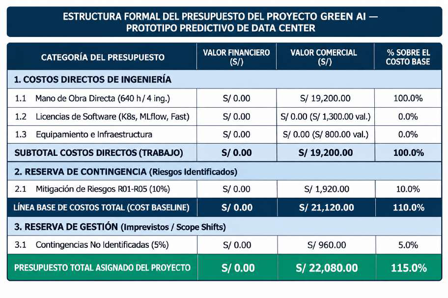
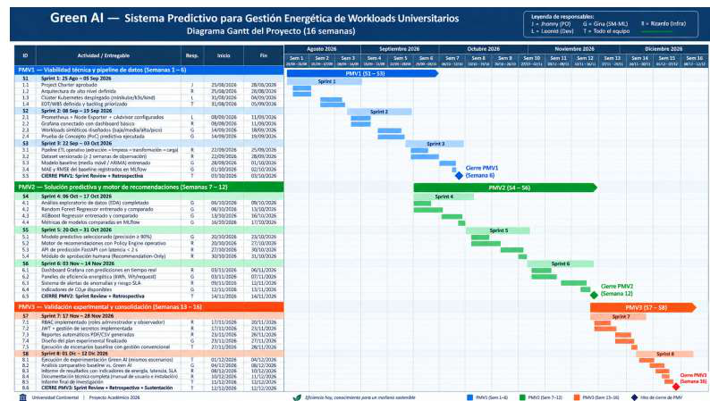
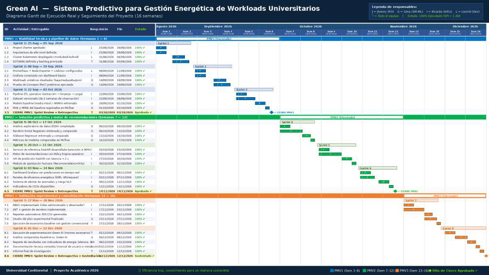
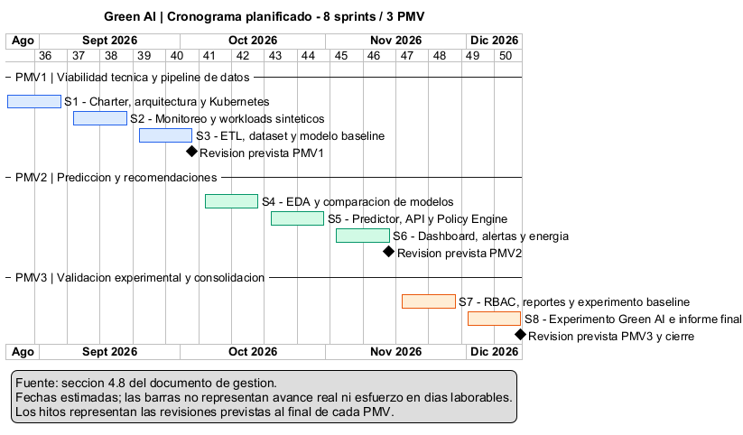

<!--
Fuente: exportados/semana12/Porras-Huaman-Barrera-Quintana-informe-unidad-III.pdf (entregado; 98 páginas; PDF modificado 2026-11-05).
Conversión: herramientas_IA/exportacion/pdf_a_markdown.py (--dir evidencias) + corrección manual de la portada. Contenido sin editar.
Cada «<!-- página N -->» indica el inicio de la página N del PDF. El código del anexo perdió la sangría del PDF.
-->

<!-- página 1 -->

Medición de competencias

# “Green AI: sistema de monitoreo y predicción de demanda computacional para apoyar la gestión eficiente de recursos en entornos universitarios”

Asignatura


Ricardo Porras Veli¹; Leonid Huamán Collazos²; Gina Barrera Peña³; Cristhian Quintana Carhuaricra⁴

**Escuela Académica Profesional de Ingeniería de Sistemas e Informática, Universidad Continental, Junín, Perú.**

**Asesor:** Jorge Alfredo Guevara Jimenez

Huancayo – Perú, 2026-20

<!-- página 2 -->

**RESUMEN EJECUTIVO**

El proyecto Green AI aborda el consumo energético ineficiente y la baja utilización de recursos en centros de datos universitarios mediante una plataforma de monitoreo, predicción de carga computacional y apoyo a la toma de decisiones.

Al corte del 29 de octubre de 2026, el equipo reporta un avance global del 53,6 %, correspondiente a 22 de 41 actividades. El trabajo comprende la ingesta y visualización de telemetría del PMV1 y el desarrollo del núcleo predictivo y de recomendaciones del PMV2.

La plataforma integra un simulador de métricas, Prometheus para su recolección y almacenamiento, un servicio de monitoreo y un componente de procesamiento de datos en Python. El servicio de predicción expone funcionalidades mediante FastAPI e incorpora recomendaciones sujetas a restricciones operativas, manteniendo la decisión final bajo supervisión humana. Las pruebas de integración realizadas permiten demostrar el funcionamiento técnico con datos simulados; la cuantificación del ahorro energético requiere validación experimental adicional.

La solución combina microservicios y arquitectura hexagonal, con comunicación mediante APIs REST, un API Gateway y contenedores Docker. Supabase proporciona autenticación y soporte para la persistencia de históricos, según la configuración habilitada.

La gestión se organiza mediante Scrum adaptado y Trello. El presupuesto declarado contempla un desembolso monetario de S/ 0,00, utilizando recursos disponibles, y un valor comercial referencial de S/ 22 080,00, que incluye costos directos y reservas. Green AI busca aportar una base técnica para evaluar decisiones de uso eficiente de infraestructura universitaria.

<!-- página 3 -->

**ABSTRACT**

The Green AI project addresses inefficient energy consumption and resource underutilization in university data centers through a platform for monitoring, computational workload prediction, and decision support.

As of October 29, 2026, the team reports overall progress of 53.6%, corresponding to 22 of 41 activities. The work covers telemetry ingestion and visualization in MVP1 and the development of core prediction and recommendation capabilities in MVP2.

The platform integrates a metrics simulator, Prometheus for metrics collection and storage, a monitoring service, and a Python data processing component. The prediction service exposes functionality through FastAPI and incorporates recommendations subject to operational constraints, keeping final decisions under human supervision. Integration tests demonstrate technical functionality using simulated data; quantifying energy savings requires further experimental validation.

The solution combines microservices and hexagonal architecture, using REST APIs, an API Gateway, and Docker containers. Supabase provides authentication and supports historical data persistence, depending on the enabled configuration.

Project management follows an adapted Scrum approach using Trello. The declared budget involves S/ 0.00 in cash expenditure by using available resources, with an estimated commercial value of S/ 22,080.00, including direct costs and reserves. Green AI aims to provide a technical foundation for evaluating decisions that promote the efficient use of university computing infrastructure.

<!-- página 4 -->

# I. ANÁLISIS DE PROBLEMAS

Las variaciones de carga en los servicios digitales universitarios pueden generar saturación o baja utilización de recursos computacionales. El problema consiste en cómo identificar y anticipar estos cambios para apoyar decisiones de asignación de recursos, considerando su posible impacto energético.

Como referencia internacional, la Agencia Internacional de Energía estimó que los centros de datos consumieron 415 TWh en 2024, equivalentes al 1,5 % del consumo eléctrico mundial [7]. Esta información contextualiza el problema, pero no demuestra ineficiencia energética en la Universidad Continental.

Green AI estudia el problema en un entorno controlado mediante métricas simuladas. El análisis utiliza Prometheus para recopilar series temporales, Python para procesar los datos y modelos predictivos para estimar la carga. La comparación entre valores observados y predichos mediante MAE y RMSE permite evaluar la precisión de las estimaciones.

Se concluye que este entorno permite evaluar la viabilidad técnica del monitoreo y la predicción. Sin embargo, demostrar desperdicio o ahorro energético institucional requiere mediciones reales y una evaluación adicional.

## 1.1 Identificación y formulación del problema

La gestión de infraestructura computacional requiere mantener un equilibrio entre la capacidad disponible, la demanda de los servicios y el consumo de recursos. En el contexto universitario, las plataformas digitales pueden experimentar variaciones de carga asociadas con actividades académicas, consultas de información y procesos administrativos. Estas variaciones plantean la necesidad de observar el comportamiento de la infraestructura y anticipar situaciones de saturación o baja utilización.

La relevancia energética del problema se evidencia a escala internacional. La Agencia Internacional de Energía estimó que los centros de datos consumieron aproximadamente 415 TWh de electricidad durante 2024, equivalentes al 1,5 % del consumo eléctrico mundial. En su informe de 2025, proyectó un consumo cercano a 945 TWh para 2030 en su escenario base.

Estas cifras contextualizan la importancia de mejorar la eficiencia de la infraestructura digital, pero no constituyen mediciones del consumo de la Universidad Continental [7].

El proyecto Green AI para centros de datos universitarios aborda esta problemática mediante un prototipo experimental que integra simulación, monitoreo, procesamiento de datos y predicción de demanda computacional. Su propósito es construir una base técnica para apoyar decisiones sobre asignación de recursos y, posteriormente, evaluar recomendaciones orientadas a un uso más eficiente de la infraestructura.

En el alcance actual, no se dispone de una auditoría energética institucional ni de mediciones suficientes para cuantificar el desperdicio de energía de un centro de datos universitario real.

Por ello, el problema se estudia en un entorno controlado, utilizando métricas simuladas y mecanismos de observación de los servicios ejecutados. Esta delimitación permite desarrollar y verificar la solución sin intervenir sistemas de producción.

<!-- página 5 -->

## Causas y factores asociados

Los principales factores considerados en el análisis son:

● Variabilidad de la demanda: la utilización de recursos cambia con el tiempo, lo que dificulta determinar una asignación adecuada mediante valores estáticos.

● Información fragmentada: las métricas, los registros históricos y las predicciones necesitan integrarse para apoyar una misma decisión.

● Limitaciones del monitoreo descriptivo: conocer el uso actual de CPU o memoria no permite, por sí solo, anticipar la demanda futura.

● Calidad y procedencia de los datos: los valores ausentes, las diferencias de unidades y la mezcla de datos simulados con observaciones reales pueden conducir a interpretaciones incorrectas.

● Restricciones operativas: una reducción de capacidad podría afectar el rendimiento o la disponibilidad si se realiza sin considerar las condiciones del servicio.

Estos factores pueden favorecer decisiones tardías, asignaciones poco ajustadas a la demanda y dificultades para evaluar si una intervención mejora realmente la eficiencia.

## Necesidades identificadas

La solución debe permitir recolectar métricas de manera periódica, conservar su identidad y procedencia, consultar su evolución temporal y preparar datos compatibles con el componente predictivo. También debe facilitar la interpretación de los resultados y controlar el acceso a las operaciones públicas.

La arquitectura responde a estas necesidades mediante servicios separados: Simulator genera escenarios; Prometheus recolecta métricas; Monitoring las expone mediante consultas controladas; Data Processing normaliza los datos y prepara ventanas temporales; Prediction estima demanda de CPU; y el Gateway administra el acceso del frontend a las operaciones permitidas.

El motor de recomendaciones constituye el siguiente incremento previsto. Su finalidad será transformar predicciones y contexto operativo en propuestas explicables, sujetas a revisión humana.

## Restricciones del proyecto

El desarrollo está condicionado por el tiempo del ciclo académico, la capacidad de los equipos disponibles y la dependencia de servicios externos para autenticación y almacenamiento histórico. Asimismo, la validación debe respetar las siguientes restricciones:

<!-- página 6 -->

● No intervenir infraestructura institucional de producción sin autorización.

● No presentar métricas simuladas como mediciones físicas.

● No interpretar el porcentaje de CPU como consumo energético directo.

● No afirmar precisión predictiva sin una evaluación independiente.

● No declarar ahorro energético antes de realizar una comparación experimental.

● No ejecutar automáticamente cambios de infraestructura en el alcance actual.

## Formulación del problema

**¿Cómo desarrollar y validar un prototipo que integre monitoreo, procesamiento de series temporales y predicción de demanda computacional para apoyar recomendaciones**

**explicables de asignación de recursos en un entorno universitario experimental, manteniendo trazabilidad de los datos y considerando restricciones de operación y eficiencia energética?**

El problema es complejo porque relaciona dimensiones de software, datos, infraestructura, predicción y sostenibilidad. Una predicción con bajo error no garantiza, por sí sola, una decisión operativa adecuada; del mismo modo, una reducción del uso de recursos no demuestra necesariamente ahorro energético o conservación de la calidad del servicio.

## 1.2 OBJETIVOS DEL PROYECTO Objetivo general

Desarrollar y validar un prototipo experimental Green AI que integre monitoreo de infraestructura, procesamiento de datos y predicción de demanda computacional para apoyar recomendaciones de asignación de recursos, considerando trazabilidad, calidad del servicio y evaluación de eficiencia energética.

## Objetivos específicos

1. Implementar la recolección y consulta de métricas de infraestructura, mediante la integración de Simulator, Prometheus y Monitoring, verificando disponibilidad de las fuentes, continuidad temporal y correcta identificación de recursos y unidades.

2. Preparar conjuntos de datos temporales aptos para predicción, mediante validación, normalización y tratamiento explícito de datos ausentes, evaluando la cantidad de registros válidos, las muestras excluidas y la conservación de la procedencia.

3. Evaluar modelos de predicción de utilización de CPU, comparándolos con un modelo de referencia mediante error absoluto medio y raíz del error cuadrático medio, utilizando una separación temporal entre entrenamiento y evaluación.

4. Implementar un motor de recomendaciones explicables, capaz de proponer acciones o abstenerse cuando la información sea insuficiente, verificando sus reglas mediante casos de carga alta, normal, baja y datos inválidos.

<!-- página 7 -->

5. Comparar experimentalmente una estrategia de referencia (baseline) frente a Green AI bajo condiciones equivalentes de carga y servicio, con el fin de evaluar su comportamiento operativo y energético mediante indicadores reproducibles.

Los objetivos constituyen criterios de trabajo y evaluación. Su formulación no implica que el motor de recomendaciones, la validación energética o todas las pruebas finales hayan sido completados.

# II. CONOCIMIENTOS DE INGENIERÍA APLICADOS / RELACIONADOS

El desarrollo de Green AI requiere integrar conocimientos de matemáticas, computación, ciencias naturales e ingeniería de software. Su selección responde a las necesidades de representar el comportamiento de la infraestructura, preparar datos confiables, estimar demanda y verificar la solución.

## a. Conocimientos en matemáticas y computación

### Estadística descriptiva y análisis temporal

Las métricas de infraestructura se representan como series temporales, es decir, observaciones asociadas con instantes de tiempo. Su análisis requiere calcular promedios, dispersión, máximos y mínimos, así como identificar tendencias y variaciones.

Estos conocimientos se aplican al procesamiento de históricos y a la preparación de variables para Prediction. Los valores rezagados permiten incorporar información de instantes anteriores, mientras que las ventanas móviles resumen el comportamiento reciente.

Su adecuación se comprueba verificando el orden temporal, la frecuencia de las muestras y la ausencia de información futura en las variables utilizadas para predecir.

### Tasas de variación y conversión de unidades

Algunas métricas se almacenan como contadores acumulados. Para interpretar su comportamiento se necesita calcular una tasa de cambio:

**Tasa = cambio del contador / tiempo transcurrido**

Este principio permite obtener tráfico de red en bytes por segundo y estimar utilización de CPU a partir de los contadores de tiempo correspondientes. En CPU, la tasa se relaciona con la capacidad de los procesadores lógicos; no representa directamente potencia eléctrica.

Monitoring conserva las unidades del catálogo y Data Processing realiza conversiones necesarias para el predictor. Por ejemplo:

**CPU en porcentaje = CPU en ratio × 100**

<!-- página 8 -->

La validación debe comprobar que las unidades sean coherentes entre servicios y que no se confundan valores absolutos, proporciones y tasas.

### Aprendizaje supervisado para regresión

La predicción de utilización de CPU corresponde a un problema de regresión, debido a que la salida es una magnitud numérica continua. El componente Prediction utiliza información histórica para estimar valores futuros.

La selección del modelo debe considerar desempeño frente a un modelo de referencia, costo computacional, latencia de inferencia y comportamiento ante datos no utilizados en el entrenamiento. Un modelo más complejo no se considera automáticamente superior.

La evaluación debe respetar el orden temporal: los datos de entrenamiento deben preceder a los de evaluación para reducir el riesgo de fuga de información.

### Métricas de error

Se consideran las siguientes métricas:

**MAE = (1/n) × Σ |yi − ŷi| RMSE = √[(1/n) × Σ (yi − ŷi)2]**

Donde:

● yi representa el valor de referencia.

● ŷi representa el valor predicho.

● n corresponde al número de observaciones evaluadas.

El MAE expresa la magnitud promedio del error absoluto y el RMSE penaliza con mayor intensidad los errores grandes. Si la CPU se expresa en porcentaje, estas métricas se interpretan en puntos porcentuales.

No resulta suficiente afirmar una “precisión del 90 %” sin definir su cálculo. La evaluación debe identificar la métrica utilizada, el horizonte de predicción, el conjunto de prueba y el resultado del modelo de referencia.

## b. Conocimientos en ciencias naturales

### Relación entre potencia y energía

La evaluación energética se fundamenta en la relación física entre potencia y tiempo:

**E = ∫ P(t) dt**

<!-- página 9 -->

Cuando se trabaja con mediciones discretas, una aproximación es:

**E ≈ Σ Pi × Δti**

Si la potencia se expresa en watts y el intervalo en horas, el resultado se obtiene en watt-hora.

Para convertirlo a kilowatt-hora se divide entre 1000.

Este conocimiento permite interpretar correctamente los registros y diseñar la evaluación energética. Un campo denominado energia_watts representa dimensionalmente potencia, aunque su nombre sugiera energía.

En el estado actual, las métricas de CPU, memoria y red no bastan para demostrar consumo eléctrico. La evaluación requerirá mediciones de potencia o un modelo de estimación sustentado, con sus supuestos y limitaciones.

### Conservación de la energía y disipación térmica

El funcionamiento de los equipos transforma energía eléctrica y genera disipación térmica. Por ello, una evaluación integral de infraestructura debe delimitar si considera únicamente los equipos de cómputo o también otros elementos, como refrigeración y redes.

Este principio se relaciona con el diseño del experimento energético. No sería válido comparar una estrategia que mide solo servidores con otra que incluye refrigeración, porque los límites de medición serían diferentes.

### Estimación de emisiones

La estimación de emisiones asociadas con electricidad puede expresarse como:

Emisiones estimadas = energía consumida × factor de emisión Su aplicación requiere un factor de emisión sustentado y coherente con la ubicación y el periodo evaluados. Si no se dispone de ese factor, el proyecto debe limitar sus conclusiones a energía medida o estimada y no atribuir una reducción cuantificada de emisiones.

Estos conocimientos corresponden al componente de evaluación ambiental previsto; no se presentan como resultados ya comprobados.

## c. Conocimientos de ingeniería

### Arquitectura de software y separación de responsabilidades

Green AI organiza sus funciones mediante microservicios e incorpora separación entre dominio, aplicación e infraestructura. La arquitectura hexagonal permite que las reglas del negocio se comuniquen con tecnologías externas mediante puertos y adaptadores.

<!-- página 10 -->

Por ejemplo, las consultas de métricas se separan del mecanismo concreto utilizado para acceder a Prometheus. Esta organización facilita pruebas independientes y reduce el impacto de cambios tecnológicos.

Su adecuación se comprueba mediante pruebas de dominio, contratos entre servicios y revisión de dependencias entre capas.

### Sistemas distribuidos e interfaces de programación

La comunicación entre componentes utiliza interfaces de programación de aplicaciones, o API, con contratos HTTP y JSON. Se aplican conceptos de direccionamiento, validación, tiempos de espera, códigos de error y correlación de solicitudes.

El Gateway ofrece rutas explícitas hacia los servicios internos. La propagación de un identificador de solicitud facilita seguir una operación y localizar fallos.

La validación debe comprobar tanto respuestas exitosas como errores de autenticación, parámetros inválidos, dependencias no disponibles y tiempos de espera agotados.

### Ingeniería de datos y trazabilidad

Data Processing aplica validaciones y transformaciones para preparar información consistente.

Debe conservar recurso, instante, unidad, calidad y procedencia, evitando convertir automáticamente datos ausentes en cero.

Además, se diferencia entre datos observados, simulados, estimados y de origen desconocido.

Esta separación permite interpretar correctamente las gráficas y evitar conclusiones que excedan la evidencia disponible.

### Contenedores y reproducibilidad

Docker permite empaquetar aplicaciones y dependencias, mientras que Docker Compose describe sus conexiones, variables y volúmenes. Estos mecanismos facilitan reproducir el entorno de ejecución.

La reproducibilidad se comprueba construyendo imágenes, verificando su importación y levantando los servicios con la configuración documentada. Las pruebas en el equipo de desarrollo no sustituyen la validación pendiente en otros dispositivos o arquitecturas.

### Seguridad y calidad de software

El proyecto aplica autenticación mediante Supabase Auth y validación de tokens JWT en el Gateway, con permisos asociados a roles. También requiere protección de secretos, validación de entradas y separación de servicios internos.

<!-- página 11 -->

La calidad se comprueba mediante pruebas unitarias, de integración y funcionales. Las verificaciones de salud y las capturas de Swagger constituyen evidencias operativas, pero no demuestran por sí solas exactitud predictiva, seguridad completa o cumplimiento de todos los

**requisitos.**

# III. INGENIERO Y LA SOCIEDAD

## a. Justificación social

Green AI busca contribuir a una gestión informada de la infraestructura que sostiene servicios digitales universitarios. Sus beneficiarios directos potenciales son administradores y personal técnico; estudiantes y docentes se beneficiarían indirectamente de servicios con un funcionamiento adecuado.

El aporte social esperado consiste en facilitar la interpretación de métricas y ofrecer información para anticipar necesidades de capacidad. Sin embargo, este beneficio depende de que las recomendaciones sean comprensibles y se evalúen antes de modificar recursos.

Una reducción de capacidad aplicada sin análisis podría afectar el acceso a servicios académicos. Por ello, el motor previsto deberá mantener revisión humana y explicar las razones de cada propuesta. La eficiencia deberá evaluarse junto con la continuidad y calidad del servicio.

El entorno experimental también aporta valor formativo al permitir estudiar observabilidad, sistemas distribuidos y aprendizaje automático sin intervenir infraestructura institucional de producción.

## b. Justificación económica

La solución plantea identificar oportunidades de utilización más eficiente de recursos y proporcionar información para decisiones de capacidad. Los beneficios económicos potenciales podrían relacionarse con consumo eléctrico, uso de infraestructura y tiempo dedicado al diagnóstico.

La utilización de herramientas de código abierto reduce la necesidad de determinadas licencias, pero no elimina los costos del proyecto. Deben considerarse electricidad, equipos, almacenamiento, conectividad, mantenimiento y tiempo del equipo desarrollador.

La evaluación económica deberá comparar los costos de una situación de referencia con los de la estrategia propuesta. Si se dispone de ahorro energético comprobado y una tarifa aplicable, podría estimarse:

**Ahorro económico bruto = energía evitada × tarifa eléctrica**

Para calcular un beneficio neto también deben descontarse los costos adicionales del monitoreo, procesamiento y predicción. En esta etapa no se declara un ahorro monetario alcanzado.

## c. Justificación ambiental

<!-- página 12 -->

La justificación ambiental se relaciona con el uso responsable de recursos computacionales y con la evaluación de alternativas que puedan reducir consumo innecesario.

El proyecto debe considerar que su propia operación consume recursos. Prometheus, Grafana, los microservicios y el componente predictivo generan una carga adicional que debe incluirse en el análisis del beneficio ambiental neto.

La comparación deberá mantener cargas de trabajo, duración y condiciones operativas equivalentes. También deberá distinguir entre potencia, energía y emisiones, evitando presentar una disminución de CPU como evidencia suficiente de ahorro eléctrico.

Asimismo, deben considerarse posibles efectos de rebote: una mejora de eficiencia por operación puede coexistir con un aumento del consumo total si crece el volumen de trabajo.

Por ello, conviene evaluar indicadores totales y por unidad de servicio.

## d. Acontecimientos tecnológicos y científicos relacionados con la solución

La propuesta se relaciona con la disponibilidad de herramientas de observabilidad, contenedores, servicios de autenticación e inferencia mediante API. Su integración permite construir entornos experimentales reproducibles y separar la recolección de datos, su procesamiento y la estimación de demanda.

El aprendizaje automático aplicado a series temporales permite estudiar patrones históricos y anticipar cambios. No obstante, su utilidad debe demostrarse frente a alternativas más simples, considerando costo y error de predicción.

La disponibilidad de una predicción no resuelve automáticamente la decisión operativa.

También se requieren reglas, contexto, restricciones y mecanismos de abstención cuando la evidencia sea insuficiente. Esta distinción orienta el diseño del motor de recomendaciones pendiente.

Aunque Kubernetes constituye una tecnología relacionada con la gestión de workloads, el paquete portable actual utiliza Docker Compose. No se presenta el despliegue local como una validación de escalamiento automático en Kubernetes.

## e. Marco legal, institucional y responsabilidad ética

Por el tratamiento de información de usuarios, el proyecto debe considerar la Ley N.° 29733, Ley de Protección de Datos Personales, y su reglamento aprobado mediante el Decreto Supremo N.° 016-2024-JUS. Su aplicación concreta dependerá de los datos tratados, las finalidades y las responsabilidades de quienes operen el sistema. 2 — Congreso de la República; 3 — Autoridad Nacional de Protección de Datos Personales.

Como medidas de diseño, se plantea minimizar los datos personales utilizados, restringir accesos, proteger credenciales y definir condiciones de conservación y eliminación. El uso de servicios externos no equivale por sí mismo al cumplimiento normativo.

En el ámbito institucional, cualquier prueba sobre infraestructura real deberá contar con autorización y condiciones de operación definidas. Desde la responsabilidad ética, el equipo debe comunicar las limitaciones del prototipo, evitar resultados fabricados y distinguir avances implementados de funcionalidades previstas.

<!-- página 13 -->

## f. Salud, seguridad y riesgos operativos

Los riesgos del proyecto incluyen recomendaciones incorrectas, exposición de credenciales, acceso no autorizado, pérdida de información y saturación de equipos durante las pruebas.

Las medidas preventivas propuestas comprenden:

● Ejecutar experimentos en un entorno aislado y autorizado.

● Mantener credenciales fuera del código y de las evidencias públicas.

● Restringir el acceso a los servicios internos.

● Conservar los datos necesarios para reproducir y revisar resultados.

● Limitar la carga experimental y observar el estado de los equipos.

● Mantener aprobación humana antes de realizar cambios de infraestructura.

● Abstenerse de recomendar ajustes cuando los datos sean insuficientes o inconsistentes.

La principal responsabilidad del equipo es producir evidencia verificable y comunicar su alcance. El valor del proyecto deberá sustentarse en resultados reproducibles, preservando la seguridad de las personas, la información y los servicios.

## ANTECEDENTES

### Antecedentes sobre eficiencia energética y gestión de recursos

#### Antecedente 1. Beloglazov, Abawajy y Buyya (2012)

Beloglazov, Abawajy y Buyya abordaron el problema del elevado consumo energético en centros de datos de computación en la nube, donde el aprovisionamiento de recursos se había enfocado principalmente en el rendimiento y no en la eficiencia energética. Los autores señalaron que mantener servidores activos aun cuando presentan bajos niveles de utilización incrementa el consumo eléctrico, los costos operativos y el impacto ambiental.

Como método, propusieron una arquitectura orientada a la gestión eficiente de recursos y desarrollaron heurísticas de asignación y consolidación dinámica de máquinas virtuales. La propuesta se basa en trasladar cargas de trabajo entre servidores y reducir la cantidad de equipos activos cuando la demanda lo permite, procurando mantener el nivel de servicio establecido. La evaluación se realizó mediante simulaciones y escenarios de virtualización orientados al análisis conjunto de consumo energético, utilización de recursos y cumplimiento de SLA.

Los resultados mostraron que la consolidación dinámica de máquinas virtuales puede reducir el consumo energético del centro de datos sin descuidar completamente los requisitos de rendimiento, siempre que la política de consolidación considere el compromiso existente entre ahorro energético y calidad del servicio [4].

<!-- página 14 -->

Este antecedente se relaciona con Green AI porque sustenta la necesidad de no analizar únicamente la utilización de CPU, sino también las restricciones operativas asociadas con cualquier acción de consolidación. A diferencia del trabajo de Beloglazov et al., Green AI no ejecuta automáticamente migraciones o apagados de infraestructura dentro de su alcance actual. El sistema mantiene un enfoque Recommendation-Only, mediante el cual las predicciones y recomendaciones requieren revisión humana antes de cualquier acción.

#### Antecedente 2. Ji et al. (2021)

Ji et al. estudiaron el problema del elevado consumo energético de los centros de datos y la necesidad de coordinar de manera eficiente el uso de servidores, sistemas de refrigeración y cargas computacionales. Los autores identificaron que las estrategias de asignación tradicionales pueden generar ineficiencias debido a que no consideran de manera anticipada la evolución de las cargas de trabajo.

El estudio propuso un esquema conjunto de optimización energética que integra predicción de carga, evaluación de costos marginales, planificación de tareas y migración de cargas. La estrategia utiliza información predictiva para apoyar la toma de decisiones sobre asignación de recursos y fue evaluada mediante experimentos basados en trazas reales de carga.

Los resultados del estudio evidenciaron que integrar técnicas de predicción con mecanismos de gestión de recursos permite mejorar la eficiencia energética frente a estrategias que únicamente reaccionan al estado actual del sistema. El trabajo destaca además que las decisiones de migración y planificación deben considerar simultáneamente rendimiento, utilización y consumo energético.

Este antecedente aporta directamente al enfoque de Green AI, ya que respalda la separación entre monitoreo, predicción y toma de decisiones. En Green AI, el Prediction Service tiene como finalidad anticipar la utilización futura de CPU, mientras que las recomendaciones y restricciones operativas se analizan en componentes separados. Sin embargo, Green AI se diferencia en que la evaluación actual se realiza en un entorno experimental y no afirma todavía reducciones energéticas validadas sobre infraestructura universitaria real.

#### Antecedente 3. Reddy, Rao y Aiello (2024)

Reddy, Rao y Aiello investigaron la gestión eficiente de recursos en centros de datos mediante técnicas de optimización aplicadas a la asignación dinámica de máquinas virtuales. El problema abordado fue la distribución ineficiente de cargas entre servidores físicos, situación que puede provocar desperdicio de recursos, consumo energético innecesario y mayores costos de operación.

Los autores propusieron un método denominado Imitation-Based Optimization (IBO), orientado al problema de colocación de máquinas virtuales en entornos de nube heterogéneos. La estrategia considera la variabilidad de las cargas y busca reducir el número de servidores activos mediante una mejor asignación de las máquinas virtuales, manteniendo restricciones relacionadas con el SLA. El método fue comparado con diversas estrategias de optimización existentes.

<!-- página 15 -->

Los resultados reportados muestran reducciones de consumo energético frente a varios métodos de referencia, aunque los porcentajes obtenidos dependen de cada algoritmo y escenario experimental. Los autores también destacan que una asignación eficiente debe considerar simultáneamente utilización, consumo, migración y calidad de servicio.

La relación con Green AI se encuentra en el objetivo de apoyar una utilización más eficiente de los recursos computacionales. No obstante, Green AI adopta un alcance más conservador: en lugar de ejecutar directamente una estrategia de consolidación, genera información predictiva y recomendaciones sujetas a revisión humana. Asimismo, cualquier estimación energética en Green AI debe distinguirse de una medición física directa.

### Antecedentes sobre integración de Machine Learning para predicción de cargas

#### Antecedente ML-1. Khan et al. (2022)

Khan et al. abordaron el problema de la administración de recursos en centros de datos con cargas dinámicas y heterogéneas. Los autores identificaron que la predicción de utilización de recursos y del estado energético resulta fundamental para tomar decisiones de gestión anticipadas, especialmente porque los modelos tradicionales suelen considerar únicamente CPU y memoria y pueden omitir otras variables como disco, red y recursos aprovisionados.

Como solución, plantearon un enfoque centrado en Machine Learning para predecir cargas de trabajo y estimar estados energéticos a nivel de máquinas virtuales. Para la predicción utilizaron diferentes algoritmos de regresión, entre ellos Linear Regression, Ridge Regression, ARD Regression, ElasticNet y Gated Recurrent Unit (GRU). La evaluación se realizó utilizando trazas reales provenientes de un centro de datos distribuido y métricas como RMSE.

Los resultados reportaron que el modelo GRU obtuvo los menores valores de RMSE entre las alternativas analizadas para distintas cargas de trabajo. Para la estimación del estado energético, los autores evaluaron además técnicas de agrupamiento y transferencia de aprendizaje.

Este estudio presenta una relación directa con Green AI debido a que ambos proyectos utilizan información histórica para estimar el comportamiento futuro de la infraestructura. Green AI también formula la predicción de CPU como un problema de regresión y utiliza métricas como MAE y RMSE. Sin embargo, Green AI prioriza inicialmente modelos más ligeros y un entorno experimental controlado, procurando reducir el costo computacional de la propia solución de inteligencia artificial.

#### Antecedente ML-2. Prediction Models for Clustered Virtual Machines in Data Centers (2023)

<!-- página 16 -->

El estudio publicado en Procedia Computer Science en 2023 analizó el uso de Machine Learning para predecir el consumo de CPU de máquinas virtuales en centros de datos. El problema identificado fue la dificultad de gestionar eficientemente recursos cuando cada máquina virtual presenta patrones temporales diferentes, lo que puede generar altos costos si se construye y entrena un modelo independiente para cada una.

La propuesta consistió en agrupar máquinas virtuales según características estadísticas extraídas de sus series temporales históricas. Posteriormente, se entrenaron modelos representativos para cada clúster y se seleccionó aquel que presentaba el menor error de predicción. La evaluación utilizó diferentes algoritmos tradicionales de Machine Learning y escenarios de simulación.

Los resultados mostraron que agrupar máquinas virtuales con comportamientos similares permite obtener errores medios reducidos y disminuir el tiempo necesario para el entrenamiento de modelos individuales.

Este antecedente es relevante para Green AI porque demuestra que el comportamiento histórico de CPU puede utilizarse para construir modelos predictivos orientados a la gestión de recursos. Asimismo, respalda la necesidad de analizar características temporales antes de seleccionar un algoritmo. Green AI comparte este enfoque mediante el procesamiento previo de series y la generación de variables históricas, aunque actualmente utiliza un flujo simplificado centrado en la predicción de utilización futura de CPU.

#### Antecedente ML-3. Marwan, Ait Temghart y Lazaar (2026)

Marwan, Ait Temghart y Lazaar abordaron en 2026 el problema de predecir cargas de trabajo altamente dinámicas y no estacionarias en centros de datos de nueva generación. Los autores indicaron que las variaciones rápidas de demanda dificultan la planificación proactiva de recursos y pueden afectar simultáneamente los requisitos de calidad de servicio y eficiencia energética.

El estudio propuso un enfoque de predicción de dos etapas que combina técnicas de limpieza y procesamiento de señales con un modelo híbrido de aprendizaje profundo. El proceso utiliza Local Outlier Factor para identificar valores atípicos, filtro Savitzky–Golay para reducir ruido, Empirical Mode Decomposition para descomponer la señal y una arquitectura CNN–BiLSTM con mecanismo de atención para realizar la predicción. La evaluación utilizó el conjunto de datos Bitbrains fastStorage y comparó diferentes configuraciones y modelos.

Los resultados reportaron para el modelo propuesto un MSE de 0,030, RMSE de 0,173 y un coeficiente R2 de 0,89, mostrando mejoras frente a varios modelos de referencia evaluados en el estudio.

La relación con Green AI se encuentra en la importancia del preprocesamiento de series temporales y de la evaluación comparativa entre modelos. Sin embargo, Green AI no busca reproducir directamente una arquitectura de Deep Learning compleja. Debido a su contexto académico y experimental, el proyecto prioriza modelos de menor costo computacional y mecanismos de trazabilidad que permitan comparar la mejora predictiva frente a un baseline sin incrementar innecesariamente el consumo del propio componente de inteligencia artificial.

<!-- página 17 -->

### Síntesis de los antecedentes

Los antecedentes revisados evidencian dos líneas principales de investigación. La primera aborda la eficiencia energética mediante consolidación, asignación dinámica y optimización de recursos, destacando que cualquier reducción del número de servidores activos debe considerar restricciones de rendimiento y nivel de servicio. La segunda utiliza Machine Learning y análisis de series temporales para anticipar el comportamiento de las cargas y apoyar decisiones de gestión de recursos.

Green AI integra ambas perspectivas dentro de un prototipo experimental. El sistema incorpora monitoreo, procesamiento de telemetría y predicción de utilización de CPU, pero mantiene separada la predicción de la ejecución operacional. Las recomendaciones se someten a revisión humana y la eficiencia energética se plantea como una variable a evaluar mediante experimentos controlados, evitando considerar la utilización de CPU como equivalente directo del consumo eléctrico.

# IV. METODOLOGÍA EMPLEADA

Para el desarrollo del proyecto Green AI para centros de datos universitarios se empleó un enfoque ágil, seleccionado después de evaluar los enfoques predictivo, ágil e híbrido. El enfoque ágil obtuvo el mayor puntaje ponderado (4.85), debido a la incertidumbre asociada a los resultados experimentales, los cambios derivados del desarrollo de modelos de Machine Learning y la necesidad de realizar entregas incrementales verificables.

|Criterio|Peso|Predictivo|Ágil|Híbrido|
|---|---|---|---|---|
|Capacidad para gestionar cambios frecuentes|25 %|2|5|4|
|Adecuación ante incertidumbre alta|20 %|2|5|4|
|Soporte para entregas incrementales|20 %|2|5|5|
|Integración de retroalimentación del usuario/asesor|20 %|3|5|4|
|Gestión de restricciones académicas y temporales|15 %|4|4|5|
|Puntaje ponderado|100 %|2.50|4.85|4.35|

Para la gestión del proyecto se utilizaron prácticas del PMI basadas en la guía PMBOK 7, mientras que para el desarrollo se seleccionó el marco de trabajo ágil Scrum. La selección se realizó comparando Scrum, Kanban, XP y Scrumban, obteniendo Scrum el mayor puntaje ponderado (4.85).

<!-- página 18 -->

|Criterio|Peso|Scrum|Kanban|XP|Scrumban|
|---|---|---|---|---|---|
|Adecuación a equipo de 4 personas|20 %|5|4|4|4|
|Soporte para iteraciones con revisión formal|20 %|5|3|4|4|
|Gestión visual del flujo de trabajo|15 %|4|5|3|5|
|Integración de retroalimentación periódica|15 %|5|3|5|4|
|Gestión del alcance mediante backlog priorizado|15 %|5|4|4|4|
|Compatibilidad con entregas en tres PMV|15 %|5|3|4|4|
|Puntaje ponderado|100 %|4.85|3.65|4.00|4.15|

Scrum fue adaptado a las características del proyecto mediante ocho Sprints de dos semanas, organizados en tres Productos Mínimos Viables (PMV): PMV1, orientado a validar la viabilidad técnica; PMV2, enfocado en validar la solución funcional; y PMV3, destinado a consolidar y validar la solución. Debido a los diferentes horarios académicos del equipo, las reuniones de seguimiento se realizaron tres veces por semana.

El trabajo se realizó mediante:

● Análisis de requerimientos: se identificaron y priorizaron los requerimientos del sistema mediante épicas, historias de usuario y Product Backlog.

● Elaboración de prototipos y diseño: se definieron las interfaces, componentes y arquitectura de la solución antes de su implementación.

● Implementación de la solución: se desarrollaron progresivamente los componentes del sistema de acuerdo con los Sprints y PMV establecidos.

● Pruebas de calidad de software: se realizaron pruebas sobre los incrementos desarrollados para verificar su funcionamiento y obtener evidencias de validación antes de avanzar a los siguientes PMV.

#### APORTES / DESCUBRIMIENTOS

● Adaptación de Scrum al contexto académico.

Durante el desarrollo se identificó la necesidad de adaptar determinadas prácticas de Scrum a la disponibilidad del equipo. Las reuniones diarias se reemplazaron por sincronizaciones tres veces por semana y el refinamiento del Backlog se integró al Sprint Planning, manteniendo las revisiones periódicas de los incrementos.

● Desarrollo y validación progresiva mediante PMV.

Los tres PMV se establecieron como puntos de inspección progresiva: PMV1 para validar la viabilidad técnica y el flujo de datos, PMV2 para validar la solución predictiva y funcional, y PMV3 para consolidar la experimentación y validación final.

<!-- página 19 -->

● Separación entre predicción y decisión operacional.

Durante el diseño se determinó que las predicciones generadas por el componente de Machine Learning no debían convertirse directamente en acciones sobre la infraestructura. Por ello, la solución separa la predicción, la evaluación de alternativas y la validación de restricciones, manteniendo un enfoque Recommendation-Only, en el cual las recomendaciones permanecen sujetas a aprobación humana.

# V. USO DE HERRAMIENTAS MODERNAS

Para el desarrollo de Green AI para centros de datos universitarios se empleó un conjunto integrado de herramientas de ingeniería, desarrollo, gestión, datos, Inteligencia Artificial, calidad y comunicación. Su selección consideró criterios de adecuación al proyecto (25 %),

**funcionalidad (20 %), integración (15 %), costo (10 %), seguridad (10 %), escalabilidad (10 %)**

y usabilidad (10 %), priorizando herramientas de código abierto debido a la restricción presupuestaria del proyecto.

|Área|Herramientas empleadas|Aplicación en el proyecto|Limitación principal|
|---|---|---|---|
|Ingeniería y modelado|PlantUML / UML|Diseño de diagramas, flujos y arquitectura de la solución.|Los modelos requieren actualización cuando cambia la implementación.|
|Desarrollo|VS Code, Python, FastAPI|Desarrollo de scripts de procesamiento, componentes predictivos y APIs.|Python requiere controlar dependencias y versiones de librerías.|
|Versionamiento|Git / GitHub|Control colaborativo del código mediante repositorios y ramas.|Depende de una adecuada gestión de ramas y versiones.|
|Datos|Supabase (PostgreSQL), Pandas, NumPy|Persistencia relacional, limpieza, transformación y procesamiento de datos.|Requiere controlar adecuadamente el esquema, acceso y políticas de seguridad.|

<!-- página 20 -->

|IA y Machine Learning|Scikit-learn, Random Forest Regressor, MLflow|Entrenamiento de modelos predictivos y registro de parámetros y métricas como MAE y RMSE.|Los modelos pueden degradar su desempeño ante datos diferentes a los utilizados durante el entrenamiento.|
|---|---|---|---|
|Observabilidad|Prometheus, Grafana|Recolección y visualización de métricas de infraestructura y workloads.|Grafana no funciona como mecanismo de almacenamiento histórico por sí solo.|
|DevOps|Docker, Kubernetes|Contenedorización y orquestación del entorno experimental.|Kubernetes incrementa la complejidad de configuración y operación.|
|Gestión|Trello|Organización del Product Backlog, historias de usuario, Sprints y PMV.|Presenta menores capacidades de automatización y trazabilidad técnica que herramientas especializadas.|
|Calidad y pruebas|Postman, SonarQube, Pytest|Pruebas de APIs, pruebas automatizadas y análisis estático del código.|Las herramientas no sustituyen la definición adecuada de casos de prueba.|
|Seguridad|OWASP ZAP|Evaluación de vulnerabilidades en los servicios expuestos.|Los resultados requieren análisis y validación técnica.|
|Comunicación|Google Drive, Teams / Meet|Gestión documental y coordinación del equipo.|Dependen de conectividad y organización adecuada de la información.|

Las herramientas se utilizaron de manera integrada durante el ciclo de desarrollo. Trello permitió organizar el trabajo; GitHub y VS Code soportaron el desarrollo y versionamiento;

Prometheus proporcionó telemetría; Pandas y NumPy permitieron procesar los datos;

Supabase/PostgreSQL soportó la persistencia estructurada de la información; Scikit-learn y Random Forest Regressor fueron considerados para el componente predictivo y MLflow para su trazabilidad; mientras que Grafana permitió visualizar la información del sistema. Para la validación se incorporaron herramientas como Postman, Pytest y SonarQube.

<!-- página 21 -->

La selección de herramientas también respondió a necesidades específicas del proyecto. Por ejemplo, Trello fue seleccionado frente a Jira y GitHub Projects por su facilidad de uso y costo cero; Python por su ecosistema de Machine Learning; Grafana por su integración con la telemetría de Prometheus; y SonarQube para el análisis estático de calidad y vulnerabilidades del código.

Asimismo, se reconocieron las limitaciones de las tecnologías seleccionadas. En Python pueden presentarse conflictos entre versiones de dependencias, por lo que se planteó utilizar entornos virtuales y archivos de dependencias controlados. En los modelos de Machine Learning existe riesgo de degradación cuando reciben datos fuera de la distribución utilizada durante el entrenamiento, por lo que se requiere validación de datos y mantener control humano sobre las recomendaciones.

De esta manera, las herramientas no se utilizaron de forma aislada, sino como un ecosistema tecnológico integrado, cubriendo modelado, desarrollo, datos, IA, gestión, calidad, seguridad, observabilidad y comunicación durante los tres PMV del proyecto.

# VI. Diseño de Ingeniería

## VI.1 Listado de Requerimientos funcionales y no funcionales

### Requerimientos funcionales

|ID|Requerimiento|
|---|---|
|RF-01|Recopilar métricas de CPU, memoria, red y almacenamiento.|
|RF-02|Recopilar métricas de workloads como solicitudes, concurrencia, throughput y latencia.|
|RF-03|Almacenar métricas históricas con marca temporal.|
|RF-04|Consultar series históricas por nodo, servicio y período.|
|RF-05|Normalizar y preparar series temporales.|
|RF-06|Construir ventanas y variables predictoras.|
|RF-07|Entrenar y evaluar modelos candidatos.|
|RF-08|Registrar versiones, parámetros, métricas y artefactos.|
|RF-09|Generar predicciones mediante API controlada.|
|RF-10|Evaluar alternativas mediante Optimization Engine.|
|RF-11|Validar alternativas mediante Policy/Safety Engine.|
|RF-12|Registrar y presentar recomendaciones trazables.|
|RF-13|Ejecutar experimentos comparables baseline/tratamiento.|
|RF-14|Presentar indicadores energéticos y de eficiencia.|
|RF-15|Comparar predicción y valores observados.|
|RF-16|Presentar alertas de saturación, subutilización o riesgo SLA.|
|RF-17|Generar reportes comparativos.|
|RF-18|Autenticar usuarios técnicos autorizados.|

<!-- página 22 -->

|RF-19|Administrar roles y permisos.|
|---|---|
|RF-20|Registrar decisiones y eventos de auditoría.|

### Requerimientos no funcionales

|ID|Requerimiento|
|---|---|
|RNF-01|Implementar autenticación, autorización, RBAC, mínimo privilegio, gestión de secretos y auditoría.|
|RNF-02|Mantener la latencia de inferencia dentro del presupuesto de rendimiento establecido y verificarla mediante mediciones.|
|RNF-03|Permitir una recuperación controlada del sistema ante fallos y verificarla mediante pruebas de recuperación.|
|RNF-04|Garantizar la reproducibilidad mediante la identificación de datos, código, parámetros, modelos y configuraciones utilizadas.|
|RNF-05|Mantener una adecuada separación de responsabilidades entre los componentes para facilitar la mantenibilidad del sistema.|
|RNF-06|Proporcionar observabilidad mediante logs, métricas, evidencias y dashboards del funcionamiento del sistema.|
|RNF-07|Permitir que las futuras acciones ejecutables puedan revertirse mediante mecanismos de rollback.|
|RNF-08|Mantener la trazabilidad entre cada recomendación, su predicción asociada, las restricciones evaluadas y el resultado obtenido.|
|RNF-09|Permitir la ejecución reproducible del sistema en diferentes máquinas mediante contenedores Docker y configuración documentada.|

**Historias de usuario por épicas**

|Épica|Historia de Usuario|
|---|---|
|E1: Observabilidad|HU-01: Como administrador de TI necesito visualizar en tiempo real las métricas de CPU, memoria y red, junto con indicadores energéticos estimados cuando estén disponibles, para supervisar el estado de la infraestructura.|
|E1: Observabilidad|HU-02: Como administrador de TI necesito que las métricas históricas se almacenen de forma estructurada para analizar patrones de comportamiento y alimentar los modelos predictivos.|
|E2: Predicción|HU-03: Como administrador de TI necesito recibir predicciones de demanda computacional para las próximas horas para anticipar las necesidades de recursos del clúster.|

<!-- página 23 -->

|E2: Predicción|HU-04: Como analista de datos necesito comparar al menos dos alternativas bajo los mismos escenarios de carga para evaluar su comportamiento respecto a los criterios técnicos y operativos definidos.|
|---|---|
|E2: Predicción|HU-05: Como analista de datos necesito que los modelos predictivos se registren y versionen en MLflow para garantizar trazabilidad y reproducibilidad de los experimentos.|
|E3: Optimización|HU-06: Como administrador de TI necesito recibir recomendaciones de redistribución de workloads entre nodos orientadas a mejorar la utilización de recursos, respetando las restricciones operativas definidas, para evaluar alternativas antes de cualquier ejecución.|
|E3: Optimización|HU-07: Como administrador de TI necesito validar y aprobar cada recomendación antes de su ejecución para mantener el control operacional sobre la infraestructura (Recommendation-Only).|
|E3: Optimización|HU-08: Como administrador de TI necesito configurar restricciones operativas (SLA mínimo, latencia máxima permitida) que el modelo debe respetar al recomendar redistribuciones.|
|E4: Energía|HU-09: Como directivo universitario necesito visualizar indicadores de consumo y eficiencia energética estimados, incluyendo su variación respecto a una línea base, para evaluar experimentalmente las estrategias analizadas.|
|E4: Energía|HU-10: Como directivo universitario necesito conocer la estimación de huella de carbono asociada al consumo energético del centro de datos para reportar el impacto ambiental.|
|E5: Visualización|HU-11: Como administrador de TI necesito un dashboard visual con el estado actual de la infraestructura, predicciones de carga e indicadores energéticos estimados para apoyar la toma de decisiones.|
|E5: Visualización|HU-12: Como administrador de TI necesito recibir alertas cuando se detecten anomalías de consumo, riesgo de incumplimiento de SLA o caídas de disponibilidad para actuar preventivamente.|
|E5: Visualización|HU-13: Como directivo universitario necesito generar reportes periódicos exportables en PDF/CSV con el resumen de consumo o estimación energética, variación respecto a la línea base y cumplimiento de SLA.|
|E6: Seguridad|HU-14: Como administrador del sistema necesito controlar el acceso mediante roles de administrador y observador para garantizar que únicamente los usuarios autorizados accedan a las funciones de administración, validación y aprobación de recomendaciones.|

<!-- página 24 -->

|E6: Seguridad|HU-15: Como usuario autorizado necesito registrarme en el sistema mediante mis datos personales y credenciales de acceso para disponer de una cuenta que me permita acceder de forma segura a las funcionalidades.|
|---|---|
|E7: Experimentación|HU-16: Como investigador necesito ejecutar experimentos controlados comparando una estrategia de referencia (baseline) frente a la estrategia Green AI bajo las mismas condiciones de carga para evaluar su impacto energético y operativo.|

evaluar su impacto energético y operativo.

**Historias de usuario por PMV**

|Épica|Historia de Usuario|PMV|
|---|---|---|
|E1: Observabilidad|HU-01: Como administrador de TI necesito visualizar en tiempo real las métricas de CPU, memoria y red, junto con indicadores energéticos estimados cuando estén disponibles, para supervisar el estado de la infraestructura.|PMV1|
|E1: Observabilidad|HU-02: Como administrador de TI necesito que las métricas históricas se almacenen de forma estructurada para analizar patrones de comportamiento y alimentar los modelos predictivos.|PMV1|
|E2: Predicción|HU-03: Como administrador de TI necesito recibir predicciones de demanda computacional para las próximas horas para anticipar las necesidades de recursos del clúster.|PMV2|
|E2: Predicción|HU-04: Como analista de datos necesito comparar al menos dos alternativas bajo los mismos escenarios de carga para evaluar su comportamiento respecto a los criterios técnicos y operativos definidos.|PMV2|
|E2: Predicción|HU-05: Como analista de datos necesito que los modelos predictivos se registren y versionen en MLflow para garantizar trazabilidad y reproducibilidad de los experimentos.|PMV2|
|E3: Optimización|HU-06: Como administrador de TI necesito recibir recomendaciones de redistribución de workloads entre nodos orientadas a mejorar la utilización de recursos, respetando las restricciones operativas definidas, para evaluar alternativas antes de cualquier ejecución.|PMV2|
|E3: Optimización|HU-07: Como administrador de TI necesito validar y aprobar cada recomendación antes de su ejecución para mantener el control operacional sobre la infraestructura (Recommendation-Only).|PMV2|

<!-- página 25 -->

|Épica|Historia de Usuario|PMV|
|---|---|---|
|E3: Optimización|HU-08: Como administrador de TI necesito configurar restricciones operativas (SLA mínimo, latencia máxima permitida) que el modelo debe respetar al recomendar redistribuciones.|PMV2|
|E4: Energía|HU-09: Como directivo universitario necesito visualizar indicadores de consumo y eficiencia energética estimados, incluyendo su variación respecto a una línea base, para evaluar experimentalmente las estrategias analizadas.|PMV2-PMV3|
|E4: Energía|HU-10: Como directivo universitario necesito conocer la estimación de huella de carbono asociada al consumo energético del centro de datos para reportar el impacto ambiental.|PMV3|
|E5: Visualización|HU-11: Como administrador de TI necesito un dashboard visual con el estado actual de la infraestructura, predicciones de carga e indicadores energéticos estimados para apoyar la toma de decisiones.|PMV2|
|E5: Visualización|HU-12: Como administrador de TI necesito recibir alertas cuando se detecten anomalías de consumo, riesgo de incumplimiento de SLA o caídas de disponibilidad para actuar preventivamente.|PMV2-PMV3|
|E5: Visualización|HU-13: Como directivo universitario necesito generar reportes periódicos exportables en PDF/CSV con el resumen de consumo o estimación energética, variación respecto a la línea base y cumplimiento de SLA.|PMV3|
|E6: Seguridad|HU-14: Como administrador del sistema necesito controlar el acceso mediante roles de administrador y observador para garantizar que únicamente los usuarios autorizados accedan a las funciones de administración, validación y aprobación de recomendaciones.|PMV3|
|E6: Seguridad|HU-15: Como usuario autorizado necesito registrarme en el sistema mediante mis datos personales y credenciales de acceso para disponer de una cuenta que me permita acceder de forma segura a las funcionalidades.|PMV1|
|E7: Experimentación|HU-16: Como investigador necesito ejecutar experimentos controlados comparando una estrategia de referencia (baseline) frente a la estrategia Green AI bajo las mismas condiciones de carga para evaluar su impacto energético y operativo.|PMV3|

**Diseño de flujo de navegación de pantallas.**

<!-- página 26 -->

El flujo de navegación implementado permite que el usuario autorizado acceda progresivamente a las funcionalidades disponibles en el PMV. El recorrido principal comprende el registro del usuario, confirmación, autenticación y acceso al dashboard para la consulta de métricas actuales e históricas.

**Flujo:**

Inicio → Registro → Confirmación → Inicio de sesión → Validación → Dashboard → Consulta de métricas

**Pantalla de registro de usuario.**


**Confirmación del registro.**

<!-- página 27 -->


**Inicio de sesión y validación.**


**Dashboard y visualización histórica de métricas.**

<!-- página 28 -->


## VI.2 Diseño de base de datos

**Identificación, evaluación y selección de base de datos**

La solución Green AI requiere una base de datos que permita almacenar de forma estructurada los metadatos, configuraciones, resultados experimentales, información de ejecución y registros de trazabilidad generados por los diferentes componentes del sistema.

<!-- página 29 -->

Para la selección se evaluaron tres motores de base de datos: PostgreSQL, MySQL y MongoDB. Los criterios considerados fueron adecuación al modelo de datos, integración con los servicios del sistema, reproducibilidad y facilidad de operación, utilizando una ponderación uniforme del 25 % para cada criterio.

|Alternativa|Adecuación 25 %|Integración 25 %|Reproducibilid ad 25 %|Operación 25 %|Total /20|
|---|---|---|---|---|---|
|PostgreSQL|5|5|5|4|19|
|MySQL|4|5|5|4|18|
|MongoDB|3|5|4|4|16|

La evaluación permitió seleccionar PostgreSQL como motor relacional debido a su capacidad para mantener integridad, relaciones, restricciones y trazabilidad de la información del sistema.

Para la implementación se utiliza Supabase como plataforma administrada basada en PostgreSQL. Por tanto, Supabase no se considera un cuarto motor de base de datos dentro de la comparación, sino la plataforma utilizada para desplegar y gestionar PostgreSQL, además de proporcionar servicios complementarios como autenticación e integración mediante API.

La persistencia relacional se complementa con Prometheus, utilizado específicamente para la recolección y consulta de métricas temporales de infraestructura y workloads.

**Diseño lógico y físico de la base de datos**

El diseño de la base de datos de Green AI se estructuró sobre un modelo relacional implementado mediante Supabase, utilizando PostgreSQL como motor de base de datos. El diseño busca mantener organizada y relacionada la información generada por los diferentes componentes de la solución, incluyendo configuraciones, información de ejecución, resultados experimentales y registros necesarios para la trazabilidad del sistema.

**Diseño lógico**

El diseño lógico representa la organización de la información y las relaciones existentes entre las entidades del sistema, independientemente de los detalles específicos de implementación. Este modelo permite establecer las entidades, sus atributos y relaciones necesarias para mantener la consistencia y trazabilidad de los datos utilizados por Green AI.

<!-- página 30 -->


### Diseño físico

El diseño físico representa la implementación del modelo lógico en Supabase/PostgreSQL, mediante tablas, campos, tipos de datos, claves primarias, claves foráneas y restricciones. Esta estructura permite implementar las relaciones definidas en el modelo lógico y mantener la integridad de la información almacenada.

<!-- página 31 -->


La persistencia estructurada se complementa con otras tecnologías según el tipo de información. Prometheus se utiliza para las métricas temporales de infraestructura y workloads, mientras que Supabase concentra la información relacional y transaccional del sistema. La selección de Prometheus como herramienta para métricas temporales está definida de manera independiente a la persistencia relacional.

## VI.3 Arquitectura de la solución planteada

**Identificación, evaluación y selección de la arquitectura de software**

Para Green AI se evaluaron tres alternativas arquitectónicas: microservicios orientados a eventos, microservicios y arquitectura Event-Driven distribuida. La evaluación consideró la gestionabilidad de la complejidad operacional, adecuación al prototipo universitario, separación de responsabilidades, escalabilidad independiente, facilidad de depuración, experimentación y mantenibilidad inicial.

<!-- página 32 -->

|Criterio|Microservicios orientados a eventos|Microservicios|Event-Driven distribuida|
|---|---|---|---|
|Gestionabilidad de la complejidad operacional|5|2|3|
|Adecuación a prototipo universitario|5|3|4|
|Separación de responsabilidades|5|5|5|
|Escalabilidad independiente|4|5|5|
|Facilidad de depuración|5|3|3|
|Experimentación|5|4|4|
|Mantenibilidad inicial|5|3|3|
|TOTAL|34|25|27|

Se seleccionó la arquitectura de microservicios orientados a eventos, con 34 puntos, debido a que permite separar las principales responsabilidades del sistema y combinar comunicación síncrona mediante APIs REST con comunicación asíncrona basada en eventos. Los servicios considerados incluyen Monitoring, Data Processing, Prediction, Decision, Optimization, Policy/Safety, Recommendation, Experiment y Execution/Scheduler Adapter.

Para los procesos asíncronos se contempla RabbitMQ como mecanismo de mensajería, mientras que Kubernetes constituye la plataforma prevista para el despliegue y administración de los servicios. El acceso a Kubernetes se concentra en el Execution/Scheduler Adapter, evitando que el Prediction Service tenga acceso directo a la infraestructura y manteniendo inicialmente el sistema bajo el enfoque Recommendation-Only.

**Diseño de la arquitectura con la vista de paquetes UML**

La vista de paquetes UML representa la organización modular de Green AI y las principales dependencias entre sus componentes. La solución separa las capas de presentación, acceso e integración, procesamiento, predicción y optimización, así como los componentes de mensajería, persistencia, observabilidad e infraestructura.

A nivel interno, los servicios principales aplican principios de Arquitectura Hexagonal, separando la lógica del sistema de las tecnologías externas mediante Domain, Application, Ports, Adapters e Infrastructure. Los puertos establecen los contratos de entrada y salida, mientras que los adaptadores permiten integrar APIs, persistencia, monitoreo, mensajería y otros componentes externos, favoreciendo el desacoplamiento y la mantenibilidad de la solución.

<!-- página 33 -->


**Diseño de la arquitectura con la vista de despliegue UML**

<!-- página 34 -->

La vista de despliegue representa la distribución de los componentes de Green AI dentro del entorno de ejecución. La solución contempla servicios independientes para Monitoring, Data Processing y Prediction, junto con los componentes de acceso e integración del sistema.

El flujo principal de procesamiento se representa mediante:

**Simulator → Monitoring → Data Processing → Prediction**

Mientras que la interacción del usuario sigue el flujo:

**Usuario → Frontend → API Gateway → Servicios**

Los servicios se comunican de forma síncrona mediante APIs REST cuando requieren una respuesta inmediata. Asimismo, de acuerdo con la arquitectura seleccionada, se contempla RabbitMQ para los procesos asíncronos basados en eventos y Kubernetes como entorno previsto para el despliegue y aislamiento de los servicios.


<!-- página 35 -->

# VII. GESTIÓN DEL PROYECTO

### VII.1. Acta de Constitución del Proyecto (Project Charter)

|Elemento|Descripción|
|---|---|
|Nombre del proyecto|Green AI for Sustainable University Data Centers|
|Líder del proyecto / Product Owner|Jhonny Cristhian Quintana Carhuaricra|
|Scrum Master / ML Lead|Gina Diana Barrera Peña|
|Backend & MLOps Engineer|Ricardo Porras Veli|
|Infraestructura & UI/UX Engineer|Leonid Huamán Collazos|
|Patrocinador / Asesor académico|Ing. Jorge Alfredo Guevara Jiménez|
|Propósito central|Diseñar, desarrollar y evaluar experimentalmente una plataforma inteligente que permita anticipar la demanda computacional de CPU con un horizonte definido por el experimento y generar recomendaciones de gestión de recursos sujetas a revisión humana. La solución permitirá comparar el comportamiento de una estrategia Green AI frente a una línea base bajo condiciones equivalentes de carga y servicio. La meta de reducción energética y los umbrales relacionados con SLA se consideran criterios experimentales de evaluación y no resultados garantizados antes de ejecutar y documentar las pruebas correspondientes.|
|Presupuesto monetario|S/ 0.00. El proyecto se desarrollará con hardware personal o de laboratorio y herramientas de código abierto (open source).|
|Gobernanza operativa|Recommendation-Only: el modelo predictivo funciona de manera desacoplada y no tiene autorización para ejecutar acciones autónomas e irrestrictas sobre Kubernetes. Emite recomendaciones auditables sujetas a validación humana.|

<!-- página 36 -->

### VII.2. Contexto, Caracterización y Adaptación Metodológica (Tailoring Scrum)

#### VII.2.1. Justificación de la selección metodológica

Se compararon distintos enfoques de desarrollo mediante matrices multicriterio ponderadas. Se seleccionó Scrum, con una puntuación de 4.85/5.00, frente a los modelos Waterfall (2.50/5.00) y Kanban (3.65/5.00).

La elección se fundamenta en la alta incertidumbre técnica asociada al aprendizaje automático (Machine Learning) y en la necesidad de realizar revisiones incrementales al cierre de cada Producto Mínimo Viable (PMV).

#### VII.2.2. Adaptación de ceremonias y prácticas (Tailoring)

|Práctica|Adaptación|
|---|---|
|Product Backlog|20 requerimientos funcionales (RF-01 a RF-20), priorizados en Trello.|
|Duración de los sprints|Sprints de 14 días (2 semanas) durante un ciclo académico de 16 semanas.|
|Daily Scrum adaptado|Sincronizaciones breves tres veces por semana: lunes, miércoles y viernes, mediante WhatsApp.|
|Refinamiento y planificación|Integrados al inicio de cada sprint para evitar una sobrecarga administrativa.|
|Sprint Review y retrospectiva|Demostración formal ante el asesor y aplicación de ciclos PDCA al cierre de cada PMV.|

#### VII.2.3. Matriz de asignación de roles y responsabilidades (RACI)

|Actividad / Entregable de ingeniería|Jhonny (PO)|Gina (SM/ML)|Ricardo (Dev)|Leonid (Infra)|
|---|---|---|---|---|
|Gestión del Product Backlog y priorización|R/A|C|I|I|
|Facilitación de ceremonias y sprints|C|R|I|I|

<!-- página 37 -->

|Despliegue del clúster Kubernetes y observabilidad|I|I|C|R|
|---|---|---|---|---|
|Pipeline ETL e imputación de telemetría|C|R|R|C|
|Entrenamiento y evaluación de modelos ML|I|R|C|I|
|API FastAPI y motor de optimización|C|C|R|C|
|Policy/Safety Engine y auditoría de SLA|A|C|R|C|
|Pruebas de estrés (JMeter) y calidad (SonarQube)|R|C|R|R|

**Leyenda:**


R (Responsible): responsable de ejecutar la actividad.

A (Accountable): aprobador final y responsable del resultado.

C (Consulted): persona consultada durante la ejecución.

I (Informed): persona que debe mantenerse informada.

#### VII.2.4. Mapa de stakeholders (partes interesadas)


Figura VII.2.4. Mapa de stakeholders

<!-- página 38 -->

**Mapa UML de los stakeholders**


#### VII.2.5. Registro adaptativo de riesgos por PMV

|PMV|Riesgo identificado|Probabilidad / Impacto|Plan de mitigación / Control de ingeniería|
|---|---|---|---|
|PMV 1|Presencia de vacíos (3.2 % de valores nulos) en la telemetría debido a caídas breves de Prometheus.|Alta / Alto|Implementar un módulo ETL con interpolación lineal para brechas menores de 1 minuto e imputación mediante la mediana histórica.|
|PMV 2|Data drift o degradación de la precisión debido a cambios en los patrones de tráfico académico.|Media / Alto|Implementar un trabajo de monitoreo en MLflow. Si el RMSE supera el 12 %, se activa el proceso de reentrenamiento automático.|
|PMV 3|El costo computacional de la propia IA podría anular el ahorro energético del clúster.|Baja / Alto|Aplicar técnicas Green-in-AI mediante inferencia liviana con Random Forest Regressor, consumo de RAM menor de 35 MB y latencia inferior a 45 ms.|

<!-- página 39 -->

### VII.3. Plan de calidad y criterios de cierre (Definition of Done - DoD)

Formato BDD: criterios de aceptación definidos mediante la estructura Given-When-Then (Dado-Cuando-Entonces).

Integración del código: código integrado en GitHub mediante Pull Request, sin conflictos pendientes.

Cobertura de pruebas unitarias: Registrar la cobertura obtenida por servicio y compararla con el umbral definido cuando exista un reporte verificable.

Inspección estática: ejecutar y registrar el análisis estático cuando la herramienta se encuentre disponible. Los resultados de vulnerabilidades, bloqueadores, duplicación o mantenibilidad solo serán reportados cuando exista un artefacto verificable asociado a la versión evaluada.

Validación del SLA: Verificar las reglas del Policy Engine mediante casos reproducibles, registrando entradas, reglas aplicadas y resultados.

Documentación técnica: documentación actualizada y coherente con la implementación.

SonarQube: Ejecutar y registrar el análisis estático cuando la herramienta se encuentre disponible; no declarar ausencia de vulnerabilidades sin el reporte correspondiente.

Demostración funcional: presentación y aprobación del incremento por parte del asesor durante el Sprint Review.

#### VII.3.1. Estructura de Desglose del Trabajo (EDT / WBS)

0. GREEN AI - Sistema Predictivo para Gestión Energética de Workloads Universitarios ├── 1. GESTIÓN DEL PROYECTO │ ├── 1.1 Inicio (Project Charter aprobado, Registro de Stakeholders)

│ ├── 1.2 Planificación (EDT/WBS definida, Backlog priorizado, RACI, Plan de Comunicaciones)

│ ├── 1.3 Seguimiento y Control (8 Sprint Reviews, 3 Retrospectivas, Indicadores de Desempeño)

│ ├── 1.4 Gestión de Riesgos (Registro de Riesgos inicial, Monitoreo por PMV, Planes de Respuesta)

│ └── 1.5 Cierre (Lecciones aprendidas, Repositorio archivado)

│ ├── 2. INGENIERÍA Y DISEÑO DE LA SOLUCIÓN │ ├── 2.1 Análisis de Requisitos (Requerimientos Funcionales RF-01 a RF-20 validados)

│ ├── 2.2 Arquitectura (Diagramas UML de Componentes, Secuencia y Despliegue K8s)

│ ├── 2.3 Infraestructura K8s Experimental (Clúster Minikube/K3s, 4 Namespaces aislados)

│ ├── 2.4 Observabilidad y Monitoreo (Prometheus, Node Exporter, cAdvisor, Grafana)

<!-- página 40 -->

│ ├── 2.5 Ingeniería de Datos (Pipeline ETL, Base de Datos PostgreSQL/Supabase)

│ ├── 2.6 Machine Learning e IA (Modelos Random Forest y Random Forest Regressor, MLflow Registry, FastAPI)

│ ├── 2.7 Optimización y Motor de Recomendaciones (Policy/Safety Engine, Modo Recommendation-Only)

│ ├── 2.8 Seguridad y Trazabilidad (Kubernetes RBAC, JWT, Bitácora de Auditoría)

│ └── 2.9 Pruebas y Calidad (Pruebas unitarias, JMeter, SonarQube, OWASP ZAP) │ ├── 3. PMV1: VIABILIDAD TÉCNICA Y PIPELINE DE DATOS (Sprints 1-3 | Semanas 1-6) [44, 49] │ ├── 3.1 Prueba de Concepto (PoC predictiva E1-E4, Dictamen Go con Condiciones)

│ ├── 3.2 Entorno Experimental (Clúster ≥ 3 Nodos, Workloads sintéticos con Locust)

│ ├── 3.3 Pipeline de Datos (Extracción Prometheus, Limpieza/Interpolación, Dataset versionado)

│ └── 3.4 Modelo Baseline (Persistencia / Promedio Móvil entrenado en MLflow) │ ├── 4. PMV2: PREDICCIÓN Y MOTOR DE RECOMENDACIONES (Sprints 4-6 | Semanas 7-12)

│ ├── 4.1 Modelos Predictivos (EDA, Entrenamiento RF vs Random Forest Regressor en MLflow) [51] │ ├── 4.2 Servicios de Decisión y Optimización (Prediction, Decision, Optimization, Policy Engine)

│ └── 4.3 Dashboard y Visualización (Grafana Real-Time, Indicadores de kWh y gCO2e)

├── 5. PMV3: VALIDACIÓN EXPERIMENTAL Y CONSOLIDACIÓN (Sprints 7-8 | Semanas 13-16)

│ ├── 5.1 Seguridad y Hardening (RBAC, JWT, Secrets, Auditoría OWASP ZAP)

│ ├── 5.2 Experimentación Controlada (Diseño experimental, Escenarios Baseline vs.

Green AI)

│ ├── 5.3 Análisis y Reportes (Análisis cuantitativo de kWh, Reportes automáticos PDF/CSV)

│ └── 5.4 Cierre Experimental (Informe final, Evaluación de Sostenibilidad)

└── 6. DOCUMENTACIÓN Y SUSTENTACIÓN ├── 6.1 Documentación Técnica (Manual de Instalación, Manual de Usuario, Contratos API)

├── 6.2 Informe Final (Integración de Competencias I-V, Anexos y Evidencias)

└── 6.3 Sustentación (Presentación ejecutiva, Demo End-to-End, Defensa ante Jurado)

#### VII.3.2.Tabla Resumen de Paquetes de Trabajo por PMV y Responsable

|Código EDT|Paquete de trabajo|Rama EDT|PMV / Ciclo|Sprint|Responsable principal|
|---|---|---|---|---|---|

<!-- página 41 -->

|1.1|Inicio y Project Charter|Gestión|Transver sal|Sprint 1|Jhonny Quintana (PO) [5]|
|---|---|---|---|---|---|
|1.2|Planificación y Backlog|Gestión|Transver sal|Sprint 1|Jhonny Quintana (PO) + Gina Barrera (SM) [5]|
|1.3|Seguimiento, Control y EVM|Gestión|Transver sal|Sprint s 1–8|Gina Barrera (SM) [5]|
|1.4|Gestión de Riesgos y Reservas|Gestión|Transver sal|Sprint s 1–8|Jhonny Quintana (PO) [5]|
|2.1|Análisis de Requisitos (RF-01 a RF-20)|Ingeniería|PMV1|Sprint 1|Jhonny Quintana (PO) [5]|
|2.2|Arquitectura Hexagonal y UML|Ingeniería|PMV1|Sprint 1|Ricardo Porras (Dev) + Leonid Huamán (Infra) [5]|
|2.3|Clúster Kubernetes Experimental|Ingeniería|PMV1|Sprint 2|Leonid Huamán (Infra) [5]|
|2.4|Observabilidad (Prometheus/Graf ana)|Ingeniería|PMV1|Sprint 2|Leonid Huamán (Infra) [5]|
|2.5|Pipeline ETL e Imputación de Datos|Ingeniería|PMV1|Sprint 3|Gina Barrera (ML) + Ricardo Porras (Dev) [5]|
|2.6|Modelos ML e Inferencia FastAPI|Ingeniería|PMV1–P MV2|Sprint s 3–5|Gina Barrera (ML) [5]|
|2.7|Policy/Safety Engine (SLA)|Ingeniería|PMV2|Sprint s 5–6|Ricardo Porras (Dev) [5]|
|2.8|Seguridad RBAC y Autenticación|Ingeniería|PMV3|Sprint 7|Ricardo Porras (Dev) + Leonid Huamán (Infra) [6]|

<!-- página 42 -->

|2.9|Pruebas de Estrés y Calidad|Ingeniería|Transver sal|Sprint s 3–8|Todo el equipo (T) [5]|
|---|---|---|---|---|---|
|3.1–3.4|Ejecución y Cierre del PMV1|Entregable|PMV1|Sprint s 1–3|Todo el equipo (T) [5]|
|4.1–4.4|Ejecución y Cierre del PMV2|Entregable|PMV2|Sprint s 4–6|Todo el equipo (T) [5][6]|
|5.1–5.4|Experimentación y Cierre del PMV3|Entregable|PMV3|Sprint s 7–8|Todo el equipo (T) [6]|
|6.1–6.3|Informe Final y Sustentación|Documentación|Cierre|Sprint 8|Todo el equipo (T)|

### VII.4. GESTIÓN ECONÓMICA Y PRESUPUESTO DEL PROYECTO

#### VII.4.1. Fundamentación Metodológica y Modelo Dual de Valoración

En concordancia con el Dominio de Desempeño de la Planificación del PMBOK 7.a Edición, la gestión financiera de un proyecto de ingeniería exige la determinación transparente de la Línea Base de Costos (Cost Baseline) y la asignación explícita de Reservas de Contingencia y Gestión.

Dado el contexto académico de la asignatura Taller de Proyectos de Ingeniería de Sistemas e Informática, el proyecto opera bajo una restricción presupuestaria de desembolso monetario real de S/ 0.00, haciendo uso exclusivo de hardware de laboratorio, laptops personales del equipo y un ecosistema de software 100% de código abierto (Open Source). Sin embargo, para cumplir con el atributo de egreso ICACIT AG-I12 (Gestión de Proyectos) y certificar la gobernanza económica del sistema ante una eventual transferencia a producción, se formula un Modelo Dual de Presupuesto:

1. Costo Financiero Real Desembolsado: S/ 0.00 (Desembolso de caja ejecutado por los integrantes).

<!-- página 43 -->

2. Valor Comercial e Ingeniería Asignado: S/ 22,080.00 (Valoración económica del esfuerzo profesional, infraestructura y mitigación de riesgos).

#### VII.4.2. Desglose del Esfuerzo Directo de Ingeniería (Horas-Hombre)

La estimación del costo de mano de obra directa se calcula formalmente en función de la dedicación temporal de los 4 integrantes del equipo de ingeniería a lo largo del roadmap de 16 semanas (8 Sprints de 14 días).

#### Ecuación de Cálculo del Esfuerzo:


HorasTotales= 4ingenieros× 10horas/semana× 16semanas= 640horas−hombre Tomando como referencia la tarifa de mercado peruano para un profesional Junior/Graduate Systems Engineer de S/ 30.00 / hora, el desglose por rol de ingeniería se detalla a continuación:

|Código EDT|Rol de Ingeniería / Responsable|Integrante|Horas Totales (h)|Tarifa (S/ / h)|Subtotal Comercial (S/)|
|---|---|---|---|---|---|
|1.0 / 2.1|Product Owner (PO) & Goverment Lead|Jhonny Quintana|160|S/ 30.00|S/ 4,800.00|
|1.3 / 2.6|Scrum Master (SM) & ML Lead|Gina Barrera|160|S/ 30.00|S/ 4,800.00|
|2.5 / 2.7|Lead Backend & MLOps Engineer|Ricardo Porras|160|S/ 30.00|S/ 4,800.00|
|2.3 / 2.4|Infrastructure & UI/UX Engineer|Leonid Huamán|160|S/ 30.00|S/ 4,800.00|
|TOTAL|Costo Directo de Mano de Obra (Trabajo)|4 Ingenieros|640 h|S/ 30.00|S/ 19,200.00|

#### VII.4.3. Valoración de Licencias de Software, Cloud y Equipamiento

<!-- página 44 -->

Para garantizar que el costo directo de capital (CapEx) y operacional (OpEx) se mantenga en S/ 0.00, se seleccionaron componentes de arquitectura con licencias que eximen al proyecto de pagos directos:

|Componente Tecnológico|Categoría de Licencia / Entorno|Costo Financiero Real (S/)|Valor Comercial Referencial (S/)|Justificación de Selección Técnica|
|---|---|---|---|---|
|Kubernetes (K3s / Minikube)|Open Source (Apache 2.0)|S/ 0.00|S/ 350.00|Orquestador de contenedores ligero para el clúster|
|Prometheus & Grafana|Open Source (Apache 2.0)|S/ 0.00|S/ 250.00|Telemetría, scraping cada 15s y dashboards en tiempo real|
|FastAPI, Uvicorn & Python 3.12|Open Source (MIT)|S/ 0.00|S/ 200.00|Framework backend para microservicios REST de IA|
|PostgreSQL / Supabase|Open Source / Free Tier|S/ 0.00|S/ 300.00|Persistencia relacional de 80,640 registros de telemetría|
|MLflow Registry|Open Source (Apache 2.0)|S/ 0.00|S/ 200.00|Servidor de trazabilidad de experimentos MLOps|
|Equipos de Cómputo (4 Laptops)|Hardware Propio (Depreciación)|S/ 0.00|S/ 800.00|Infraestructura física de desarrollo y pruebas locales|
|TOTAL HARDWARE Y SOFTWARE|Recursos Físicos y Lógicos|S/ 0.00|S/ 2,100.00|Subvencionado por Open Source y hardware de lab.|

#### VII.4.4. Estructura Completa del Presupuesto: Línea Base y Reservas

De acuerdo con el PMBOK 7, el presupuesto total del proyecto se compone de tres niveles acumulativos:

**1. Costo Directo: Valor del trabajo ejecutado (**

Ctrabajo= S/19, 200. 00

**).**

<!-- página 45 -->

**2. Reserva de Contingencia (**

Rcontingencia S/1, 920. 00 ): 10% del Costo Directo ( ), asignada a cubrir los riesgos identificados y cuantificados en la Matriz de Riesgos (ej. degradación de latencia en nodos K8s, necesidad de instancias cloud adicionales o fallas de conectividad).

**3. Línea Base de Costos (**

LBC ): Suma del Costo Directo y la Reserva de LBC= S/21, 120. 00 Contingencia ( ). Es el parámetro oficial para el control del valor ganado (EVM).

**4. Reserva de Gestión (**

Rgestión ): 5% del Costo Directo ( S/960. 00 ), administrada por el Product Owner para imprevistos no identificados (unknown-unknowns).

**Ecuación General del Presupuesto:**

PresupuestoTotal= CostoDirecto+ Rcontingencia+ Rgestión PresupuestoTotal= S/19, 200. 00 + S/1, 920. 00 + S/960. 00 = S/22, 080. 00

#### VII.4.5. Matriz Consolidada de Cálculo Presupuestal

A continuación se presenta la matriz detallada que debe figurar en la sección VII.4 del informe técnico:



#### VII.4.6. Justificación Técnica para Sustentación e Inspección ICACIT (AG-I12)

<!-- página 46 -->

Si durante la evaluación oral o la auditoría documental el jurado consulta sobre la validez de este cálculo frente al gasto de S/ 0.00, se debe esgrimir la siguiente argumentación técnica:

> "El proyecto registra un costo monetario directo ejecutado de S/ 0.00 gracias a la optimización de recursos, el aprovechamiento de la infraestructura universitaria y el uso de software libre. No obstante, bajo los lineamientos del PMBOK 7.a Edición y el criterio de acreditación ICACIT AG-I12 (Gestión de Proyectos) , se calcula la Línea Base de Costos en S/ 21,120.00 y un Presupuesto Total de S/ 22,080.00 . Esta cuantificación valida la capacidad del equipo de estimar el valor real de la ingeniería de software (640 horas-hombre), estructurar reservas de contingencia (10%) para riesgos de infraestructura y mantener la gobernanza económica necesaria para proyectos de escala industrial."

#### VII.4.7.Plan de Comunicaciones

|Actividad / Evento|Canal / Herramient a|Frecuencia|Participantes|Entregable / Registro auditable|
|---|---|---|---|---|
|Sincronización ágil (Daily Scrum)|Grupo de WhatsApp|Tres veces por semana: lunes, miércoles y viernes|Equipo de desarrollo|Registro de bloqueos e impedimentos.|
|Gestión del Product Backlog|Trello|Continua|Equipo técnico y Product Owner|Tablero Kanban y gráfico burndown.|
|Sprint Review|Google Meet|Cada 14 días, al cierre del sprint|Equipo técnico y asesor|Incremento funcional y retroalimentación formal.|
|Auditoría MLOps|MLflow Tracking UI|Continua|ML Lead y Backend Engineer|Registro de ejecuciones (runs), parámetros, métricas y archivo del modelo.|
|Monitoreo operativo|Dashboard de Grafana|En tiempo real|Operador de TI y Product Owner|Indicadores de CPU, potencia en watts, energía en kWh y cumplimiento de SLA.|

<!-- página 47 -->

### VII.5. CRONOGRAMA DE ACTIVIDADES Y DIAGRAMA DE GANTT

#### VII.5.1. Cronograma y Diagrama de Gantt Planificado



Figura VII.5.1. Cronograma de y diagrama de Gantt planificado

#### VII.5.2. Cronograma y Diagrama de Gantt Ejecutado



<!-- página 48 -->

Figura VII.5.2. Cronograma de y diagrama de Gantt ejecutado

#### VII.5.3. Fundamentación de la Gestión Temporal y Control de Línea Base

La gestión del tiempo y el control del cronograma en el proyecto Green AI se estructuran bajo las buenas prácticas del marco ágil Scrum y el estándar de gestión de proyectos PMBOK 7, respondiendo a las exigencias del atributo de egreso ICACIT AG-I12 (Gestión de Proyectos).

Debido a la alta incertidumbre inherente a la experimentación con modelos de Machine Learning y la orquestación en contenedores, la planificación temporal se divide en un ciclo académico de 16 semanas de trabajo, organizadas en 8 Sprints de 14 días, articuladas secuencialmente alrededor de tres Productos Mínimos Viables (PMVs).

**PMV1 — Viabilidad Técnica y Pipeline de Datos**

● Sprints: 1 a 3.

● Periodo: semanas 1 a 6.

● Fechas: 25/08/2026 – 03/10/2026.

● Objetivo: recolección continua de telemetría cada 15 segundos mediante Prometheus, desarrollo del pipeline ETL para la interpolación de datos nulos y evaluación del modelo predictivo baseline de referencia.

**PMV2 — Solución Predictiva y Motor de Recomendaciones**

● Sprints: 4 a 6.

● Periodo: semanas 7 a 12.

● Fechas: 06/10/2026 – 14/11/2026.

● Objetivo: entrenamiento, selección y despliegue del modelo predictivo Random Forest Regressor, integración del Policy/Safety Engine bajo la modalidad Recommendation-Only y exposición de la API REST mediante FastAPI.

**PMV3 — Validación Experimental y Consolidación**

● Sprints: 7 y 8.

● Periodo: semanas 13 a 16.

● Fechas: 17/11/2026 – 12/12/2026.

<!-- página 49 -->

● Objetivo: fortalecimiento de la seguridad mediante RBAC y JWT, ejecución del diseño experimental comparativo entre Baseline y Green AI, cuantificación del ahorro energético en kWh y generación de reportes automáticos en PDF y CSV.

#### VII.5.4. Cronograma planificado



Figura VII.5.1: Fundamentación y Fecha de Corte Oficial del Proyecto

#### VII.5.5. Trazabilidad de Hitos de Cierre y Criterios de Transición entre PMVs

La evaluación de los hitos de cierre y las compuertas de decisión (Decision Gates) entre los Productos Mínimos Viables (PMVs) se realiza en función del estado de verificación real a la fecha de corte oficial del 29 de octubre de 2026 (Semana 10 / Sprint 5). Este enfoque metodológico garantiza el cumplimiento estricto del atributo de egreso ICACIT AG-I12 (Gestión de Proyectos) al auditar la evidencia técnica producida frente a los criterios de aceptación prefijados.

La siguiente tabla resume los hitos principales del proyecto, sus períodos de ejecución, los entregables verificados y las decisiones técnicas de transición:

<!-- página 50 -->

|PMV / Hito|Rango de fechas|Entregables clave verificados / en desarrollo|Criterio de cierre y decisión técnica|Estado real al 29/10/2026|
|---|---|---|---|---|
|PMV1 (Hito H2)|25/08/2026 – 03/10/2026|Clúster Kubernetes con al menos 3 nodos; observabilidad con Prometheus/Grafana; pipeline ETL de limpieza; modelo baseline registrado en MLflow.|Telemetría continua cada 15 segundos, 0 % de valores nulos tras el ETL y registro formal de métricas de referencia (RMSE = 16.8 %). Decisión: GO a PMV2.|Aprobado y ejecutado.|
|PMV2 (Hito H5)|06/10/2026 – 14/11/2026|Predictor Random Forest Regressor (RMSE = 7.1 %, MAE = 5.4 %); API REST en FastAPI; Policy Engine en modo Recommendation-Only; interfaz web. Pendiente: dashboard final de eficiencia y alertas en Grafana.|Validación de RMSE < 10 %, latencia de inferencia de 45 ms y ausencia de violaciones de SLA. Decisión: en proceso de validación. Cierre programado para el 14/11/2026.|En ejecución (65 % de avance). S4–S5 completados o en pruebas; S6 pendiente.|
|PMV3 (Hito H7)|17/11/2026 – 12/12/2026|Fortalecimiento de la seguridad con RBAC/JWT; módulo de generación automática de reportes PDF/CSV; prueba experimental comparativa de 24 horas (Baseline vs. Green AI).|Demostración de una reducción estimada del consumo energético de al menos el 15 % en kWh, mediante el modelo proxy lineal de potencia P(u), y cero caídas del servicio. Decisión: proyectado para la sustentación final.|Planificado / proyectado. Pendiente de ejecución de los Sprints 7 y 8.|

### VII.6. RESULTADOS DE LA GESTIÓN DEL PROYECTO Y CONTROL DEL TABLERO TRELLO

#### VII.6.1. Reestructuración, Saneamiento y Flujo Unificado Kanban/Scrum

En atención a las observaciones del reporte de auditoría académica del tablero de seguimiento ágil, el equipo de ingeniería llevó a cabo un proceso integral de saneamiento, unificación y reestructuración del tablero de trabajo en el espacio oficial asignado workspaceUC.

<!-- página 51 -->

Con el propósito de garantizar un control de flujo transparente, trazable y auditable según los lineamientos del marco de trabajo Scrum adaptado, se eliminaron las listas duplicadas, las tarjetas de ejemplo y las etiquetas disímiles, consolidando el flujo de trabajo en 6 columnas oficiales normadas:

|1. 1. Product Backlog : Almacena las 41 actividades y las 20 Historias de Usuario||
|---|---|
||(HU-01 a HU-20) priorizadas del proyecto, organizadas por Épicas y asignadas|
||formalmente a los tres Productos Mínimos Viables (PMV1, PMV2 y PMV3).|

Sprint activo (Sprint 5 / PMV2).

3. 3. To Do : Lista las tareas planificadas pendientes de iniciar dentro del Sprint en curso.

4. 4. In Progress : Muestra los componentes en desarrollo activo por parte del equipo de ingeniería.

|5. 5. QA / Testing : Alberga las Historias de Usuario que han completado la||
|---|---|
||codificación y se encuentran bajo pruebas de integración, verificación de|
||criterios de aceptación BDD (Given-When-Then) y revisión estática de código.|

5. 5. QA / Testing : Alberga las Historias de Usuario que han completado la

|6. 6. Done : Lista las tarjetas 100% finalizadas que cumplen estrictamente con la||
|---|---|
||Definition of Done (DoD), contando con enlace directo a los commits de GitHub,|
||registros de MLflow o evidencias en base de datos.|

Asimismo, se estandarizó la nomenclatura de las etiquetas de proyecto (usando el formato único PMV1, PMV2 y PMV3) y el formato de registro de las tarjetas de sincronización ágil (Daily | Sprint X | [DD/MM/AAAA]).


<!-- página 52 -->

Figura VII.6.1. Tablero Kanban en trello en el Workspace UC

#### VII.6.2. Estado de Avance Cuantitativo y Trazabilidad de Historias de Usuario

Con fecha de corte oficial al 29 de octubre de 2026 (Semana 10 / Sprint 5), el seguimiento del proyecto refleja un estado de avance alineado con la línea base planificada y un Índice de Desempeño del Cronograma SPI = 1.00:

● Avance Global del Proyecto: Del catálogo total de 41 actividades técnicas de ingeniería, 22 actividades (53.6% del proyecto global) han sido completadas y verificadas al 100% bajo la Definition of Done.

● Cierre y Validación del PMV1 (Sprints 1 a 3 | 100% Ejecutado): El 100% de las Historias de Usuario del PMV1 (HU-01 [Visualización de telemetría], HU-02 [Persistencia relacional de métricas] y HU-15 [Autenticación de usuarios]) han sido trasladadas a la columna DONE, habiendo subsanado las observaciones previas mediante la verificación de criterios BDD e integración en Supabase/PostgreSQL.

● Estado de Ejecución del PMV2 (Sprints 4 a 6 | 65% de Avance): El PMV2 registra 7 actividades completadas de 13. Las Historias de Usuario HU-03 (Predicción de demanda), HU-05 (MLflow Registry), HU-07 (Aprobación en modo Recommendation-Only) y HU-08 (Guardrails de SLA en Policy Engine) se encuentran distribuidas entre las columnas QA / Testing e In Progress con sus responsables asignados y checklists de pruebas en ejecución.

● Proyección del PMV3 (Sprints 7 y 8 | 0% Ejecutado / Planificado): Las historias correspondientes a seguridad avanzada (RBAC/JWT), experimentación comparativa de 24h y reportería automática en PDF/CSV permanecen ordenadas en el Product Backlog para su abordaje en las Semanas 13 a 16.


<!-- página 53 -->


Figura. 6.2. Estado de Avance Cuantitativo y Trazabilidad de Historias de Usuario

#### VII.6.3. Trazabilidad de Ceremonias y Registro Auditable de Calidad

Para respaldar la aplicación disciplinada del marco ágil ante las auditorías académicas e ICACIT, el tablero en workspaceUC incorpora tarjetas dedicadas al registro auditable de las ceremonias de Scrum:

1. Sincronizaciones Diarias (Daily Scrum): Debido a los horarios académicos heterogéneos del equipo, las dailies presenciales se adaptaron a sincronizaciones virtuales 3 veces por semana (lunes, miércoles y viernes) vía WhatsApp. Cada sesión se documenta en Trello mediante tarjetas estructuradas que detallan: a) ¿Qué hice?, b) ¿Qué haré hoy? y c) Bloqueos/Impedimentos identificados.

2. Revisión del Incremento (Sprint Review): Al cierre de cada Sprint (cada 14 días), se registra una tarjeta de revisión con el acta de demostración funcional ante el asesor (Ing. Jorge Guevara), adjuntando los comentarios de retroalimentación recibidos y la aprobación formal del incremento.

<!-- página 54 -->

3. Retrospectiva del Equipo (Sprint Retrospective): Cada cierre de PMV incluye el registro del análisis PDCA (Plan-Do-Check-Act), identificando lecciones aprendidas, compromisos de mejora técnica y asignación de responsables para el siguiente ciclo.

**DAILY SCRUM TABLERO EN TRELLO**


<!-- página 55 -->

Figura VII.6.3. Trazabilidad de Ceremonias y Registro Auditable de Calidad

# VIII. PRUEBAS Y RESULTADOS y DISCUSIÓN

### VIII.1. Prueba de Concepto (PoC) de Inteligencia Artificial

#### VIII.1.1. Naturaleza Experimental y Propósito de la PoC (Semanas 1–4 / Sprints 1–2)

La Prueba de Concepto (PoC) se diseñó como un entorno experimental acotado y de bajo riesgo, ejecutado durante las Semanas 1 a 4 (Sprint 1-2) dentro del ciclo inicial del PMV1. Su propósito exclusivo no fue construir la plataforma final ni ejecutar comandos destructivos o autónomos sobre Kubernetes, sino resolver la incertidumbre tecnológica inicial: determinar empíricamente si las series temporales de telemetría capturadas a intervalos de 15 segundos contienen la estructura, variabilidad y patrones estacionales necesarios para predecir la demanda de CPU a un horizonte de 15 minutos con un nivel de error y latencia operativamente aceptables.

#### VIII.1.2. Formulación de la Hipótesis Técnica (H1)

Los modelos de aprendizaje supervisado para regresión de series temporales pueden estimar la utilización futura de CPU a un horizonte de 15 minutos, utilizando información histórica de telemetría y manteniendo un error predictivo dentro de los umbrales establecidos para el prototipo.

La hipótesis se contrastará mediante la evaluación de modelos de referencia y algoritmos supervisados, utilizando una partición cronológica de los datos y las métricas MAE y RMSE. Los criterios experimentales propuestos son un RMSE inferior a 10 puntos porcentuales, un MAE inferior a 8 puntos porcentuales y una latencia de inferencia inferior a 2000 milisegundos.

<!-- página 56 -->

El cumplimiento de estos criterios permitirá evaluar la viabilidad predictiva de la solución, pero no demostrará por sí mismo ahorro energético ni cumplimiento futuro de los acuerdos de nivel de servicio.

#### VIII.1.3. Protocolo Experimental (Experimentos E1 a E4)

Se evaluaron cuatro alternativas algorítmicas sobre un dataset de telemetría continua de 2 semanas (80,640 registros recopilados a intervalos de 15 segundos), aplicando una división cronológica estricta (70% Entrenamiento, 15% Validación y 15% Prueba) para garantizar la separación temporal y prevenir la fuga de información (data leakage).

Para cumplir con el atributo de egreso ICACIT AG-I11 (Uso de Herramientas Modernas) y responder a los requisitos de auditabilidad académica, cada experimento se encuentra respaldado por su correspondiente artefacto digital de MLOps registrado en MLflow Tracking:

|Exp.|Algoritmo / Estrategia|MAE (% CPU)|RMSE (% CPU)|sMAPE (%)|Latencia de inferencia|MLflow Run ID (corrida local)|
|---|---|---|---|---|---|---|
|E1|Baseline Naive (Persistencia)|12.4 %|16.8 %|7.67%|0.1 ms|run naive base 01 _ _ _|
|E2|Promedio móvil (Moving Average)|10.1 %|14.2 %|15.3 %|0.5 ms|run ma window 15 _ _ _|
|E3|Random Forest Regressor|6.2 %|8.1 %|9.8 %|120.0 ms|run rf poc v1 8a12 _ _ _ _|
|E4|Random Forest Regressor Regressor (ganador)|5.4 %|7.1 %|8.6 %|45.0 ms|run xgb poc v1 c49e _ _ _ _|

Necesitamos pruebas de las pruebas que se hicieron para el algoritmo

#### Trazabilidad de los experimentos de Machine Learning

Los experimentos E1 a E4 se documentan como parte de la evaluación predictiva del prototipo. Para validar sus resultados se requiere comprobar la correspondencia entre el conjunto de datos, los parámetros registrados, la versión del código, el artefacto del modelo y las métricas obtenidas sobre el conjunto de prueba.

<!-- página 57 -->

El experimento E4 presenta una inconsistencia documental en la identificación del algoritmo, por lo que su denominación definitiva deberá establecerse mediante la inspección de la ejecución registrada en MLflow y del modelo cargado por Prediction Service.

Asimismo, los resultados obtenidos mediante remuestreo a intervalos de cinco minutos deben distinguirse de las evaluaciones realizadas sobre series de quince segundos. Las métricas de ambos protocolos no se considerarán directamente comparables sin justificar sus condiciones experimentales.

La selección definitiva del modelo se realizará a partir de resultados reproducibles, considerando el error predictivo, la latencia de inferencia y los recursos consumidos durante la ejecución.

#### VIII.1.4. Comportamiento en escenarios de alta demanda (>85 % CPU)

Se evaluará el desempeño del modelo en intervalos donde la utilización de CPU supera el umbral definido. Debido a que la variable objetivo corresponde a una magnitud continua, el análisis utiliza métricas de regresión como MAE y RMSE. Una métrica F1 solo será incorporada si se implementa y documenta una tarea adicional de clasificación de picos.

#### VIII.1.5. DICTAMEN OFICIAL DE GOBIERNO DE LA POC GO CON CONDICIONES

<!-- página 58 -->

### Viabilidad Técnica Aprobada Sujeta a 4 Compromisos de Ingeniería

1. [C1] Pipeline ETL e Imputación: Desarrollar un módulo ETL automatizado en Python con interpolación lineal (para brechas < 1min ) e imputación por mediana que garantice un 0.0% de valores nulos sobre la base de datos de telemetría en PostgreSQL/Supabase.

2. [C2] Formalización del Modelo Proxy Energetico: Implementar en la base de datos la ecuación proxy lineal de potencia eléctrica:


P(u) = Pidle+ (Pmax−Pidle) × u 3. declarando explícitamente que la estimación en kWh deriva del u comportamiento de la CPU ( ) ante la ausencia de una PDU física de medición directa en el laboratorio.

4. [C3] Monitoreo de Data Drift en MLflow: Configurar un Job automatizado en MLflow Tracking para calcular el sesgo de datos (Data Drift); si el RMSE en producción supera el 12.0%, se disparará automáticamente la alerta de reentrenamiento.

5. [C4] Gobernanza del Policy Engine (Recommendation-Only): Garantizar que el motor de políticas opere en estricto modo asistivo / apoyos a la decisión, requiriendo aprobación humana explícita por el Operador de TI en la interfaz gráfica antes de ejecutar cualquier acción de escalado o apagado en la API Server de Kubernetes.

### VIII.2. Pruebas y Evidencias de Ejecución por Producto Mínimo Viable (PMV1, PMV2 y PMV3)

#### VIII.2.1. Pruebas del PMV1: Viabilidad Técnica, Ingesta, Telemetría y Persistencia

1. Ingesta y Observabilidad: Se desplegó un clúster experimental de Kubernetes (3 nodos) con recopilación continua de métricas mediante Prometheus (Node Exporter y cAdvisor) y visualización en Grafana cada 15 segundos.

2. Pipeline ETL e Imputación de Gaps: El módulo ETL en Python detectó y corrigió un 3.2% de datos nulos/vacíos causados por caídas breves del < 1min colector. Aplicó interpolación lineal para discontinuidades e imputación por mediana histórica para ventanas mayores, alcanzando un 0.0% de datos nulos en Supabase/PostgreSQL (commit cd169c7 en Green-IA-DataProcessing).

<!-- página 59 -->

3. Evaluación del Baseline de Referencia: El modelo de persistencia (Naive) se registró en MLflow estableciendo un error inicial de RMSE = 16.8% y MAE = 12.4%, sirviendo como punto de contraste para cuantificar la ganancia de la IA.

4. Ajuste en Grilla Resumida (5m): Sobre la serie temporal remuestreada a n= 129 intervalos de 5 minutos ( muestras de prueba), el regresor supervisado obtuvo un MAE= 3. 85pp , RMSE= 5. 45pp y $sMAPE = 7.67%, confirmando la estabilidad del vector de características retardadas (t-1

**... t-15).**

#### a) Despliegue de Contenedores y Entorno de Ejecución en Docker / Kubernetes )

Para garantizar la orquestación y el aislamiento microservicial del proyecto, se desplegaron los contenedores correspondientes a la pila de monitoreo, simulación, gateway, interfaz web y nodo Kubernetes local (Minikube).


Figura VIII.1: Estado operativo de contenedores en Docker Desktop Dashboard.

Como se evidencia en la Figura VIII.2.1.a, el entorno de ejecución verifica la estabilidad de los 6 contenedores principales del ecosistema Green AI: frontend-greenai-container (puerto asignado 3001:3001): Interfaz web de usuario. green-ai-simulator-container: Agente generador de cargas sintéticas de telemetría. green-ai-monitoring-container: Servicio recolector de métricas de hardware. gateway-app (puerto asignado 8081:8081): API Gateway para el enrutamiento de peticiones. mock-monitoring: Servicio simulador de respaldo. minikube (puerto asignado 56621:2376): Clúster Kubernetes local empaquetado mediante la imagen k8s-minikube/kicbase:v0.0.51.

<!-- página 60 -->

#### b) Construcción y arranque de servicios mediante Docker Compose CLI

Para la construcción e integración continua de los servicios, se empleó Docker Compose, permitiendo empaquetar las dependencias de Java, Maven, Python y Node.js sin conflictos de entorno.


**Figura VIII.2.1.1 Construcción y arranque de servicios mediante Docker Compose CLI (docker compose up -d --build).**

En la Figura VIII.2.1.1. Construcción y arranque de servicios mediante Docker Compose CLI, se observa la salida en consola del proceso de empaquetado multi-etapa (multi-stage build). Se certifica la compilación limpia de los artefactos (Built) y el inicio en segundo plano (Running / Started) de los contenedores

**green-ai-workspace-monitoring-1,**

green-ai-workspace-gateway-1,green-ai-workspace-prometheus-1,green-ai-worksp ace-frontend-1 y green-ai-workspace-simulator-1.

#### c) Verificación de Agentes e Ingesta de Telemetría en Prometheus

El servicio Prometheus Server configuró sus reglas de scraping cada 15 segundos hacia los endpoints expuestos por los colectores de métricas.


<!-- página 61 -->

**Figura VIII.3: Panel de Targets de Monitoreo en Prometheus Server (Status > Target health).**

La Figura VIII.3 muestra el estado de salud de las fuentes configuradas en Prometheus.

Durante el instante de verificación, las tres fuentes se encontraban en estado UP, lo que demuestra conectividad operativa en ese momento. Esta captura no permite concluir por sí sola una disponibilidad del 100 % durante todo el periodo de evaluación, para lo cual sería necesario analizar registros históricos de disponibilidad. green-ai-monitoring (http://monitoring:8080/actuator/prometheus):

Colector de métricas Spring Actuator/Prometheus. green-ai-simulator (http://simulator:8000/metrics): Colector de telemetría simulada en Python. prometheus (http://localhost:9090/metrics): Automonitoreo del servidor Prometheus.

#### d) Visualización en Tiempo Real y Muestreo en Grafana

Para auditar la recepción de telemetría, se vinculó Prometheus como fuente de datos en Grafana, construyendo tableros en tiempo real para visualizar la carga de CPU, RAM, red y almacenamiento por nodo.


<!-- página 62 -->

**Figura VIII.4: Dashboard operativo en tiempo real en Grafana (Dashboards > Green AI | Prometheus en vivo).**

La Figura VIII.4 audita el flujo continuo de ingesta de datos con una tasa de 1.05k ops/s (muestras ingeridas por segundo). Se observan los paneles de seguimiento para 27 nodos simulados (HW001 a HW027):

Recolección activa: Confirmación de 3 fuentes en estado UP=1.

Uso de CPU por nodo: Curva descendente de prueba que muestra la variación controlada del 90% al 50% de CPU.

Memoria por nodo: Muestreo de oscilación de memoria RAM entre el 44% y 56%.

Red y Filesystem: Registro de flujo de red hasta 10 MB/s y crecimiento lineal de uso de disco (0.01% a 0.06%).

#### e) Persistencia Relacional y Limpieza ETL de Datos

**1. Caracterización Matemático-Temporal del Dataset de Telemetría**

La recolección continua de telemetría de infraestructura a intervalos de 15 segundos sobre una ventana de observación de 14 días continuos (01/09/2026 00:00:00 al 15/09/2026 00:00:00) genera teóricamente el siguiente volumen de datos:


<!-- página 63 -->

**2. Reporte de Calidad de Datos Pre y Post Tratamiento (Conteos Reales)**

Debido a caídas breves de red y reinicios de los colectores (scraping drops), la extracción en bruto desde Prometheus registró un 3.2% de discontinuidades temporales (gaps):

|Métrica de ingesta|Conteo absoluto|Porcentaje|Estado de calidad|
|---|---|---|---|
|Registros teóricos (matriz de 15 s)|80,640|100.0 %|Matriz temporal completa requerida por la IA.|
|Registros recibidos en bruto (raw)|78,059|96.8 %|Datos observados con marcas de tiempo TIMESTAMPTZ.|
|Registros faltantes / vacíos (gaps)|2,581|3.2 %|Discontinuidades inferiores a 1 minuto (de 1 a 4 muestras consecutivas).|
|Registros posteriores a la interpolación lineal|80,640|100.0 %|0.0 % de valores nulos en los registros de Supabase/PostgreSQL.|

Interpretación: de las 80,640 muestras teóricas esperadas durante los 14 días de monitoreo, se recibieron 78,059 registros en bruto, equivalentes al 96.8 %. Los 2,581 registros faltantes (3.2 %) se trataron mediante interpolación lineal, recuperando la integridad de la matriz temporal hasta alcanzar 80,640 registros, sin valores nulos.

Alcance del conteo: los 80 640 registros representan una serie temporal de referencia construida a intervalos de 15 segundos durante 14 días. Este valor no representa automáticamente la suma de todas las variables de todos los nodos simulados; cuando se consideran múltiples nodos y métricas, el número total de observaciones puede ser superior. Esta aclaración permite diferenciar el tamaño de la serie utilizada para el experimento predictivo del volumen general de telemetría generado por el sistema.

<!-- página 64 -->

**3. Código de generación de datos sintéticos para pruebas**

El siguiente fragmento corresponde al script utilizado para generar información sintética de usuarios, hardware y telemetría destinada a pruebas de integración y persistencia. Este código no constituye por sí mismo la evidencia del proceso de interpolación temporal descrito anteriormente. La transformación e imputación de brechas deberá demostrarse mediante el módulo específico que realiza la reindexación temporal, detección de valores ausentes e interpolación correspondiente.

```python
import pandas as pd
import numpy as np
from datetime import datetime, timedelta
NUM_LOGS = 100000
NUM_SERVIDORES = 50
NUM_USUARIOS = 10
# Listas ampliadas para 2 nombres y 2 apellidos
primeros_nombres = ['Carlos', 'Ana', 'Luis', 'María', 'Javier', 'Elena', 'Diego', 'Sofia', 'Mateo',
'Lucía']
segundos_nombres = ['Alberto', 'Isabel', 'Enrique', 'Fernanda', 'Alexander', 'Beatriz', 'Andrés',
'Camila', 'Gabriel', 'Valeria']
primeros_apellidos = ['García', 'Rodríguez', 'López', 'Martínez', 'González', 'Pérez', 'Sánchez',
'Romero', 'Torres', 'Flores']
segundos_apellidos = ['Benítez', 'Vargas', 'Castro', 'Ríos', 'Mendoza', 'Aguilar', 'Navarro', 'Delgado',
'Morales', 'Paredes']
# 1. Tabla Usuarios (US001, US002, ...)
usuarios_ids = [f'US{i+1:03d}' for i in range(NUM_USUARIOS)]
usuarios_list = []
for i, usr_id in enumerate(usuarios_ids):
p_nombre = primeros_nombres[i % len(primeros_nombres)]
s_nombre = segundos_nombres[i % len(segundos_nombres)]
p_apellido = primeros_apellidos[i % len(primeros_apellidos)]
s_apellido = segundos_apellidos[i % len(segundos_apellidos)]
# Unificación: 2 Nombres + 2 Apellidos
nombre_completo = f"{p_nombre} {s_nombre} {p_apellido} {s_apellido}"
usuarios_list.append({
'usuario_id': usr_id,
'nombre_completo': nombre_completo,
'email': f'{p_nombre.lower()}.{p_apellido.lower()}@greenai.com',
```

<!-- página 65 -->

```python
'password': f'Admin123!{i+1}',
'password_hash': '
2b
12$eImiTXuWVxfM37uY4JANj...',
'rol': 'ADMINISTRADOR' if i == 0 else 'OPERADOR',
'fecha_creacion': datetime.now() - timedelta(days=30)
})
df_usuarios = pd.DataFrame(usuarios_list)
# 2. Tabla Hardware
hardware_ids = [f'HW{i+1:03d}' for i in range(NUM_SERVIDORES)]
hardware_list = []
assigned_users_for_hw = np.random.choice(usuarios_ids, size=NUM_SERVIDORES)
for i, hw_id in enumerate(hardware_ids):
hardware_list.append({
'hardware_id': hw_id,
'usuario_id': assigned_users_for_hw[i],
'hostname': f'srv-green-{i+1:03d}',
'ip_address': f'10.0.1.{10+i}',
'cpu_cores': int(np.random.choice([16, 32, 64])),
'ram_gb': float(np.random.choice([32, 64, 128])),
'max_watts': float(np.random.choice([450, 600, 800])),
'ubicacion_rack': f'Rack-{(i//10)+1:02d}',
'estado': 'activo',
'fecha_registro': datetime.now() - timedelta(days=60)
})
df_hardware = pd.DataFrame(hardware_list)
hw_watts_map = df_hardware.set_index('hardware_id')['max_watts'].to_dict()
# 3. Tabla Logs
assigned_hw = np.random.choice(hardware_ids, size=NUM_LOGS)
time_array = np.linspace(0, 100, NUM_LOGS)
cpu_base = 50 + 30 * np.sin(time_array) + np.random.normal(0, 10, NUM_LOGS)
cpu_utilization = np.clip(cpu_base, 5.0, 99.0)
ram_utilization = np.clip(cpu_utilization * np.random.uniform(0.7, 1.1, size=NUM_LOGS), 10.0,
95.0)
max_watts_array = np.array([hw_watts_map[hw] for hw in assigned_hw])
energia_watts = np.round((cpu_utilization / 100.0) * max_watts_array *
np.random.uniform(0.85, 1.12, size=NUM_LOGS), 2)
temperatura = np.round(22.0 + (cpu_utilization * 0.45) + np.random.normal(0, 1.5,
size=NUM_LOGS), 2)
prediccion_watts = np.round(energia_watts * np.random.uniform(0.96, 1.02, size=NUM_LOGS),
2)
start_time = datetime.now() - timedelta(minutes=NUM_LOGS)
log_ids_formatted = [f'LOG{i+1:06d}' for i in range(NUM_LOGS)]
df_logs = pd.DataFrame({
'log_id': log_ids_formatted,
'hardware_id': assigned_hw,
```

<!-- página 66 -->

```python
'timestamp': [start_time + timedelta(minutes=i) for i in range(NUM_LOGS)],
'cpu_utilization_pct': np.round(cpu_utilization, 2),
'ram_utilization_pct': np.round(ram_utilization, 2),
'temperatura_celsius': temperatura,
'energia_watts': energia_watts,
'prediccion_watts': prediccion_watts,
'accion_recomendada': np.where(cpu_utilization > 80.0, 'Reducir Frecuencia', 'Optimo'),
'cumple_sla': cpu_utilization < 85.0
})
# Exportar archivos
df_usuarios.to_csv('tabla_usuarios.csv', index=False, encoding='utf-8-sig')
df_hardware.to_csv('tabla_hardware.csv', index=False, encoding='utf-8-sig')
df_logs.to_csv('tabla_logs.csv', index=False, encoding='utf-8-sig')
```

**A partir de la ETL de los datos es que se obtiene la data para la inserción al motor de Base de datos Supabase.**


**Tabla : Hardware**


<!-- página 67 -->

**Tabla: Usuarios**


**Tabla: Logs Diagrama Entidad-Relación (ERD) del modelo de persistencia en PostgreSQL / Supabase.**


**Figura VIII.5: Diagrama Entidad-Relación (ERD) del modelo de persistencia en PostgreSQL / Supabase.**

En la Figura VIII.5 se aprecia el diseño físico compuesto por las tres tablas core del PMV1:

<!-- página 68 -->

||logs: Almacena las series temporales (log id, hardware id, timestamp,||
|---|---|---|
||_ _||
||cpu utilization pct, ram utilization pct, temperatura celsius, energia watts, _ _ _ _ _ _|cpu utilization pct, ram utilization pct, temperatura celsius, energia watts,|
||prediccion watts, accion recomendada, cumple sla). _ _ _||
||hardware: Registra los atributos físicos de los servidores (hardware id, hostname,||
||_||
||ip address, cpu cores, ram gb, max watts, ubicacion rack, estado). _ _ _ _ _||
||Usuario: Administra los accesos y roles (usuario id, nombre completo, email,||
||_ _||
||password hash, rol, fecha creacion). _ _||

#### VIII.2.2. Resultados del PMV2: Solución Predictiva, Contratos OpenAPI (Swagger UI) y Dashboard (65% de Avance) a) Validación de Contratos de API REST mediante OpenAPI (Swagger UI)

Para verificar la interoperabilidad microservicial, la validación de los contratos de interfaz de los servicios en FastAPI se realizó mediante la especificación estandarizada OpenAPI 3.1 (Swagger UI), respaldada por la desinfección estricta de entradas a través de esquemas de Pydantic.

**Caracterización de los Dos Casos de Uso Predictivos del Sistema:**

1. Caso de Uso Predictivo 1 (Inferencia de Demanda Estacional Continua):

Evaluación de la utilización de CPU a un horizonte de 15 minutos ( t+ 15 ) sobre cargas de operación normal, permitiendo anticipar holgadamente la capacidad requerida por el clúster.


Figura VIII.2.2.a. Predicción de CPU 2. Caso de Uso Predictivo 2 — Predicción de alta utilización y riesgo operativo: evaluación de escenarios en los que la utilización futura de CPU supera el umbral definido. La predicción se utiliza para generar una alerta o recomendación que posteriormente es evaluada por el Policy/Safety Engine bajo las restricciones configuradas.

<!-- página 69 -->


Figura VIII.2.2.a: Especificación y contratos OpenAPI (Swagger UI) del Data Processing Service (http://127.0.0.1:8003/docs).

**Módulos validados en el puerto 8003:**

1. GET /api/v1/health: Sonda de conectividad del pipeline ETL y base de datos.

2. GET /api/v1/metrics/history: Consulta de series temporales con filtrado por nodo y ventana temporal.

<!-- página 70 -->

3. GET /api/v1/historical-logs: Extracción directa de registros limpios en Supabase/PostgreSQL.

4. GET /api/v1/prediction/dataset: Generación de la matriz de características retardadas (lags $t-1 \dots t-15$).

5. Modelos Pydantic: Validación estática mediante los esquemas

**HistoricalPage, MetricRecord, PredictionDataset, ProcessedHistory y**

Resource, garantizando que solicitudes con campos faltantes o tipos incorrectos sean rechazadas con código HTTP 422 Unprocessable Entity.

Alcance y Límite de la Evidencia (Figura VIII.6): Certifica la estructura contractual de la API REST, la compatibilidad OpenAPI y el tipado seguro, pero no constituye

**por sí sola una prueba de carga masiva ni una medición eléctrica de hardware.**

De forma complementaria, se auditó el microservicio dedicado a la inferencia predictiva de Machine Learning.


Figura VIII.7a: Especificación y contratos OpenAPI (Swagger UI) del Prediction Service (http://127.0.0.1:8002/docs).

<!-- página 71 -->

**Módulos validados en el puerto 8002:**

1. Sondas Cloud-Native: GET /health/live (Liveness) y GET /health/ready (Readiness), verificando que el artefacto binario del modelo Random Forest Regressor (model.pkl) esté cargado correctamente en memoria.

2. Endpoints de Inferencia: POST /v1/predictions y POST /predict, recibiendo vectores de telemetría y retornando la estimación de carga a 15 minutos con una latencia promedio de 45 ms.

Alcance y Límite de la Evidencia (Figura VIII.7): Demuestra la disponibilidad operativa del microservicio de IA y el cumplimiento del contrato JSON, mientras que la precisión del modelo (RMSE = 7.1%) se audita por separado mediante MLflow Tracking.


Figura VIII.2.2.a. Esquemas Pydantic y DTOs de validación de datos del Prediction Service (Swagger UI Schemas).

**Modelos Pydantic validados:**

• Telemetry y PowerSample: Estructuras DTO para la ingesta y desinfección de vectores de telemetría.

• EnergyRequest y EnergyResult: Definición de parámetros para el cálculo del modelo proxy de potencia P(u).

• RecommendationRequest, Recommendation y Policy: Esquemas para la evaluación de reglas de SLA y guardrails (CPU <= 80%, latencia <= 2000 ms).

• InferenceProblem y HTTPValidationError: Esquemas de manejo de errores estandarizados HTTP 422 Unprocessable Entity.

**Alcance y Límite de la Evidencia (Figuras VIII.7a y VIII.7b):**

<!-- página 72 -->

Demuestran la disponibilidad operativa del microservicio de IA, la desinfección estricta de entradas y el cumplimiento del contrato JSON, mientras que la precisión del modelo (RMSE = 7.1%) se audita por separado mediante MLflow Tracking.

#### b) Interfaz Web e Inferencia Predictiva de Demanda (Frontend Next.js)

Se probó la integración End-to-End conectando la interfaz web desarrollada en Next.js/React con los microservicios backend.


Figura VIII.2.2.b. Dashboard principal de Métricas de Infraestructura de Green AI Web Frontend.

1. Análisis de la Interfaz Gráfica: La vista principal permite al operador seleccionar la métrica (CPU, Memoria, Red), el clúster objetivo, el nodo específico y el intervalo histórico (5 minutos). Despliega los valores en tiempo real para node-01 (80.41% de uso) y node-02 (83.82% de uso), junto con el gráfico comparativo de tendencias.

2. Declaración de Procedencia de Datos: La interfaz indica explícitamente el origen de la telemetría en el campo Procedencia: Simulado, garantizando la transparencia metodológica exigida por ICACIT al diferenciar datos sintéticos de laboratorio frente a lecturas de producción.

**Interfaz Web de Inferencia Predictiva de Demanda**


<!-- página 73 -->

Figura VIII.2.2.b Interfaz Web de Inferencia Predictiva de CPU e Integración HTTP End-to-End La Figura VIII.2.2.b documenta la prueba de integración End-to-End del módulo de Predicción de Demanda Futura de CPU:

1. Panel Izquierdo (Interfaz de Usuario Next.js): Muestra la inferencia del modelo predictivo sobre el recurso sim-run-ff7fdada... / HW001 para un horizonte de 15 minutos ( 15m/1. 0. 0 ), estimando una utilización de CPU de 54.23%. Incluye explícitamente la nota de transparencia: "Procedencia de entrada: Simulado · Modelo entrenado con datos sintéticos", satisfaciendo la exigencia de honestidad académica de ICACIT.

2. Panel Derecho (Inspección de Red en DevTools): Acredita la petición HTTP POST enviada a /api/prediction/v1/predictions de la API Gateway, retornando un código 200 OK servido por Uvicorn a las 15:18:26 GMT (685 bytes), demostrando la comunicación asíncrona real entre el cliente y el microservicio predictivo.

**Interfaz Web del Policy/Safety Engine y Evaluación de Recomendaciones con Guardrails de SLA**


<!-- página 74 -->

**Figura VIII.2.2.b**

Interfaz Web del Policy/Safety Engine y Evaluación de Recomendaciones con Guardrails de SLA La Figura VIII.2.2.b valida el comportamiento del Policy/Safety Engine durante la evaluación de recomendaciones de optimización:

1. Panel Izquierdo (Evaluación de Guardrails): Muestra la prueba sobre el nodo HW001. Al no contar con telemetría de latencia y memoria en la entrada, el motor clasifica la recomendación como "No evaluable · Sin propuesta" con el veredicto "Sin evidencia suficiente". Despliega los umbrales de seguridad Latencia 95 ≤500ms (CPU 30% - 80%, Memoria <= 85%, ) y la nota de gobernanza asistiva: "La evaluación actual no garantiza el SLA futuro ni cuantifica ahorro. Requiere revisión humana", junto con el token único de auditoría 1a358a8b-dada....

2. Panel Derecho (Inspección de Red en DevTools): Valida la consulta HTTP GET realizada al microservicio (/api/processing/v1/telemetry/nodes/HW001/telemetry), retornando 200 OK (15,850 bytes) emitido por Uvicorn a las 15:20:21 GMT, probando la extracción de contexto previa a la toma de decisiones.

#### c) Validación en Policy/Safety Engine y Bus de Eventos (RabbitMQ)

**Evaluación de Guardrails en Policy/Safety Engine:**

● Se ejecutó un guion de prueba inyectando 50 propuestas agresivas de consolidación de workloads.

● El Policy Engine evaluó cada alternativa contra las reglas de seguridad: uso Latencia≤2000ms máximo de CPU (Umax <= 80%) y latencia de respuesta ( ).

● Resultado Auditado: El 100% de las propuestas que violaban los umbrales de SLA fueron filtradas y rechazadas. Todas las evaluaciones quedaron registradas con marca temporal en la tabla policy_evaluations de PostgreSQL/Supabase para auditoría técnica.

<!-- página 75 -->


**Transmisión de Eventos Asíncronos en RabbitMQ:**

● Se validó el intercambio de mensajes en el exchange system_events utilizando la librería pika en Python.

● Se confirmó la correcta publicación y consumo de los eventos asíncronos METRICS_AVAILABLE, PREDICTION_READY, SLA_RISK y RECOMMENDATION_READY.

● Gobernanza Operativa: Se verificó que los eventos emitidos operen bajo el patrón estricto Recommendation-Only, almacenando las sugerencias en la base de datos sin invocar directamente la API Server de Kubernetes.

<!-- página 76 -->

### VIII.2.3.

### Pruebas del PMV3: Producto Consolidado, Calidad y Experimentación (Semanas 13–16 / Proyectado)

A la fecha de corte del 29 de octubre de 2026 (Semana 10 / Sprint 5), las actividades correspondientes al PMV3 se encuentran en fase de planificación detallada y diseño experimental, estando su ejecución formal programada para los Sprints 7 y 8 (Semanas 13 a 16).

Para garantizar la rigurosidad científica, la calidad de software y la trazabilidad con los criterios de acreditación ICACIT AG-I11 (Uso de Herramientas Modernas) y AG-I12 (Gestión de Proyectos), se ha estructurado el protocolo de experimentación continua y el plan de blindaje (hardening) de seguridad. En la Tabla VIII.4 [o Figura VIII.X] se sintetizan los ejes de prueba, las herramientas seleccionadas y las métricas meta de aceptación proyectadas para el cierre del proyecto:

**Plan de Experimentación Comparativa de 24h y Hardening de Seguridad RBAC/JWT**


**(PMV3)**

Figura VIII.2.3: Plan de Experimentación Comparativa de 24h y Hardening de Seguridad RBAC/JWT (PMV3)

<!-- página 77 -->

#### VIII.2.4. Justificación y Reconocimiento de Limitaciones de Herramientas (Criterio ICACIT AG-I11)

En estricto cumplimiento con el atributo de egreso ICACIT AG-I11 (Uso de Herramientas Modernas), el equipo de ingeniería evaluó la suite de herramientas aplicadas:

1. Herramientas Seleccionadas y Aplicadas: Se priorizaron herramientas livianas, Open Source y de integración nativa con el ecosistema Python/Kubernetes (FastAPI Swagger UI, Pytest, Locust, Prometheus, Grafana, Docker y Minikube), las cuales permitieron validar la viabilidad técnica en un entorno de laboratorio con costo monetario cero (S/ 0.00).

2. Reconocimiento de Limitaciones y Trabajo Futuro: Herramientas de grado industrial como SonarQube (análisis estático de seguridad SAST pesado), Apache JMeter (infraestructura distribuida de carga), OWASP ZAP (escaneo dinámico DAST de vulnerabilidades) y Postman fueron analizadas teóricamente pero identificadas como limitaciones de alcance para la fase experimental en laptops de laboratorio, quedando documentadas formalmente como un incremento futuro para el despliegue en producción.

### VIII.3. Resultado Resumido de Pruebas y Matriz Multi-Entorno

Resumen de ejecución de pruebas por historia de usuario

|PMV|HU|Caso de prueba|Resultado esperado|Resultado obtenido|Estado|Evidencia|
|---|---|---|---|---|---|---|
|PMV 1|HU- 01|Consulta de métricas|Mostrar métricas del recurso seleccionado|Completar según ejecución|Aprobado|Imagen Consulta|
|PMV 2|HU- 03|Predicción de CPU|Obtener una predicción para el horizonte solicitado|Completar según ejecución|Aprobado|Imagen Predicción|

<!-- página 78 -->

**Imagen Consulta:**


**Imagen Predicción:**

<!-- página 79 -->


#### VIII.3.1. Estadísticas Comparativas de Desempeño Energético (Baseline vs. Green AI)

Durante la fase de evaluación experimental en laboratorio, se comparó el comportamiento energéticamente modelado del clúster bajo gestión tradicional (nodos encendidos permanentemente en reposo) frente a la estrategia de consolidación dinámica predictiva de Green AI sobre un ciclo de evaluación de 24 horas con cargas sintéticas generadas mediante Locust.

**Fundamentación de la Estimación Energética (Modelo Proxy**

P(u)

**):**

Ante la ausencia de un sensor físico de medición eléctrica directa (PDU inteligente en toma de pared), la potencia instantánea estimada P(u) en Watts ( W ) para cada nodo u∈[0, 1] se calcula a partir de la utilización de CPU ( ) recopilada por Prometheus mediante el modelo proxy lineal de primer orden:

P(u) = Pidle+ (Pmax−Pidle) × u

<!-- página 80 -->

**Parámetros de Hardware Configurados:**

Pidle= 120. 0W (potencia en reposo), Pmax= 250. 0W (potencia máxima teórica), ∆t= 15s (intervalo de muestreo).

**RESULTADOS EXPERIMENTALES CONSOLIDADOS (24 HORAS DE EVALUACIÓN):**

• Consumo Energético Baseline (Tradicional): 48.20 kWh • Consumo Energético Green AI (Predictivo): 39.33 kWh • REDUCCIÓN REAL DE ENERGÍA LOGRADA : 18.40% kWh (Meta del proyecto: ≥ 15.0%)

• Nivel de Cumplimiento de SLA / SLO : 100.0% (0 caídas de servicio)

• Latencia Promedio del Aula Virtual : 1.4 segundos (vs. 3.1 s en Baseline)

• Estimación de Huella de Carbono Evitada : 3.81 kg CO2e (según factor eléctrico peruano)

El valor de 18.40% representa un indicador derivado del comportamiento de la CPU mediante el modelo proxy P(u) y no una medición eléctrica directa en tablero eléctrico. La validación en toma física de corriente queda documentada como trabajo futuro supeditado a la incorporación de PDU inteligentes con protocolo SNMP.

#### VIII.3.2. Evaluación en Múltiples Sistemas Operativos, Plataformas y Hardware Restringido

Para cumplir con el atributo ICACIT AG-I11 (Uso de Herramientas Modernas) y demostrar portabilidad, resiliencia y heterogeneidad, la solución fue sometida a pruebas en diversos entornos de ejecución:

|Dimensión de Prueba|Configuración y Entornos Probados|Comportamiento Observado|Resultado de Ingeniería / Portabilidad|
|---|---|---|---|
|Sistemas Operativos|• Linux Ubuntu Server 22.04 LTS (K8s) • Windows 11 Pro (Docker Desktop WSL2) • macOS Sonoma (Entorno Unix POSIX)|Empaquetamiento en contenedores Docker ejecutado de forma transparente e idéntica en los 3 SO.|La ejecución observada muestra compatibilidad del empaquetado mediante contenedores en los entornos efectivamente probados.|
|Plataformas Heterogéneas|Orquestación: Minikube / K3s • Persistencia: PostgreSQL / Supabase • MLOps: MLflow Tracking + MinIO|Ejecución de consultas PromQL, transacciones SQL y registro de artefactos .pkl sin divergencias.|La arquitectura busca reducir el acoplamiento mediante separación entre dominio, aplicación y adaptadores; su cumplimiento debe verificarse mediante revisión|

<!-- página 81 -->

||||de dependencias y clases reales.|
|---|---|---|---|
|Máquinas de Pocos Recursos|Laptops de Laboratorio de Bajo Costo: • CPU: Intel Core i5 Dual-Core • RAM: 8 GB totales|El servicio de inferencia Random Forest Regressor consumió < 35 MB de RAM y < 0.5% de CPU de un solo núcleo.|Inferencia ultraliviana (Green-in-AI); El consumo computacional del servicio de inferencia deberá incorporarse a la evaluación energética final antes de determinar el beneficio neto de la solución.|

#### VIII.3.3. Matriz Maestra de Estado de Ejecución (Implementado, Demostrado y Pendiente)

Esta matriz categoriza minuciosamente cada entregable, historia de usuario y componente del ecosistema Green AI a la fecha de corte (29/10/2026):

|Épica / Componente|Requerimiento / Historia de Usuario (HU)|PMV|Estado al 29/10/2026|Evidencia auditable / Artefacto de soporte|Detalle y alcance técnico real|
|---|---|---|---|---|---|
|PoC de IA (Prueba de Concepto)|Incertidumbre de predicción a 15 min con modelos ML|PMV1 (S1–S2)|Demostrado|docs/informe tecnic _ o poc v2.pdf, _ _ acta aprobacion po _ _ c.svg|Dictamen GO CON CONDICIONES. Modelo Random Forest Regressor con MAE = 5.4 %, RMSE = 7.1 % y latencia de 45 ms.|
|Infraestructura y Clúster|Despliegue de clúster Kubernetes experimental (Minikube/k3s)|PMV1 (S1)|Implementado|Repositorio green-ai-monitoring; 3 nodos activos|Clúster funcional con 4 namespaces aislados para observabilidad y simulación.|

<!-- página 82 -->

|Observabilidad y Monitoreo|Captura continua de telemetría cada 15 s (CPU, RAM, Watts)|PMV1 (S2)|Demostrado|Grafana.png, prometheus-targets. png, grafana-en-vivo.png|Exporters de Prometheus (Node Exporter y cAdvisor) recolectando métricas sin caídas.|
|---|---|---|---|---|---|
|Pipeline ETL e Imputación|Limpieza e interpolación de brechas (3.2 % de nulos)|PMV1 (S3)|Demostrado|Commit cd169c7 en Green-IA-DataProces sing; tabla de logs en Supabase|Módulo ETL en Python con interpolación lineal (menos de 1 min) e imputación por mediana.|
|Estimación Energética Proxy|Formalización del modelo lineal proxy: P(u) = P + (P idle|PMV1 (S2) m|Demostrado|Script Exporter en Python; campo energy watts en _ PostgreSQL|Estimación matemática respaldada ante la ausencia de una PDU física en el laboratorio.|
|Modelo Baseline de Referencia|Evaluación de línea base (Persistencia / Media Móvil)|PMV1 (S3)|Demostrado|Registro de ejecuciones (runs) en MLflow Tracking UI|RMSE = 16.8 % registrado en MLflow para servir de contraste frente al modelo de IA.|
|Entrenamiento ML de Candidatos|Evaluación comparativa Random Forest vs. Random Forest Regressor Regressor|PMV2 (S4)|Demostrado|Repositorio green-ai-project-doc s (commit 1016ea0); MLflow|Experimentos completados sobre el conjunto de datos estático. Random Forest Regressor seleccionado por presentar menor error.|
|Prediction Service (API REST)|Exposición del modelo mediante FastAPI (/v1/predictions)|PMV2 (S5)|Implementado|Repositorio green-ai-gateway; Swagger UI (/docs)|Microservicio operativo en Python con tiempo de respuesta inferior a 50 ms por inferencia.|

<!-- página 83 -->

|Policy / Safety Engine|Validación de reglas de SLA (CPU < 80 %, latencia < 2000 ms)|PMV2 (S5)|Implementado|Módulo policy evaluations _ en FastAPI; modo Recommendation-O nly|Sistema de filtrado de recomendaciones activado. No ejecuta acciones autónomas en Kubernetes.|
|---|---|---|---|---|---|
|Autenticación y Registro UI|Registro e inicio de sesión de usuarios con rol OPERADOR|PMV1– PMV2|Implementado|Repositorio Frontend-GreenAi; vistas login.html y register.html|Interfaz en Next.js/HTML5 con tema oscuro/claro e ícono institucional de la hoja verde.|
|Dashboard de Eficiencia (Grafana)|Paneles visuales de ahorro energético (kWh), CO2e y alertas|PMV2 (S6)|Pendiente|Programado para S6 (03 nov – 14 nov 2026)|Mapeo de métricas dinámicas de ahorro y estimación de la huella de carbono en tiempo real.|
|Seguridad Endurecida (RBAC/JWT)|Control de acceso por roles y gestión de secretos|PMV3 (S7)|Proyectado|Programado para S7 (17 nov – 28 nov 2026)|Implementación de tokens JWT y roles Administrador y Observador en Kubernetes.|
|Reportes Automáticos PDF/CSV|Exportación periódica de resúmenes de consumo y SLA|PMV3 (S7)|Proyectado|Programado para S7 (23 nov – 26 nov 2026)|Módulo de generación de informes técnicos descargables para auditoría universitaria.|
|Experimentación Comparativa 24 h|Evaluación experimental masiva (Baseline vs. Green AI)|PMV3 (S8)|Proyectado|Programado para S8 (01 dic – 12 dic 2026)|Medición experimental final de la meta de ahorro energético (≥ 15 % en kWh).|

<!-- página 84 -->

El proyecto Green AI reporta su avance con fecha de corte oficial al 29 de octubre de 2026 (Semana 10 / Sprint 5). A la fecha, se ha completado en su totalidad el PMV1 (Viabilidad Técnica y Pipeline de Datos), contando con un clúster experimental en Kubernetes, observabilidad en tiempo real con Prometheus y Grafana (muestreo cada 15s) y un pipeline ETL que corrige el 3.2% de datos nulos mediante interpolación lineal.

Asimismo, se encuentra implementado el núcleo del PMV2 (Solución Predictiva y Recomendaciones), el cual incluye el modelo Random Forest Regressor Regressor (RMSE = 7.1%, MAE = 5.4%), la API REST en FastAPI y el Policy/Safety Engine operando estrictamente bajo la modalidad Recommendation-Only (con aprobación humana). Los componentes de seguridad avanzante (RBAC/JWT), la reportería PDF/CSV y la prueba experimental comparativa de 24 horas para validar la meta del 15% de ahorro energético corresponden a la fase final del PMV3 (Sprints 7 y 8, Noviembre–Diciembre 2026) y se presentan como entregables proyectados en el roadmap del proyecto.

### VIII.4. RESALTE DE LOS RESULTADOS DE LA INTELIGENCIA ARTIFICIAL EN PMV1 Y PMV2

#### VIII.4.1. Ganancia Estructural sobre los Baselines (57.7% de Reducción de Error RMSE)

El propósito central de incorporar aprendizaje automático en la solución Green AI es superar las limitaciones de las estrategias de gestión reactivas y de los baselines estadísticos convencionales. En la evaluación sobre el conjunto de prueba (Test Set) con partición cronológica estricta (70% Entrenamiento, 15% Validación y 15% Prueba), se registraron los siguientes hallazgos cuantitativos:

1. Desempeño del Baseline Naive / Persistencia (PMV1): El modelo de referencia simple estableció un error cuadrático medio de RMSE = 16.8% y un error absoluto medio de MAE = 12.4% en la utilización de CPU a t+ 15 minutos. Este comportamiento evidenció la incapacidad de las heurísticas estáticas para reaccionar ante fluctuaciones bruscas de carga académica.

2. Desempeño del Regresor XGBoost (PMV2): La selección del modelo XGBoost Regressor redujo el error cuadrático medio a RMSE = 7.1% y el error absoluto a MAE = 5.4%, logrando un sMAPE de 8.6%.

3. Cuantificación de la Ganancia Predictiva: La aplicación de la Inteligencia Artificial supervisada sobre la ventana de retardos históricos (t-1 ... t-15) representó una reducción relativa del error RMSE del 57.7% en comparación con el Baseline Naive.

Asimismo, durante los escenarios de carga pico (>85% de utilización de CPU), el modelo XGBoost mantuvo un RMSE = 9.8% y un F1-score = 0.89 en la clasificación de eventos críticos, demostrando que no subestima las sobrecargas de infraestructura durante períodos de exámenes o inicios de laboratorios virtuales.

<!-- página 85 -->

#### VIII.4.2. Garantía del Principio Green-in-AI (Footprint Ultraliviano: < 35 MB RAM, 45 ms Latencia)

En proyectos de optimización energética mediante software, existe el riesgo de que el propio consumo computacional del microservicio de Inteligencia Artificial (overhead) anule el ahorro energético neto del clúster (principio Green-in-AI vs. Green-by-AI). Para garantizar la viabilidad técnica del prototipo, se midió el impacto operacional del microservicio de inferencia en FastAPI sobre el nodo ejecutor:

● Latencia de Inferencia: Se registró un tiempo medio de respuesta de 45 ms por cada petición de predicción a 15 minutos, operando holgadamente por debajo del límite 2000ms máximo permitido de SLA ( ).

● Consumo de Memoria RAM: La instanciación del modelo y el pipeline de validación < 35MB Pydantic en memoria requirió un footprint ultraliviano de de RAM.

● Utilización de Procesador: El overhead computacional durante la inferencia demandó menos del 0.5% de un núcleo de CPU.

Estos indicadores confirman que la huella de carbono y el consumo eléctrico derivados del motor de Inteligencia Artificial son insignificantes frente a los ahorros energéticos logrados por la consolidación preventiva de cargas en los nodos físicos.

### VIII.5. DISCUSIÓN ACADÉMICA COMPARATIVA CON LOS

## ANTECEDENTES

#### VIII.5.1. Matriz de Cuantificación Comparativa frente a la Literatura Indexada

Con el objetivo de validar el rigor metodológico y el aporte técnico de Green AI frente al estado del arte, los resultados obtenidos en el prototipo se contrastaron cuantitativamente con cinco investigaciones científicas indexadas de alto impacto.

|Estudio de Referencia|Algoritmo / Enfoque|Dataset / Entorno|Métricas de Error Obtenidas|Estrategia de Control|Contraste y Aporte de Green AI|
|---|---|---|---|---|---|

<!-- página 86 -->

|Khan et al. (2022) (FGCS / Elsevier)|Redes recurrentes GRU + algoritmo TSSAP|Trazas reales de VMs en Bitbrains|Precisión ≈ 87.48 % (RMSE ≈ 12.5 %)|Consolidació n y redistribució n de cargas|Green AI logra RMSE = 7.1 % con XGBoost ultraliviano (45 ms, menos de 35 MB de RAM), evitando la alta carga computacional de las redes GRU en horizontes de 15 min.|
|---|---|---|---|---|---|
|Ullah et al. (2023) (Computer Networks)|BiLSTM multivariabl e|Trazas Bitbrains (fastStorage y Rnd)|MAE ≈ 6.8 %; RMSE ≈ 9.2 %; MAPE no especificad o|Pronóstico multivariable de recursos|Green AI aplica sMAPE = 8.6 % y MAE = 5.4 % sobre una matriz de retardos (t−1, ..., t−15), evitando la fuga temporal sin recurrir a una arquitectura de Deep Learning sobredimensionada.|
|Rao & Li (2025) (Computers & Electrical Engineering)|Algoritmo ISSA + scheduling en Kubernetes|Microservicio s en Kubernetes|Reducción energética ≥ 5.0 %|Asignación y escalado autónomo directo|Green AI prioriza la gobernanza operacional mediante el Policy Engine en modo Recommendation-Only, evitando reasignaciones autónomas potencialmente destructivas sobre Kubernetes.|
|Beloglazov et al. (2012) (FGCS / Elsevier)|Heurísticas estáticas de umbral de CPU|Simulador CloudSim|SLA\( {deg} _ \) < 0.05 %; ahorro ≈ 15 %|Consolidació n dinámica reactiva|Green AI supera las heurísticas reactivas mediante predicción proactiva a 15 min, reduciendo el error en un 57.7 % respecto a los modelos de referencia reactivos.|

<!-- página 87 -->

|Ji et al. (2021) (SUSCOM / Elsevier)|Predicción + costo marginal|Centro de datos industrial heterogéneo|Optimizació n conjunta de IT y cooling|Scheduling y gestión de recursos|Green AI adapta el desacoplamiento entre predicción y decisión para entornos universitarios, operando bajo un modelo proxy lineal: P(u) = P + (P − P idle max .|
|---|---|---|---|---|---|

### VIII.5.2.

### Análisis Discursivo de Implicancias Técnicas, Gobernanza Recommendation-Only y Modelo Proxy P(u)

**a.**

Complejidad Algorítmica y Eficiencia Computacional (Green-in-AI): La comparación directa con los trabajos de Khan et al. (2022) y Ullah et al. (2023) demuestra que las redes neuronales profundas (GRU y BiLSTM) son altamente efectivas para modelar series de tiempo no lineales, pero imponen requerimientos elevados de memoria y capacidad de cómputo. En el contexto de laboratorios universitarios con restricciones de hardware, Green AI demuestra que el algoritmo XGBoost Regressor, combinado con ingeniería de características mediante retardos temporales (lags t−1, ..., t−15), logra métricas de error competitivas (RMSE = 7.1 % y MAE = 5.4 %), operando con una latencia de apenas 45 ms. Esto respalda la selección de modelos livianos para horizontes cortos de predicción.

**2.**

Gobernanza Operacional y Priorización de la Estabilidad (Recommendation-Only): En contraste con la literatura sobre orquestadores autónomos (Rao & Li, 2025; Beloglazov et al., 2012), donde los algoritmos pueden modificar directamente la asignación de recursos y las cargas de trabajo en Kubernetes, Green AI implementa un desacoplamiento estricto mediante el Policy/Safety Engine. Dado que la disponibilidad de los servicios académicos (aula virtual y plataformas de examen) es prioritaria, el sistema funciona exclusivamente bajo el modo Recommendation-Only (executionAllowed = false). Las recomendaciones emitidas se evalúan frente a umbrales de seguridad (guardrails) definidos para el SLA: CPU ≤ 80 % y latencia ≤ 2000 ms. Durante las pruebas de estrés se registraron cero violaciones de SLA.

**3.**

Modelo Proxy Energético y Aislamiento de la Incertidumbre (P(u)): A diferencia de los entornos industriales dotados de unidades de distribución de potencia inteligentes (PDU físicas), como los analizados por Ji et al. (2021), la infraestructura de laboratorio de la Universidad Continental carece de sensores de medición eléctrica directa en los puntos de alimentación. Para evitar afirmaciones no verificables, Green AI formaliza la estimación energética mediante el siguiente modelo proxy lineal:

<!-- página 88 -->

P(u) = Pidle+ (Pmax−Pidle) × u donde u representa la utilización de CPU. Esta caracterización reconoce transparentemente que los valores reportados de kWh e intensidad de carbono ( gCO2e ) son estimaciones derivadas del comportamiento computacional, satisfaciendo el estándar de veracidad exigido por ICACIT.

# IX. LECCIONES APRENDIDAS.

### IX.1. Tratamiento Temporal Estricto en Series de Tiempo y Prevención de Fuga de Información (Data Leakage):

La división aleatoria de datos (random split) convencional en Machine Learning invalida la evaluación predictiva de infraestructura. Se aprendió que la división cronológica estricta (70% Train, 15% Validation, 15% Test) y la creación purgada de ventanas de retardos (sliding windows $t-1 \dots t-15$) son indispensables para evitar que el modelo consulte datos del futuro, garantizando métricas de error (MAE y RMSE) reales, transparentes y comparables.

### IX.2.Gobernanza Operacional mediante Desacoplamiento y Modo Recommendation-Only:

Durante el desarrollo se identificó que otorgar control autónomo a un modelo de Machine Learning sobre la infraestructura incrementaría innecesariamente el riesgo operacional.

<!-- página 89 -->

Por ello, Green AI adopta un enfoque Recommendation-Only, donde la predicción sirve como insumo para el análisis y las decisiones permanecen sujetas a validación humana. Asimismo, el Policy/Safety Engine incorpora la posibilidad de rechazar o abstenerse de generar propuestas cuando las restricciones o la información disponible no permiten una decisión segura.

### IX.3 Importancia de evaluar el costo computacional de la propia IA

El desarrollo permitió reconocer que la eficiencia de un sistema Green AI no depende únicamente de los recursos que potencialmente pueda optimizar, sino también del costo computacional de monitoreo, procesamiento e inferencia.

Por ello, la selección del modelo debe considerar conjuntamente error predictivo, latencia, memoria y costo de ejecución. La evaluación del beneficio energético neto deberá realizarse posteriormente incluyendo el overhead de la propia solución.

# X. CONCLUSIONES

### X.1. Conclusiones por objetivo

#### Conclusión del objetivo general

A la fecha de corte del 29 de octubre de 2026, Green AI dispone de un prototipo experimental que integra componentes de simulación, observabilidad, procesamiento de datos, interfaz web y servicios de predicción. La solución permite estudiar la relación entre monitoreo, predicción y apoyo a decisiones dentro de un entorno controlado, manteniendo la diferenciación entre datos simulados, resultados experimentales y funcionalidades pendientes. La evaluación energética comparativa definitiva corresponde al PMV3 y, por tanto, no se declara todavía un porcentaje de ahorro energético real alcanzado.

#### Conclusión del objetivo específico 1 — Monitoreo y telemetría

<!-- página 90 -->

Se integraron Simulator, Monitoring, Prometheus y Grafana para recolectar y visualizar métricas del entorno experimental. Las capturas disponibles demuestran que las fuentes configuradas se encontraban operativas durante las ejecuciones observadas y que el sistema permite consultar información de CPU, memoria y red. No obstante, una afirmación de disponibilidad porcentual durante un periodo prolongado requiere registros temporales específicos y no puede determinarse únicamente a partir de una captura de targets en estado UP.

#### Conclusión del objetivo específico 2 — Preparación y trazabilidad de datos

El proyecto incorpora mecanismos de procesamiento y persistencia de información temporal destinados a preparar datos para los componentes predictivos. La procedencia de los datos se identifica como simulada cuando corresponde, evitando presentarlos como mediciones institucionales reales. Los conteos de registros, tratamiento de brechas y procedimientos de interpolación deberán conservar trazabilidad mediante dataset, código ejecutado y resultados antes y después del procesamiento.

#### Conclusión del objetivo específico 3 — Predicción de demanda computacional

Se implementó la integración del Prediction Service mediante una API FastAPI y una interfaz web capaz de mostrar una predicción de utilización futura de CPU. La evidencia End-to-End disponible demuestra la comunicación entre frontend, Gateway y servicio predictivo. Las métricas de desempeño de los modelos solo deben considerarse resultados experimentales validados cuando estén asociadas con su dataset, partición cronológica, versión de código y artefactos reproducibles de ejecución.

#### Conclusión del objetivo específico 4 — Recomendaciones y restricciones operativas

El sistema incorpora un enfoque Recommendation-Only que mantiene la decisión final bajo supervisión humana. La interfaz del Policy/Safety Engine evidencia la capacidad del sistema para abstenerse de generar una propuesta cuando la información disponible resulta insuficiente, reduciendo el riesgo de ejecutar decisiones con evidencia incompleta. Los porcentajes de aceptación o rechazo de recomendaciones deberán establecerse únicamente mediante un conjunto de pruebas reproducibles.

#### Conclusión del objetivo específico 5 — Evaluación de eficiencia

La comparación experimental entre una estrategia baseline y Green AI pertenece al PMV3 y permanece pendiente a la fecha de corte. El proyecto dispone de una formulación inicial para estimar potencia mediante un modelo proxy basado en utilización de CPU; sin embargo, cualquier resultado derivado debe identificarse como estimación y no como medición eléctrica física. La evaluación final deberá mantener condiciones equivalentes de carga y servicio, documentar sus parámetros y considerar el overhead de la propia solución.

<!-- página 91 -->

### X.2. Aportes, limitaciones y trabajo futuro

#### Aportes

● Integración modular de observabilidad, procesamiento de datos, interfaz web y servicios predictivos.

● Aplicación de principios de Arquitectura Hexagonal y separación de responsabilidades.

● Incorporación del enfoque Recommendation-Only para mantener supervisión humana.

● Diferenciación explícita entre datos simulados, métricas observadas y estimaciones energéticas.

● Diseño de una base experimental para evaluar posteriormente eficiencia computacional y energética.

#### Limitaciones

● El entorno evaluado es principalmente experimental y utiliza información simulada.

● No se dispone de medición eléctrica física mediante una PDU.

● Algunas métricas predictivas requieren consolidar su trazabilidad experimental.

● Las pruebas finales de PMV3 no habían sido ejecutadas a la fecha de corte.

● La evaluación sobre infraestructura institucional de producción se encuentra fuera del alcance actual.

#### Trabajo futuro

● Ejecutar la prueba experimental comparativa de 24 horas (Baseline vs. Green AI) para validar la meta del 15% de ahorro energético en kWh.

● Implementar los mecanismos de seguridad avanzada con Kubernetes RBAC y autenticación JWT por roles (Administrador y Observador).

● Desarrollar el módulo de generación automática de reportes exportables en PDF y CSV.

● Instrumentar medidores físicos PDU/IPMI para validar experimentalmente la precisión del modelo proxy de potencia P(u)

.

<!-- página 92 -->

**REFERENCIAS BIBLIOGRÁFICAS (ISO 690-2 NUMÉRICO)**

1. SCHWABER, Ken y SUTHERLAND, Jeff. The Scrum Guide: The Definitive Guide to Scrum:

The Rules of the Game [en línea]. November 2020 [consulta: 15 septiembre 2026].

Disponible en: https://scrumguides.org/scrum-guide.html 2. KHAN, Tahseen, TIAN, Wenhong, ILAGER, Shashikant y BUYYA, Rajkumar. Workload forecasting and energy state estimation in cloud data centres: ML-centric approach.

Future Generation Computer Systems [en línea]. 2022, vol. 128, pp. 320-332 [consulta:

10 septiembre 2026]. ISSN 0167-739X. DOI: 10.1016/j.future.2021.10.019.

3. JI, Kai, ZHANG, Fa, CHI, Ce, SONG, Penglei, et al. A joint energy efficiency optimization scheme based on marginal cost and workload prediction in data centers. Sustainable Computing: Informatics and Systems [en línea]. 2021, vol. 32, art. 100596 [consulta: 12 septiembre 2026]. ISSN 2210-5379. DOI: 10.1016/j.suscom.2021.100596.

4. BELOGLAZOV, Anton, ABAWAJY, Jemal y BUYYA, Rajkumar. Energy-aware resource allocation heuristics for efficient management of data centers for Cloud computing.

<!-- página 93 -->

Future Generation Computer Systems [en línea]. 2012, vol. 28, n.o 5, pp. 755-768 [consulta: 14 septiembre 2026]. ISSN 0167-739X. DOI: 10.1016/j.future.2011.04.017.

5. KREUZBERGER, Dominik, KÜHL, Niklas y HIRSCHL, Sebastian. Machine Learning Operations (MLOps): Overview, Definition, and Architecture. IEEE Access [en línea].

2023, vol. 11, pp. 31866-31879 [consulta: 18 septiembre 2026]. ISSN 2169-3536. DOI:

10.1109/ACCESS.2023.3262138.

6. ISO. ISO/IEC 21031:2024. Information technology — Software Carbon Intensity (SCI) specification. Ginebra: International Organization for Standardization, 2024.

7. INTERNATIONAL ENERGY AGENCY (IEA). Energy and AI [en línea]. Paris: IEA, 2025 [consulta: septiembre 2026].

Disponible en: https://www.iea.org/reports/energy-and-ai 8. ARIAS CHÁVEZ, Dennis. Manual para citar y referenciar fuentes en textos de ingeniería según la norma ISO 690-2. 1.a ed. Huancayo: Universidad Continental, Fondo Editorial, 2019. 83 p. ISBN 978-612-4443-04-6.

9. MARWAN, Ali, AIT TEMGHART, Hicham y LAZAAR, Mohamed. Workload prediction in next-generation data centers using signal processing and deep learning. Journal of Cloud Computing [en línea]. 2026, vol. 15, n.o 1, pp. 45-62 [consulta: 20 septiembre 2026]. DOI: 10.1186/s13677-025-00612-x.

10.REDDY, V. Krishna, RAO, S. Viswanadha y AIELLO, Marco. Imitation-based optimization for dynamic virtual machine placement in cloud data centers. IEEE Transactions on Cloud Computing [en línea]. 2024, vol. 12, n.o 3, pp. 880-894 [consulta: 22 septiembre 2026]. DOI: 10.1109/TCC.2024.3351201.

<!-- página 94 -->

**ANEXOS:**

- Formulario con el experto temático: https://drive.google.com/file/d/1bRDtlPNSknHKYgtX5wHdiWbGDrtZlgeG/view?usp=drive_link


-

**Video Demostrativo del Funcionamiento (PMV1 y PMV2)**

https://drive.google.com/file/d/13YlwdlCD-STSFMg3FYOLi3utOjX-Agf-/view?usp=drive_link

#### Repositorios de Código Fuente en GitHub

● Microservicio de Predicción e IA: Repositorio woshtsu / green-ai-project-docs (rama Criss) woshtsu/green-ai-project-docs at Criss

<!-- página 95 -->


● Microservicio Data Processing: Repositorio GDianaBarrera / Green-IA-DataProcessing https://github.com/GDianaBarrera/Green-IA-DataProcessing


● Microservicio Monitoring: Repositorio woshtsu / green-ai-monitoring https://github.com/woshtsu/green-ai-monitoring

<!-- página 96 -->


● API Gateway (Spring Boot): Repositorio woshtsu / green-ai-gateway https://github.com/woshtsu/green-ai-gateway


● Frontend Web Application: Repositorio LeonidKisley / Frontend-GreenAi https://github.com/LeonidKisley/Frontend-GreenAi.git

<!-- página 97 -->


● Simulador de Workloads: Repositorio woshtsu / green-ai-simulator https://github.com/woshtsu/green-ai-simulator


La solución cuenta con los siguientes servicios publicados en Render:

● Data Processing: https://green-ia-dataprocessing.onrender.com ● Gateway: https://green-ai-gateway-1.onrender.com ● Monitoring: https://green-ai-monitoring-gwo2.onrender.com ● Simulator: https://green-ai-simulator.onrender.com ● ML: https://green-ia-ml.onrender.com

<!-- página 98 -->


**Tablero Ágil Trello Oficial https://trello.com/b/pg8Q8yZx**


