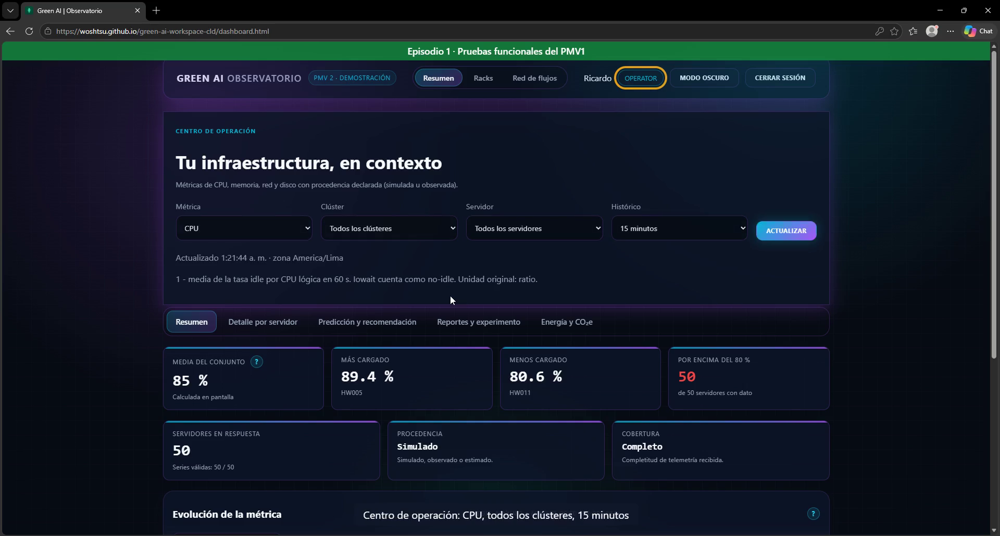
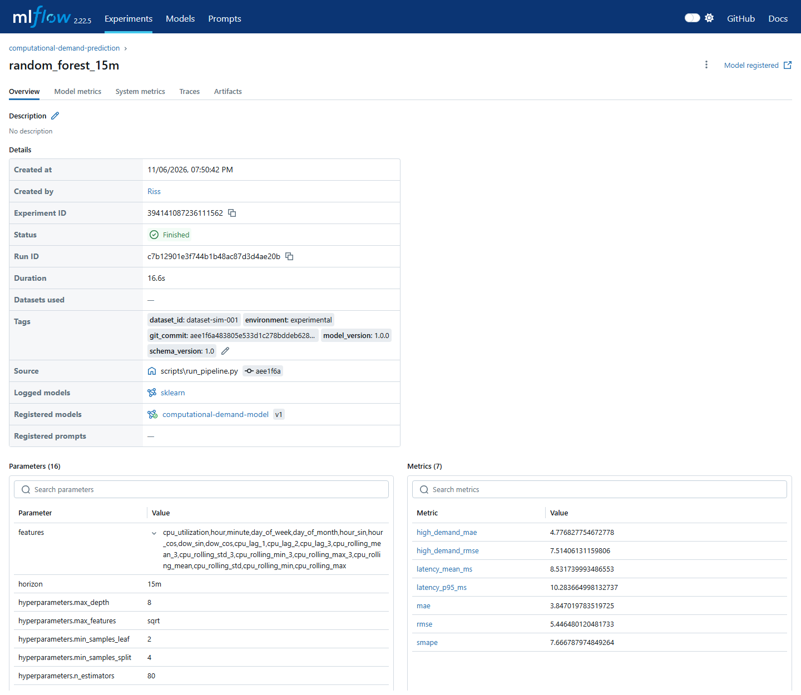
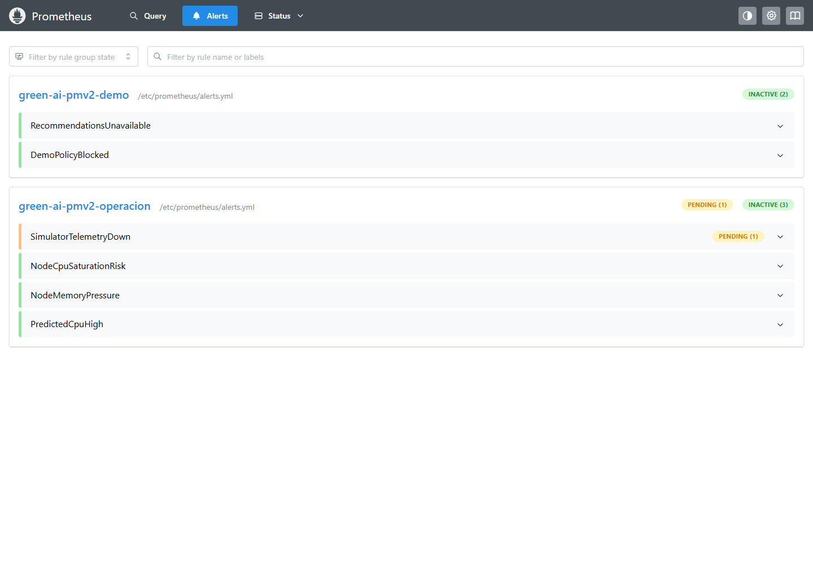
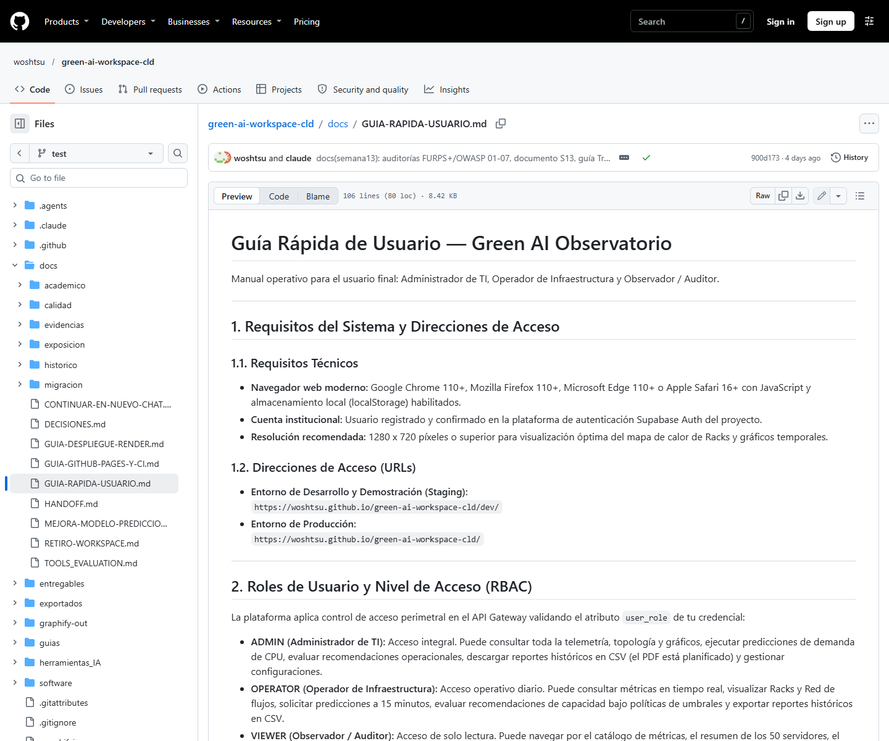
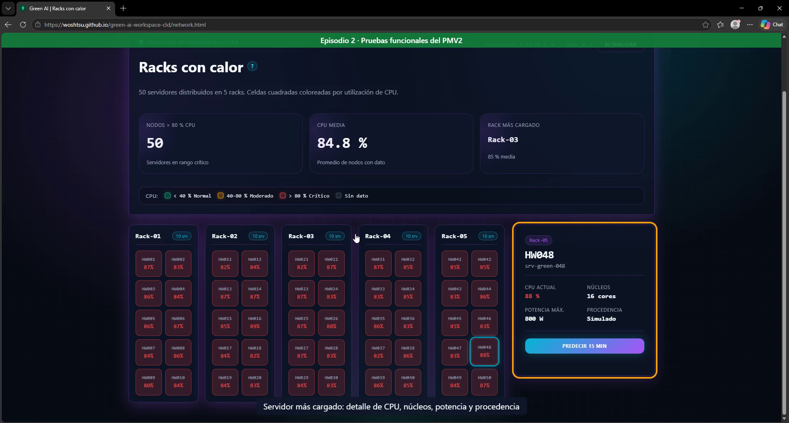
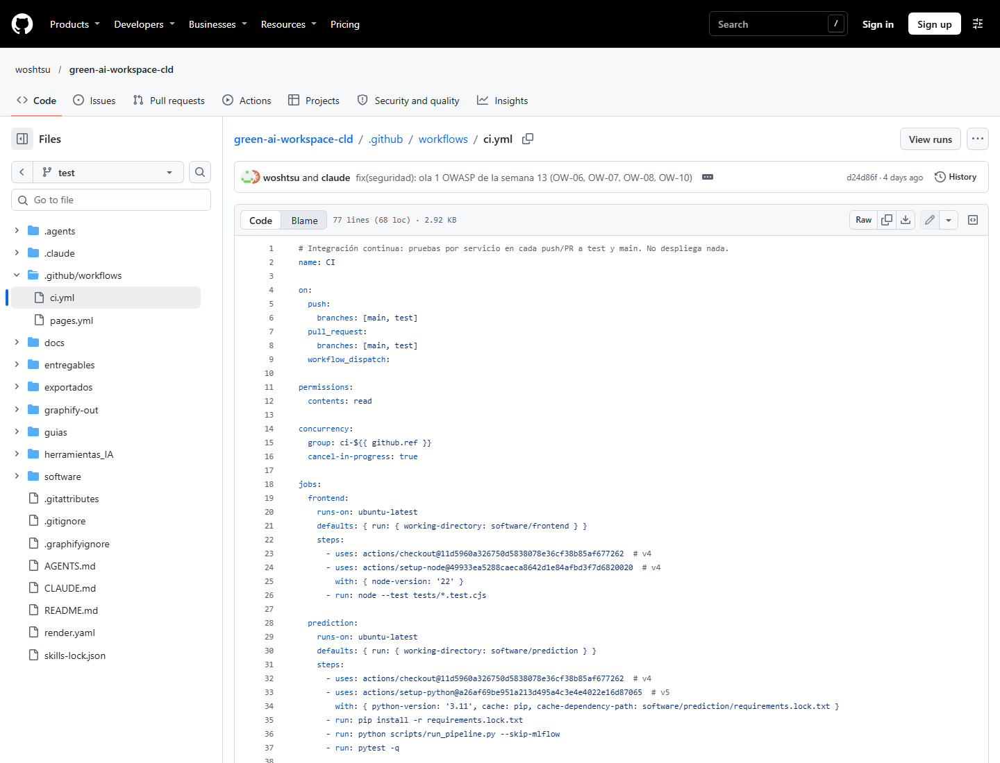
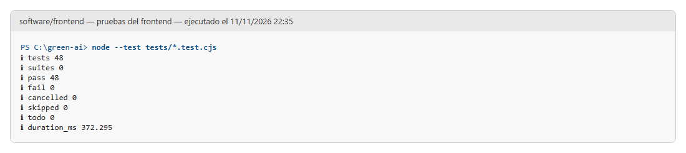

CAPTURA-PENDIENTE-S00: Insertar el logo oficial de la Universidad Continental y borrar este recuadro.

::: {custom-style="Portada Institucion"}
Universidad Continental
:::
::: {custom-style="Portada Escuela"}
Escuela Académico Profesional de Ingeniería de Sistemas e Informática
:::
::: {custom-style="Portada Curso"}
Taller de Proyectos 1 · Semana 13
:::
::: {custom-style="Portada Titulo"}
Aplicación de criterios de calidad de software al proyecto Green AI
:::
::: {custom-style="Portada Subtitulo"}
Evaluación con el modelo FURPS+ y OWASP Top 10, plan de mejora y validación
:::
::: {custom-style="Portada Etiqueta"}
Integrantes
:::
::: {custom-style="Portada Texto"}
Ricardo Porras Veli
:::
::: {custom-style="Portada Texto"}
Leonid Kisley Orlando Huamán Collazos
:::
::: {custom-style="Portada Texto"}
Gina Diana Barrera Peña
:::
::: {custom-style="Portada Texto"}
Jhonny Cristhian Quintana Carhuaricra
:::
::: {custom-style="Portada Texto"}
Claude (Anthropic, Opus 5.5) – agente de IA que ejecutó las auditorías y la ola 1 bajo supervisión del equipo
:::
::: {custom-style="Portada Etiqueta"}
Docente
:::
::: {custom-style="Portada Texto"}
Jorge Alfredo Guevara Jiménez
:::
::: {custom-style="Portada Etiqueta"}
NRC
:::
::: {custom-style="Portada Texto"}
NRC-PENDIENTE
:::
::: {custom-style="Portada Nota"}
Huancayo, noviembre de 2026
:::

# 1. Introducción y logro de la sesión

El desarrollo de soluciones de software contemporáneas para infraestructuras críticas demanda trascender la mera verificación de funcionalidad algorítmica. En proyectos orientados a la sostenibilidad computacional y eficiencia energética en centros de datos, como Green AI, la confiabilidad del cálculo, la protección perimetral frente a intrusiones externas, la operabilidad ágil y la mantenibilidad a largo plazo constituyen atributos de primer orden que determinan la viabilidad operativa del producto.

El logro de aprendizaje establecido para la Semana 13 estipula: «Al finalizar la sesión, el estudiante aplica criterios de calidad de software con claridad y propósito al proyecto». En concordancia con este objetivo, el equipo de ingeniería del proyecto Green AI ejecutó un proceso integral de evaluación, mejora sistemática y validación formal de calidad y seguridad, sustentado en dos de los marcos metodológicos más consolidados de la industria:

1. El modelo de factores de calidad FURPS+ (Hewlett-Packard / Rational Software Corp.), adaptado a los lineamientos institucionales de la Universidad Continental.
2. El estándar de seguridad de aplicaciones web y APIs OWASP Top 10 (edición 2021).

El presente documento sistematiza los resultados obtenidos en las tres fases del proceso metodológico: el diagnóstico inicial de calidad y seguridad, la formulación de los planes de mejora por olas de trabajo, la implementación verificable de la primera ola de mitigación (Ola 1), la auditoría de implementación independiente y el dictamen final integral. Asimismo, se incorpora la matriz de calidad docente con 50 preguntas de control técnico y la justificación explícita de las brechas que separan el estado actual del sistema respecto a la meta esperada.

# 2. Por qué aplicar calidad de software

La aplicación sistemática de criterios de calidad de software adquiere un papel neurálgico en Green AI debido a la naturaleza de su dominio. El sistema tiene por finalidad optimizar la capacidad y el consumo eléctrico de centros de datos mediante el monitoreo de telemetría de 50 servidores agrupados en racks y la inferencia anticipada de demanda de CPU a 15 minutos mediante modelos de Machine Learning (Random Forest).

Si un sistema de esta índole careciera de rigurosos controles de calidad, se enfrentarían riesgos severos:

1. Impacto operacional por falsas recomendaciones: Un error de cálculo en las políticas de recomendación o una falla en las restricciones operativas (latencia, memoria, tasa de errores) podría provocar la desactivación errónea de servidores en momentos de alta concurrencia, ocasionando degradación de servicio y penalizaciones por acuerdos de nivel de servicio (SLA).
2. Vulnerabilidad perimetral en infraestructuras híbridas: Al operar mediante microservicios distribuidos (Java Spring Boot, Python FastAPI, Go) y comunicarse con servicios en la nube (Supabase para autenticación y persistencia histórica, Render para despliegue de contenedores, GitHub Pages para distribución estática), una brecha en la validación de tokens JWT o configuraciones permisivas en el control de acceso a la base de datos expondría registros operacionales y credenciales de operadores.
3. Degradación por sobrecarga y tiempos de respuesta inadmisibles: Un diseño ineficiente en los adaptadores de persistencia o la carencia de límites de tasa (rate limiting) ante peticiones masivas de inferencia sobrecargaría los procesadores del backend, elevando paradójicamente el consumo energético que la solución busca mitigar.
4. Falta de transparencia y honestidad experimental: La adopción de afirmaciones no demostradas respecto a la procedencia de la telemetría induciría a error a los evaluadores y operadores. En Green AI, la aplicación de calidad garantiza declarar explícitamente que la telemetría actual proviene de simulación determinista controlada y que la potencia eléctrica corresponde a un modelo matemático lineal, preservando el rigor ético y científico del proyecto.

La calidad de software, por tanto, no representa una etapa cosmética o posterior al desarrollo, sino un principio rector transversal que garantiza que cada componente del monorepo sea determinista, seguro, mantenible y verificable a través de pruebas automatizadas continuas.

# 3. Modelo FURPS+ y OWASP Top 10

## 3.1. El Modelo de Calidad FURPS+

Propuesto originalmente por Robert Grady en Hewlett-Packard y adoptado formalmente por Rational Software, el modelo FURPS+ clasifica los atributos y requisitos de calidad de software en cinco categorías fundamentales, complementadas por factores de restricción («+»):

* F - Funcionalidad (Functionality): Evalúa la completitud del conjunto de características del sistema, las capacidades operacionales de los casos de uso, la seguridad de las transacciones y la consistencia del procesamiento de negocio. En Green AI, abarca los casos de uso del Producto Mínimo Viable (PMV1 y PMV2), tales como visualización de telemetría en tiempo real (HU-01), histórico paginado (HU-02), predicción de CPU a 15 minutos (HU-03), comparación de modelos (HU-04), experimentos en MLflow (HU-05), recomendaciones con restricciones (HU-06) y control de acceso RBAC (HU-14).
* U - Usabilidad (Usability): Examina los factores humanos en la interacción persona-computador, la ergonomía visual, la coherencia de navegación, la claridad de los mensajes de error, el tiempo requerido para completar tareas críticas y la documentación de ayuda al usuario.
* R - Confiabilidad (Reliability): Valora la capacidad del software para mantener su nivel de servicio en condiciones operativas normales y anómalas. Incluye la tolerancia a fallos, la gestión defensiva de errores mediante formatos estandarizados (RFC 7807), el aislamiento entre servicios mediante timeouts y la cobertura exhaustiva de pruebas unitarias, de integración y de humo.
* P - Rendimiento (Performance): Mide la velocidad de respuesta, el consumo eficiente de memoria RAM y procesador, la huella en disco de las imágenes de contenedor y el comportamiento del sistema ante condiciones de arranque en frío en infraestructuras de nube.
* S - Soporte y Mantenibilidad (Supportability): Analiza la modularidad de la base de código, la observancia de patrones arquitectónicos desacoplados (arquitectura hexagonal), la estabilidad de los contratos de interfaz (OpenAPI), la mantenibilidad del repositorio y la integración continua (CI/CD).
* «+» - Restricciones Adicionales: Incorpora restricciones de diseño (patrones arquitectónicos obligatorios), de implementación (lenguajes, bibliotecas compatibles y estándares de codificación), de interfaz (interacción segura con servicios externos como Supabase), físicas y de despliegue (orquestación mediante Docker Compose, viabilidad de hosting a costo cero en Render y GitHub Pages) y normativas legales (licencias Open Source y Ley N° 29733 de Protección de Datos Personales en el Perú).

## 3.2. El Estándar OWASP Top 10 (2021)

La iniciativa Open Web Application Security Project (OWASP) publica periódicamente el consenso global de las vulnerabilidades más críticas que amenazan a las aplicaciones web y APIs modernas. Su marco de referencia Top 10:2021 estructura la seguridad en diez categorías:

1. A01:2021 - Pérdida de Control de Acceso (Broken Access Control): Elusión de privilegios, acceso horizontal/vertical no autorizado y políticas de seguridad a nivel de fila (Row Level Security - RLS) insuficientes.
2. A02:2021 - Fallos Criptográficos (Cryptographic Failures): Transmisión o almacenamiento de información sensible en texto claro, protocolos obsoletos y manejo inseguro de claves de cifrado.
3. A03:2021 - Inyección (Injection): Fallos derivados de la interpolación de datos no confiables en intérpretes de comandos, consultas SQL/ORM o lenguajes de consulta de monitoreo (PromQL).
4. A04:2021 - Diseño Inseguro (Insecure Design): Ausencia de patrones de defensa en profundidad, modelos de amenazas no atendidos y carencia de límites de consumo de recursos (rate limiting).
5. A05:2021 - Configuración de Seguridad Incorrecta (Security Misconfiguration): Cabeceras HTTP de protección web ausentes, valores predeterminados inseguros y directivas de control de orígenes (CORS) excesivamente permisivas.
6. A06:2021 - Componentes Vulnerables y Obsoletos (Vulnerable and Outdated Components): Inclusión de paquetes desactualizados y carga de scripts externos desde redes de distribución de contenido (CDN) sin comprobación criptográfica de integridad.
7. A07:2021 - Fallos de Identificación y Autenticación (Identification and Authentication Failures): Debilidades en la verificación de tokens de sesión JWT, fijación de sesiones y almacenamiento indebido de credenciales en el cliente.
8. A08:2021 - Fallos en la Integridad del Software y de los Datos (Software and Data Integrity Failures): Uso de dependencias y flujos de automatización CI/CD dependientes de etiquetas mutables sin anclaje criptográfico inmutable.
9. A09:2021 - Fallos de Registro y Monitoreo de Seguridad (Security Logging and Monitoring Failures): Omisión de trazas de auditoría ante accesos no autorizados (errores HTTP 401/403) y ausencia de alertas automáticas ante incidentes.
10. A10:2021 - Falsificación de Peticiones del Lado del Servidor (Server-Side Request Forgery - SSRF): Capacidad de inducir al servidor a emitir peticiones no autorizadas hacia recursos internos o redes privadas aisladas.

En el marco metodológico del curso, las diez categorías de OWASP se integran directamente como el factor técnico de seguridad dentro del componente «+» del modelo FURPS+, estableciendo un examen exhaustivo de la robustez del sistema.

# 4. Metodología de trabajo y distribución de roles

## 4.1. Flujo Metodológico de 9 Pasos y 3 Fases

La ejecución del trabajo se apegó estrictamente a la «Guía para la Evaluación, Mejora y Validación de la Calidad y Seguridad de Software mediante FURPS+ y OWASP Top 10 utilizando Agentes de IA». Dicha guía estructura el ciclo de vida de aseguramiento de calidad en nueve pasos correlativos divididos en tres fases fundamentales:

* Fase 1: Evaluación y Mejora de Calidad (FURPS+)
  * Paso 1: Auditoría inicial FURPS+ (entregable 01_auditoria_furps.md).
  * Paso 2: Planificación de mejoras de calidad (entregable 02_plan_furps.md).
  * Paso 3: Aplicación controlada del plan por parte del equipo técnico.
  * Paso 4: Auditoría independiente de implementación FURPS+ (entregable 03_auditoria_implementacion_furps.md).
* Fase 2: Evaluación y Mejora de Seguridad (OWASP Top 10)
  * Paso 5: Auditoría inicial de seguridad OWASP (entregable 04_auditoria_owasp.md).
  * Paso 6: Planificación de remediación de vulnerabilidades (entregable 05_plan_owasp.md).
  * Paso 7: Aplicación controlada de las remediaciones programadas.
  * Paso 8: Auditoría independiente de implementación OWASP (entregable 06_auditoria_implementacion_owasp.md).
* Fase 3: Validación Global Integral
  * Paso 9: Auditoría final integral y emisión de dictamen técnico (entregable 07_auditoria_final.md).

## 4.2. Colaboración Humano-Agente y Corrección de Sobrecalificaciones

Una singularidad del proceso radica en el esquema de trabajo cooperativo entre los integrantes del equipo y los agentes de inteligencia artificial. Claude Code (Anthropic, Opus 5.5) actuó como coordinador metodológico, evaluador crítico e implementador directo de las remediaciones en la máquina de desarrollo local, mientras que Antigravity CLI (con modelo Gemini) fue asignado a la ejecución de borradores analíticos de auditoría y planes detallados.

Para garantizar la honestidad experimental, cada informe generado por un agente fue sometido a revisión cruzada contra el código fuente real del monorepo por parte del equipo y de Claude Code. Este filtro crítico resultó decisivo: la primera auditoría automatizada producida por un agente otorgó a Green AI una calificación del 96.00 % en FURPS+, asumiendo erróneamente que la presencia de maquetas en la interfaz equivalía a funcionalidad completa. Tras contrastar el reporte contra los endpoints y la base de datos, se identificaron brechas esenciales:

* La aprobación humana de recomendaciones operativas (HU-07) carecía de persistencia en base de datos.
* Los reportes históricos solo se exportaban en formato CSV plano, sin generación de documentos PDF formales (HU-13).
* El consumo energético y la potencia se basaban en un modelo matemático sintético, no en lecturas de sensores de hardware físicos en tiempo real (HU-09).
* La interfaz de MLflow operaba de forma local sin despliegue público en la nube (HU-05).

Tras subsanar estas sobrecalificaciones y ceñir la evaluación a la evidencia técnica verificable, la calificación inicial formal de FURPS+ se reajustó de manera transparente a 85.00 % (170 / 200 puntos brutos), garantizando un punto de partida verosímil y defendible.

## 4.3. Distribución de Responsabilidades por Integrante

Conforme a los requerimientos de la actividad colaborativa de la Semana 13, los factores del modelo de calidad FURPS+ y el estándar de seguridad OWASP fueron distribuidos formalmente entre los integrantes del equipo de proyecto, asumiendo cada uno la responsabilidad técnica sobre los hallazgos y las acciones correctivas:

| Factor | Dimensión de Calidad | Integrante Responsable | Rol en el Proyecto | Alcance y Responsabilidad Técnica |
|:---:|---|---|---|---|
| **F** | Funcionalidad | Jhonny Cristhian Quintana Carhuaricra | Product Owner (PO) | Verificación de historias de usuario (HU-01 a HU-15), casos de uso de PMV1 y PMV2, alcance de negocio y reporte de experimentación. |
| **U** | Usabilidad | Leonid Kisley Orlando Huamán Collazos | Ingeniero de Frontend y UX | Consistencia de interfaz, accesibilidad (ARIA / WCAG), diseño responsivo, ergonomía del mapa de calor de Racks y navegación en <= 3 pasos. |
| **R** | Confiabilidad | Ricardo Porras Veli | Arquitecto de Backend y Seguridad | Estandarización de errores (RFC 7807), sondas de salud (health checks), timeouts escalonados, suites de pruebas automatizadas y contratos de persistencia. |
| **P** | Rendimiento | Gina Diana Barrera Peña | Ingeniera de Datos y ML | Latencias de respuesta, optimización de consumo de memoria RAM, aligeramiento de imágenes Docker de inferencia y profiling de algoritmos. |
| **S** | Soporte / Mantenibilidad | Gina Diana Barrera Peña y Jhonny Quintana Carhuaricra | Equipo de Datos y Documentación | Desacoplamiento de arquitectura hexagonal, especificaciones OpenAPI versionadas, pipelines de CI en GitHub Actions e higiene del monorepo. |
| **+** | Restricciones Adicionales y OWASP | Ricardo Porras Veli (con apoyo de Claude Code) | Especialista en Ciberseguridad | Evaluación de las 10 categorías OWASP Top 10:2021, cabeceras HTTP, Subresource Integrity, anclaje inmutable de CI/CD y despliegue a costo cero. |

# 5. Fase 1 — Calidad de Software (Modelo FURPS+)

## 5.1. Auditoría Inicial FURPS+ (Entregable 01)

La auditoría formal de calidad de software se documentó en el informe docs/calidad/01_auditoria_furps.md, evaluando los microservicios del monorepo (software/gateway, software/monitoring, software/data-processing, software/prediction, software/simulator, software/frontend y software/infraestructura).

La calificación global inicial ponderada alcanzó 85.00 / 100 puntos (170 de 200 puntos brutos en la matriz de 40 preguntas), con el siguiente desglose por categoría:

| Factor FURPS+ | Ponderación | Puntaje Obtenido (0-100) | Nivel Cualitativo | Principales Brechas Identificadas |
|---|:---:|:---:|:---:|---|
| **Funcionalidad (F)** | 25 % | 78 / 100 | Aceptable | Aprobación humana de recomendaciones sin persistencia (HU-07), potencia eléctrica modelada sin sensores físicos (HU-09), MLflow UI sin exposición en nube (HU-05) y reporte histórico sin soporte PDF formal (HU-13). |
| **Usabilidad (U)** | 15 % | 80 / 100 | Aceptable | Ausencia de una guía rápida de usuario para la operación del sistema (M-U07), falta de escaneo formal WCAG 2.1 AA con Lighthouse y flujo de cálculo de energía en más de 3 pasos (M-U08). |
| **Confiabilidad (R)** | 20 % | 93 / 100 | Bueno | Excelente cobertura con 415+ pruebas y formato RFC 7807 problem+json. Brecha: riesgo de políticas permisivas en la base de datos externa de Supabase ante saturación. |
| **Rendimiento (P)** | 15 % | 87 / 100 | Bueno | Latencias locales inferiores a 30 ms en Java y 4 ms en Go. Brecha: retardo por arranque en frío (cold start de ~60 s) en Render Free Tier tras 15 minutos de inactividad (M-P01). |
| **Soporte (S)** | 15 % | 90 / 100 | Bueno | Monorepo limpio sin gitlinks ni repositorios anidados, CI automatizado en GitHub Actions y contratos OpenAPI vigentes. Brecha: acoplamiento de adaptadores en runner.py del Simulator. |
| **Restricciones (+)** | 10 % | 93 / 100 | Bueno | Punto único perimetral, orquestación unificada con Docker Compose, compatibilidad de licencias Open Source y apego estricto a la Ley N° 29733. Brecha: cuota compartida de 750 h/mes en Render. |
| **TOTAL PONDERADO** | **100 %** | **85.00 / 100** | **Satisfactorio** | **El sistema cumple las condiciones funcionales requeridas, requiriendo un plan de mejora por fases.** |

## 5.2. Plan de Mejora FURPS+ (Entregable 02)

El plan integral de mejora de calidad se estructuró en docs/calidad/02_plan_furps.md, fundamentándose en dos principios de diseño no negociables:
1. El sistema ya funciona: Se prohíbe cualquier refactorización agresiva o cambio de contratos que altere el comportamiento de los microservicios en producción.
2. Barrera de regresión obligatoria: Toda tarea exige la ejecución de su suite de pruebas correspondiente antes de su integración, garantizando cero regresiones funcionales sobre la línea base de más de 415 pruebas automatizadas:
   * Frontend: 48 pruebas en node:test.
   * Prediction Service: 100 pruebas en pytest.
   * Data Processing Service: 121 pruebas en pytest.
   * Monitoring Service: 112 pruebas en JUnit 5 / Maven.
   * API Gateway: 12 pruebas en Spring Cloud Gateway y 30 pruebas en Go test.
   * Simulator: 10 pruebas unitarias deterministas.
   * Smoke Test Global: 14/14 comprobaciones HTTP sobre el stack en ejecución.

El roadmap de mejora se programó en tres olas de trabajo:
* Ola 1 - Semana 13 (07/11/2026): Implementación inmediata documental y de usabilidad: redacción y publicación de la Guía Rápida de Usuario (M-U07).
* Ola 2 - Sprint 7 (17/11/2026 - 23/11/2026): Funcionalidades críticas y mantenibilidad: persistencia de aprobación de recomendaciones (HU-07 / M-F07), generación de reporte PDF institucional (HU-13 / M-F11), exposición y evidencia de MLflow UI (HU-05 / M-F05), verificación en Staging con sesión real (/dev/), refactorización hexagonal en Simulator (runner.py / M-S01), script keep-alive para precalentamiento en Render (M-P01) y tabla accesible para gráficos de Chart.js (M-U06).
* Ola 3 - Sprint 8 (24/11/2026 - 30/11/2026): Optimización avanzada y cierre de brechas operativas: optimización del flujo de cálculo de energía a tres pasos (M-U08) y desacoplamiento de blueprints de despliegue en Render (M-PL03).

## 5.3. Aplicación del Plan — Ola 1 (Semana 13)

Durante la Ola 1, el equipo implementó con éxito la mejora M-U07 mediante la creación del documento entregables/guia-de-uso/GUIA-RAPIDA-USUARIO.md.

La guía se redactó bajo los siguientes estándares de calidad:
1. Orientación por roles de usuario: Define explícitamente los alcances operativos para Administradores de TI (ADMIN), Operadores de Infraestructura (OPERATOR) y Observadores/Auditores (VIEWER).
2. Regla de diseño operacional de tres pasos: Cada uno de los 8 flujos de negocio esenciales del Observatorio fue estructurado de manera que el operador pueda completarlo en 3 pasos o menos, empleando las etiquetas y textos exactos de la interfaz gráfica:
   * Tarea 1: Iniciar sesión o registrarse (register.html / login.html).
   * Tarea 2: Visualizar métricas agregadas de los 50 servidores (dashboard.html).
   * Tarea 3: Inspeccionar Racks mediante el mapa de calor interactivo (network.html).
   * Tarea 4: Predecir la demanda de CPU a 15 minutos (método directo desde Racks o Centro de Operación).
   * Tarea 5: Evaluar recomendaciones operativas con restricciones de política.
   * Tarea 6: Descargar reportes históricos consolidados en formato CSV.
   * Tarea 7: Conmutar la apariencia visual entre Modo Claro y Modo Oscuro.
   * Tarea 8: Consultar el significado de indicadores y fórmulas mediante la ayuda contextual (botones «?»).
3. Transparencia y honestidad experimental: La guía incluye una sección final de advertencia ética que aclara al operador que la telemetría es de origen sintético y que el cálculo de consumo en vatios y kilovatios-hora deriva de un modelo matemático estandarizado.

## 5.4. Auditoría de Implementación FURPS+ (Entregable 03)

La auditoría independiente documentada en docs/calidad/03_auditoria_implementacion_furps.md verificó la efectividad de la Ola 1:
* La pregunta M-U07 transitó de No cumple (1 punto) a Cumple (5 puntos).
* El puntaje bruto del factor Usabilidad ascendió de 32 a 36 puntos (incrementando su nivel de apego del 80.00 % al 90.00 %).
* El puntaje total bruto de FURPS+ se elevó de 170 / 200 (85.00 %) a 174 / 200 (87.00 %), lo que representa un valor ponderado del 87.62 %.
* Se verificó la total ausencia de regresiones: la suite de pruebas del frontend ratificó 48 de 48 pruebas exitosas.

# 6. Fase 2 — Seguridad de Software (OWASP Top 10)

## 6.1. Auditoría Inicial de Seguridad OWASP (Entregable 04)

La evaluación de seguridad estática registrada en docs/calidad/04_auditoria_owasp.md analizó el perímetro web, los servicios de backend y las canalizaciones de CI/CD. Se determinó un Score Global de Seguridad inicial de 80.5 / 100 puntos, caracterizado por una defensa perimetral sólida pero con debilidades identificadas en configuraciones web y riesgos de cadena de suministro.

| ID OWASP | Categoría de Riesgo | Estado Inicial | Severidad Máxima | Puntuación (0-10) | Principales Hallazgos Identificados |
|---|---|---|---|:---:|---|
| **A01:2021** | Broken Access Control | Requiere Atención | Alto (no verificado) | 7.0 / 10 | Puertos locales expuestos en Docker Compose (OW-02) y riesgo latente de RLS permisivo en Supabase (OW-01). |
| **A02:2021** | Cryptographic Failures | Requiere Atención | Alto (no verificado) | 7.5 / 10 | Columna password en tabla usuario de snapshot (OW-03) y contraseñas sintéticas legibles en archivo Excel de datasets (OW-04). |
| **A03:2021** | Injection | Conforme / Mitigado | Bajo | 9.5 / 10 | Consultas parametrizadas con SQLite, escape riguroso en PostgREST y listas blancas estrictas en PromQL. |
| **A04:2021** | Insecure Design | Requiere Atención | Medio | 8.0 / 10 | Ausencia de Rate Limiting perimetral en Gateway para peticiones de inferencia pesadas (OW-05). |
| **A05:2021** | Security Misconfiguration | Requiere Atención | Medio | 7.0 / 10 | Ausencia de cabeceras defensivas HTTP (CSP, X-Frame-Options) en Nginx (OW-06) y sobrescritura en location de configuración (OW-07). |
| **A06:2021** | Vulnerable Components | Requiere Atención | Medio | 8.0 / 10 | Inclusión de scripts JS y hojas CSS externas desde CDN sin hash de integridad Subresource Integrity (OW-08). |
| **A07:2021** | Identification Failures | Conforme con Observación | Medio | 8.5 / 10 | Verificación rigurosa de claims JWT en Gateway; token de sesión persistido en localStorage del navegador (OW-09). |
| **A08:2021** | Software & Data Integrity | Requiere Atención | Bajo | 7.5 / 10 | Acciones de GitHub CI referenciadas con tags mutables v4/v5 (OW-10) e imágenes base de Docker sin fijación por digest SHA256 (OW-11). |
| **A09:2021** | Security Logging | Requiere Atención | Medio | 8.0 / 10 | Correlación distribuida con X-Request-Id y 6 alertas Prometheus; sin registro estructurado de auditoría para eventos 401/403 en Gateway (OW-12). |
| **A10:2021** | SSRF | Conforme / Mitigado | Bajo | 9.5 / 10 | Rutas upstream fijas, rechazo de redirecciones en cliente HTTP y validación de esquemas URL. |
| **GLOBAL** | **OWASP Top 10:2021** | **Nivel Bueno / Robusto** | **Medio Global** | **80.5 / 100** | **Perímetro seguro con recomendaciones focalizadas de remediación.** |

## 6.2. Plan de Remediación OWASP (Entregable 05)

El documento docs/calidad/05_plan_owasp.md definió la hoja de ruta técnica para subsanar los 12 hallazgos de seguridad (OW-01 a OW-12), agrupándolos estratégicamente en tres olas:
* Ola 1 - Inmediata (Semana 13, 07–09/11/2026): Endurecimiento perimetral y cadena de suministro sin riesgo de regresión: incorporación de cabeceras HTTP de protección en Nginx (OW-06, OW-07), incorporación de hashes SRI en scripts y hojas de estilo de CDN (OW-08) y fijación inmutable de GitHub Actions mediante SHA (OW-10).
* Ola 2 - Sprint 7 (17–23/11/2026): Seguridad en persistencia externa y Gateway: revisión y aplicación de políticas RLS restrictivas en Supabase (OW-01), retiro de la columna password en base de datos (OW-03), implementación de filtro de Rate Limiting por Token Bucket en Gateway (OW-05), registro estructurado de auditoría para eventos 401/403 (OW-12) y Content-Security-Policy mediante meta etiqueta HTML.
* Ola 3 - Sprint 8 (24–30/11/2026): Endurecimiento avanzado de contenedores y sesión: fijación de imágenes Docker base por digest SHA256 (OW-11), retiro de puertos internos en compose (OW-02), depuración de contraseñas de archivo Excel (OW-04) y transición de almacenamiento de sesión de localStorage hacia cookies con atributos HttpOnly y SameSite (OW-09).

## 6.3. Aplicación del Plan — Ola 1 de Seguridad

La ejecución de la Ola 1 de seguridad fue concretada y verificada mediante el commit d24d86f en la rama test, implementando las siguientes modificaciones:

1. OW-06 y OW-07: Blindaje de Cabeceras HTTP en Nginx
   En software/frontend/nginx.conf se incorporaron directivas de seguridad para mitigar ataques de Clickjacking, MIME-sniffing y fugas de contexto:
   * X-Frame-Options: DENY (impide que la consola sea incrustada en iframes maliciosos).
   * X-Content-Type-Options: nosniff (fuerza al navegador a respetar los tipos MIME declarados).
   * Referrer-Policy: no-referrer (evita el envío de URLs internas en peticiones salientes).
   * Permissions-Policy: geolocation=(), camera=(), microphone=() (deshabilita APIs invasivas del navegador).
   * Cross-Origin-Opener-Policy: same-origin (aísla el contexto de ejecución de ventanas secundarias).
   Asimismo, en el bloque específico location = /config.local.js se replicaron explícitamente estas directivas defensivas junto con Cache-Control: no-store, subsanando el comportamiento de Nginx que descarta cabeceras heredadas cuando un bloque hijo define encabezados propios.
2. OW-08: Subresource Integrity (SRI) en Recursos Externos
   Se añadieron atributos integrity con algoritmo SHA-384 y crossorigin="anonymous" en las 6 páginas HTML del frontend (index.html, login.html, register.html, dashboard.html, network.html y flows.html) para todas las bibliotecas consumidas desde CDN:
   * Supabase JS (v2.117.1): sha384-q36VSR1ktH2hgqgm+0LDeyqPW8CyZHSxfDSttSPm5ReOJzB+sYThmh7D4fE+jWTs.
   * Chart.js (v4.4.8): sha384-T/4KgSWuZEPozpPz7rnnp/5lDSnpY1VPJCojf1S81uTHS1E38qgLfMgVsAeRCWc4.
   * Font Awesome (v6.4.0): sha384-iw3OoTErCYJJB9mCa8LNS2hbsQ7M3C0EpIsO/H5+EGAkPGc6rk+V8i04oW/K5xq0.
   Esto inmuniza a los clientes frente al envenenamiento o alteración arbitraria de dependencias en servidores CDN externos.
3. OW-10: Inmunización de la Cadena de Suministro en CI/CD
   En los flujos .github/workflows/ci.yml y .github/workflows/pages.yml, se sustituyeron el 100 % de las referencias a GitHub Actions con etiquetas mutables (@v4, @v5) por sus respectivos hashes de commit inmutables de 40 caracteres (SHA-1), conservando la versión semántica como comentario inline (ej. actions/checkout@11d5960a326750d5838078e36cf38b85af677262 # v4).

## 6.4. Auditoría de Implementación OWASP (Entregable 06)

El informe docs/calidad/06_auditoria_implementacion_owasp.md constató la correcta aplicación de los cambios:
* Ninguna regresión detectada: La suite de frontend ejecutó 48 de 48 pruebas satisfactoriamente y la sintaxis de Nginx fue validada formalmente con resultado exitoso.
* Recálculo del Score Global de Seguridad: El puntaje ascendió de 80.5 / 100 a 85.0 / 100 (+4.5 puntos netos):
  * A05 (Security Misconfiguration): Pasa de 7.0 a 9.0 (+2.0 puntos) por cabeceras HTTP y corrección en config.local.js.
  * A06 (Vulnerable Components): Pasa de 8.0 a 9.5 (+1.5 puntos) gracias a la implementación integral de hashes SRI.
  * A08 (Integrity Failures): Pasa de 7.5 a 8.5 (+1.0 punto) por la fijación inmutable de GitHub Actions.
  * Las categorías A01, A02, A04, A07 y A09 permanecen estables según su programación para las Olas 2 y 3.

# 7. Matriz de evaluación FURPS+ y OWASP aplicada al proyecto

La siguiente tabla refleja la evaluación técnica individual sobre las 50 preguntas que integran el marco de calidad de Green AI: las 40 preguntas del modelo FURPS+ y las 10 preguntas correspondientes al factor técnico de seguridad OWASP Top 10. La escala de cumplimiento docente corresponde a: Cumple (5 puntos), Parcial (3 puntos) y No cumple (1 punto).

## 7.1. Matriz de Evaluación Docente Completa (50 Preguntas)

| FACTOR | id | PREGUNTA | ARTEFACTO | CUMPLIMIENTO | ACCIÓN CORRECTIVA O EVIDENCIA | RESPONSABLE | FECHA | PO | PD | NIVEL APEGO (%) |
|:---:|:---:|---|:---:|:---:|---|:---:|:---:|:---:|:---:|:---:|
| **F** | M-F01 | ¿Se ha implementado el caso de uso de visualización de métricas en tiempo real (HU-01)? | SOFTWARE | Cumple (5) | Catálogo y telemetría de 50 servidores vía Prometheus y Monitoring. Evidencia: software/monitoring y dashboard.html. Smoke 14/14. | — | — | 5 | 5 | 100.0 % |
| **F** | M-F02 | ¿Se ha implementado el caso de uso de consulta y paginación de históricos (HU-02)? | SOFTWARE | Cumple (5) | Endpoint /api/v1/historical-logs con paginación keyset y adaptador dual SQLite/Supabase. 114 tests de contrato. | — | — | 5 | 5 | 100.0 % |
| **F** | M-F03 | ¿Se ha implementado el caso de uso de predicción de demanda de CPU a 15 min (HU-03)? | SOFTWARE | Cumple (5) | Inferencia con Random Forest vía POST /v1/predictions con metadatos y origin=estimated. 100 pruebas pytest. | — | — | 5 | 5 | 100.0 % |
| **F** | M-F04 | ¿Se ha implementado la comparación de alternativas de modelos y estrategias (HU-04)? | SOFTWARE | Cumple (5) | Comparación de 4 modelos en pipeline y experimento Baseline reactivo vs Green AI predictivo en UI. Evidencia: plan experimental y dashboard. | — | — | 5 | 5 | 100.0 % |
| **F** | M-F05 | ¿Se ha implementado el registro y visualización de experimentos en MLflow (HU-05)? | HERRAMIENTA | Parcial (3) | Corridas registradas localmente en software/prediction/mlruns; falta captura de UI y servidor público en la nube. | Gina Barrera Peña | 14/11/2026 | 3 | 5 | 60.0 % |
| **F** | M-F06 | ¿Se ha implementado el caso de uso de recomendación con restricciones de política (HU-06)? | SOFTWARE | Cumple (5) | Evaluación de CPU, memoria, latencia y errores con executionAllowed=false para control humano. Evidencia: recommendations.py. | — | — | 5 | 5 | 100.0 % |
| **F** | M-F07 | ¿Se ha implementado la aprobación humana persistida de recomendaciones (HU-07)? | SOFTWARE | No cumple (1) | No existe flujo interactivo de aprobar/rechazar ni persistencia de decisiones en base de datos; solo bandera defensiva. | Ricardo Porras Veli | 20/11/2026 | 1 | 5 | 20.0 % |
| **F** | M-F08 | ¿Se ha implementado el cálculo de energía y CO2e a partir de potencia (HU-09)? | SOFTWARE | Parcial (3) | Cálculo de kWh por regla del trapecio implementado; potencia modelada sintéticamente, no de hardware real. Factor CO2e manual. | Gina Barrera Peña | 21/11/2026 | 3 | 5 | 60.0 % |
| **F** | M-F09 | ¿Se ha implementado el dashboard integrado de observabilidad (HU-11)? | SOFTWARE | Parcial (3) | Implementado en software/frontend/dashboard.html; probado en local; pendiente verificación con sesión real de Supabase en /dev/. | Leonid Huamán Collazos | 12/11/2026 | 3 | 5 | 60.0 % |
| **F** | M-F10 | ¿Se ha implementado el sistema de reglas de alerta de infraestructura (HU-12)? | SOFTWARE | Cumple (5) | 4 reglas configuradas en software/infraestructura/prometheus/alerts.yml, validadas formalmente con promtool. | — | — | 5 | 5 | 100.0 % |
| **F** | M-F11 | ¿Se ha implementado la generación y descarga de reportes históricos (HU-13)? | SOFTWARE | Parcial (3) | Endpoint genera resumen JSON y exportación CSV plano; exportación en formato PDF sigue pendiente. | Ricardo Porras Veli | 18/11/2026 | 3 | 5 | 60.0 % |
| **F** | M-F12 | ¿Se ha implementado el control de acceso y autorización RBAC (HU-14)? | SOFTWARE | Cumple (5) | Gateway valida claims user_role para roles ADMIN, OPERATOR y VIEWER. Evidencia: application.yaml y routes.go. | — | — | 5 | 5 | 100.0 % |
| **F** | M-F13 | ¿Se ha implementado el registro e inicio de sesión seguro (HU-15)? | HOSTING | Parcial (3) | Flujo PKCE y trigger SQL en supabase-auth-setup.sql; sin pruebas automatizadas con usuario real y pendiente verificar RLS. | Ricardo Porras Veli | 11/11/2026 | 3 | 5 | 60.0 % |
| **U** | M-U01 | ¿La interfaz cuenta con navegación organizada en pestañas y consistencia visual? | SOFTWARE | Cumple (5) | Consola organizada en 5 pestañas temáticas, layout responsive y navegación común en software/frontend. | — | — | 5 | 5 | 100.0 % |
| **U** | M-U02 | ¿El sistema dispone de soporte para temas visuales (modo oscuro y claro)? | SOFTWARE | Cumple (5) | Conmutador accesible con persistencia en localStorage y variables CSS en appearance.js. | — | — | 5 | 5 | 100.0 % |
| **U** | M-U03 | ¿Se cuenta con visualizaciones avanzadas de infraestructura (Racks con mapa de calor)? | SOFTWARE | Cumple (5) | Matriz interactiva de 50 servidores en 5 racks con umbrales semafóricos en network.html y 20 pruebas unitarias. | — | — | 5 | 5 | 100.0 % |
| **U** | M-U04 | ¿El sistema provee ayuda contextual comprensible y textos explicativos (botones «?»)? | SOFTWARE | Cumple (5) | Módulo de ayuda contextual detallando qué es, uso, cálculo y límites experimentales en help-content.js. | — | — | 5 | 5 | 100.0 % |
| **U** | M-U05 | ¿Se traducen los errores técnicos de la API a mensajes amigables para el usuario? | SOFTWARE | Cumple (5) | Clasificación de fallas en lenguaje humano con botones de acción sin códigos crípticos en friendly-errors.js. | — | — | 5 | 5 | 100.0 % |
| **U** | M-U06 | ¿La interfaz respeta estándares de accesibilidad (semántica HTML, ARIA y contraste)? | SOFTWARE | Parcial (3) | Marcado semántico y atributos ARIA completos; pendiente escaneo formal WCAG 2.1 AA con Lighthouse y tabla para Chart.js. | Leonid Huamán Collazos | 15/11/2026 | 3 | 5 | 60.0 % |
| **U** | M-U07 | ¿Se cuenta con una guía rápida de usuario para la operación del sistema? | GUÍA INST. | Cumple (5) | Subsanado en Ola 1: entregables/guia-de-uso/GUIA-RAPIDA-USUARIO.md documenta 8 flujos en <= 3 pasos con textos reales de la interfaz. | Jhonny Quintana Carhuaricra | 07/11/2026 | 5 | 5 | 100.0 % |
| **U** | M-U08 | ¿Se completa cualquier operación principal en tres pasos o menos? | SOFTWARE | Parcial (3) | Operaciones comunes en <= 3 pasos; cálculo de energía con archivo y factor toma 4 pasos, e inferencia CPU usa pestañas separadas. | Leonid Huamán Collazos | 17/11/2026 | 3 | 5 | 60.0 % |
| **R** | M-R01 | ¿Se manejan los errores de las APIs mediante el estándar RFC 7807 (problem+json)? | SOFTWARE | Cumple (5) | Respuestas application/problem+json uniformes con requestId en todos los microservicios. | — | — | 5 | 5 | 100.0 % |
| **R** | M-R02 | ¿Todos los microservicios exponen sondas de salud (health checks / liveness / readiness)? | SOFTWARE | Cumple (5) | Sondas /health/ready, Actuator y binario -healthcheck en Go operando con normalidad. | — | — | 5 | 5 | 100.0 % |
| **R** | M-R03 | ¿El sistema implementa timeouts defensivos para mitigar caídas de servicios upstream? | SOFTWARE | Cumple (5) | Timeouts escalonados en Gateway (6 s, 15 s, 30 s) y Data Processing (10 s) para evitar bloqueos en cascada. | — | — | 5 | 5 | 100.0 % |
| **R** | M-R04 | ¿Se cuenta con una batería de pruebas automatizadas y smoke test end-to-end? | HERRAMIENTA | Cumple (5) | 415+ pruebas automatizadas en 6 suites y smoke test de 14/14 pasos pasando satisfactoriamente. | — | — | 5 | 5 | 100.0 % |
| **R** | M-R05 | ¿La plataforma resiste caídas y saturación sin comprometer la base de datos de producción? | HOSTING | Parcial (3) | SQLite aísla desarrollo local; falta verificar resistencia ante carga masiva en PostgREST remoto y verificar RLS en Supabase. | Ricardo Porras Veli | 13/11/2026 | 3 | 5 | 60.0 % |
| **R** | M-R06 | ¿Se controla el retorno exitoso y no exitoso desde la base de datos? | SOFTWARE | Cumple (5) | Data Processing intercepta respuestas/errores de PostgREST y SQLite traduciéndolos a problem+json sin filtrar datos sensibles. | — | — | 5 | 5 | 100.0 % |
| **P** | M-P01 | ¿La operación y consulta responde en promedio en menos de 7 segundos hacia el usuario? | SOFTWARE | Parcial (3) | Local responde en < 30 ms (Java) y < 4 ms (Go); en Render Free Tier el cold start toma ~60 s tras 15 min de inactividad. | Leonid Huamán Collazos | 19/11/2026 | 3 | 5 | 60.0 % |
| **P** | M-P02 | ¿Hay un uso razonable del consumo de memoria RAM (< 512 MB por contenedor)? | SISTEMA OP. | Cumple (5) | Prediction consume 122–142 MiB; Gateway Go 2.3–9.8 MiB; Data Processing 76 MiB; Monitoring ~211 MiB. | — | — | 5 | 5 | 100.0 % |
| **P** | M-P03 | ¿Se cuenta con imágenes de contenedor optimizadas y ligeras para inferencia? | HERRAMIENTA | Cumple (5) | Dockerfile multi-etapa en Prediction redujo imagen en 82 % (de 2.85 GB a 510 MB); Gateway Go distroless de 16.2 MB. | — | — | 5 | 5 | 100.0 % |
| **S** | M-S01 | ¿El código fuente sigue los principios de arquitectura hexagonal (puertos y adaptadores)? | SOFTWARE | Parcial (3) | Hexagonal pura en backend; Simulator acopla adaptadores en application/runner.py importándolos directamente. | Ricardo Porras Veli | 24/11/2026 | 3 | 5 | 60.0 % |
| **S** | M-S02 | ¿Se cuenta con especificaciones de contratos de interfaz OpenAPI versionadas? | SOFTWARE | Cumple (5) | Contratos OpenAPI versionados en Gateway, Monitoring, Data Processing y Swagger en Prediction. | — | — | 5 | 5 | 100.0 % |
| **S** | M-S03 | ¿Se dispone de un flujo de integración continua (CI) que valide pruebas en cada cambio? | HERRAMIENTA | Cumple (5) | Workflow de GitHub Actions que ejecuta suites completas de pruebas en main y test. ci.yml y pages.yml blindados. | — | — | 5 | 5 | 100.0 % |
| **S** | M-S04 | ¿El monorepo cuenta con estructura limpia sin repositorios Git anidados ni gitlinks? | HERRAMIENTA | Cumple (5) | Repositorio unificado en la raíz; verificación git ls-files -s sin modo 160000; ramas principales main y test. | — | — | 5 | 5 | 100.0 % |
| **PLUS** | M-PL01 | ¿Cuenta con la guía de instalación y despliegue paso a paso para la nube? | GUÍA INST. | Cumple (5) | Guía detallada en docs/GUIA-DESPLIEGUE-RENDER.md para desplegar en Render y GitHub Pages sin secretos versionados. | — | — | 5 | 5 | 100.0 % |
| **PLUS** | M-PL02 | ¿Se cuenta con un instalador o mecanismo automático de arranque local (docker-compose)? | HERRAMIENTA | Cumple (5) | Archivo Docker Compose multi-servicio que arranca el stack completo con docker compose up en software/infraestructura. | — | — | 5 | 5 | 100.0 % |
| **PLUS** | M-PL03 | ¿Se cuenta con los espacios para alojar el software en calidad a costo cero? | HOSTING | Parcial (3) | Frontend en Pages y backend en Render Free Tier; limitaciones de suspensión (15 min) y cuota de 750 h/mes compartida. | Leonid Huamán Collazos | 22/11/2026 | 3 | 5 | 60.0 % |
| **PLUS** | M-PL04 | ¿El sistema invoca a otros sistemas externos de manera desacoplada y segura? | SOFTWARE | Cumple (5) | Conexión segura a Supabase Auth por JWKS público; sin llaves service_role en frontend ni backend. | — | — | 5 | 5 | 100.0 % |
| **PLUS** | M-PL05 | ¿El proyecto cumple con las restricciones de licencias de software y normativa legal? | SOFTWARE | Cumple (5) | Dependencias Open Source compatibles (Apache 2.0 / MIT); apego explícito a la Ley N° 29733 en el frontend. | — | — | 5 | 5 | 100.0 % |
| **PLUS** | M-PL06 | ¿Se cuenta con una guía de inicio o arranque del sistema? | GUÍA INST. | Cumple (5) | Documentado en README.md:L22-L38 y docs/CONTINUAR-EN-NUEVO-CHAT.md para Docker Compose, puertos y ejecución de pruebas. | — | — | 5 | 5 | 100.0 % |
| **OWASP** | OW-A01 | ¿Se tiene implementado el control de acceso contra A01: Broken Access Control? | SOFTWARE | Parcial (3) | RBAC sólido en Gateway (ADMIN/OPERATOR/VIEWER); pendiente verificar RLS en Supabase y aislar puertos locales. | Ricardo Porras Veli | 17/11/2026 | 3 | 5 | 60.0 % |
| **OWASP** | OW-A02 | ¿Se tiene implementada la protección criptográfica contra A02: Cryptographic Failures? | SOFTWARE | Parcial (3) | TLS forzado y verificación JWT asimétrica; pendiente eliminar columna password en BD y contraseñas de dataset Excel. | Ricardo Porras Veli | 17/11/2026 | 3 | 5 | 60.0 % |
| **OWASP** | OW-A03 | ¿Se tiene implementada la prevención contra A03: Injection? | SOFTWARE | Cumple (5) | Parámetros ligados en SQLite (?), escape en PostgREST, lista blanca PromQL y modelos Pydantic restrictivos. | — | — | 5 | 5 | 100.0 % |
| **OWASP** | OW-A04 | ¿Se tiene implementado el diseño seguro contra A04: Insecure Design? | SOFTWARE | Parcial (3) | Arquitectura hexagonal y principio fail-secure en recomendaciones; pendiente Rate Limiting perimetral en Gateway. | Ricardo Porras Veli | 20/11/2026 | 3 | 5 | 60.0 % |
| **OWASP** | OW-A05 | ¿Se tiene implementada la configuración segura contra A05: Security Misconfiguration? | SOFTWARE | Cumple (5) | Subsanado en Ola 1: cabeceras defensivas (X-Frame-Options, nosniff, COOP) en nginx.conf y corrección en config.local.js. | Ricardo Porras Veli | 07/11/2026 | 5 | 5 | 100.0 % |
| **OWASP** | OW-A06 | ¿Se tiene implementado el control contra A06: Vulnerable Components? | SOFTWARE | Cumple (5) | Subsanado en Ola 1: hashes Subresource Integrity (SRI) y crossorigin en todas las páginas HTML para scripts CDN. | Ricardo Porras Veli | 07/11/2026 | 5 | 5 | 100.0 % |
| **OWASP** | OW-A07 | ¿Se tiene implementada la autenticación robusta contra A07: Authentication Failures? | SOFTWARE | Parcial (3) | Validación exhaustiva de tokens JWT y claims en Gateway; observación por persistencia de token en localStorage. | Ricardo Porras Veli | 30/11/2026 | 3 | 5 | 60.0 % |
| **OWASP** | OW-A08 | ¿Se tiene implementada la integridad de software contra A08: Integrity Failures? | HERRAMIENTA | Cumple (5) | Subsanado en Ola 1: anclaje inmutable del 100 % de GitHub Actions por commit SHA en ci.yml y pages.yml. | Ricardo Porras Veli | 07/11/2026 | 5 | 5 | 100.0 % |
| **OWASP** | OW-A09 | ¿Se tiene implementado el registro y monitoreo contra A09: Security Logging Failures? | SOFTWARE | Parcial (3) | Trazabilidad con X-Request-Id y alertas Prometheus; pendiente registro de auditoría estructurado para 401/403 en Gateway. | Ricardo Porras Veli | 20/11/2026 | 3 | 5 | 60.0 % |
| **OWASP** | OW-A10 | ¿Se tiene implementada la protección contra A10: Server-Side Request Forgery (SSRF)? | SOFTWARE | Cumple (5) | Rutas upstream fijas en Gateway, validación estricta de esquemas URL y rechazo de redirecciones en cliente HTTP. | — | — | 5 | 5 | 100.0 % |

## 7.2. Tabla de Nivel de Apego por Factor (Inicial, Actual y Esperado)

Los puntajes consolidados del proyecto se resumen a continuación, reflejando el progreso obtenido tras la ejecución de la Ola 1 y la proyección hacia el cierre del ciclo de vida del proyecto. Los valores corresponden fielmente a los registros del archivo oficial exportados/semana13/MODELO-FURPSPLUS-Green-AI.xlsx generado para la sesión:

| Factor Evaluado | Preguntas | Puntaje Deseado (PD) | Puntaje Inicial (PO) | Apego Inicial (%) | Puntaje Actual Post Ola 1 | Apego Actual (%) | Puntaje Esperado (Meta) | Apego Esperado (%) | Variación Neta Ola 1 |
|---|:---:|:---:|:---:|:---:|:---:|:---:|:---:|:---:|:---:|
| **F — Funcionalidad** | 13 | 65 | 51 | 78.5 % | 51 | 78.5 % | 63 | 96.9 % | 0.0 % |
| **U — Usabilidad** | 8 | 40 | 32 | 80.0 % | 36 | 90.0 % | 40 | 100.0 % | +10.0 % |
| **R — Confiabilidad** | 6 | 30 | 28 | 93.3 % | 28 | 93.3 % | 30 | 100.0 % | 0.0 % |
| **P — Rendimiento** | 3 | 15 | 13 | 86.7 % | 13 | 86.7 % | 15 | 100.0 % | 0.0 % |
| **S — Soporte / Mantenibilidad** | 4 | 20 | 18 | 90.0 % | 18 | 90.0 % | 20 | 100.0 % | 0.0 % |
| **+ — Restricciones Adicionales** | 6 | 30 | 28 | 93.3 % | 28 | 93.3 % | 28 | 93.3 % | 0.0 % |
| **SUBTOTAL FURPS+ (01–03)** | **40** | **200** | **170** | **85.0 %** | **174** | **87.0 %** | **196** | **98.0 %** | **+2.0 %** |
| **OWASP — Seguridad Web (04–06)** | 10 | 50 | 30 | 60.0 % | 36 | 72.0 % | 48 | 96.0 % | +12.0 % |
| **TOTAL GENERAL CONSOLIDADO** | **50** | **250** | **200** | **80.0 %** | **210** | **84.0 %** | **244** | **97.6 %** | **+4.0 %** |

Nota metodológica sobre las métricas:
1. El informe docs/calidad/01_auditoria_furps.md reportó inicialmente un nivel de apego del 85.00 %, el cual evalúa de forma estricta las 40 preguntas del estándar FURPS+ (170 / 200 puntos). Al integrar las 10 preguntas de seguridad OWASP Top 10 en la matriz consolidada docente de 50 ítems, el puntaje inicial total fue de 200 sobre 250 puntos, lo que arroja un nivel de calidad inicial global del 80.0 %.
2. Tras la ejecución de la Ola 1, el puntaje global ascendió a 210 sobre 250 puntos (84.0 %), impulsado por la subsanación de M-U07 en Usabilidad (+4 puntos brutos) y las remediaciones de seguridad en cabeceras Nginx, SRI y anclaje SHA de GitHub Actions (+6 puntos brutos en los factores OW-A05, OW-A06 y OW-A08).
3. El detalle exhaustivo fila por fila para cada uno de los tres escenarios se encuentra particionado en las hojas correspondientes («Inicial», «Actual» y «Esperado») dentro del libro de trabajo Excel adjunto MODELO-FURPSPLUS-Green-AI.xlsx.

# 8. Nivel de calidad inicial y esperado: análisis de brechas

La progresión desde un nivel de calidad inicial del 80.0 % hasta un nivel actual del 84.0 % y una meta proyectada del 97.6 % ilustra un avance metodológico sustentado en evidencias. Sin embargo, un principio central de la ingeniería de software es reconocer con honestidad técnica por qué el sistema no alcanza —ni debe pretender alcanzar en esta fase académica— un 100.0 % de cumplimiento perfecto.

El análisis de brechas identifica tres condicionantes estructurales que impiden alcanzar el puntaje ideal:

1. Condicionantes Físicas y Financieras del Hosting Gratuito (Render Free Tier):
   El despliegue de backend a costo cero constituye un logro significativo para el proyecto, pero introduce limitaciones intrínsecas:
   * Suspensión por inactividad: Render suspende los contenedores tras 15 minutos sin tráfico entrante. El encendido subsecuente (cold start) impone latencias de 45 a 70 segundos para la primera petición, lo que vulnera el criterio estricto de respuesta menor a 7 segundos (M-P01).
   * Límite de memoria y CPU: Cada servicio dispone de 512 MB de memoria RAM no ampliable y cuota compartida de 750 horas mensuales por cuenta de usuario (PLUS-02 / M-PL03).
   * Debido a que estas restricciones son inherentes al modelo de alojamiento sin costo, la pregunta M-PL03 se mantiene deliberadamente en Parcial (3 puntos, 28/30 en el factor «+»), impidiendo el 100 % en dicha categoría.
2. Honestidad Experimental en la Medición de Telemetría y Potencia Eléctrica:
   En la pregunta M-F08 (cálculo de energía y CO2e), el sistema aplica formalmente la regla del trapecio sobre valores de potencia en vatios. Sin embargo, la potencia no proviene de mediciones de hardware reales ni sensores IPMI/PDU físicos, sino de un modelo lineal aproximado P = P_idle + (P_max - P_idle) * CPU (software/frontend/energy.js).
   Simular que esta potencia es una medición de laboratorio real violaría las directrices de integridad científica de la universidad. Por ende, la pregunta M-F08 se califica en Parcial (3 puntos) y se mantendrá en ese estado hasta que el centro de datos cuente con instrumentación de hardware real conectada por protocolos SNMP o Redfish.
3. Desacoplamiento de Persistencia Externa en la Nube:
   En el factor de seguridad OWASP (OW-A01 y OW-A02), persisten observaciones sobre la base de datos externa en Supabase (riesgo de políticas RLS permisivas registradas en snapshots históricos y presencia de la columna password). Mientras el administrador de la base de datos no ejecute y certifique las consultas de catálogo en vivo, la calificación se mantiene prudencialmente en Parcial.

Estas brechas no constituyen negligencia técnica, sino la delimitación consciente entre el alcance demostrativo de un prototipo de ingeniería riguroso y la operación corporativa a escala productiva.

# 9. Evidencias técnicas por pregunta y verificación de la Ola 1

Para fundamentar las calificaciones de la matriz docente y constatar la efectividad de las mejoras implementadas en la Ola 1, se presentan a continuación los registros de ejecución, comandos y salidas reales obtenidos del entorno de verificación (docs/evidencias/semana13-ola1-verificacion.md), complementados con las referencias de capturas de pantalla requeridas.

## 9.1. Pregunta M-F09 (Dashboard Integrado de Observabilidad - HU-11)

El Observatorio integra en una consola visual única el monitoreo de métricas en tiempo real, el detalle por servidor, la inferencia de demanda y la emisión de recomendaciones operativas.



## 9.2. Pregunta M-F05 (Registro y Visualización en MLflow - HU-05)

El entrenamiento y selección del modelo Random Forest para inferencia de CPU a 15 minutos se gestiona mediante MLflow, registrando parámetros de hiperparámetros, métricas de error (RMSE, MAE) y artefactos serializados.



## 9.3. Pregunta M-F10 (Sistema de Reglas de Alerta - HU-12)

Prometheus supervisa continuamente los umbrales de infraestructura mediante cuatro reglas declarativas de operación (grupo `green-ai-pmv2-operacion`, más dos de demostración en `green-ai-pmv2-demo`) validadas con la herramienta promtool.



## 9.4. Pregunta M-PL03 (Alojamiento en Hosting a Costo Cero)

La infraestructura de servicios contenerizados opera sobre el plan gratuito de Render, coordinando el API Gateway y los microservicios de backend.

CAPTURA-PENDIENTE-S04: Capturar el panel de control de Render mostrando los servicios desplegados del monorepo con los seis servicios green-ai-*-dev (prediction, data-processing, gateway, simulator, prometheus y monitoring) en estado activo.

## 9.5. Pregunta M-U07 (Guía Rápida de Usuario — Mejora Ola 1)

Subsanación documental que estructura la interacción del usuario final en 8 tareas principales de 3 pasos o menos.

```bash
# Verificación de correspondencia de textos reales entre la guía y la interfaz
grep -o -E "Registrar operador|Entrar al sistema|Centro de operación|Predecir 15 min|Evaluar recomendación" \
  software/frontend/*.html software/frontend/*.js
```

Resultado obtenido:
```text
software/frontend/dashboard.html:Centro de operación
software/frontend/dashboard.html:Evaluar recomendación
software/frontend/login.html:Entrar al sistema
software/frontend/network.html:Predecir 15 min
software/frontend/register.html:Registrar operador
```



## 9.6. Pregunta M-U03 (Visualización de Racks con Mapa de Calor)

Consola topológica interactiva que distribuye los 50 servidores simulados en 5 racks con código semafórico de carga de CPU.



## 9.7. Pregunta OW-A05 / M-U01 / M-PL04 (Cabeceras Defensivas HTTP en Nginx — OW-06 y OW-07)

Verificación de la sintaxis y de las cabeceras servidas por el contenedor web Nginx:

```bash
# Verificación de sintaxis de Nginx
docker run --rm -v .../nginx.conf:/etc/nginx/conf.d/default.conf:ro nginx:1.28.0-alpine nginx -t
```

Resultado obtenido:
```text
nginx: the configuration file /etc/nginx/nginx.conf syntax is ok
nginx: configuration file /etc/nginx/nginx.conf test is successful
```

```bash
# Inspección de cabeceras en /login.html y /config.local.js
curl -sSI http://127.0.0.1:13099/config.local.js   # contenedor nginx:1.28.0-alpine con nginx.conf montado
```

Resultado obtenido (07/11/2026; se omiten Date, ETag y Content-Length):
```text
HTTP/1.1 200 OK
Server: nginx/1.28.0
Content-Type: application/javascript
Cache-Control: no-store
X-Content-Type-Options: nosniff
Referrer-Policy: no-referrer
X-Frame-Options: DENY
Permissions-Policy: camera=(), microphone=(), geolocation=(), payment=()
Cross-Origin-Opener-Policy: same-origin
```

CAPTURA-PENDIENTE-S07: Capturar la terminal ejecutando el comando curl -sSI mostrando las cabeceras de seguridad devueltas por el servidor Nginx para /config.local.js y /login.html.

## 9.8. Pregunta OW-A06 (Subresource Integrity en CDN — OW-08)

Comprobación de la estabilidad y consistencia de los hashes criptográficos generados:

```bash
# Verificación de hash SRI para supabase-js 2.117.1
curl -sSfL https://cdn.jsdelivr.net/npm/@supabase/supabase-js@2.117.1 | \
  openssl dgst -sha384 -binary | openssl base64 -A
```

Resultado obtenido:
```text
q36VSR1ktH2hgqgm+0LDeyqPW8CyZHSxfDSttSPm5ReOJzB+sYThmh7D4fE+jWTs
```

Verificación en navegador sin errores de integridad:

CAPTURA-PENDIENTE-S08: Capturar la consola del desarrollador (F12) del navegador en login.html y dashboard.html evidenciando la ausencia total de errores de integridad SRI y la disponibilidad de los objetos window.supabase y window.Chart.

## 9.9. Pregunta OW-A08 / M-S03 (Anclaje Inmutable de GitHub Actions — OW-10)

Inspección de las canalizaciones automatizadas en .github/workflows/ci.yml y pages.yml:

```bash
# Inspección de referencias inmutables SHA en ci.yml
grep -n "uses: actions/" .github/workflows/ci.yml
```

Resultado obtenido:
```text
23:      - uses: actions/checkout@11d5960a326750d5838078e36cf38b85af677262  # v4
24:      - uses: actions/setup-node@49933ea5288caeca8642d1e84afbd3f7d6820020  # v4
32:      - uses: actions/checkout@11d5960a326750d5838078e36cf38b85af677262  # v4
33:      - uses: actions/setup-python@a26af69be951a213d495a4c3e4e4022e16d87065  # v5
43:      - uses: actions/checkout@11d5960a326750d5838078e36cf38b85af677262  # v4
44:      - uses: actions/setup-python@a26af69be951a213d495a4c3e4e4022e16d87065  # v5
53:      - uses: actions/checkout@11d5960a326750d5838078e36cf38b85af677262  # v4
54:      - uses: actions/setup-go@40f1582b2485089dde7abd97c1529aa768e1baff  # v5
63:      - uses: actions/checkout@11d5960a326750d5838078e36cf38b85af677262  # v4
64:      - uses: actions/setup-java@cf277c60eb25467037889841efdb72551f06f6c3  # v4
72:      - uses: actions/checkout@11d5960a326750d5838078e36cf38b85af677262  # v4
```



## 9.10. Verificación de Regresiones en Frontend (M-R04)

Ejecución de la suite modular de pruebas unitarias sobre el frontend tras las modificaciones de seguridad:

```bash
cd software/frontend && node --test tests/*.test.cjs
```

Resultado obtenido:
```text
ℹ tests 48
ℹ suites 0
ℹ pass 48
ℹ fail 0
ℹ cancelled 0
ℹ skipped 0
ℹ todo 0
ℹ duration_ms 496.619
```



# 10. Auditoría final integral: dictamen y recomendaciones

La síntesis de todo el ciclo de evaluación y mejora quedó formalizada en el informe docs/calidad/07_auditoria_final.md, emitido por el Auditor Principal de Calidad y Seguridad.

## 10.1. Dictamen Oficial de Calidad y Seguridad

El dictamen técnico emitido para el proyecto Green AI es:

**APTO PARA PRODUCCIÓN CON OBSERVACIONES**

## 10.2. Justificación Técnica del Dictamen

1. Cumplimiento de Calidad (FURPS+): El sistema alcanzó un nivel de apego auditado del **87.00 %** (87.62 % ponderado) en FURPS+, superando con holgura los requerimientos exigidos para un Producto Mínimo Viable (PMV2) de demostración académica.
2. Cumplimiento de Seguridad (OWASP Top 10): El Score de Seguridad auditado post Ola 1 se situó en **85.0 / 100**, evidenciando un perímetro protegido contra falsificación de orígenes (CORS), inyecciones y adulteración de dependencias.
3. Preservación de Funcionalidad: Cero (0) regresiones técnicas. Las 7 suites de pruebas del monorepo mantienen operativas más de 415 pruebas automatizadas pasando de manera ininterrumpida.
4. Nivel de Riesgo Operativo: Clasificado en **Riesgo Operativo Medio**, originado no por deficiencias de codificación, sino por las dependencias externas del entorno de demostración (cuotas de Render Free Tier, datos de potencia calculados sintéticamente y políticas RLS pendientes de certificación remota).

## 10.3. Recomendaciones Mandatorias para la Operación y Sustentación

Para garantizar una sustentación académica exitosa y sentar las bases de la transición hacia la siguiente fase de desarrollo, el Auditor Principal formula cuatro recomendaciones esenciales:
1. Procedimiento de Precalentamiento (Keep-Alive): En toda demostración o sustentación ante el jurado, el equipo debe enviar peticiones de precalentamiento a los servicios de Render con al menos 25 minutos de anticipación, mitigando el retardo de 60 segundos por arranque en frío.
2. Transparencia y Honestidad Científica: Mantener en toda presentación, diapositiva e informe que los datos corresponden a un entorno de data center simulado y que el cálculo energético obedece a un modelo determinista, lo que enaltece el valor metodológico del proyecto.
3. Verificación Mandatoria en Consola Supabase: El responsable de base de datos debe constatar en el editor SQL de Supabase la eliminación definitiva de la columna password en la tabla usuario y la remoción de directivas permisivas cmd: ALL para el rol público.
4. Ejecución del Roadmap de Olas 2 y 3: Continuar con la implementación de las tareas planificadas en los Sprints 7 y 8 (persistencia de aprobación de recomendaciones HU-07, reporte PDF formal HU-13 y rate limiting en Gateway) para alcanzar la meta proyectada del 97.6 % de apego global.

# 11. Conclusiones y qué aprendimos

El desarrollo de la sesión y la aplicación de los marcos FURPS+ y OWASP Top 10 dejan aprendizajes de alto valor formativo y profesional para el equipo de ingeniería:

1. Proceso de Software Incremental y Preservación de Funcionalidad:
   Aprendimos que la calidad no se logra mediante reescrituras masivas ni alteraciones disruptivas, sino a través de incrementos delgados, controlados y reversibles (olas de mejora). La adopción de barreras de regresión basadas en suites automatizadas (415+ tests) brindó la confianza requerida para modificar archivos de configuración crítica y código de marcado sin romper los microservicios existentes.
2. Producto de Software Web en Arquitectura Hexagonal:
   Se consolidó la importancia práctica de desacoplar el núcleo de negocio de los adaptadores de infraestructura. El uso de contratos OpenAPI rigurosos, formatos de error estándar (RFC 7807 problem+json) y un API Gateway perimetral permitió que microservicios políglotas (Java, Python, Go) convivan de manera armoniosa y admitan implementaciones alternativas (como el gateway ligero en Go) sin alterar la experiencia del cliente web.
3. Criterios de Calidad de Software y Evaluación Crítica:
   La aplicación del modelo FURPS+ enseñó a valorar las dimensiones no funcionales (Usabilidad, Confiabilidad, Rendimiento y Mantenibilidad) al mismo nivel de exigencia que las funcionalidades de negocio. Comprendimos que la honestidad experimental es un valor superior: reajustar una sobrecalificación inicial del 96 % al 85 % real refuerza la solidez técnica del proyecto ante cualquier auditoría externa.
4. Herramientas de Evaluación y Seguridad Aplicada:
   El análisis bajo OWASP Top 10 reveló que la seguridad debe concebirse en profundidad. Aprendimos a blindar la cadena de suministro en CI/CD mediante hashes SHA inmutables, a proteger a los usuarios frente a alteraciones de CDN con Subresource Integrity (SRI) y a configurar cabeceras defensivas en Nginx para mitigar vectores de explotación como Clickjacking y MIME-sniffing.
5. Colaboración Sinergica con Agentes de Inteligencia Artificial:
   La interacción entre Claude Code y Antigravity CLI demostró el potencial de los agentes autónomos en tareas complejas de auditoría, redacción documental y verificación técnica, siempre que exista una supervisión humana rigurosa que guíe los criterios de aceptación, examine los diffs de código y valide la ausencia de alucinaciones contra el repositorio real.

# 12. Anexos y trazabilidad en el repositorio

Para fines de verificación, auditoría y trazabilidad académica, todos los artefactos documentales, archivos de configuración y suites de código citados en este informe se encuentran versionados en el repositorio oficial de GitHub del proyecto:

* Repositorio oficial: https://github.com/woshtsu/green-ai-workspace-cld
* Rama base de desarrollo y calidad: test
* Matriz de Calidad en formato Excel: exportados/semana13/MODELO-FURPSPLUS-Green-AI.xlsx

## Relación de Entregables del Ciclo de Calidad y Seguridad (01–07)

1. docs/calidad/01_auditoria_furps.md  
   Auditoría Integral de Calidad de Software bajo el Modelo FURPS+ (Línea base inicial: 85.00 %).  
   Enlace en repositorio: https://github.com/woshtsu/green-ai-workspace-cld/blob/test/docs/calidad/01_auditoria_furps.md
2. docs/calidad/02_plan_furps.md  
   Plan Integral de Mejora de Calidad de Software (Estrategia en tres olas y barreras de regresión).  
   Enlace en repositorio: https://github.com/woshtsu/green-ai-workspace-cld/blob/test/docs/calidad/02_plan_furps.md
3. docs/calidad/03_auditoria_implementacion_furps.md  
   Auditoría Independiente de Implementación FURPS+ (Puntaje verificado post Ola 1: 87.00 %).  
   Enlace en repositorio: https://github.com/woshtsu/green-ai-workspace-cld/blob/test/docs/calidad/03_auditoria_implementacion_furps.md
4. docs/calidad/04_auditoria_owasp.md  
   Auditoría de Seguridad de Aplicaciones Web y APIs según OWASP Top 10:2021 (Score inicial: 80.5 / 100).  
   Enlace en repositorio: https://github.com/woshtsu/green-ai-workspace-cld/blob/test/docs/calidad/04_auditoria_owasp.md
5. docs/calidad/05_plan_owasp.md  
   Plan de Remediación de Vulnerabilidades de Seguridad OWASP Top 10 (Roadmap en tres olas).  
   Enlace en repositorio: https://github.com/woshtsu/green-ai-workspace-cld/blob/test/docs/calidad/05_plan_owasp.md
6. docs/calidad/06_auditoria_implementacion_owasp.md  
   Auditoría Independiente de Implementación de Seguridad OWASP (Score verificado post Ola 1: 85.0 / 100).  
   Enlace en repositorio: https://github.com/woshtsu/green-ai-workspace-cld/blob/test/docs/calidad/06_auditoria_implementacion_owasp.md
7. docs/calidad/07_auditoria_final.md  
   Dictamen Final Integral de Calidad y Seguridad de Software («Apto para producción con observaciones»).  
   Enlace en repositorio: https://github.com/woshtsu/green-ai-workspace-cld/blob/test/docs/calidad/07_auditoria_final.md

## Documentos Técnicos Complementarios de Evidencia

* docs/evidencias/semana13-ola1-verificacion.md: Registro de comandos y resultados de la verificación técnica de la Ola 1.
* entregables/guia-de-uso/GUIA-RAPIDA-USUARIO.md: Manual operativo en 8 flujos de <= 3 pasos para el usuario final (M-U07).
* docs/GUIA-DESPLIEGUE-RENDER.md: Procedimiento de despliegue contenerizado a costo cero en Render.
* docs/HANDOFF.md: Bitácora de ingeniería, arquitectura hexagonal, inventario de pruebas y directrices de honestidad experimental.
