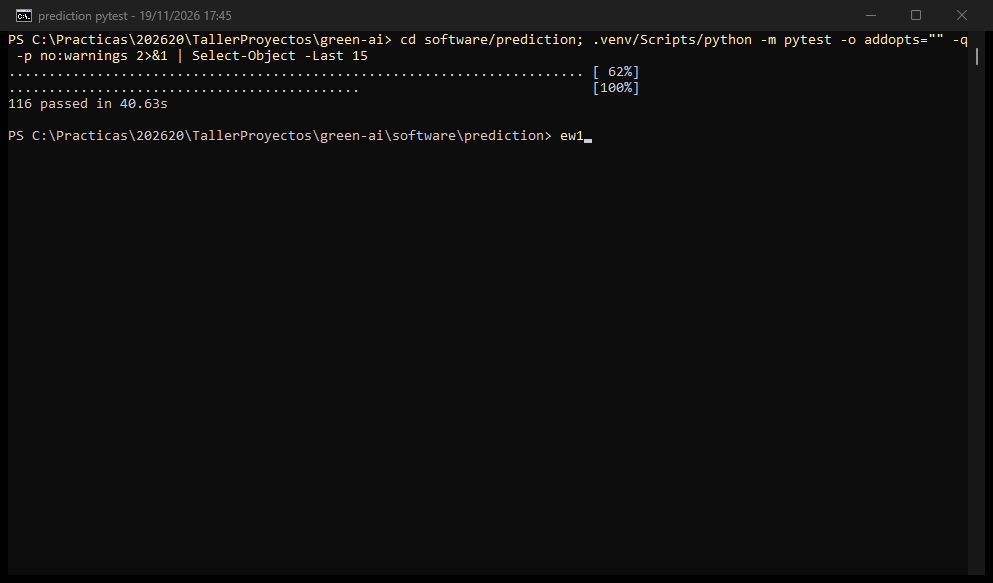
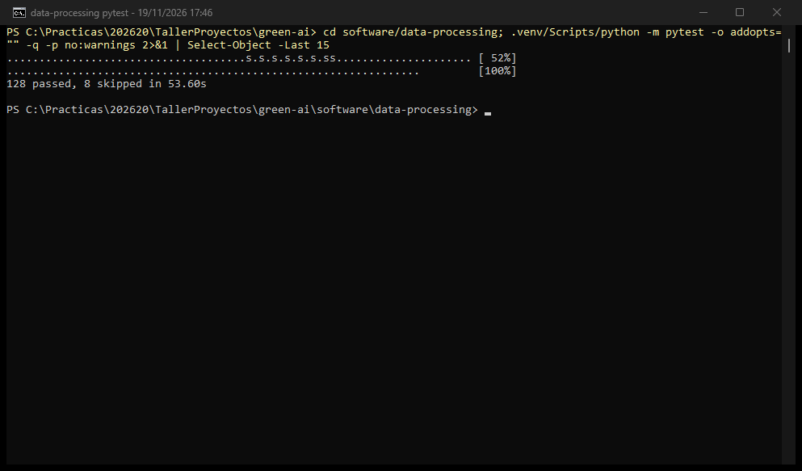
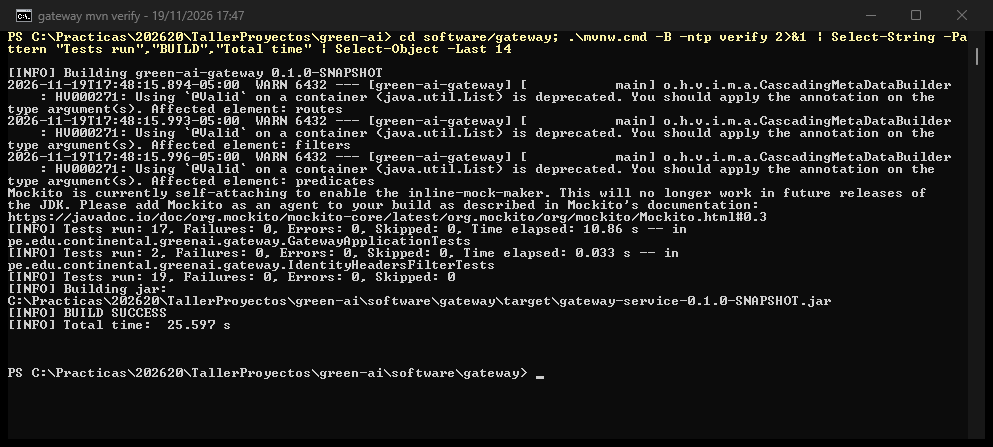
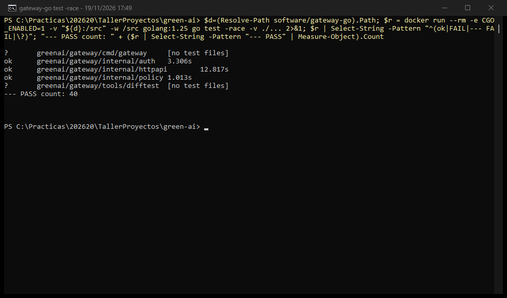
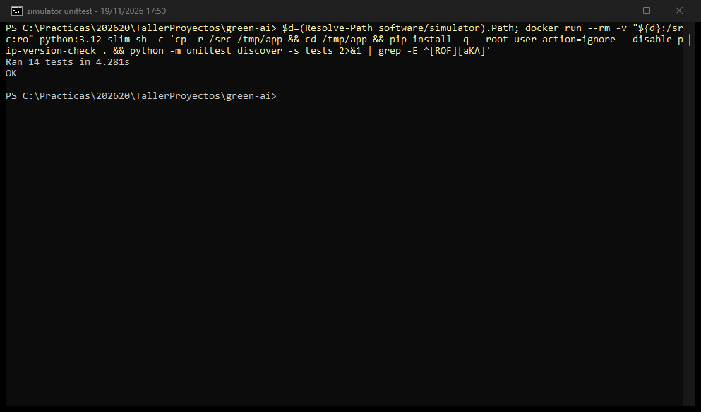
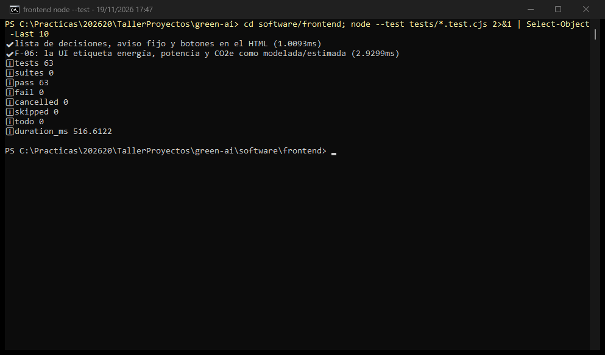
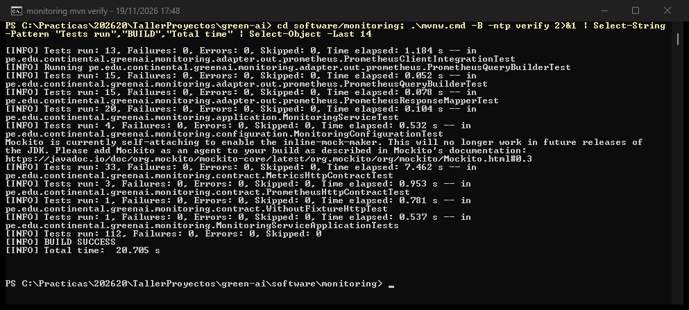
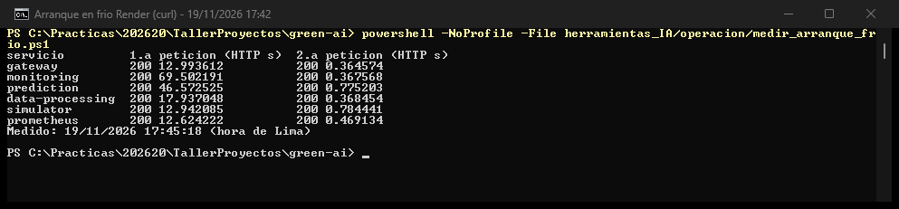

# Sprint 7 — Implementación de la ola 2 de mejoras (FURPS+ / OWASP)

Proyecto Green AI · Taller de Proyectos 1 · NRC 30170 · Sprint 7 (17/11/2026 – 23/11/2026) · corte: 19/11/2026

Equipo: Ricardo Porras Veli, Leonid Kisley Orlando Huamán Collazos, Gina Diana Barrera Peña, Jhonny Cristhian Quintana Carhuaricra. Asistentes de IA: Claudio (Claude de Anthropic) como coordinador y revisor, con subagentes para la implementación en ramas separadas.

Fuente del plan: `guias/semana14/FURPS+ Y OWASP/Ejecuciones/02_Plan_FURPS.md` y la ola 2 comprometida en el entregable de la semana 13. Contratos: `docs/contratos/sprint7-ola2.md`.

## 1. Resumen

| ID | Mejora | Estado al 19/11 | Evidencia |
|---|---|---|---|
| F-02 / HU-07 | Decisión humana persistente (aprobar/rechazar) sobre recomendaciones | **Implementada y probada en local**; no desplegada | Figuras 1 a 4 |
| F-05 / HU-13 | Reporte histórico en PDF | **Implementada y probada en local**; no desplegada | Figura 2 |
| U-02 / M-U06 | Tabla textual accesible equivalente al gráfico Chart.js | **Implementada**; sin escaneo axe/Lighthouse ni lector de pantalla | Figura 6 |
| F-06 / HU-09 | Etiquetas «modelada/estimada» en potencia, energía y CO₂e | **Implementada** | Figura 6 |
| S-01 / M-S01 | Desacoplar adaptadores del caso de uso del Simulator | **Implementada**; salida determinista idéntica antes/después | Figura 5 |
| F-04 / HU-05 | Consulta de experimentos MLflow | **Documentada** (`docs/operacion/mlflow-y-precalentamiento.md`); MLflow no bloquea la inferencia | Captura C303 del informe |
| P-01 / M-P01 | Arranque en frío de Render y precalentamiento controlado | **Medido** y documentado (sin ping permanente) | Figura 7 |
| F-01 / HU-15 | Verificar y endurecer RLS de Supabase y columna `password` | **Pendiente**: requiere acceso administrativo a Supabase y autorización del equipo | — |
| F-03 / HU-11 | Validar el dashboard con sesión real en `/dev/` | **Pendiente**: requiere iniciar sesión con una cuenta del equipo | — |
| R-01 / M-R05 | Pruebas de carga controladas en staging | **Pendiente** (depende de F-01) | — |
| U-03 / M-U08 | Flujo de energía en tres pasos | Ola 3 (Sprint 8) | — |

## 2. Qué se implementó

### HU-07 · Decisión humana persistente (F-02)
- **Prediction Service:** `POST` y `GET /v1/recommendations/{recommendationId}/decisions`. La decisión es un registro de auditoría: guarda usuario, rol, decisión, comentario, fecha y el SHA-256 de la recomendación evaluada; `executionAllowed` sigue siendo `false` y nada se ejecuta. Un usuario decide una sola vez por recomendación (409). El rol VIEWER puede consultar pero no decidir (403).
- **Seguridad (hallazgo H-01 de la ingeniería inversa):** como Prediction es accesible en Render sin pasar por el Gateway, la identidad solo se acepta si llega el secreto compartido `X-Green-Gateway-Secret` = `GATEWAY_SHARED_SECRET`. Sin la variable, las rutas responden 503 (falla cerrado).
- **Gateways Java y Go:** publican las rutas nuevas (solo UUID), aplican RBAC, eliminan las cabeceras de identidad que envíe el cliente y las reponen desde el JWT validado.
- **Persistencia:** SQLite (`DECISIONS_DB_PATH`) detrás del puerto `DecisionRepository`. En Render el disco es efímero; la migración equivalente para Supabase (`software/prediction/migrations/001_recommendation_decisions.sql`, con RLS) **no se ha aplicado**.
- **Frontend:** botones «Aprobar» y «Rechazar» con comentario opcional y lista de decisiones, con el texto «Registrar una decisión no ejecuta ningún cambio»; ocultos para VIEWER.

### HU-13 · Reporte en PDF (F-05)
- Data Processing acepta `format=pdf` en el reporte histórico, con los mismos datos y validaciones que JSON y CSV y la leyenda «Datos simulados; energía modelada, no medida». Puerto `ReportRenderer` con adaptador fpdf2. Botón «Descargar PDF» en el frontend.
- Coste: la imagen Docker de Data Processing pasa de 426 MB a 498 MB (fpdf2, Pillow y fonttools), medido con `docker images` el 19/11.

### U-02, F-06 y S-01
- Tabla «Ver datos en tabla» bajo el gráfico de evolución, con los mismos datos del canvas, `caption` y encabezados con `scope`; el canvas tiene `role="img"` y descripción.
- Etiquetas «modelada/estimada» en la pestaña de energía, tarjetas de energía y CO₂e y en la potencia máxima de Racks.
- El caso de uso del Simulator ya no importa adaptadores: puertos en `application/ports.py` y ensamblaje en `adapters/composition.py`. La salida con semilla 42 es idéntica antes y después (mismo md5 de `samples.jsonl`).

## 3. Pruebas (capturas reales de consola, 19/11/2026)

| Servicio | Resultado | Antes del Sprint 7 |
|---|---|---|
| Prediction | 116 passed | 100 |
| Data Processing | 128 passed, 8 skipped | 121 passed, 8 skipped |
| Gateway Java | 19 tests, 0 fallos, BUILD SUCCESS | 12 |
| Gateway Go | 40 PASS, 0 FAIL (`go test -race`) | 32 |
| Simulator | Ran 14 tests, OK | 10 |
| Frontend | 63 pass, 0 fail | 48 |
| Monitoring | 112 tests, 0 fallos, BUILD SUCCESS | 112 |
| **Total** | **492 aprobadas** | 435 |

*Figura 1. Prediction Service: 116 pruebas aprobadas, incluidas las 16 de decisiones HU-07 (secreto del Gateway, 401, 403 VIEWER, 409 duplicado, 422, 503 sin secreto).*

*Figura 2. Data Processing: 128 aprobadas y 8 omitidas, incluidas las 7 del reporte PDF.*

*Figura 3. Gateway Java: 19 pruebas (17 de aplicación y 2 del filtro de identidad), BUILD SUCCESS.*

*Figura 4. Gateway Go: 40 pruebas con detector de carreras, 0 fallos.*

*Figura 5. Simulator: 14 pruebas, incluida la que verifica con `ast` que la aplicación no importa adaptadores.*

*Figura 6. Frontend: 63 pruebas (15 nuevas: tabla accesible, URL del PDF, decisiones y etiquetas modeladas).*

*Figura 6.a. Monitoring sin regresiones: 112 pruebas.*

*Figura 7. Arranque en frío medido en Render Free: primera petición tras inactividad (12,6–69,5 s) y segunda (< 0,8 s).*

## 4. Lo que falta y quién lo hace

| Pendiente | Por qué no se hizo | Responsable sugerido |
|---|---|---|
| Desplegar en Render (pasar `test` → `main`) y configurar `GATEWAY_SHARED_SECRET` en Prediction y Gateway | Cambio de producción y de secretos remotos: requiere autorización del equipo | Ricardo / Leonid |
| Aplicar la migración de decisiones en Supabase (o mantener SQLite efímero) | Cambio de base de datos de producción | Ricardo, con F-01 |
| F-01: exportar y revisar las políticas RLS reales y la columna `password` de `usuario` | Requiere acceso administrativo a Supabase | Ricardo / Gina |
| F-03: validar el dashboard con sesión real en `/dev/` (incluye probar Aprobar/Rechazar, PDF y la tabla accesible en navegador) | Requiere iniciar sesión con una cuenta del equipo | Leonid |
| U-02: escaneo axe/Lighthouse y prueba con lector de pantalla | Requiere navegador con sesión | Leonid |
| R-01: carga controlada en staging | Depende de F-01 | Jhonny |
| Revisión del PR de integración por otro integrante | Política DoD (criterio 3) | Cualquier integrante distinto del autor |
