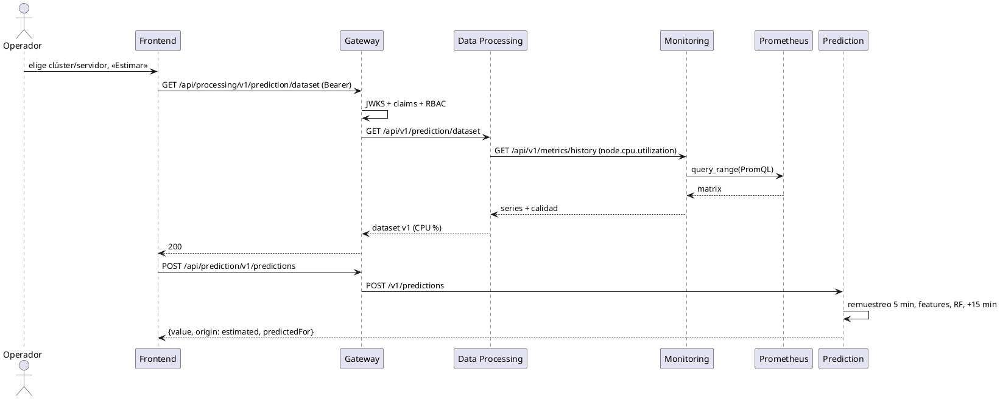

# Modelo de dominio — Prompt 8: Reconstrucción del Dominio (DDD)

> **Rol:** Experto en Domain Driven Design · **Fase 5** · Reconstrucción a partir del código fuente (no de la documentación académica). Cada elemento indica su archivo de origen.

## 1. Dominio y subdominios

**Dominio:** gestión eficiente de capacidad computacional en un centro de datos («Green AI»): observar la carga de los servidores, anticipar la demanda de CPU y proponer ajustes de capacidad **sujetos a revisión humana**, cuantificando la energía con honestidad sobre la procedencia de los datos.

| Subdominio | Tipo | Bounded Context | Servicio |
|---|---|---|---|
| Predicción de demanda y política de capacidad | **Núcleo** (*core*) | Predicción y Recomendación | Prediction |
| Observación de telemetría | Soporte | Observación | Monitoring (+ Prometheus) |
| Preparación de datos e históricos | Soporte | Procesamiento de Datos | Data Processing |
| Generación de telemetría sintética | Soporte | Simulación | Simulator |
| Identidad y acceso | Genérico | Identidad (Supabase) + Política de Acceso | Supabase, Gateway |

### Mapa de contextos

```text
 ┌──────────────┐   Published Language        ┌──────────────┐  Conformist (lee PromQL)  ┌──────────────┐
 │  Simulación  │──(exposition format)───────►│  Prometheus  │◄──────────────────────────│  Observación │
 │  (Simulator) │   node_* {cluster,node,     │   (externo)  │                           │ (Monitoring) │
 └──────────────┘    origin}                  └──────────────┘                           └──────┬───────┘
                                                                                                 │ Open Host Service
                                                                                                 │ (monitoring-v0.1)
                                                    Anti-Corruption Layer                       ▼
 ┌──────────────┐  Customer/Supplier       ┌───────────────────────────────────────────────────────────┐
 │  Predicción  │◄─(dataset v1 provisional)│  Procesamiento de Datos (Data Processing)                  │
 │      y       │                          │  ACL: monitoring_contract.py valida todo payload entrante  │
 │ Recomendación│                          └───────────────────────────┬───────────────────────────────┘
 └──────┬───────┘                                                      │ Conformist (PostgREST)
        │                                                              ▼
        │ Shared Kernel mínimo: Resource{type,cluster,id}, origin   ┌──────────────┐
        └─────────────────────────────────────────────────────────► │   Supabase   │◄── Identidad (Auth,
                                                                     │ (logs, users)│     user_roles, hook)
            Política de Acceso (Gateway) ── Conformist del JWT ────► └──────────────┘
```

**Lenguaje ubicuo detectado:** recurso/nodo, clúster, métrica, muestra, calidad (`valid`, `missing`, `non_finite`, `out_of_range`), procedencia/origen (`observed`, `simulated`, `estimated`, `unknown`), estado de datos (`complete`, `partial`, `no_data`), ventana, horizonte, predicción, política, comprobación (*check*), elegible para revisión, bloqueada, no evaluable, ejecución permitida, energía modelada, factor de emisión con fuente.

## 2. Entidades

| Entidad | Identidad | Atributos | Contexto | Fuente |
|---|---|---|---|---|
| **Node** (servidor) | `id` (regex `^[A-Za-z0-9][A-Za-z0-9_.:-]{0,127}$`) | `logical_cpus`, `memory`, `interfaces[]`, `filesystems[]` | Simulación | `simulator/domain/inventory.py` |
| **Hardware** | `hardware_id` (1–20) | `hostname`, `ip_address`, `cpu_cores`, `ram_gb`, `max_watts`, `ubicacion_rack`, `estado`, `usuario_id` | Procesamiento (persistencia) | `sqlite/schema.sql`, Supabase `public.hardware` |
| **HistoricalLog** | `log_id` (1–20) | `hardware_id`, `timestamp` (UTC), `cpu_utilization_pct`, `ram_utilization_pct`, `temperatura_celsius`, `energia_watts`, `quality{campo}`, `origin`, `source` | Procesamiento | `read_historical_logs.py` |
| **Series** | (`resource`, `labels`) única por respuesta | `source`, `origin`, `samples[]` | Observación | `MetricData.Series` |
| **Prediction** | `predictionId` (`pred-<uuid>`) | `resource`, `target=cpu_utilization`, `unit=%`, `value`, `origin=estimated`, `predictedFor`, `generatedAt`, `modelVersion`, `inputDatasetId` | Predicción | `inference/predict.py`, `recommendations.Prediction` |
| **Recommendation** | `recommendationId` (uuid) | `predictionId`, `inputDatasetId`, `predictedCpuPercent`, `telemetry`, `resource`, `status`, `action`, `executionAllowed=false`, `policy`, `checks[]`, `warnings[]` | Recomendación | `service/recommendations.py` |
| **SelectedModel** (artefacto) | `modelVersion` + `modelSha256` | `modelType`, `horizon`, `features[]`, `metrics`, `selectionProtocol`, `dataKind`, `datasetId` | Predicción | `models/selected/metadata.json` |
| **SimulationRun** | `uuid` | `seed`, `mode`, `duration`, `tick`, `status`, `stop_reason`, `bytes_written` | Simulación | `adapters/persistence/run_logger.py` |
| **UserAccount** | `auth.users.id` (uuid) | `UserProfile{full_name}`, `UserRole{role}` | Identidad | `supabase-auth-setup.sql` |

## 3. Value Objects

| Value Object | Atributos | Invariantes | Fuente |
|---|---|---|---|
| `ValueWithOrigin` | `value`, `unit`, `origin ∈ {synthetic_fixture, observed, modeling_assumption}` | Inmutable (`frozen=True`) | `inventory.py` |
| `NetworkInterface`, `FileSystem` | nombre/capacidad; device/mountpoint/fstype/capacidad | Límites por nodo (≤ 10 / ≤ 20) | `inventory.py` |
| `Scenario` | `base_cpu_utilization`, `base_memory_utilization`, tasas de red/disco, `noise_factor` | Utilizaciones y ruido ∈ [0,1]; tasas ≥ 0 | `scenario.py` |
| `CpuState`, `MemoryState`, `NetworkState`, `FileSystemState`, `EngineState` | contadores acumulados | Monótonos (contadores) | `state.py` |
| `MetricDefinition` | `id`, `group`, `resourceType`, `unit`, `aggregation`, `windowSeconds`, `description`, `denominator`, `seriesLabels` | Catálogo cerrado de 5 | `MetricDefinition.java` |
| `MetricQuery` | métrica, `resourceType`, `cluster`, `resourceId`, `start`, `end`, `stepSeconds` | Ver §5 (R-OBS) | `MetricQuery.java` |
| `Resource` | `type`, `cluster`, `id` | `type=node` | `MetricData.Resource`, `recommendations.Resource` |
| `Sample` | `timestamp`, `value`, `quality` | `value=null` si `quality≠valid` | `MetricData.Sample` |
| `Period` | `start`, `end` (UTC) | `start < end`, `end ≤ ahora`, zona obligatoria | `domain/validation.py` |
| `HistoricalCursor` | `version=1`, `scope{hardwareId,start,end}`, `timestamp`, `logId` | Debe pertenecer al mismo alcance y periodo | `read_historical_logs.py` |
| `PredictionDataset` (contrato v1) | `datasetId`, `resource`, `features[{timestamp, cpu_utilization, origin, quality}]`, `units`, `origins`, `dataStatus`, `excludedSampleCount`, `warnings` | Sin imputación; un solo origen | `prepare_prediction_dataset.py`, `dataset-v1.schema.json` |
| `Policy` | `cpuLowPercent=30`, `cpuHighPercent=80`, `memoryMaxPercent=85`, `latencyP95MaxMs=500`, `errorRateMaxPercent=1`, `freshnessSeconds=300`, `mode=demonstration` | `low < high`; porcentajes 0–100 | `recommendations.Policy` |
| `Telemetry` | `resource`, `observedAt` (con zona), `origin ∈ {observed, simulated}`, `memoryPercent`, `latencyP95Ms`, `errorRatePercent` | Rangos válidos; `extra='forbid'` | `recommendations.Telemetry` |
| `Check` | `name`, `status ∈ {pass, fail, unknown}` | — | `recommendations.Check` |
| `PowerSample`, `EnergyRequest`, `EnergyResult` | `timestamp`, `watts`; factor y fuente | 2–10 000 muestras; factor ⇒ fuente | `recommendations.py` |
| `HistoricalSummary` | CPU/RAM `mean`, `p95`, `max`; `highLoadPct`, `energyWh`, `recordCount`, `gaps_ignored` | Percentil 95 lineal | `historical_report.py` |
| `Route` (política de acceso) | método, ruta, upstream, `StripPrefix`, `PrefixPath`, `MaxBody`, `Timeout` | Coincidencia exacta; tabla cerrada | `gateway-go/internal/policy/routes.go` |
| `AppRole` | `ADMIN`, `OPERATOR`, `VIEWER` | Enum de PostgreSQL | `supabase-auth-setup.sql` |

## 4. Servicios de dominio

| Servicio | Responsabilidad | Pureza | Fuente |
|---|---|---|---|
| `derive_noise` / `compute_next_state` | Ruido determinista (SHA-256 de `seed\|tiempo\|nodo\|recurso`) y avance del estado por tick | Pura | `simulator/domain/engine.py` |
| `validate_inventory`, `validate_scenario` | Reglas de configuración de la simulación | Pura | `inventory.py`, `scenario.py` |
| `MetricCatalog.require` | Resolver y restringir métricas permitidas | Pura | `MetricCatalog.java` |
| `MonitoringService.execute` | Validar series de la fuente, completar la grilla temporal, marcar calidad y estado | Pura respecto a la fuente (puerto) | `MonitoringService.java` |
| `PrometheusQueryBuilder.build` | Traducir métrica de negocio → PromQL con *escaping* | Pura | `PrometheusQueryBuilder.java` |
| `interval`/`utc` | Normalizar y acotar periodos | Pura | `domain/validation.py` |
| `PreparePredictionDatasetUseCase` (lógica) | Ratio → %, exclusión sin imputación, procedencia | Pura | `prepare_prediction_dataset.py` |
| `percentile_95`, integración trapezoidal de energía | Estadística de reportes | Pura | `historical_report.py` |
| `evaluate_policy` | Decidir `status` y `action` de la recomendación | **Pura** (sin HTTP ni modelo) | `src/recommendations/policy.py` |
| Integración de energía (`/v1/energy`) | kWh y CO₂e | Pura (hoy dentro del adaptador HTTP) | `service/recommendations.py` |
| `build_supervised_frame`, `assert_no_future_features` | Ingeniería de variables y garantía anti-fuga temporal | Pura | `preprocessing/features.py` |
| `select_model` | Protocolo de selección (MAE → RMSE → sMAPE → alta demanda → latencia; equivalencia 2 % ⇒ más simple) | Pura | `evaluation/comparison.py` |
| `compare_distributions` (PSI) | Detección de deriva sin reentrenar | Pura | `drift/monitor.py` |
| `Route.Allows`, `Match`, `UpstreamPath` | Autorización por rol y reescritura de rutas | Pura | `policy/routes.go` |

## 5. Reglas de negocio

### Observación (R-OBS)
- R-OBS-01 Solo 5 métricas permitidas; `resourceType` debe coincidir con la métrica.
- R-OBS-02 Consulta histórica: paso 15–3600 s, `start < end`, rango ≤ 24 h, `end` no futuro, segundos enteros.
- R-OBS-03 Máximo 100 series y 10 000 puntos por respuesta.
- R-OBS-04 Identificadores `cluster`/`resourceId` con regex; etiquetas reservadas no admitidas.
- R-OBS-05 Toda muestra lleva calidad; huecos = `missing`, NaN/Inf = `non_finite`; nunca se rellenan.
- R-OBS-06 Advertencias de la fuente no se exponen textualmente (`SOURCE_WARNING`).
- R-OBS-07 CPU = 1 − media de la tasa *idle* por CPU lógica en 60 s (iowait cuenta como uso).

### Procesamiento e históricos (R-DAT)
- R-DAT-01 Fechas con zona horaria obligatoria; se normalizan a UTC.
- R-DAT-02 Históricos: rango ≤ 31 días; página 1–500; orden `(timestamp, log_id)`; continuar hasta página vacía.
- R-DAT-03 Porcentajes fuera de 0–100 → `out_of_range`; energía negativa → `out_of_range`; sin imputación.
- R-DAT-04 La procedencia de los históricos se declara `origin=unknown` (no confirmada) y `source ∈ {supabase, sqlite}`.
- R-DAT-05 El cursor solo es válido para el mismo hardware y periodo.
- R-DAT-06 Dataset para Prediction: CPU en %, cero válido se conserva, `missing`/`non_finite` se excluyen y se cuentan; no se mezclan orígenes.
- R-DAT-07 SQLite solo en `development`/`test`; lectura `mode=ro`.
- R-DAT-08 `hardwareId` es un **filtro**, no una autorización por usuario.

### Predicción (R-PRE)
- R-PRE-01 Objetivo: CPU (%) a 15 min (horizontes 5/15/30 configurables); frecuencia del modelo 5 min (remuestreo).
- R-PRE-02 Toda predicción es `origin=estimated`.
- R-PRE-03 El artefacto se rechaza si su SHA-256 no coincide (`ArtifactIntegrityError` → 503).
- R-PRE-04 Prohibidas las variables futuras (anti-*leakage*); split temporal 70/15/15 sin barajar.
- R-PRE-05 Mínimo 20 muestras de entrenamiento y 5 de evaluación; datos insuficientes → 422.

### Recomendación (R-REC)
- R-REC-01 `executionAllowed` es **siempre falso**: el sistema propone, el humano decide.
- R-REC-02 La predicción debe ser fresca (edad ≤ `freshnessSeconds`) y su `predictedFor` futuro; si no, `unknown`.
- R-REC-03 La telemetría debe referirse al mismo recurso y ser fresca; si falta, todas sus comprobaciones son `unknown`.
- R-REC-04 Memoria ≤ 85 %, latencia p95 ≤ 500 ms, error ≤ 1 %; superar uno ⇒ `fail`.
- R-REC-05 Estado: algún `fail` ⇒ `blocked`; algún `unknown` ⇒ `not_evaluable`; todo `pass` ⇒ `eligible_for_review`.
- R-REC-06 Acción solo si elegible: CPU < 30 % ⇒ `review_capacity_reduction`; > 80 % ⇒ `review_capacity_increase`; en otro caso `maintain`.
- R-REC-07 La política inválida impide arrancar el servicio.

### Energía (R-ENE)
- R-ENE-01 2–10 000 muestras, ordenadas, sin duplicados ni huecos > 300 s.
- R-ENE-02 Integración trapezoidal: kWh = Σ ((Pᵢ + Pᵢ₊₁)/2 · Δt) / 3,6·10⁶.
- R-ENE-03 CO₂e solo con factor **y** fuente declarada; sin factor ⇒ `null` («no evaluable»).
- R-ENE-04 (Frontend) Potencia modelada P = P_idle + (P_max − P_idle)·CPU, con P_idle = 40 % de P_max.

### Acceso (R-ACC)
- R-ACC-01 Roles ADMIN y OPERATOR: todas las rutas publicadas; VIEWER: solo GET.
- R-ACC-02 Nuevo usuario ⇒ rol OPERATOR por defecto (trigger).
- R-ACC-03 Token válido: `iss` exacto, `aud=authenticated`, `exp` sin holgura, `nbf` con 60 s, `sub` no vacío, `role=authenticated`, no anónimo, algoritmos ES256/RS256 (RSA ≥ 2048 bits).
- R-ACC-04 Ruta no publicada ⇒ denegada.

### Simulación (R-SIM)
- R-SIM-01 Esquema `1.0`; ≤ 100 nodos, ≤ 4 096 CPU totales.
- R-SIM-02 Duración múltiplo del tick; ambos > 0.
- R-SIM-03 Determinismo: misma semilla ⇒ mismas series.
- R-SIM-04 Identidad externa `cluster=sim-run-<uuid>`, `origin=simulated`.

## 6. Agregados

| Agregado (raíz) | Miembros | Invariante protegida | Persistencia |
|---|---|---|---|
| **Inventory** | `Node` → `NetworkInterface`, `FileSystem`, `ValueWithOrigin` | Límites y unicidad de nombres | JSON de configuración |
| **SimulationRun** | `EngineState` por nodo | Avance monotónico de contadores | `runs/<uuid>/manifest.json`, `samples.jsonl` |
| **MetricResponse** (modelo de lectura) | `Series` → `Sample` | Identidades únicas, grilla alineada, estado coherente | No persiste (Prometheus es la fuente) |
| **HistoricalLog** | Valores con calidad | Rango y calidad por campo | Supabase `public.logs` / SQLite |
| **Hardware** | — | Referenciado por `hardware_id` desde `HistoricalLog` | Supabase `public.hardware` |
| **Recommendation** | `Check[]`, `Policy` (copia), `Telemetry` | Coherencia `status`/`action`/`checks`; `executionAllowed=false`; referencia a `Prediction` por id | **No persiste** (respuesta efímera; la aprobación humana HU-07 no está implementada) |
| **SelectedModel** | metadatos, métricas | Integridad SHA-256 | Archivo `model.joblib` + `metadata.json` |
| **UserAccount** | `UserProfile`, `UserRole` | Un rol por usuario; RLS «solo mi perfil» | Supabase |

## 7. Repositorios (puertos de persistencia/lectura)

| Repositorio (puerto) | Implementaciones | Operaciones |
|---|---|---|
| `HistoricalLogsSource` | `SupabaseHistoricalLogsAdapter` (PostgREST), `SqliteHistoricalLogsAdapter` | `read_page(hardware_id, start, end, limit, after)` (solo lectura) |
| `MetricsSource` (Monitoring) | `PrometheusMetricsSource`, `FixtureMetricsSource`, `UnavailableMetricsSource`, decorador `BoundedMetricsSource` | `query(MetricQuery)` |
| `MetricsSource` (Data Processing) | `MonitoringHttpAdapter` | `get_history(...)` |
| `DatasetSource` / `DatasetRepository` | `GreenAIExcelAdapter` / `CsvDatasetRepository` | `extract()` / `save(data)` (ETL) |
| Repositorio de modelos (implícito) | `load_selected_model()` sobre el sistema de archivos | Cargar y verificar artefacto |
| Registro de ejecuciones | `RunLogger` | Manifiesto + muestras JSONL |
| Repositorio de usuarios | Supabase Auth + tablas `user_*` | Gestionado por Supabase |

## 8. Casos de uso (resumen; detalle en `casos_uso.md`)
Consultar catálogo/actual/histórico de métricas · Leer históricos paginados · Generar reporte resumen · Preparar dataset de predicción · Predecir CPU · Recomendar ajuste de capacidad · Calcular energía/CO₂e · Simular telemetría · Entrenar y seleccionar modelo · Ejecutar ETL · Registrarse/iniciar sesión · Asignar rol.

## 9. Diagramas UML textuales

### 9.1 Diagrama de clases — contexto Predicción y Recomendación (PlantUML)
```plantuml
@startuml
package "Predicción y Recomendación" {
  class Resource <<VO>> { type = "node"\n cluster : str\n id : str }
  class PredictionDataset <<VO>> { datasetId : str\n features : Sample[*]\n origins : str[*]\n dataStatus }
  class Prediction <<Entity>> { predictionId : str\n target = cpu_utilization\n unit = "%"\n value : 0..100\n origin = estimated\n predictedFor : datetime\n generatedAt : datetime\n modelVersion }
  class SelectedModel <<Aggregate Root>> { modelVersion\n modelType = random_forest\n horizon = 15m\n modelSha256\n features[20] }
  class Policy <<VO>> { cpuLowPercent = 30\n cpuHighPercent = 80\n memoryMaxPercent = 85\n latencyP95MaxMs = 500\n errorRateMaxPercent = 1\n freshnessSeconds = 300 }
  class Telemetry <<VO>> { observedAt\n origin : observed|simulated\n memoryPercent?\n latencyP95Ms?\n errorRatePercent? }
  class Check <<VO>> { name\n status : pass|fail|unknown }
  class Recommendation <<Aggregate Root>> { recommendationId\n status : eligible_for_review|blocked|not_evaluable\n action : none|maintain|review_capacity_reduction|review_capacity_increase\n executionAllowed = false }
  class PolicyEngine <<Domain Service>> { +evaluate_policy(prediction, telemetry, limits, now) }
  class EnergyCalculator <<Domain Service>> { +integrate(samples) : kWh\n +co2e(kWh, factor, source) }

  PredictionDataset --> Resource
  Prediction --> Resource
  Prediction ..> SelectedModel : generada por
  Prediction ..> PredictionDataset : inputDatasetId
  Recommendation --> "1" Prediction : predictionId
  Recommendation *-- "1" Policy
  Recommendation o-- "0..1" Telemetry
  Recommendation *-- "5" Check
  Telemetry --> Resource
  PolicyEngine ..> Recommendation : decide status/action
}
@enduml
```

### 9.2 Diagrama de clases — Observación y Procesamiento
```plantuml
@startuml
package "Observación (Monitoring)" {
  class MetricDefinition <<VO>> { id; unit; aggregation; windowSeconds; seriesLabels }
  class MetricCatalog <<Domain Service>> { +all() ; +require(id) }
  class MetricQuery <<VO>> { start; end; stepSeconds; cluster?; resourceId?\n MAX_SERIES = 100\n MAX_POINTS = 10000 }
  class Series <<Entity>> { resource; labels; source; origin }
  class Sample <<VO>> { timestamp; value?; quality }
  class MetricResponse <<Aggregate Root>> { dataStatus : complete|partial|no_data; warnings }
  interface QueryMetrics <<Port in>>
  interface MetricsSource <<Port out>>
  MetricCatalog o-- "5" MetricDefinition
  MetricQuery --> MetricDefinition
  MetricResponse *-- "0..100" Series
  Series *-- "*" Sample
}
package "Procesamiento de Datos" {
  class HistoricalLog <<Aggregate Root>> { log_id; hardware_id; timestamp; cpu%; ram%; temp; watts; quality{} ; origin = unknown; source }
  class Hardware <<Aggregate Root>> { hardware_id; hostname; cpu_cores; ram_gb; max_watts; rack }
  class HistoricalCursor <<VO>> { version = 1; scope; timestamp; logId }
  class HistoricalSummary <<VO>> { cpu{mean,p95,max}; ram{...}; highLoadPct; energyWh }
  interface HistoricalLogsSource <<Repository>> { +read_page(hw, start, end, limit, after) }
  HistoricalLog --> Hardware : hardware_id
  HistoricalLogsSource ..> HistoricalLog
  HistoricalSummary ..> HistoricalLog : agrega
}
@enduml
```

### 9.3 Diagrama de estados — Recommendation
```text
                    ┌───────────────────────── evaluate_policy() ─────────────────────────┐
 [solicitud] ──► (evaluando) ──► algún check = fail ────────────────► [blocked]           (acción = none)
                      │──────► algún check = unknown (sin telemetría,
                      │         telemetría vieja o de otro recurso,
                      │         predicción no fresca) ─────────────► [not_evaluable]     (acción = none)
                      └──────► todos los checks = pass ────────────► [eligible_for_review]
                                                                         ├─ CPU < 30 % ► review_capacity_reduction
                                                                         ├─ CPU > 80 % ► review_capacity_increase
                                                                         └─ otro caso  ► maintain
 En todos los estados: executionAllowed = false. No existe transición a «aprobada/ejecutada» (HU-07 sin implementar).
```

### 9.4 Diagrama de secuencia — Predicción


## 10. Explicación y valoración

1. **El núcleo del dominio es la política de capacidad**, no el modelo de ML: el valor diferencial está en las reglas R-REC (frescura, identidad, umbrales, *fail-closed*, sin ejecución automática). Está bien aislada en una función pura (`evaluate_policy`), pero el agregado `Recommendation` vive dentro del adaptador HTTP (`service/recommendations.py`) como modelo Pydantic: es un **modelo de dominio anémico** acoplado al framework.
2. **Honestidad de datos como regla de dominio transversal:** todos los contextos modelan explícitamente `origin` y `quality` y prohíben la imputación. Es un rasgo distintivo y consistente del sistema.
3. **Falta de persistencia del ciclo de vida de la recomendación:** no hay repositorio de recomendaciones ni estados de aprobación/rechazo/ejecución; el agregado nace y muere en la respuesta HTTP.
4. **Dos modelos de «servidor» no reconciliados:** `Node` del Simulator (`HW001…HW050`, clúster `sim-run-<uuid>`) y `Hardware` de Supabase (`HW001…HW050`, `max_watts`, rack). Comparten identificadores por convención, no por contrato; el frontend une ambos mediante `racks.json`.
5. **El modelo de ML está entrenado con un único recurso sintético** (`cluster-01/node-01`, 3 días, 864 registros) y se aplica a 50 nodos: la generalización entre recursos no está validada dentro del dominio.
